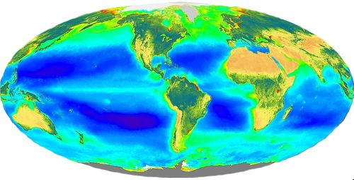
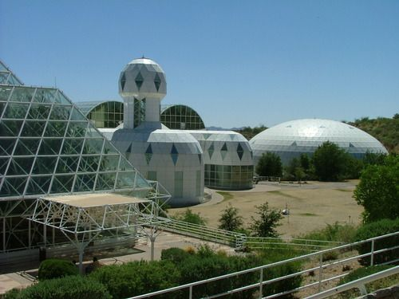
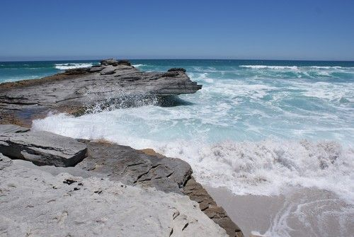
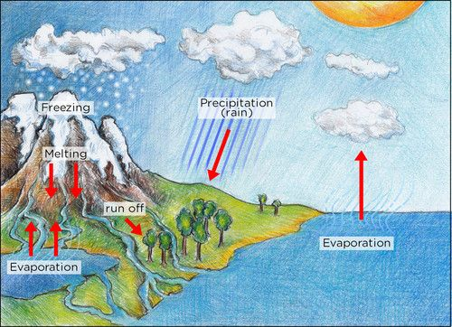
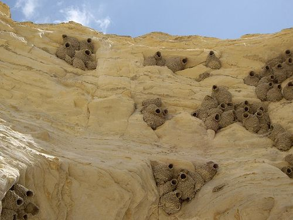
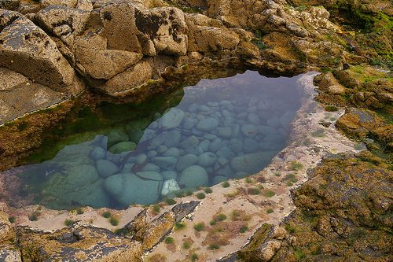
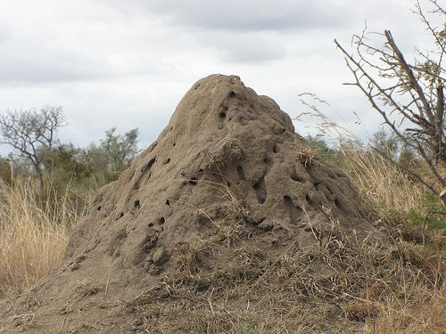
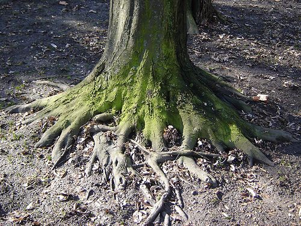
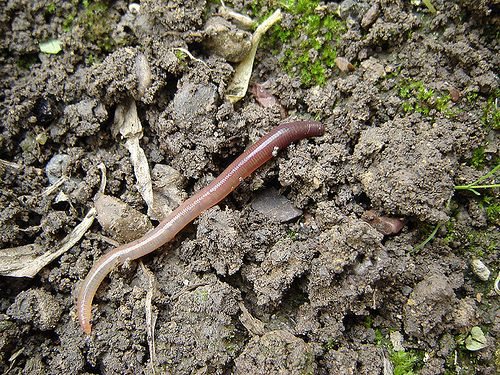
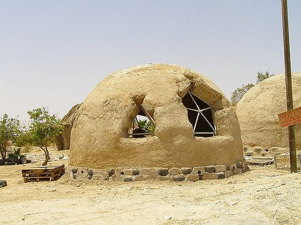

## What is the biosphere?

<Callout type="note" title="Note">
- atmosphere
- biosphere
- depend
- environment
- habitat
- microorganism
- organism
</Callout>

<Callout type="note" title="Note">
All the 'New words' listed in the boxes in the margin are defined in the glossary at the end of this strand.
</Callout>

This website has many interesting articles about science and science-related jobs. They have been classified according to topics and also provide tips on how to incorporate the articles into your classroom. If you are interested in incorporating real world science into your classroom, visit: [http://www.sciencenewsforkids.org/news-in-the-classroom/](http://www.sciencenewsforkids.org/news-in-the-classroom/)

Have you heard the word 'sphere' before? Do you know what it means? A sphere is normally used when talking about a round shape (like a ball). Now, what do we mean when we talk about the **biosphere**? The prefix 'bio-' indicates something to do with life. For example, 'biology' is the study of living organisms. So, can you put these two meanings together to work out what 'biosphere' means?

The biosphere is the place where life exists on planet Earth. When we talk about the biosphere, we are talking about a huge system (the whole world!) and how all the different parts work together to support life. We will look at these different parts in more detail a bit later.

<Callout type="note" title="Note">
The first person to use the term 'biosphere' was the geologist Eduard Suess in 1875 when he wrote a definition for the biosphere as 'the place on Earth's surface where life dwells*.*'
</Callout>

The biosphere is where life exists on our planet, including the soil and rocks, water and air.

<Callout type="note" title="Note">
The 'Visit' boxes in the margins contain links to interesting websites and videos. Simply type the link exactly as it is into the address bar in your browser.
</Callout>

We can also use the term biosphere in different ways. When we speak of all life on Earth as it interacts with the non-living rocks and soil, water and air (**atmosphere**), we call this the biosphere.

Biosphere 2 is a man-made research centre in America, in the Arizona desert, where scientists have built a large enclosed artificial biosphere. [http://commons.wikimedia.org/wiki/File:Biosphere_2_Habitat_%26_Lung_2009-05-10.jpg](http://commons.wikimedia.org/wiki/File:Biosphere_2_Habitat_%26_Lung_2009-05-10.jpg)

<Callout type="note" title="Note">
Learn more about Biosphere 2, a fascinating ongoing project to maintain a man-made biosphere[http://www.b2science.org/](http://www.b2science.org/)
</Callout>

We can also call a specific part or region on Earth that supports life, a biosphere, especially when we refer to the living organisms and the **environments** in which they live.

# Where do you think life exists on Earth ?

This is meant as an introductory activity to show that life exists everywhere on Earth and also bring to mind some of the work done on habitats in Gr. 4-6. You can also use it to assess what learners understand by the term 'life'. For example, do they only identify animals as life, and forget that plants are also living organisms? Learners have not yet been exposed much to microorganisms and so might not identify these as life forms.

**INSTRUCTIONS:**

2. The following table contains some photos of different places on Earth. Describe what each photo is showing.
4. Then decide if you think life exists there or not. If you do think so, list some of the organisms which you think live in this place.

| A place on Earth | What is this image showing? | Do you think there is life there? If so, what? |
| --- | --- | --- |

**Problem:**

**Solution:**
| A place on Earth | What is this image showing? | Do you think there is life there? If so, what? |
| --- | --- | --- |
|  | A desert with rocks, some mountains and grass. | Yes, life exists here. Organisms include: snakes birds grasses cacti insects possibly buck, jackal, hares, etc possibly humans (this is actually a photo from Namibia) |
|  | A mountain range covered in snow. | Yes, life exists here. Organisms include: trees (seen at bottom of photo) possibly bears, snow leopards, rabbits, etc possibly humans |
|  | The sky with clouds and some birds. | Yes, life exists here. Organisms include: birds insects |
|  | Soil with grass growing on top. | Yes, life exists here. Organisms include: plants (grasses and other shrubs) insects earthworms microorganisms |

After doing this activity, did you see that life exists everywhere on Earth? From the highest mountains to the deepest oceans, from the hottest deserts to the thickest jungles, there is life. Did you also notice that when describing the places on Earth where life exists, you used words such as soil, rocks, water, air? These are all part of the biosphere and have special names.

### Components of the biosphere

<Callout type="note" title="Note">
- adapt
- aquatic
- component
- hydrosphere
- lithosphere
- marine
- matter
- organic
- photosynthesis
- respire
</Callout>

In the previous activity we saw that life can be found in water, soil and rocks or the air around us. These **components** form part of the biosphere and have special names:

- **Lithosphere** which includes the soil and rocks.
- **Hydrosphere** which includes all the water.
- **Atmosphere** which includes all the gases.

The biosphere includes the lithosphere, hydrosphere and atmosphere. The biosphere includes all living organisms, and also dead **organic matter**.

# Describe the components of the biosphere

**INSTRUCTIONS:**

2. Study the following photo that shows the components of the biosphere.
4. Identify and describe the elements of the lithosphere, hydrosphere and atmosphere that you can see in the photo.

The lithosphere, hydrosphere and atmosphere on Earth.

**Problem:**
Lithosphere:

**Solution:**
There are rocks. They are hard, sharp, porous in places, eroded by water. There is sand. It is grainy, rough, contains many small pieces of shell and rocks.

**Problem:**
Hydrosphere:

**Solution:**
This is the seawater and sea spray. Some learners might mention the water vapour that evaporates from the sea. The water is clear and fast flowing, the sea water tastes salty, the sea foam forms on top.

**Problem:**
Atmosphere:

**Solution:**
This is the gases. The air includes gases such as oxygen, carbon dioxide and nitrogen. Atmospheric gases are not visible, but the sky looks blue.

**Problem:**
Even though you cannot see living organisms in this photo, there are many living and dead plants and animals that could live on a beach such as this one. Make about 10 plausible (believable) guesses of the types of organisms which would live in this environment. (Hint, think about what might be living in the sea, sand or air.)

**Solution:**
Learner-dependent answer. Learners should be able to imagine for example dolphins swimming in the water, or snails or mussels on the rocks, seaweed in the water and perhaps microbes in the sand. Other organisms could be: crabs, sea gulls and other birds, many types of fish, sharks and whales out at sea, corals, anemones, etc.

This question was specifically included in this way to assist teachers in gauging learner's ability to differentiate between living (biotic)and non-living (abiotic) components of the biosphere.

Different organisms can exists in different places in the biosphere. Let's have a look at the different components of the biosphere and which types of organisms exist there.

#### Atmosphere

The atmosphere is the layer of gases that surrounds the Earth. The three most important gases in the atmosphere are nitrogen, oxygen and carbon dioxide. The atmosphere is made up of several layers.

<Callout type="note" title="Note">
A fun infographic about the atmosphere[http://visual.ly/infographic-earths-atmosphere-top-bottom](http://visual.ly/infographic-earths-atmosphere-top-bottom)
</Callout>

<Callout type="note" title="Note">
The Earth's atmosphere has changed over time. Our oxygen rich atmosphere was formed by algae millions of years ago.
</Callout>

# The atmosphere

Learners do not need to know the layers of the atmosphere - this will be done in more detail in Gr. 9 Earth and Beyond. The focus of this activity is to show that the atmosphere is actually a very wide layer around the Earth, but life only exists at the bottom near to the Earth's surface where their requirements for life are met.

**QUESTIONS:**

**Problem:**
Discuss with your partner whether you think organisms could live on Earth without the atmosphere. Explain why you think so.

**Solution:**
This questions is deliberately included to elicit debate. Without the atmosphere life as we know it would not be possible. The oxygen and carbon dioxide in the lower layers of the troposphere (that touches Earth) allow life to exist as organisms can respire and plants can photosynthesise. The atmosphere also helps to keep the Earth warm by trapping solar energy. The atmosphere protects life from too much UV radiation from the Sun. Earth is the only planet in our solar system that can support life, due in part to our atmosphere.

<Callout type="note" title="Note">
Our atmosphere is escaping! (video)
</Callout>

#### Hydrosphere

The hydrosphere consists of all water on Earth in all its forms.

# The water cycle

This acts as a revision of some of the previous work done on the water cycle and states of matter and links this to different aquatic habitats for organisms.

**INSTRUCTIONS:**

2. Study the following diagram describing the water cycle on Earth.
4. Answer the questions that follow.

**QUESTIONS:**

**Problem:**
Do you remember learning about the different states of matter? The hydrosphere includes all water in all the states of matter. Look at the diagram of the water cycle and identify water in the different states of matter.

**Solution:**
Water is a liquid in the sea, dams, river, rain and dew.

Water is a solid as snow on the mountains (or in hail).

Water is a gas as water vapour in the air.

**Problem:**
The water cycle shows different sources of freshwater and saltwater. Many plants, animals and microorganisms have adapted to live in an aquatic habitat. A very small percentage of the world's water sources are freshwater and the rest is saltwater. Write down as many different types of aquatic habitats that you can think of where different organisms exist.

**Solution:**
Aquatic habitats include: rivers, dams, lakes, ponds, marshes, estuaries, groundwater and aquifers. There are many different aquatic habitats in the sea, such as rocky shorelines and rock pools, deep water and polar ice caps.

<Callout type="note" title="Note">
The word 'aquatic' is used to describe something to do with water. Therefore aquaticanimals are animals that live in or near water. The word**marine**describes organisms that live in saltwater or the sea. So someone studying the organisms in the sea is called a marine biologist.
</Callout>

#### Lithosphere

Learners will look at the lithosphere in much more detail in Gr. 9 Earth and Beyond, where they will look at the rock cycle as well as mining in South Africa. This is meant as an introduction and the focus should be on how organisms interact with the lithosphere.

As we have said, the lithosphere includes the rocks, soil and sand on Earth. Organisms **depend** on the lithosphere in many different ways. We find out how in the next activity.

# How do organisms depend on the lithosphere?

**INSTRUCTIONS:**

2. Below are several photos depicting different ways that organisms depend on and interact with the lithosphere.
4. Use these images to write a paragraph about how different organisms depend on the lithosphere in different ways.

Bird nests [http://www.flickr.com/photos/cheezepix/1733216613/](http://www.flickr.com/photos/cheezepix/1733216613/)

A rock pool [http://www.flickr.com/photos/sidelong/542808053/](http://www.flickr.com/photos/sidelong/542808053/)

A termite mound [http://www.flickr.com/photos/71888644@N00/6310931034/](http://www.flickr.com/photos/71888644@N00/6310931034/)

A tree growing in the ground [http://www.flickr.com/photos/dodo-bird/477583981/](http://www.flickr.com/photos/dodo-bird/477583981/)

A frequent misconception is that plants get larger and grow because of nutrients they absorb from the soil. However most of the organic mass from any plant is from carbon dioxide that is captured during photosynthesis and used to make organic molecules. It is important to stress that the main nutrient obtained from the soil is water, and relatively small amounts of minerals. If plants 'took up' the actual soil then one would expect it to be depleted and there would be large craters around every large tree!

An earthworm in soil [http://www.flickr.com/photos/dodo-bird/477499086/](http://www.flickr.com/photos/dodo-bird/477499086/)

A mud hut [http://www.flickr.com/photos/87328375@N06/8434096665/](http://www.flickr.com/photos/87328375@N06/8434096665/)

Some of the things which learners could note are:

- Animals live in parts of the lithosphere, such as earthworms which live in the soil, ants which make their nests out of sand. Many microorganisms live in soil.
- Some birds make their nests on rocks and also use sand to make the nests.
- Most plants and trees need soil to grow in. They absorb water and minerals, and use the soil to anchor their roots.
- Rocks form rock pools on the shoreline. Rock pools are homes to many different organisms.
- Humans use mud and stones to build houses and other buildings.

We have now looked at the different parts of the biosphere and seen that there are many different types of organisms that exist. Each of the organisms that we have seen so far needs to be able to stay alive in those specific conditions. We say they need to **adapt** to live in their particular habitat. What does it mean to stay alive though?

### Characteristics of living plants and animals

This was first introduced in Gr. 4 Life and Living and then also revised in Gr. 5 and 6.

<Callout type="note" title="Note">
- abiotic
- cellular respiration
</Callout>

<Callout type="note" title="Note">
Video about the seven life processes[http://www.bbc.co.uk/bitesize/ks3/science/organisms_behaviour_health/life_processes/activity/](http://www.bbc.co.uk/bitesize/ks3/science/organisms_behaviour_health/life_processes/activity/)
</Callout>

There are seven processes that all living organisms perform that determine whether they are alive or not. Let's have a look at the seven life processes:

**Problem:**
2. All living things need to be able to **move**. Moving does not have to consist of big movements. Even plants move, for example as the flowers and leaves turn to face the sun during the course of the day.
4. All living things need energy to perform the life processes. Organisms release energy from their food by a process called **cellular respiration**.
6. All living things need to be **sensitive** to their environment. Think of an example of why animals need to sense their environment and write it down below.
8. All living things need to be able to **grow.**
10. All living things need to be able to **reproduce** so that they do not die out.
12. All living things need to be able to **excrete** waste.
14. All living things need **nutrition,** as they need to break down nutrients during cellular respiration to release energy.

<Callout type="note" title="Note">
Learn more about the seven life processes[http://www.zephyrus.co.uk/characteristics.html](http://www.zephyrus.co.uk/characteristics.html)
</Callout>

Now that we can determine whether something is living or not, we can take a look at what living things need to survive. In other words, what are the requirements for life?
