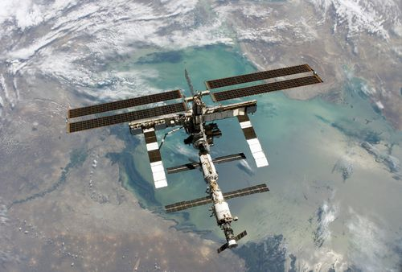
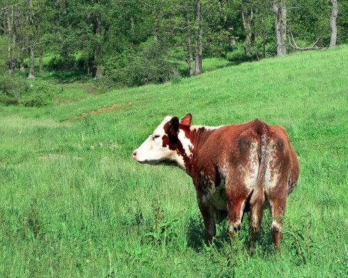
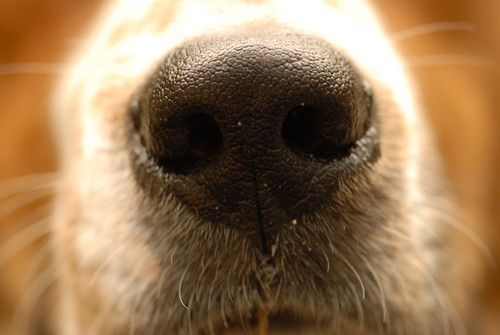
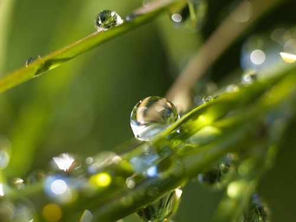
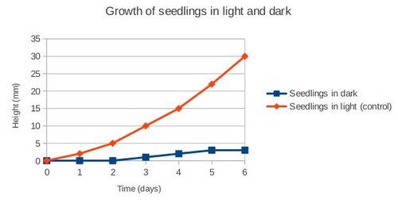
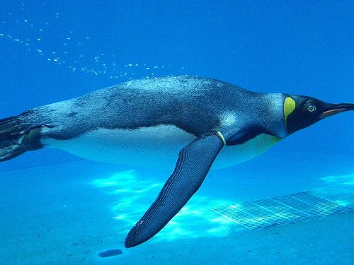
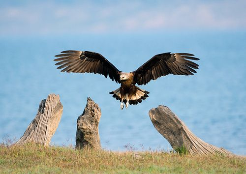
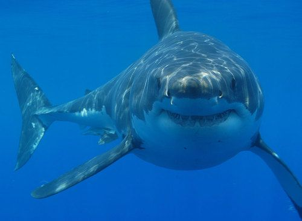
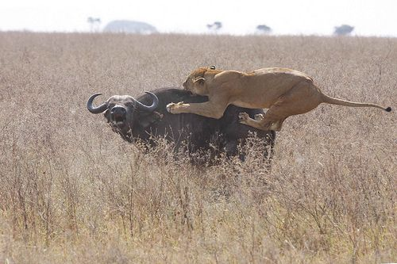

## Requirements for sustaining life

<Callout type="note" title="Note">
- favourable
- requirement
- sustain
</Callout>

After studying the seven life processes, we now know what animals, plants and other living organisms need to *do* in order to be classified as living. In order to stay alive these living organisms **require** (need) certain things or specific conditions. In this section we are going to study the requirements necessary to **sustain** life.

<Callout type="note" title="Note">
'Sustain'means to keep things alive or in existence. We also use the word sustainable when we want to say that something can continue or be continued for a long time.
</Callout>

# Identify the requirements for sustaining life

The answers to this activity are summarised in the subsequent text. In order to get learners to first think about the answers and discuss them without just reading them up in the text, perhaps get them to first take notes in a separate notebook or on scrap paper and have the class discussion before opening the workbooks and allowing them to then take down some notes.

Imagine that you are the design team for the first International Moon Space Station, similar to the International Space Station already orbiting Earth, but situated on the Moon!

The international space station that orbits Earth, seen from above.

<Callout type="note" title="Note">
Find out more about life on the International Space Station as astronauts perform their everyday tasks.[http://www.nasa.gov/audience/foreducators/teachingfromspace/dayinthelife/index.html](http://www.nasa.gov/audience/foreducators/teachingfromspace/dayinthelife/index.html) or [http://www.nasa.gov/centers/johnson/about/resources/jscfacts/index.html](http://www.nasa.gov/centers/johnson/about/resources/jscfacts/index.html)
</Callout>

**INSTRUCTIONS:**

2. Work in groups of four.
4. What do you think the astronauts and plants living on the new Moon Station will need in order to live? Discuss the five most important requirements that you need to provide in order for the astronauts and plants to remain alive on your Moon Space Station.
6. Explain why your group chose these five requirements as the most important to sustain life. Write down your notes from your group discussion on the lines provided. Decide which member of your group is going to report back your findings to the rest of the class.

**Problem:**
Have a class discussion after you have finished discussing this in your group.

**Solution:**
Learner-dependent answer

When groups are finished discussing their most important requirements, let groups share their lists with the other groups and have a class discussion. List their answers on the board and make a tick for each one that is repeated - for example Food/ Oxygen/ Water might be repeated so each time it repeats make a tick next to it. This way they will quickly be able to see which requirements are most commonly repeated in the class. Learners might identify 'Food' rather than energy. Remind them that they also have to think about the plants which do not need to eat food. So ask the learners what term they could use as a more general term for food? This links back to nutrition in the seven life processes. The answer is that living things need a source of energy. If learners do not come up with the fact that living things need 'favourable/good/optimal temperatures', ask them some leading questions such as: 'Do you think the space station needs to be heated or cooled? Why? Will
                  the humans and plants be able to survive at the temperature it is on the Moon? ' etc.

Living organisms require certain conditions or things to be able to stay alive. We say that these things or conditions sustain life.

You would have discussed some of these requirements in the last activity. Did you come up with the same or similar requirements? Living organisms require the following to survive:

- energy
- gases
- water
- soil
- favourable temperatures

Next, we look at these in a bit more detail.

**Energy**: All living organisms need energy to stay alive and perform the life processes. Plants need energy from sunlight in order to photosynthesise. Other organisms get their energy from the food that they eat.

All living things need a source of energy. The grass and trees get their energy from the Sun to photosynthesise. The cow gets its energy by eating the grass.

**Gases**: All living things require oxygen for cellular respiration. Oxygen is used to release energy from nutrients and carbon dioxide and water is produced as a waste product of respiration. Green plants also need carbon dioxide to photosynthesise.

Ask your learners what they think makes Earth's atmosphere unique. Answers: Our atmosphere contains the right gases to sustain life (ie. oxygen and carbon dioxide), our atmosphere also protects us from the harmful rays of the Sun (such as UV rays) by absorbing some of them.

All living things need oxygen to respire, such as this dog which is breathing air in through its nose.

**Water** is vital to life. Every organism on our planet needs water to live.

Water is vital for life on Earth.

<Callout type="note" title="Note">
When astronomers search for life outside of our solar system, they search for planets that might contain liquid water, believing that where there is water there may be life.
</Callout>

**Soil** sustains life on Earth. Most plants depend on soil for support, minerals and water. Without the soil, plants would not be able to produce the food that animals and other organisms depend on.

Most plants need soil to grow in. [http://www.flickr.com/photos/87743206@N04/8053614949/](http://www.flickr.com/photos/87743206@N04/8053614949/)

<Callout type="note" title="Note">
Not all plants need to grow in soil. Epiphytes, such as mosses and orchids, are a group of plants which grow on other plants or rocks. They get their moisture and minerals from the air and rain.
</Callout>

**Favourable temperatures**: All organisms are adapted to live in a particular temperature. In general, our planet has favourable temperatures to support life. Earth is at an optimal distance from the sun so that it is not too hot, like on Mercury, and not too cold, like on Neptune.

<Callout type="note" title="Note">
In Natural Sciences, when we use the word 'favourable' we mean something that is advantageous, helpful, or optimal. For example, we can talk about favourable conditions for life.
</Callout>

<Callout type="note" title="Note">
Every solar system has a 'Goldilocks' zone which is a region that is not too hot (close to the sun), and not too cold (far from the sun) to be able to sustain life. Earth is in the middle of our solar system's Goldilocks zone!
</Callout>

<Callout type="note" title="Note">
Read more about the 'Goldilocks Zone'[http://science.howstuffworks.com/other-earth1.htm](http://science.howstuffworks.com/other-earth1.htm) and [http://www.smh.com.au/technology/sci-tech/trio-of-super-earths-discovered-in-a-stars-habitable-zone-20130626-2ovx8.html](http://www.smh.com.au/technology/sci-tech/trio-of-super-earths-discovered-in-a-stars-habitable-zone-20130626-2ovx8.html)
</Callout>

Let's find out what the requirements are to grow seedlings. We will learn how to conduct a scientific investigation to do this.

In previous grades learners were required to complete a similar investigation to determine the optimal requirements for seeds to grow. CAPS suggests that they do this activity again in order to reinforce the concept of the requirements to sustain life. Teachers should gauge how many learners did this particular activity in previous grades and should explain that this repetition is not so much to find out what requirements are necessary to sustain life, but to give them an opportunity to learn how to conduct a science investigation. This has therefore been included again as a very good opportunity (with learners already aware of the outcome) to review the scientific method and allow learners to practise this.

<Callout type="note" title="Note">
- dependent variable
- hypothesis
- independent variable
- scientific method
- variables
</Callout>

# What are the requirements to sustain life in plants?

Start growing seedlings at the beginning of the term in the first lesson. A suggestion is to break the class up into groups and assign each group a different requirement to investigate. For example, one group should test whether water is needed, one group should test whether light is needed, one group should test the favourable temperature. Each group should also conduct a control so that they can all attempt to get seed to germinate.

In this investigation, we are going to germinate bean seeds (or any other seeds that your teacher provides you with). Each group in the class is going to be testing a different requirement for germination and growth of the seedling.

<Callout type="note" title="Note">
A hypothesis is an educated guess about what the outcome of the investigation will be. The hypothesis is stated before starting the investigation and must be written as a statementand must be in the future tense.
</Callout>

**AIM:**

A scientific investigation always has an aim or question that needs to be answered. What is the aim of this investigation? Write down what you aim to find out.

'To find out what plants need to grow'. (An aim MUST start with 'To find out / To determine / To see if .. etc. This is different from a scientific question like 'What do plants need to grow?')

**HYPOTHESIS:**

A hypothesis is where you propose (suggest) what the outcome of the investigation will be. It is a prediction of what the results will be. Write a hypothesis for this investigation.

Learner-dependent answer. The hypothesis should include a prediction about the need for soil, light, water and the favourable temperature. For example: 'The plant will grow best in full sunlight, less in the shade, and not at all in full darkness.'

**VARIABLES:**

Scientists often use investigations to search for cause and effect relationships. This means that they design experiments to investigate how changes to one part will cause an effect on another. These changing quantities are called **variables**. There are usually three kinds of variables:

2. **Independent variables:** This is the thing that you are changing in the investigation. You are in control of the independent variable. For example, if you wanted to investigate if eating a lot of sugar makes you gain weight, then the amount of sugar you eat is the independent variable. You control how much sugar you eat. We want to achieve something called a FAIR TEST which means that only ONE independent variable is changed at one time. Once the independent variable has been changed the scientist then observes what the effect will be. In the example of investigating if sugar makes you gain weight, you cannot at the same time investigate whether exercise makes you lose weight. This would not be a fair test.
4. **Dependent variables:** The dependent variable is the thing that you observe in an investigation. You do not change it. The dependent variable will change depending on the independent variable. For example, in the investigation to see if eating a lot of sugar makes you gain weight, then the dependent variable will be how many kilograms you gain (or lose) as a result of eating sugar. How much weight you gain depends on how much sugar you ate. Dependent variables should be measured in an objective way using numbersas far as possible.
6. **Controlled variables:** These are the quantities that a scientist wants to remain the same or unchanged throughout the experiment. The controlled variable needs to be carefully monitored to make sure that it stays the same. In the example to see if sugar makes you gain weight, you could have one person eat a lot of sugar and the other person eat no sugar and then see the changes in weight. There are some things that need to stay the same for both of these people so that it is a fair test. For example, both people must do the same amount of exercise so that this does not influence their weight. This is a controlled variable.

Stress to the learners that dependent variables should be measured using NUMBERS as far as possible, as this leads to tables and graphs. They should avoid subjective evaluations like it 'looks good' or 'feels nice'. This is not science.

Ask learners if they can think of any other variables that need to be kept the same in this example. They might think of things like the starting weight of the people should be the same, they should be the same sex, same age, they should both be healthy and not sick etc.

You can also do a control test. For example, in this investigation about the growth of plants, you will be taking away one of the requirements for growth. You need to do a control test where another plant is given all the requirements, including the one you took away in the other plant. You can then compare your plant where you took one requirement away to the control plant which has that requirement to see if there is a difference.

You, the teacher, can decide how you want to conduct this investigation. Perhaps learners can just assess whether it germinates or not, or they can look at how tall the plant grows, how many leaves it grows, etc. In most cases, the seeds probably will not germinate and grow if put in a cupboard or fridge or not given any water. So the best test is just to see whether it germinates or not.

Identify the variables for this investigation.

**Problem:**
**Independent variable**. What will you change?

**Solution:**
Learners need to explain that they will only change one factor, i.e. remove light from the plant (by putting it in a dark cupboard) or remove water (by not watering it), while keeping all the other factors constant.

**Problem:**
**Dependent variable**. What will you measure to see the effect of the independent variable on the germination and growth of the plant?

**Solution:**
Learner-dependent answer

**Problem:**
**Controlled variables and control group**. What will your control test be and what will you keep the same between the control plant and the tested plant?

**Solution:**
Learners need to explain how they will keep the other factors the same in each case but only change one at a time. It is important that learners understand and reflect on having a control group that has all the necessary factors/requirements to allow it to grow. We suggest that more than one control group be included.

The above questions give learners the opportunity to reflect on their variables and control groups. As Gr. 7s might not have had a chance to work with these concepts it is imperative that you spend time explaining why a control group is required and why only one variable be changed in each of the plants. Use the above example of testing whether eating too much sugar makes you put on weight, so that learners can then apply what you discuss about the example to this investigation.

<Callout type="note" title="Note">
Remember you control group is a special kind of comparison group.
</Callout>

**METHOD:**

In your group, plan how you are going to do the investigation. Think about which requirement you are testing and how you will take this requirement away. For example, if you are looking at light, where could you place the seeds so that they do not receive light? Remember, if you are looking at light, then you need to make sure the control and test seeds both receive the same amount of water. Once you have planned the investigation on rough paper and discussed it with your teacher, write up the method below (in numbered steps) explaining what you will do.

As groups are discussing their design, go around and check that they are on the right path and discuss it with them and provide help. Help learners to find ways that they can test the requirement, especially if they are looking at a favourable temperature. Perhaps you have a fridge that learners could put the seeds in? (However, remember to take into account whether the plants will receive light in the fridge). Find a suitable spot in the classroom for the control group plants, perhaps on a windowsill with light. How many seeds will the learners use for each experimental condition? Is one seed enough? What can go wrong if only one seed is used?

A suggestion is to give learners some options for materials for germinating the seeds. For example, they could either use cotton wool, or newspaper, or soil. But, whatever they use, it must be the same in the control and test plants within one group. It does not matter if different groups do different things. This should actually be encouraged.

Learners also need to think about how they are going to record their results before starting the investigation. If they are just seeing whether plants germinate or not, then perhaps they can draw a table. If they are going to be measuring how much the plants grow, then they will need a table for this, and they will then need to draw a graph. If they are measuring the growth of seedlings, a suggestion is to use string to measure out the height, and then to measure the length of the string on a ruler.

**MATERIALS AND APPARATUS:**

**Problem:**
Write a list of all the materials and apparatus that you will be using in this investigation.

**Solution:**
Learner-dependent answer

**RESULTS AND OBSERVATIONS:**

Use this space to record the results for your investigation. If you are seeing whether plants germinate or not, then you need to draw a table to show this. If you are measuring how much the plants grow, then you will also need a table for this.

Learner-dependent answer. (Some examples of the types of tables learners can draw are shown below. They might need help with this and you could draw these on the board. Learners could also record the results of each other's investigations as well.)

Table to show whether plants germinated or not

| Requirement being tested | Did test plants germinate? | Did control plants germinate? |
| --- | --- | --- |
| Light | Some did. | Yes |
| Water | No | Yes |
| Favourable temperature | No | Yes |

If the learners have included a number of seeds in each test group/ condition, they may want to express the result as numbers rather, or as a percentage of seeds that germinated.

Table to show growth of seedlings over time in light and in dark

| Day | Average height of seedlings in dark (mm) | Average height of seedlings in light (mm) |
| --- | --- | --- |
| 0 | 0 | 0 |
| 1 | 0 | 2 |
| 2 | 0 | 5 |
| 3 | 1 | 10 |
| 4 | 2 | 15 |
| 5 | 3 | 22 |
| 6 | 3 | 30 |

**ANALYSIS:**

Once we have collected our results in a scientific investigation, we need to analyse them. This often involves drawing a graph. If you measured the growth of the seedlings over time, then you can draw a line graph to show this. If you have counted the number of seeds that germinated you can express this using a bar chart (provided you used the same number of seeds in each group), or you can express the percentage of seeds that germinated as a pie chart. Your teacher will help you do this.

Learner-dependent answer. An example of the type of line graph which could be drawn, using the information in the second table is given below. Time will be along the independent x-axis. The height of the plants is the dependent variable and this goes along the y-axis. Both the test plants and the control plants can then be plotted on the same graph to compare the growth between the two groups. Ensure that the intervals are equal along each of the axes. On each axis the interval between points must represent an increase of the same amount! (E.g. 0, 5, 10, 15, 20, 25 etc. ) However, the intervals on the x-axis and the y-axis can be different in order to suit the data. For example you may use an interval of 1 on the x-axis to represent number of days, but an interval of 5 mm on the y-axis to represent change in height.

**CONCLUSION:**

After collecting all your results and drawing a graph using these results, you will need to use this to draw a conclusion about the requirements to sustain life in plants. The following questions will guide you in drawing your conclusion.

**Problem:**
I found out...

**Solution:**
Learner-dependent answer.

**Problem:**
I know this because...

**Solution:**
Learner-dependent answer.

**Problem:**
The investigation was fair because...

**Solution:**
Learner-dependent answer.

**Problem:**
I can trust the results because...

**Solution:**
Learner-dependent answer.

**Problem:**
While I conducted (did) this investigation I also discovered that...

**Solution:**
Learner-dependent answer.

**Problem:**
If I did this investigation again I could improve it by...

**Solution:**
Learner-dependent answer.

**What did you learn from doing this scientific investigation?**

Write 3 to 5 sentences explaining what you learnt from doing this scientific investigation following the scientific method.

<Callout type="note" title="Note">
Watch a timelapse of bean plants growing.
</Callout>

Each organism is able to survive and continue to survive in their environment because they have acquired the characteristics that allow them to do things in a special way in their particular environment. We say they have adapted to life in their particular type of environment.

Learning about adaptations is a precursor to an understanding of the concepts of natural selection and evolution which will be introduced later in the term. Make sure that learners understand that organisms cannot will their bodies to change or learn to survive in a particular environment in a single generation (lifetime). These adaptations take place over many generations as a result of natural selection, in which organisms who are better adapted to their environment are more likely to thrive and have lots of off-spring. These offspring will have the genes of the parents, and will inherit the characteristics (adaptations) that made the parents better able to survive. Teachers do not need to go into any detail about natural selection yet, but should make sure that the learners are not under the impression that any organism can 'decide' to acquire an adaptation.

### Adapted for life

Do you think you could put a polar bear in the Kalahari desert or a gemsbok in Antarctica and they would survive? Why, or why not?

Discuss this with your learners. If you put a polar bear in the Kalahari desert, it would overheat, and similarly if you put a gemsbok in Antarctica it would freeze to death.

These animals are specifically adapted to live in their specific environments. All organisms are adapted to their specific environments. In the next activity we examine some more examples of how organisms are adapted to their environments.

# Adaptations in organisms

**INSTRUCTIONS:**

2. Study the photos below showing different organisms in different environments.
4. Answer the questions.
6. You might need to do some extra research in books and on the internet to complete your answers.

**QUESTIONS:**

Look at the photos of a penguin in the water and an eagle flying in the air. Both of these are birds, but they live in very different environments that make the penguin adapted for the water and the eagle adapted for flight.

A penguin in the water. [http://www.flickr.com/photos/kankan/19828575/](http://www.flickr.com/photos/kankan/19828575/)

A flying fish eagle about to catch some food. [http://www.flickr.com/photos/kkoshy/8576660148/](http://www.flickr.com/photos/kkoshy/8576660148/)

**Problem:**
How do you think the penguin is adapted to swim in water? Hint: What are its wings used for? Does it have small or large feathers? How do you think this helps?

**Solution:**
The penguin is adapted to swim in water as it uses its wings as flippers to swim. The feathers are very small/fine which help make it waterproof.

Some additional adaptations to discuss: Penguins are able to hold their breath and dive deep underwater to catch food. Penguins are black and white which helps them to be camouflaged in the water and hide from predators (They look dark like the water from above, and light like the sky from below). Penguins have even adapted to drink salty sea water.

**Problem:**
How do you think the eagle is adapted to fly and catch its prey? Hint: Look at its feathers and wings.

**Solution:**
Fish eagles have very long wings and long feathers to enable flight and to be able to soar in the air and then swoop down and catch prey.

Some additional adaptations to discuss: They have long talons/claws so that they can catch their food as they swoop down and grab it. They also have large tail feathers that they can fan out to help them control their speed when flying.

South Africa is home to two very skilled predators, the great white shark and the lion. Both of these animals are very skilled at catching their prey, but in very different environments.

A great white shark in Gansbaai, Western Cape. [http://commons.wikimedia.org/wiki/File:Great_white_shark_south_africa.jpg](http://commons.wikimedia.org/wiki/File:Great_white_shark_south_africa.jpg)

A lioness attacking a buffalo in Kruger National Park. [http://www.flickr.com/photos/diamondglacieradventures/5737115639/](http://www.flickr.com/photos/diamondglacieradventures/5737115639/)

**Problem:**
What characteristics does the shark have that makes it adapted to living and feeding in the sea? Hint: Look at its streamlined body shape and sharp teeth.

**Solution:**
The great white shark is adapted to move very fast through the water as its body is streamlined and it has fins and a tail to swim. It has sharp teeth to bite into prey.

**Problem:**
What characteristics does a lion have that makes it adapted to living and hunting in the savanna? Hint: Look at the colour of its fur and the colour of the grass and its strong limbs.

**Solution:**
The lion is a light brown colour so that it is camouflaged in the savanna/bush to sneak up on its prey. It has 4 strong legs with claws to chase and catch prey.

We have now looked at how a few of the animals on Earth are adapted to their environments. There are many, many more organisms with very unique and interesting adaptations. In the next chapter we will learn more about the diversity of plants and animals on Earth.

Have you noticed the **VISIT** boxes in the margins which contain links? You simply need to type this whole link into the address bar in your internet browser, either on your PC, tablet or mobile phone, and press enter, like this:

It will direct you to our website where you can watch the video or visit the webpage online. **Be curious and discover more online on our website!**
