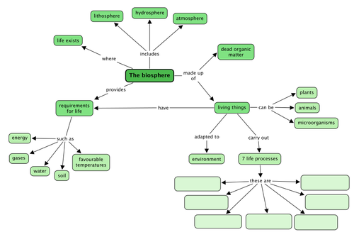
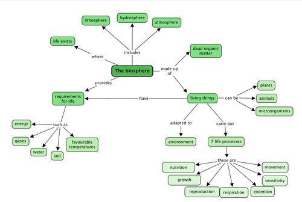

## Summary

<Callout type="note" title="Note">
- Life on planet Earth exists in the biosphere.
- The biosphere consists of the lithosphere, hydrosphere and atmosphere, as well as the many living organisms and dead, organic matter.
- Many different kinds of living organisms exist in the biosphere.
- Things can be classified as living if they perform the seven life processes:
  - Movement
  - Reproduction
  - Sensing the environment
  - Growth
  - Respiration
  - Excretion
  - Nutrition
- Living things need energy, gases, water, soil and a favourable temperature to survive.
- Living things are suited or adapted to the environment in which they live.
</Callout>

**Concept map**

Throughout this year, we are going to develop the skill of designing and making**concept maps** in Natural Sciences. The 'Key concepts' listed above is a summary written out in full sentences. A concept map provides another way of representing information (ideas and concepts) in a more visual way. The benefits of a concept map are that it allows one to show the linkages between different concepts. Often a concept map has a 'focus question' around which the other concepts radiate from - in these books the focus question will be the main topic for the chapter. The relationships between different concepts are shown using arrows with linking phrases, such as 'results in', 'includes', 'can be', 'used to', 'depends on', etc.

As this year progresses, learners will have to start filling in more parts of the concept maps themselves, and then hopefully draw their own ones by the end of the year. This teacher's guide contains the full version of each concept map. Encourage your learners to study the concept maps and make sense of them at the end of each chapter before doing the revision questions. Help your learners to understand and 'read' the concept maps by constructing sentences from them. For example in this case you could read: 'The biosphere is made up of dead organic matter and living things. Living things can be plants, animals or microorganisms. Living things are adapted to their environment and carry out the 7 life processes. These are ….'

**Learners need to learn how to learn!** This is one skill which might help them later in their school career where they have a lot more information to ingest and learn and make sense of. Concept mapping is one tool to use to summarise information and also understand how different concepts link together. Real understanding and knowledge comes from grappling with the subject matter, and not just memorizing facts.

*"Knowledge is real knowledge only when it is acquired by the efforts of your intellect, not by memory."* - Henry David Thoreau

Do you know what a concept map is? This year in Natural Sciences, we are going to learn more about how to make our own concept maps.

Above you have the 'Key concepts' for this chapter. This is a written summary and the information from this chapter is summarised using words. We can also create a concept map of this chapter, which is a map of how all the concepts (ideas and topics) in this chapter fit together and are linked to each other. A concept map gives us a more visual way of summarizing information.

Different people like to learn and study in different ways: some people like to make written summaries, whilst others like to draw their own concept maps when studying and learning. These are useful skills to have, especially for later in high school and after school!

Have a look at the concept map below for 'The Biosphere'. Complete the concept map by filling in the 7 life processes in the blank spaces.

Teacher's version:

