## Classification of living things

<Callout type="note" title="Note">
- characteristic
- class
- classify
- kingdom
- order
- phyla
</Callout>

Grouping has been a common activity in humans for thousands of years as we make sense of the world around us.

# Group some everyday objects

In this activity learners will get an opportunity to group a selection of everyday objects according to observable features. This lays the foundation for the classification and grouping work that is covered in this section. Teachers should collect enough shoeboxes or recycled ice-cream tubs (or if this is not possible shopping bags should also work) for each of the groups in the class. As homework the previous day each learner needs to bring five items from home. These items should be small enough to go into the shoebox. They should choose items that they use in their everyday lives. Please ensure that no valuables are brought!

**MATERIALS:**

- objects from home
- shoe boxes/ ice-cream tubs

<Callout type="note" title="Note">
When you observe you use your senses to tell you more about something. How does it feel or look? Does it have a special smell or taste? Is there a specific sound coming from it?
</Callout>

**INSTRUCTIONS:**

2. Work in groups of four.
4. Each member of the group should bring five items from home. Choose items that are easy to carry around and that will fit into a standard shoe box.
6. Carefully observe each of the items that everyone in your group brought.
8. Use the shoe boxes to group the items according to your observations.
10. Place all objects brought by the whole class on a display table in the front of the class.
12. Discuss the different grouping methods that each group has used as a class. Work towards a standard grouping or classifying method that you could use to **classify** ALL the items that you all brought to school.

During this activity, encourage learners to look at the observable features of the items in order to classify them, for example shape, colour, size, texture, use etc.

**QUESTIONS:**

**Problem:**
Draw a table in the space below and record all the items in your class in the groups you assigned them to.

**Solution:**
Learner-dependent answer.

**Problem:**
How did your small group classify your items to begin with? What features did you use to classify the items?

**Solution:**
Learner-dependent answer.

**Problem:**
Write three or four sentences about the standard classification method that you decided to use in your class. What **characteristics** of the items did you use to classify and group them? Were these different to what you used in your small group?

**Solution:**
Learner-dependent answer.

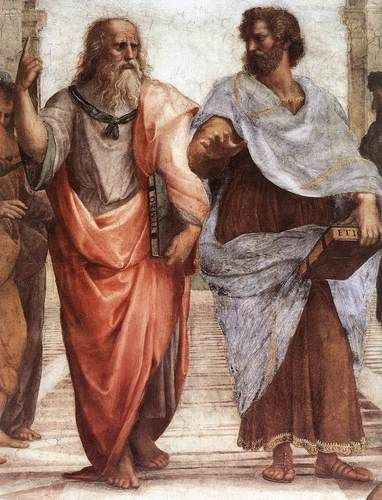

Plato and Aristotle in a famous painting by Raphael called "School of Athens".

Aristotle was a Greek philosopher and thinker who lived about 2400 years ago. Aristotle came up with the following grouping system that was used for almost 2000 years after his death!

- He divided all organisms into either animals or plants.
- Then he divided animals into those 'with blood' and those 'without blood'.
- Lastly animals are divided into three groups based on their method of movement: walkers, flyers or swimmers.

# Aristotle's classification system

This is an **optional activity** to introduce different types of classification.

**INSTRUCTIONS:**

2. Look at the following photos of different kinds of animals.
4. Use Aristotle's method of classification to group the animals based on the way that they move.
6. Draw a table of your groupings in the space provided after the photos. Give your table a heading.

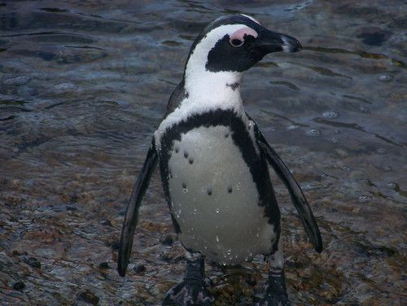

A penguin

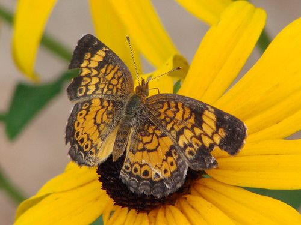

A butterfly

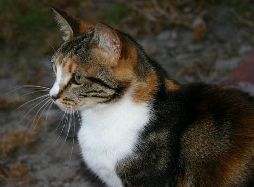

A cat

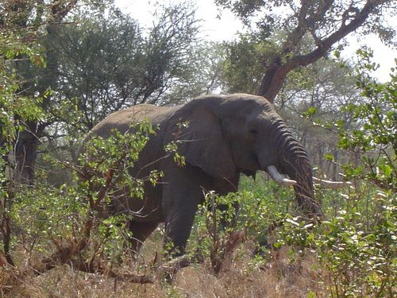

An elephant

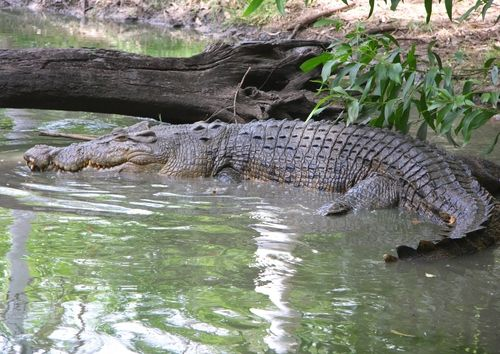

A crocodile

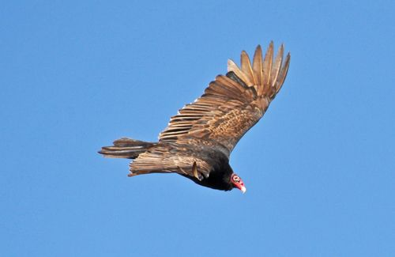

An eagle

A human

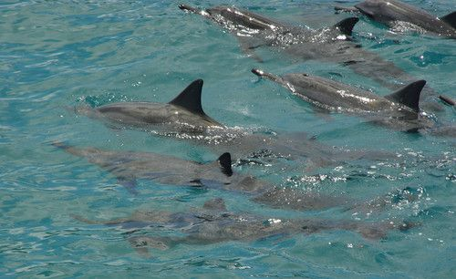

Dolphins

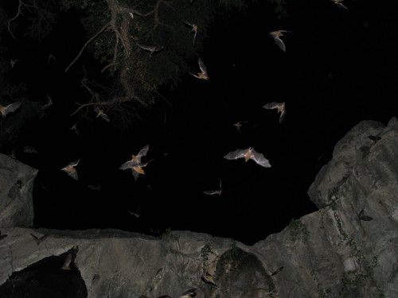

Bats

Learner-dependent answer. The table should look as follows. There may be some variations depending if learners decide to put an animal in more than one group or classify it according to its main method of movement.

Classification of a group of animals according to Aristotle's method

| Walkers | Flyers | Swimmers |
| --- | --- | --- |
| Penguin Elephant Cat Crocodile Human | Eagle Butterfly Bats | Penguin Dolphins Crocodile Human |

**QUESTIONS:**

**Problem:**
Were there any animals which you battled to classify into one group? Which ones were these?

**Solution:**
Difficult animals to classify are those which can fall into more than one group, such as the penguin, crocodile, human.

**Problem:**
Do you think Aristotle's classification system has any problems? Explain any problems that you might find when using it.

**Solution:**
Possible answers might include: Some animals fit into more than one group (penguin, crocodile, etc.) because it looks more at what the animals do rather than what they are or similarities and differences between their forms.

As more and more animals, plants and microorganisms were discovered, scientists started questioning Aristotle's classification system. It was not working as well as everyone had believed it would. Why do you think it is important to evaluate *how* we classify things?

Discuss this as a class. Refer to this process as being a constant refining of the way that classification is done and that it is not a 'given' or a static method. It needs to evolve as our knowledge and understanding of the world and the organisms in it develops and must take these new discoveries into account.

Carl Linnaeus

In the 1700s Carl Linnaeus developed the classification system that classified organisms according to their similarities, functions and relationships with other organisms.

Today with the use of modern microscopes and genetics we can classify living organisms very accurately. In this way we are able to classify living organisms according to their shared characteristics.

<Callout type="note" title="Note">
Scientists estimate that there are up to 30 million species of organisms on Earth! If they use systems to classify these organisms they can see patterns in nature and can see how organisms relate to each other.
</Callout>

### Our classification system

All living organisms can be divided into five **kingdoms**:

2. **Animals**
4. **Plants**
6. **Fungi**
8. **Protists**
10. **Bacteria**

What are humans? Which kingdom do we belong to?

Since we know that we are not a fungi or plant, or a protista or bacteria (quite a bit bigger!) we belong to the animal kingdom.

<Callout type="note" title="Note">
The kingdom Bacteria is often also referred to as **Monera**.
</Callout>

Think back to the example of how we classify learners at school. First, school is divided into pre-primary school, primary school and high school. If we compare school to the way we classify organisms, we can say that the school system has three kingdoms. But, we need to divide learners up further. So primary school is divided into seven grades (Gr. 1-7) and high school is divided into five grades (Gr. 8-12). The classification system for organisms also needs to divide organisms up further as each kingdom contains thousands of different types of organisms.

Each kingdom is divided into smaller groups or divisions called **phyla**. Organisms with similar traits (characteristics) will occupy a similar phylum. In each phylum, smaller divisions called **classes** are found and each class is further divided into **orders**, **families**, **gen era**and then**species**.

<Callout type="note" title="Note">
Be careful to use these words correctly: one* phylum*, many* phyla*. Similarly, one* genus*, many *genera.*
</Callout>

Think of your school again. Your primary school contains many learners. When you divide your entire school into grades, there are fewer learners in each grade. Your grade might be divided into different classes, and each class has fewer learners in it. When we classify organisms, the same thing happens. A kingdom is a very big group, whereas a species is a much smaller group.

Study this diagram to help you remember the order:

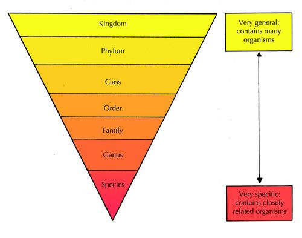

<Callout type="note" title="Note">
A mnemonic takes the first letters of a group of terms to make a funny rhyme.
</Callout>

**K**ing** P**hil **C**uts **O**pen **F**ive **G**reen **S**nakes

<Callout type="note" title="Note">
An interactive game on classifying animals[http://sciencenetlinks.com/interactives/class.html](http://sciencenetlinks.com/interactives/class.html)
</Callout>

We need to be able to distinguish between organisms too. So how do we name organisms?

<Callout type="note" title="Note">
Binomial comes from the Latin*bi*- two and *nomius*- names. Nomenclature comes from Latin words *nomen* - name and *calare-* to call. Binomial nomenclature therefore means calling things by two names.
</Callout>

Carl Linnaeus designed a special naming system called the **binomial nomenclature** to name all organisms. All organisms are therefore given **two** (bi- means two) words in their name.

- The first part of the name refers to the genus that the organism belongs to. This is always written with a capital letter.
- The second part of the name refers to the species within the genus
- If you are typing you will put both these names in *italics* but if you are doing a handwritten piece you underline it. This shows that you are identifying the organism by its scientific name.

For example, the scientific name for the African elephant is *Loxodonta africana*. Humans belong to the genus *Homo* and to the species *sapiens* so we are *Homo sapiens*.

<Callout type="note" title="Note">
The 'scientific name', the 'Latin name' and 'binomial nomenclature' are different ways of saying the same thing. All of these are referring to the*same* system of naming a species by its genus and species names in Latin.
</Callout>

<Callout type="note" title="Note">
Have a look at some curious and strange names for organisms[http://www.curioustaxonomy.net/index.html](http://www.curioustaxonomy.net/index.html)
</Callout>

Now that we have seen how to classify organisms, let's take a closer look at the differences between the kingdoms.

### Plants and animals

<Callout type="note" title="Note">
The phylogame (a card game which could be played in class)[http://phylogame.org/](http://phylogame.org/)
</Callout>

# Comparing plants and animals

**INSTRUCTIONS:**

2. Study the diagram that shows the five kingdoms that we commonly use to classify organisms. Pay close attention to the plants and animals.
4. Answer the following questions.

<Callout type="note" title="Note">
When we compare plants and animals we can often compare them based on the way that they move, what and how they get food or nourishment, and how they reproduce.
</Callout>

**QUESTIONS:**

**Problem:**
Study the organisms in the animal kingdom. What are some common features that you can see in all the animals?

**Solution:**
Learner-dependent answers. Might include: all these animals can move using a variety of methods or that all might have a special body covering. These animals all have to eat, either plants or other animals. They generally reproduce by mating with other animals of the same species. Animals drink water. Animals respire as they take in oxygen and give off carbon dioxide, often through breathing. Animals need to excrete their waste from their bodies.

**Problem:**
Study the organisms in the plant kingdom. What are some features that are common to all plants?

**Solution:**
Learner-dependent answers. Might include: plants cannot move, they are rooted to one spot. Plants do not need to eat as they produce their own food by photosynthesis. They take in water. Plants also respire like animals but they also take in carbon dioxide for photosynthesis and give off oxygen as a by product. Plants' reproduction differs to animal reproduction in that many plants produce seeds while others produce other structures (like ferns) etc.

**Problem:**
Draw a table in the space below and compare the characteristics of plants that make them different to animals. Discuss your plant and animal comparisons with your group and then with the class.

**Solution:**
Learners should compare the observable differences on the diagram / illustration between plants and animals. Some of these might include:

| Plants | Animals |
| --- | --- |
| Plants are generally rooted in one place and move by growing in shape and turning their leaves or petals towards the sun or a water source. | Animals can self-propel (move themselves around) through locomotion in order to find food, a mate or shelter, or to evade danger. |
| Plants that contain chlorophyll can photosynthesize to produce glucose (food) from sunlight and carbon dioxide. | Animals cannot produce their own food and have to eat plants or other animals to get nourishment. |
| Plants produce oxygen and take in carbon dioxide. | Animals take in oxygen and produce carbon dioxide. |
| Plants have a limited ability to sense. | Animals have a well-developed ability to sense. |
| etc. | etc |

<Callout type="note" title="Note">
Learn more about the kingdom Animalia
</Callout>

### Fungi

Most people will not eat bread covered in bread mould but will eat a plate of fried mushrooms, truffles and morels. These are all examples of fungi, including yeast.

<Callout type="note" title="Note">
Morels are a type of edible mushroom. They are distinctive for the appearance of their caps, which are have pits and ridges that resemble a honeycomb.
</Callout>

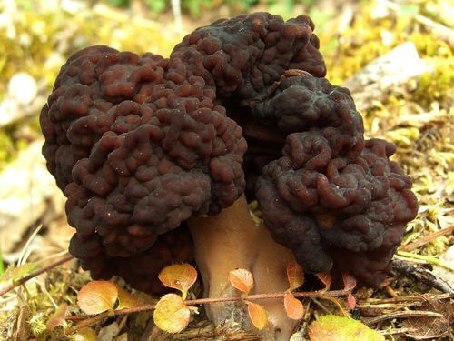

Morel[http://commons.wikimedia.org/wiki/File:False_Morel.jpg](http://commons.wikimedia.org/wiki/File:False_Morel.jpg)

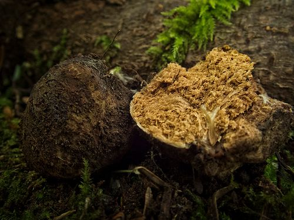

A truffle [http://www.flickr.com/photos/scott_darbey/7472656286/](http://www.flickr.com/photos/scott_darbey/7472656286/)

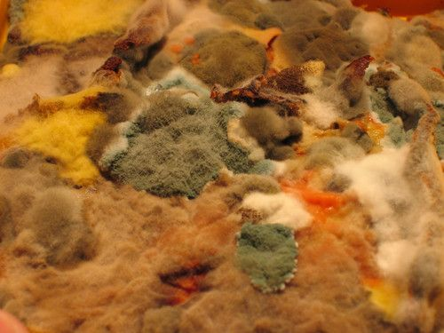

Bread mould

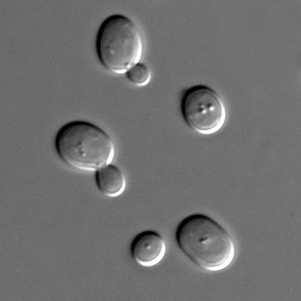

Yeast cells [http://www.flickr.com/photos/tessawatson/384591931/](http://www.flickr.com/photos/tessawatson/384591931/)

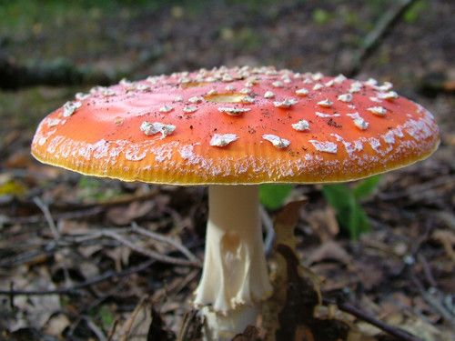

A very poisonous mushroom

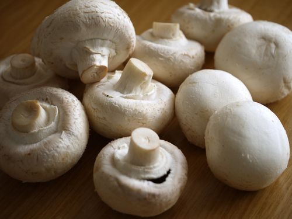

Button mushrooms (like we buy in the shops)

<Callout type="note" title="Note">
You can find out lots more online by visiting the links provided in the**Visit** boxes. Be curious and discover the possibilities!
</Callout>

Fungi play a very important role in our biosphere since they break down dead organic material and return nutrients to the soil for plants to use. Some fungi cause diseases while others, such as penicillin (an antibiotic) are very useful to us. Yeast is used in many of our products, such as making bread rise and fermenting wine and beer.

### Protists and Bacteria

Learners will only be able to fully understand the differences between Protists and Bacteria once they have done cells in Gr. 9. Essentially, Protists are eukaryotic (usually unicellular, but not always) as they have cells with a membrane bound nucleus, whereas Bacteria are prokaryotic as their DNA material is not membrane bound. Bacteria are always unicellular. Protists require a liquid medium, whereas Bacteria occur almost everywhere.

We will look at Protists and Bacteria in more detail later on in Gr. 9. For now, lets look at some of the basic features of these kingdoms.

Organisms in these two kingdoms are microscopic which means you cannot see them with your naked eye. However we can see them if we look at them under a microscope.

These images are included to give learners some idea about these two kingdoms, otherwise they will have no reference point until they get to Gr. 8 and do microorganisms again. These images are also interesting and show what is possible with the microscopy techniques available today. They include a range of techniques from scanning electron microscopy, confocal, fluorescent and light microscopy. The differentiation of a membrane bound nucleus in Protists and not in Bacteria is too advanced for learners at this stage if they have not yet done cells. For now, encourage learners to look at the photos, perhaps ask them to explain what they see, and let them get excited about the unseen world! Learners do not need to know how to recognise or name any of these microorganisms.

**Different bacteria:**

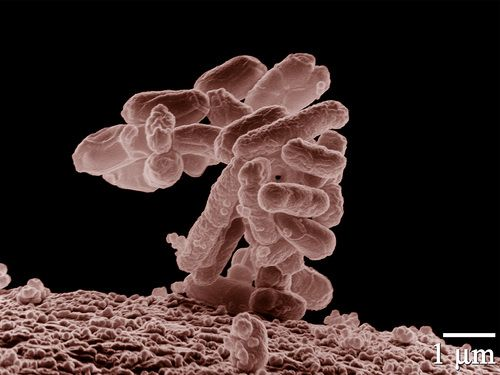

*Escherichia coli* bacteria, commonly found in the intestines of animals

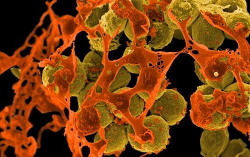

*Staphylococcus aureus* (yellow cells) often causes skin infections and pneumonia

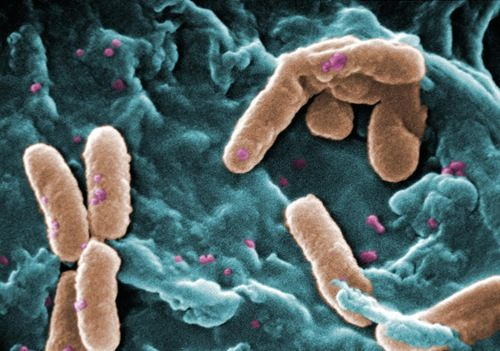

*Pseudomonas aeruginosa* is found in soil and water and cause infections in animals

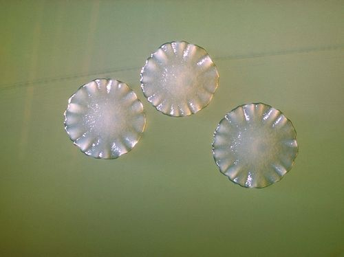

*Actinomyces* bacteria which cause diseases in the mouth

**Different Protists:**

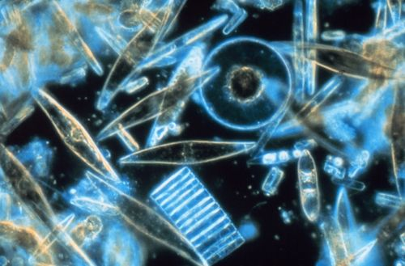

Phytoplankton from the Antarctic sea

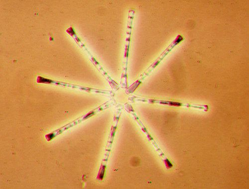

*Asterionella formosa*

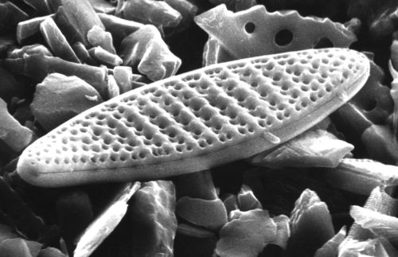

*Nitzschia kerguelensis*[http://commons.wikimedia.org/wiki/File:Nitzschia-kerguelensis_hg.jpg](http://commons.wikimedia.org/wiki/File:Nitzschia-kerguelensis_hg.jpg)

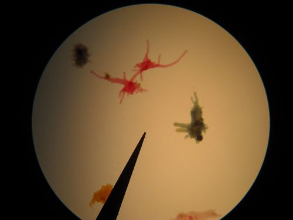

Different coloured amoebas

Now we will look at the amazing diversity of animals and plants on Earth, and especially in South Africa.
