## Diversity of animals

<Callout type="note" title="Note">
- diversity
- invertebrate
- vertebrate
</Callout>

Provide learners with old magazines and ask them to cut out any and all animals that they see. (If you teach this lesson a few years running it is worth the effort and money to cut their animals out carefully and have these laminated then they can be used over and over again!) When they have collected a large quantity of animals ask them to group the animals into only two groups. Encourage them to manipulate the animals and transfer them from one group to another, and encourage positive debate about their groupings and why they chose those specific groupings. Then end result should be that there are two main groups of animals, and scientifically speaking these would hopefully be vertebrates and invertebrates, or alternatively those with feathers and those without; those with mammary glands and those without, those with wings and those without, etc. As learners work with the pictures make sure to model words like observe, compare, contrast, evaluate, etc.

Some learners might ask "WHY" we classify and they should be praised for doing this. If this occurs point out to them that classification helps us to sort out ancestor / descendent relationships and we are therefore able to track the evolutionary history of all living organisms.Thus the presence or absence of one specific characteristic might show that an organism is related to others in in a specific genus, family or order and can also guide an investigation into the evolutionary history of these organisms. Many learners might for instance be unaware that lions, rhino and elephants are indigenous to Africa but are also found naturally in other parts of the world, like India, and through classification we are able to see how the Black Buck and the Koedoe, or the One-horned Rhinoceros of Asia and the South African black rhino are related.

### Classifying animals

All the animals in the world form part of the animal kingdom.There are two distinct divisions or groups of animals within the animal kingdom: the **vertebrates** and the **invertebrates**. Can you remember what is used to classify an animal as a vertebrate or invertebrate? Look at these x-rays of animals for a clue.

The presence or absence of a backbone is used to classify animals as vertebrates or invertebrates. The dolphin, dog and goose are vertebrates and the grasshopper and crab are invertebrates.

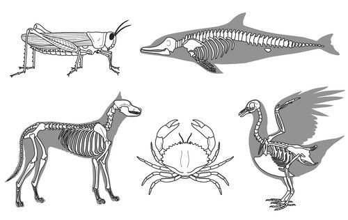

<Callout type="note" title="Note">
Almost 98% of all the animals that have been discovered on Earth are invertebrates!
</Callout>

Animals that have a backbone with a hollow tube inside to hold the nerves are vertebrates. As we can see in the x-ray images of the dolphin, dog and goose, we can see the skeletons of these vertebrates. They are made of bone. We say that vertebrates have an endoskeleton.

What about the grasshopper and the crab? Why can we not see their bones? This is because invertebratesdo not have a skeleton made of bones. The grasshopper and crab have a hard shell covering on the outside of their bodies. This supports their soft bodies inside. We say they have an exoskeleton. But not all invertebrates have an exoskeleton.

What about a jellyfish? It does not have a backbone, so it is not a vertebrate, so it must be an invertebrate. Does it have a hard, outer covering called an exoskeleton? Discuss this with your class. Make sure to take note of the third type of skeleton in your discussion.

Invertebrates do not have a backbone, but this does not necessarily mean that they have an exoskeleton. Many invertebrates have a** hydrostatic skeleton**, like the jellyfish and earthworm. Some invertebrates such as like the snail and have an exoskeleton (shell) and a hydrostatic skeleton. Sponges actually have a type of endoskeleton as their 'skeletons' are made of calcareous spicules.

# Classifying vertebrates and invertebrates

**INSTRUCTIONS:**

**Problem:**
In the table identify the type of skeleton that each animal has and write it down beneath each picture.

**Solution:**

**Problem:**
Write down whether the animal is an invertebrate or a vertebrate.

| Animal | A grasshopper | A bluebottle |
| --- | --- | --- |
| Type of skeleton |  |  |
| Vertebrate or invertebrate |  |  |
| Animal | Cape sparrow | Butterfly |
| Type of skeleton |  |  |
| Vertebrate or invertebrate |  |  |
| Animal | Tortoise | Frog |
| Type of skeleton |  |  |
| Vertebrate or invertebrate |  |  |
| Animal | Crab | Earthworm |
| Type of skeleton |  |  |
| Vertebrate or invertebrate |  |  |

**Solution:**
| Animal | A grasshopper | A bluebottle |
| --- | --- | --- |
| Type of skeleton | Exoskeleton | Hydroskeleton |
| Vertebrate or invertebrate | Invertebrate | Invertebrate |
| Animal | Cape sparrow | Butterfly |
| Type of skeleton | Endoskeleton | Exoskeleton |
| Vertebrate or invertebrate | Vertebarte | Invertebrate |
| Animal | Tortoise | Frog |
| Type of skeleton | Endoskeleton | Endoskeleton |
| Vertebrate or invertebrate | Vertebarte | Vertebrate |
| Animal | Crab | Earthworm |
| Type of skeleton | Exoskeleton | Endoskeleton |
| Vertebrate or invertebrate | Invertebarte | Invertebrate |

<Callout type="note" title="Note">
A useful chart showing the classification system[http://www.usefulcharts.com/science/classification-of-animals-chart.html](http://www.usefulcharts.com/science/classification-of-animals-chart.html)
</Callout>

<Callout type="note" title="Note">
'Phylum' is the singular and 'phyla' is the plural use of the word.
</Callout>

The invertebrates are divided into five phyla. The invertebrate phyla are:

2. Sea sponges
4. Jellyfish
6. Roundworms
8. Molluscs
10. Arthropods

The five phyla making up the invertebrates have scientific names, but these are not necessary to know at this stage. We will only focus on the two phyla Arthropoda and Mollusca.

Vertebrates belong to the phylum Chordata. Vertebrates are subdivided into five classes.

<Callout type="note" title="Note">
Only about 2% of all the animals on Earth have a backbone.
</Callout>

Have a look at the following diagram which shows the different classes of vertebrates and phyla of invertebrates. Remember, all vertebrates belong to the phylum Chordata.

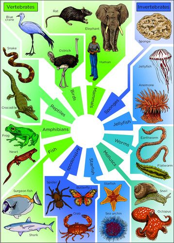

# Identify the five classes of vertebrates

**INSTRUCTIONS:**

2. Study the previous chart showing vertebrates and invertebrates and identify the names of the five classes of vertebrates. Write these on the lines below.
4. Use the pictures that you previously collected from magazines to find at least 5 examples of each of these classes of animals.

**QUESTIONS:**

**Problem:**
Identify at least one distinguishing characteristic that each class shares or has in common (that makes that class different from other classes.) Write this on the line next to the classes that you identified above.

**Solution:**
2. Fish - scales / gills / fins / etc
4. Amphibians - soft moist skin / lungs and skin used for breathing / four limbs with webbed feet
6. Reptiles - scaly skin / lungs used for breathing / four limbs with toes
8. Birds - beak, feathers cover body / air sacs used for breathing / two scaly legs and two wings,
10. Mammals - fur or hairy skin / lungs / four limbs / mammary glands, live birth

Since many animals in Africa are under threat due to habitat loss and poaching the animals featured in this section were specifically included to raise awareness and to expose learners to the wonderful animals living in South Africa. Teachers are encouraged to work with teachers from other subjects, such as the languages or art, to let learners make anti-poaching or awareness campaign posters to address the environmental issues and raise awareness with other learners in the school.

### Vertebrates

<Callout type="note" title="Note">
- amphibian
- cartilage
- ectothermic
- endothermic
- gill
- larva / larvae
- mammary gland
</Callout>

The five classes of vertebrates are:

2. Fish
4. Amphibians
6. Reptiles
8. Birds
10. Mammals

#### Fish

Visit [http://school-of-fish.co.uk/teacher_resources_topic.php](http://school-of-fish.co.uk/teacher_resources_topic.php) for a teachers' support website on fish.

Fish come in all sorts of shapes, sizes and colours. There is huge diversity amongst fish. Have a look at some of the following drawings of different types of fish.

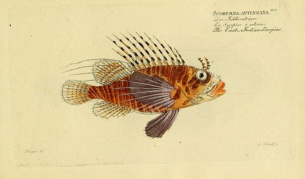

Scorpion fish [http://www.flickr.com/photos/biodivlibrary/7064505883/](http://www.flickr.com/photos/biodivlibrary/7064505883/)

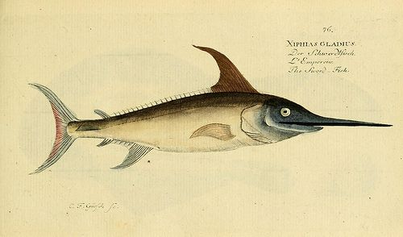

Swordfish [http://www.flickr.com/photos/biodivlibrary/7064433129/](http://www.flickr.com/photos/biodivlibrary/7064433129/)

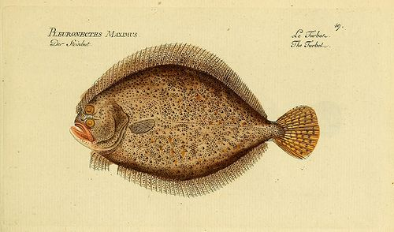

Sole Fish [http://www.flickr.com/photos/biodivlibrary/6918339104/](http://www.flickr.com/photos/biodivlibrary/6918339104/)

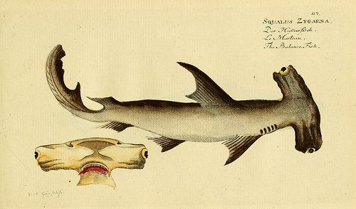

Hammerhead shark [http://www.flickr.com/photos/biodivlibrary/6918381652/](http://www.flickr.com/photos/biodivlibrary/6918381652/)

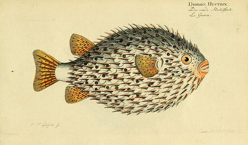

Puffer fish [http://www.flickr.com/photos/biodivlibrary/7064464957/](http://www.flickr.com/photos/biodivlibrary/7064464957/)

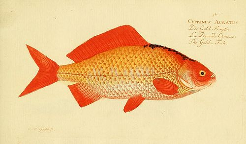

Goldfish [http://www.flickr.com/photos/biodivlibrary/6918365142/](http://www.flickr.com/photos/biodivlibrary/6918365142/)

<Callout type="note" title="Note">
Unusual and weird deep sea fish (video)
</Callout>

# Identify defining features of fish

**QUESTIONS:**

**Problem:**
Carefully study the drawings of the fish shown previously. Although they are different shapes, sizes and colours, you should be able to identify common features to all fish. List as many of the defining features of fish as you can.

**Solution:**
Features learners might list include: ectothermic, backbone, fins, gills, scales, living in water, breathing oxygen from water, streamlined body, lay eggs.

**Problem:**
Some of the features that you listed might apply to other animals that are not fish. Look at your list again. Make a tick next to any of the features you listed that only apply to fish, or perhaps a combination of characteristics that only apply to fish.

**Solution:**
The combination of gills, fins and the fact that fish live only in the water are the main defining characteristics of fish and make fish different from all other animals.

When classifying fish we look closely at the material that makes up the skeleton of the fish. This leads us to divide fish into two main groups:

- **Cartilaginous fish** have skeletons made of **cartilage**.
- **Bony fish** that have skeletons made of bone.

<Callout type="note" title="Note">
An ancient fish-like class of animals are called Agnatha. Hagfish and Lampreys are part of this group. Hagfish for instance look more like worms than fish. There is controversy over whether hagfish should be classified as fish or not.
</Callout>

<Callout type="note" title="Note">
Interesting article on the use of hagfish slime to make clothing
</Callout>

Sharks, skates and rays are part of a group of cartilaginous fish because their skeletons are made of cartilage. These fish breathe using five to seven pairs of **gills**.

<Callout type="note" title="Note">
Two thirds of the sharks brain is dedicated to its sense of smell. A shark's sense of smell is so well developed that it can tell the direction from which a smell is coming.
</Callout>

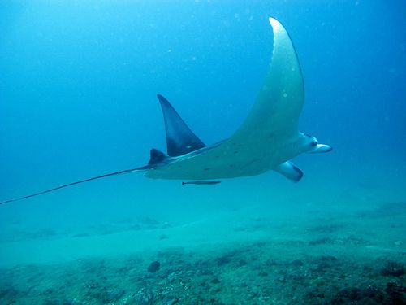

Manta ray[http://www.flickr.com/photos/zappowbang/5043221443/](http://www.flickr.com/photos/zappowbang/5043221443/)

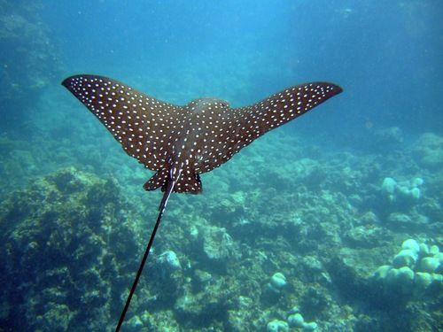

Spotted eagle ray[http://commons.wikimedia.org/wiki/File:Spotted_Eagle_Ray_%28Aetobatus_narinari%292.jpg](http://commons.wikimedia.org/wiki/File:Spotted_Eagle_Ray_%28Aetobatus_narinari%292.jpg)

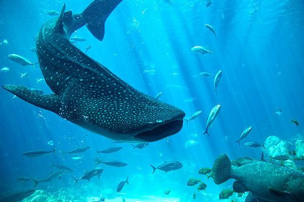

A whale shark surrounded by other fish[http://www.flickr.com/photos/zappowbang/5043846856/](http://www.flickr.com/photos/zappowbang/5043846856/)

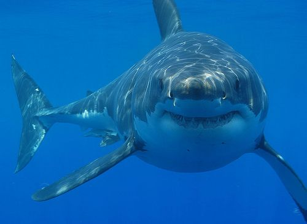

A great white shark[http://www.flickr.com/photos/hermanusbackpackers/3343254977/](http://www.flickr.com/photos/hermanusbackpackers/3343254977/)

<Callout type="note" title="Note">
A whale shark is a shark and not a whale. It is the world's largest fish and it eats only plankton.
</Callout>

<Callout type="note" title="Note">
The coelacanth was thought to be extinct for 65 million years, but was discovered in a catch of fish in 1938. Since then, more have been found along the coast of Southern Africa.
</Callout>

The largest group of all vertebrates are bony fish. Bony fish have a hard, bony skeleton.

**Challenge question:** Is a seahorse a fish? Search books and the internet to find out and explain why we can or cannot consider it to be a fish.

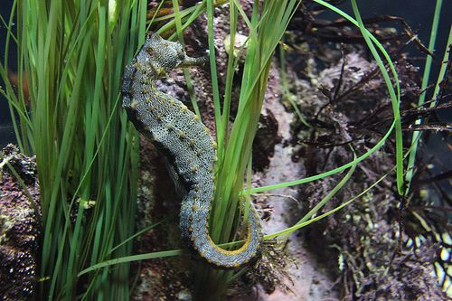

A sea horse.[http://www.flickr.com/photos/scobleizer/3458608999/](http://www.flickr.com/photos/scobleizer/3458608999/)

Yes a sea horse is in fact a fish. It breathes with gills, has a swim bladder to control buoyancy and a spine, and even though they don't have a tail fin they have four other fins that help them move. Unlike most fish, sea horses do not have scales, but skin.

<Callout type="note" title="Note">
The male seahorse actually becomes pregnant! The female squirts her eggs into the male's pouch and he then fertilizes them and incubates them until they are ready to hatch.
</Callout>

<Callout type="note" title="Note">
Watch this video of a male seahorse giving birth
</Callout>

#### Amphibians

Did you know that the word amphibia comes from two Greek words, *amphi* meaning both and *bios* meaning life? So an amphibian is an animal that has 'both lives'. What does this mean?

Amphibians are animals that include salamanders, newts, caecilians, frogs and toads. Let's find out what is meant by amphibians having 'both lives'.

<Callout type="note" title="Note">
A group of birds is called a flock, a group of cattle is called a herd, a group of lions is called a pride, but a group of frogs is called an army.
</Callout>

# Describing amphibians

**INSTRUCTIONS:**

2. Study the photos of different amphibians in the following table.
4. Answer the questions which follow.

| Amphibian | Larva (young) | Adult |
| --- | --- | --- |
| Frog |  |  |
| Toad |  |  |
| Salamander |  |  |
| Newt |  |  |

<Callout type="note" title="Note">
Salamanders can regenerate (regrow) their limbs and tail within a few weeks if they were lost due to predator attacks.
</Callout>

**QUESTIONS:**

**Problem:**
What do you notice about the habitat of the young amphibians compared to the adult amphibians?

**Solution:**
The young larvae are all in water whereas the adults are on land or near water.

**Problem:**
What do you think the larvae need to breathe underwater? What do the adult amphibians need to breathe when they are on land?

**Solution:**
The larvae needs gills to breathe in water, the adults have lungs to breathe on land.

**Problem:**
Can you now explain why amphibians have a name which comes from two Greek words and means 'double life' or 'both life'? Write your explanation below.

**Solution:**
Amphibians have two stages in their life cycle. First, they have the larval stage where they are in water, and then they have the adult stage where they live on land (and also in or near water).

**Problem:**
Amphibians are **ectothermic**. Explain how an amphibian keeps its body warm.

**Solution:**
They get heat from their environment and therefore need to live in areas where it is warm enough for them to have enough body heat to survive. If it gets very cold an amphibian will need to either find a space under a log or leaves, or else sit in the sun.

**Problem:**
Most amphibians have a slimy, moist skin. Discuss possible reasons why they need to have this specific type of skin.

**Solution:**
Learners need to compile a plausible explanation or hypothesis. The correct explanation is: Glands in the skin secrete liquid to keep the skin slimy and moist as frogs may need to use the skin alongside the lungs and mouth for gaseous exchange.

**Problem:**
Look at the following image of a caecilian. There is a debate going on in a Gr. 6 class. Some learners think this animal is a worm, making it an invertebrate. Others think it is a snake, making it a vertebrate. What do you think?

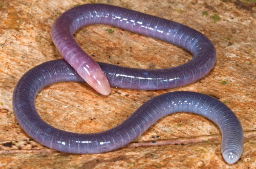

A caecilian. [http://commons.wikimedia.org/wiki/File:Adult_Microcaecilia_dermatophaga_in_life_-_journal.pone.0057756.g005-top.png](http://commons.wikimedia.org/wiki/File:Adult_Microcaecilia_dermatophaga_in_life_-_journal.pone.0057756.g005-top.png)

The caecilian is actually an amphibian! What characteristics would you test or make sure this animal displayed to explain to the Gr. 6 learners that it is not a worm. Secondly, what would you need to find out and explain to the learners to explain that it is not a reptile (a snake) but an amphibian?

**Solution:**
In order not to be an invertebrate, like a worm, the animal needs to have a backbone. The caecilian does have a backbone and a skull. The caecilian is not a snake (it is not a reptile) as it has a larval stage which is born in water and it undergoes metamorphosis to become the adult caecilian. The larvae also have gills to breathe underwater. Caecilians also do not have scales like reptiles.

**Problem:**
Amphibians lay their eggs in water, like this frog. Why do you think they need to do this? Give two reasons.

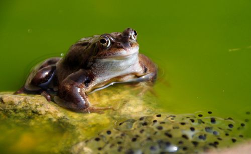

A frog that has just laid its eggs[http://www.flickr.com/photos/anthonymasi/3373720130/sizes/l/](http://www.flickr.com/photos/anthonymasi/3373720130/sizes/l/)

**Solution:**
Some possible reasons are: The eggs are in water so that when the larvae hatch they are already in the water to swim around, the eggs would dry out if they were not in water, the fertilisation process in amphibians often requires water as the female will lay the eggs and as she does so, the male deposits his sperm is the water around them so they are fertilised.

<Callout type="note" title="Note">
You can tell the difference between frog eggs and toad eggs because frogs lay their eggs in clumps and toads lay their eggs in strings. Have you ever seen frog or toad eggs?
</Callout>

<Callout type="note" title="Note">
Interesting article on caecilians[http://www.sciencenewsforkids.org/2012/05/caecilians-the-other-amphibian/](http://www.sciencenewsforkids.org/2012/05/caecilians-the-other-amphibian/)
</Callout>

<Callout type="note" title="Note">
Metamorphosis: Amphibians (full documentary).
</Callout>

#### Reptiles

Reptiles have survived on Earth for millions of years. The first reptiles on earth lived 310 to 320 million years ago and included the dinosaurs.

<Callout type="note" title="Note">
Learn about a fascinating reptile found in Australia called the thorny dragon[http://www.wild-facts.com/tag/thorny-dragon/](http://www.wild-facts.com/tag/thorny-dragon/)
</Callout>

Most reptiles live on land although some, like crocodiles, terrapins and turtles, and some snakes and lizards spend large portions of their lives in water. Reptiles are ectothermic. They cannot regulate their body heat but depend on their environment for heat.

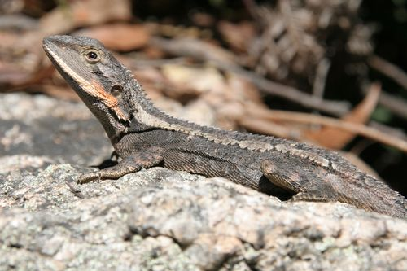

A lizard lying in the sun to warm up [http://www.flickr.com/photos/eklem/3132577798/](http://www.flickr.com/photos/eklem/3132577798/)

Reptiles are covered in dry scales. Reptiles reproduce by laying their eggs on dry land. The eggs are covered by a leathery or hard shell.

<Callout type="note" title="Note">
Learn more about the boa constrictor which keeps its eggs inside its body until they are ready to hatch[http://www.theanimalspot.com/boaconstrictor.htm](http://www.theanimalspot.com/boaconstrictor.htm)
</Callout>

# Reflect on reptiles

**QUESTIONS:**

**Problem:**
Complete these sentences.

2. Since reptiles all have a backbone they are one of the classes of ______.
4. Reptiles are ectothermic which means that ______.

**Solution:**
2. chordata or vertebrates
4. they cannot regulate their body temperature but depend on their environment for heat

**Problem:**
Make a biological drawing with labels and a heading of the lizard lying in the sun in the previous photo.

**Solution:**
Learner-dependent answer

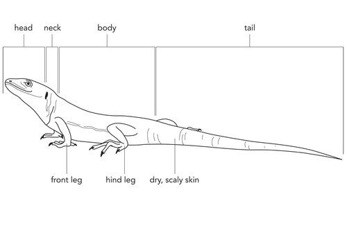

**Problem:**
We can divide reptiles into four main groups. Each of the photos in the table below shows an example of a reptile from each of these groups. Try to identify the four groups based on the animal in the photo.

**Solution:**
| crocodiles and alligators | lizards and geckos |
| snakes | turtles, terrapins and tortoises |

<Callout type="note" title="Note">
Turtles are only found in the sea, terrapins are found in freshwater, and tortoises do not swim around, but walk on land.
</Callout>

#### Birds

If possible, take your learners outside before you start discussing birds to see if you can spot any in the school grounds. Ask learners to identify what is common among all the birds - they should note that all birds have feathers. This is the most distinguishing feature of birds.

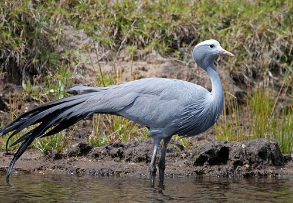

The blue crane is South Africa's national bird. [http://www.flickr.com/photos/exfordy/2967158255/](http://www.flickr.com/photos/exfordy/2967158255/)

# Identify characteristics of birds

**INSTRUCTIONS:**

2. Work in groups of three.
4. List the identifying characteristics of birds following these steps:
6. Do you remember learning about birds in previous years? Work with a different group and brainstorm identifying characteristics of birds. Study the photo of the blue crane above for some clues.
8. Use one specific colour to list the characteristics that your group can think of.
10. As you learn more about characteristics of birds add these in a different colour to help you remember the new characteristics.

Learner-dependent answers. You should once again ask groups to share their characteristics with the class in order to avoid incorrect characteristics from being included. A typical incorrect characteristic might be that all birds can fly. Point out that many birds, such as penguins and ostriches, cannot fly and remind them that Aristotle used this same classifying technique which proved to be of little use. There are also other animals that can fly which are not birds, such as bats and flies. Learners should note that all birds have beaks, wings and feathers and they lay eggs.

**QUESTIONS:**

**Problem:**
Birds are one of the five classes of vertebrates. Write a sentence to explain what all vertebrates have in common.

**Solution:**
All vertebrates have a backbone with a hollow tube running inside it carrying the nerves.

**Problem:**
Just like mammals, birds are also **endothermic**. What does this tell us about their bodies?

**Solution:**
This means that birds can control or regulate their body temperature and can therefore keep warm in very cold climates and keep cool in very hot temperatures.

**Problem:**
What type of body covering do all birds have in common?

**Solution:**
Learner-dependent answer. **Note:**Although almost all learners will say that all birds have feathers, not many will be able to identify that birds' feet are covered in scales like those on reptiles. If you are able to go outside to look at some birds, try to see if you can take note of their legs and feet.

**Problem:**
Is it accurate to say that birds have wings and can therefore fly? Explain your answer. What would be a better way to write this statement?

**Solution:**
Learners are required to evaluate a statement and give an explanation for their evaluation. It is in fact incorrect to say that birds have wings to fly since not all birds' wings are used for flying and many flightless birds exist. Think of the emu, ostrich, penguin, cassowary, kiwi and rhea. A better statement would be: Birds that can fly have wings to do so.

**Problem:**
Study the pictures of these flightless birds and compare them with the flying birds in the next column. Use the pictures to write a paragraph explaining the observable differences between flightless and flying birds and why you think these characteristics help some to fly and others not.

| Flightless Birds | Flying Birds |
| --- | --- |
| Ostriches http://www.flickr.com/photos/jries/6702308713/ | An albatross http://www.flickr.com/photos/wagnertc/3217889835/ |
| Penguins. | A hummingbird http://www.flickr.com/photos/berenicedecados/3265420622/ |

**Solution:**
The ostrich is very big and has a heavy body with long legs. Its long legs help it to run fast on land. It has wings, but its wings are small in comparison to its big heavy body. The albatross is also a big bird but it has a very large wing span relative to its body. The feathers in the albatross are also small and lie close together to help the bird to fly. Whereas the ostrich has many feathers, but they are big and loose and will not catch the updraft of the wind. The penguin also has a body shape which is not designed to help it fly, but rather to swim. It has short, stubby wings, which are not strong enough to lift it off the ground, but are useful for swimming. It is quite fat and heavy, but this helps to keep it warm in the water. The hummingbird is very light and has small wings which beat extremely fast, allowing it to fly and hover. The hummingbird has wings designed to flap quickly in the wind as they are narrow and light, while the penguin has fatter wings shaped like a
                            paddle which are rather used for swimming.

<Callout type="note" title="Note">
An application for a smart phone which helps you to identify all birds in South Africa.[http://www.sasolbirds.co.za/mobile-app.php](http://www.sasolbirds.co.za/mobile-app.php)
</Callout>

#### Mammals

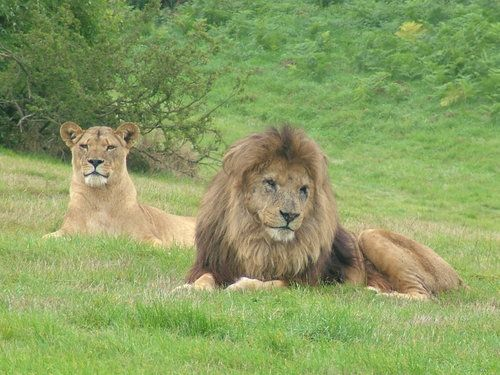

Lions are mammals.

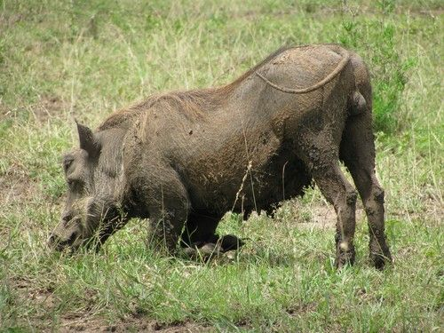

A warthog is a mammal.

# Identify characteristics of mammals

**INSTRUCTIONS:**

2. Work in groups of three to four.
4. You might have learnt about mammals in previous years. Work with your group to brainstorm as many identifying characteristics of mammals that you can think of. Study the diagram of the lion above for some clues.
6. List the characteristics that you can identify in the space below using one specific colour.
8. As you learn more about mammals, add what you have learnt to this list in a different colour. This will then provide a summary on mammals when you have completed the section.

Learner-dependent answers. **Note:**After learners have generated their lists, you should ask groups to share their characteristics with the rest of the class in order to insure that no false characteristics are included (although these would provide a foundation for discussion as to why they are not identifying characteristics for instance). Some characteristics that learners might identify are: warm-blooded (endothermic), four limbs, sexual reproduction, live young, hair on bodies.

Mammals are vertebrates meaning they have a backbone. Almost all mammals are endothermic. This means they are also able to maintain (keep) their body temperature at a constant level.

<Callout type="note" title="Note">
The Naked Mole Rat has lost the ability to regulate its body temperature while other mole rats have weakened abilities to do this since they live underground in areas where the temperatures are generally very stable.
</Callout>

<Callout type="note" title="Note">
'Thermic' means to do with temperature and 'endo' means inside, so mammals are endothermic as they can regulate their body temperature from the inside.
</Callout>

Mammals give birth to live young which are fed milk. The milk is produced by the mother's **mammary glands** (in the teats or breasts). Mammals also have hair on their bodies. This varies greatly between mammals. Mammals also have teeth that look different in different parts of the mouth.

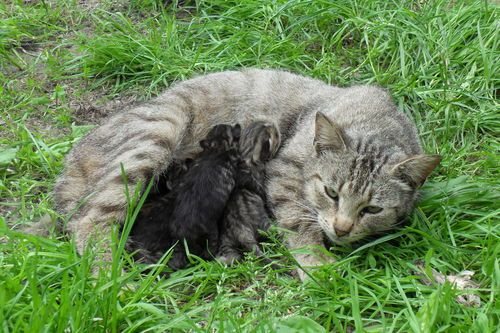

Kittens drinking milk from the mother cat.

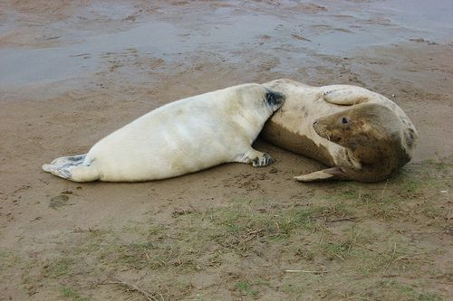

A seal pup suckling from its mother. [http://www.flickr.com/photos/tpholland/6448731161/in/photostream/](http://www.flickr.com/photos/tpholland/6448731161/in/photostream/)

All mammals breathe using lungs. Many mammals therefore live on land. Those mammals that do live in water, like whales and dolphins, have to come to the surface of the water to breathe.

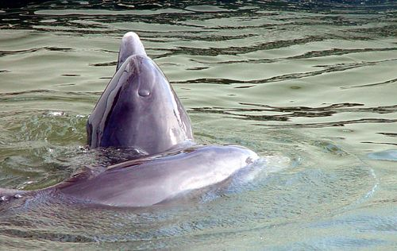

<Callout type="note" title="Note">
Whales and dolphins are born with a layer of hair that gradually thins out as they grow older and eventually disappears. Why do you think they lose their hair?
</Callout>

<Callout type="note" title="Note">
While the larger cats (lion and leopard) prefer to hunt at night to avoid overheating, cheetah hunt in the middle of the day. There is then less chance of them losing their catch to the larger cats.
</Callout>

<Callout type="note" title="Note">
Why are there no giant mammals? (video)
</Callout>

Now that we have studied the five main classes of vertebrates it is easy to compare them!

# Comparing vertebrates

**INSTRUCTIONS:**

**Problem:**
Use the table below to compare the vertebrates shown in the photos based on the features in the first column.

|  | Tortoise | Chimpanzee | Frog | Guinea fowl | Goldfish |
| --- | --- | --- | --- | --- | --- |
| Class |  |  |  |  |  |
| Skin covering |  |  |  |  |  |
| How babies are born |  |  |  |  |  |
| Habitat |  |  |  |  |  |
| Ectothermic or Endothermic |  |  |  |  |  |
| Distinguishing features |  |  |  |  |  |

**Solution:**
|  | Tortoise | Chimpanzee | Frog |  |  |
| --- | --- | --- | --- | --- | --- |
| Class | Reptile | Mammals | Amphibian | Birds | Fish |
| Skin covering | dry, scales | Hair or fur | smooth, slippery | feathers | slimy, scales |
| How babies are born | lays eggs | live birth | lays eggs | lays eggs | lays eggs |
| Habitat | on land | on land | in water when young, on land when older | on land | in water |
| Ectothermic or Endothermic | ectothermic | endothermic | ectothermic | endothermic | ectothermic |
| Distinguishing features | Scales and lay eggs | Young drink milk from the mammary glands of the mother and have fur | Live first stage in water, then on land | Have feathers. | Live only in water, have fins, scales and gills. |

Now that we have looked at all the classes of vertebrates, let's have a look at the invertebrates.

### Invertebrates

<Callout type="note" title="Note">
- antennae
- arthropod
- exoskeleton
- jointed (segmented) limbs
</Callout>

What should you look out for when you have to decide if an animal is an invertebrate?

- All invertebrates lack a backbone. They either have a hard outer shell or a fluid-filled structure that acts as a skeleton (for example jellyfish and slugs).
- All invertebrates are ectothermic.

Did you know that 97% of the animals on Earth are invertebrates? Due to the huge diversity in the invertebrates, it can sometimes make classifying them a bit tricky. The invertebrates are divided into several phyla. Some of the invertebrate phyla are:

2. Molluscs (for example snails and octopuses)
4. Arthropods (for example insects, spiders and crabs)
6. Echinoderms (for example sea urchins and starfish)
8. Cnidaria (for example jellyfish)
10. Porifera (sponges)
12. Annelids (segmented worms)
14. Platyhelminthes (flatworms)

There are some other phyla too. As you can see, the invertebrates are a very large and diverse group of animals. We are mostly going to focus on the two phyla Arthropods and Molluscs.

<Callout type="note" title="Note">
Find out more about the other phyla of invertebrates[http://www.earthlife.net/inverts/an-phyla.html](http://www.earthlife.net/inverts/an-phyla.html)
</Callout>

The word arthropod comes from two greek words *arthron* meaning 'joint' and *podos* meaning 'leg', so together it means 'jointed legs'. Arthropods have an **exoskeleton** and they have jointed (segmented) limbs.

Let's now find out more about Arthropods!

#### Arthropods

The invertebrates that fall into the phylum arthropoda, all have a hard outer covering called an **exoskeleton**. The exoskeleton protects the animal and provides a place for its muscles to attach and function.

# Classifying arthropods

If possible, collect different arthropods in a terrarium and have learners study them with magnifying glasses as they work through the activity. However, photos have been provided if this is not possible. Learners can still be encouraged to study different arthropods in the school premises as they work through the activities. If the school permits this, ask learners to walk around school taking photos with cell phones or cameras of arthropods to share with the class. If the school has access to an interactive whiteboard, put these photos up and use these to complete this activity.

**INSTRUCTIONS:**

2. Study the photos of different arthropods below.
4. Answer the question that follow.

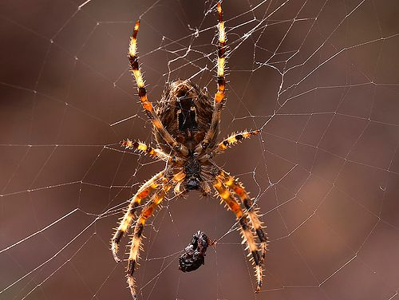

A spider[http://www.flickr.com/photos/21998322@N00/81770194/](http://www.flickr.com/photos/21998322@N00/81770194/)

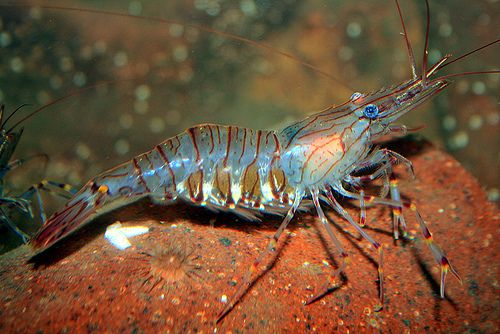

A prawn[http://www.flickr.com/photos/peteredin/5619821151/](http://www.flickr.com/photos/peteredin/5619821151/)

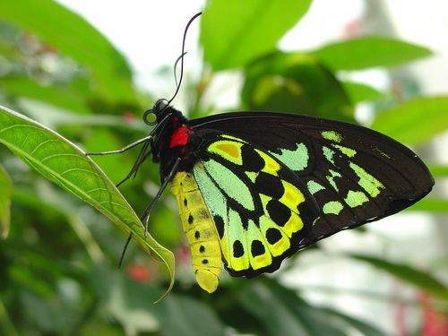

A butterfly

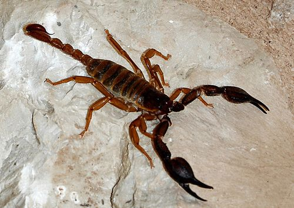

A scorpion[http://www.flickr.com/photos/ant_ronald/2398765085/](http://www.flickr.com/photos/ant_ronald/2398765085/)

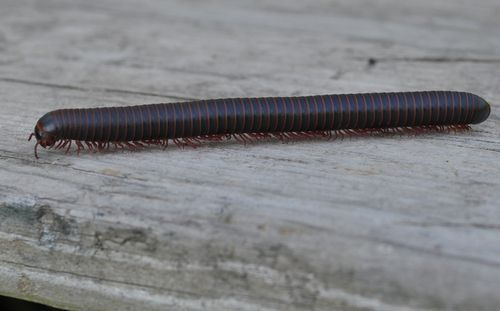

A millipede[http://www.flickr.com/photos/83476006@N07/7708530852/](http://www.flickr.com/photos/83476006@N07/7708530852/)

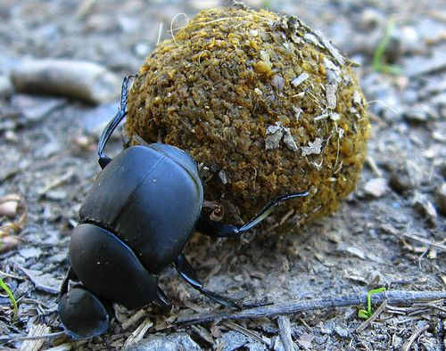

A dung beetle[http://www.flickr.com/photos/amylovesyah/3945525048](http://www.flickr.com/photos/amylovesyah/3945525048)

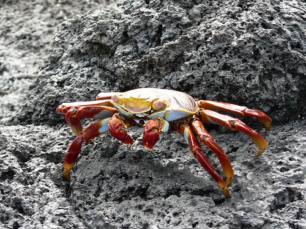

A crab[http://www.flickr.com/photos/jamespreston/88889976/](http://www.flickr.com/photos/jamespreston/88889976/)

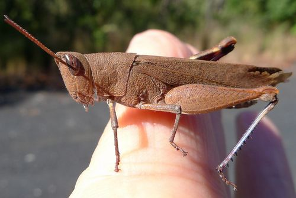

A grasshopper[http://www.flickr.com/photos/31031835@N08/7147480849/](http://www.flickr.com/photos/31031835@N08/7147480849/)

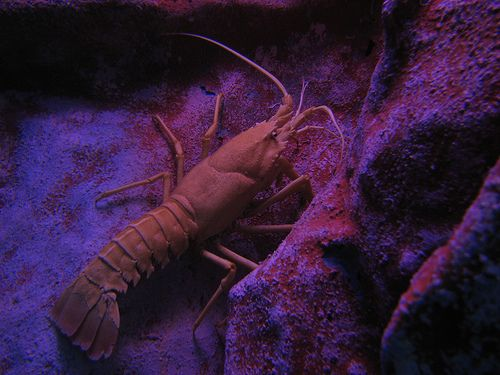

A crayfish[http://www.flickr.com/photos/botheredbybees/4305415817/](http://www.flickr.com/photos/botheredbybees/4305415817/)

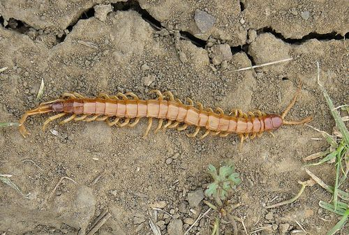

A centipede[http://www.flickr.com/photos/slodocents/2372480074/](http://www.flickr.com/photos/slodocents/2372480074/)

<Callout type="note" title="Note">
The mosquito is responsible for more human deaths each year than any other animal on earth! Malaria is carried by mosquitoes and passed to humans when an infected female bites.
</Callout>

<Callout type="note" title="Note">
Centipedes are venomous and have a very painful sting!
</Callout>

**QUESTIONS:**

**Problem:**
Study the bodies of each of these animals.

2. Describe how the bodies of the different arthropods look and if you could touch it, what do you think it would feel like?
4. Do you think their bodies would be warm or cold?

**Solution:**
2. They have hard shell-like bodies that look sturdy and inflexible; it would possibly feel hard and would crunch if broken.
4. Their bodies would feel similar to the temperature of their environment.

**Problem:**
Study the legs of the different arthropods.

2. Describe how the legs of the different arthropods look in general.
4. How are the legs able to bend?
6. One way to classify an arthropod is to count its legs and to group these animals according to this. Count the legs on each of these arthropods and write their names in the appropriate column below to see to which group they belong.
   | Insects = 6 legs | Arachnids = 8 legs | Crustaceans = 10 legs | Diplopoda and Chilopoda = many legs |
   | --- | --- | --- | --- |

**Solution:**
2. The legs are made of different parts that are joined together and are mostly covered in the same hard exoskeleton as the body.
4. Where the pieces of the leg come together they form a flexible joint that allows the leg to bend and move.
6. The learners' tables must look like this:
   | Insects = 6 legs | Arachnids = 8 legs | Crustaceans = 10 legs | Diplopoda and Chilopoda = many legs |
   | --- | --- | --- | --- |
   | Dung beetle Grasshopper Butterfly | Spider Scorpion | Crab Prawn Crayfish | Centipede Millipede |

**Problem:**
As you probably noticed, an arthropod's body is covered by a hard exoskeleton. Explain how you think an arthropod can grow and get bigger since the hard exoskeleton cannot grow with it.

**Solution:**
It sheds the hard exoskeleton (outer skeleton) in a process called **moulting**.

**Problem:**
What habitat would you say most crustaceans live in? How does this differ from the habitat of the other classes of arthropods?

**Solution:**
Most crustaceans are aquatic, either marine or freshwater. The other classes mostly live on land, although many live near water.

**Problem:**
Which class of arthropods has wings? Do all of the animals in the class have wings?

**Solution:**
Insects have wings. No, not all insects have wings.

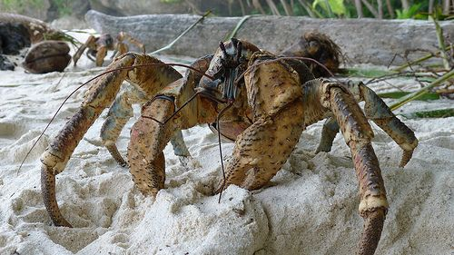

A coconut crab. [http://www.flickr.com/photos/31031835@N08/5699577576/](http://www.flickr.com/photos/31031835@N08/5699577576/)

<Callout type="note" title="Note">
The coconut crab (*Birgus Latro*) is the largest land-living arthropod on Earth and weighs up to 4 kg! It can crack whole coconuts with its pincers.
</Callout>

#### Molluscs

Molluscs are a very diverse phylum of invertebrates. They have a huge range in body shapes and sizes. Molluscs are often given a general description which is that they have internal or external shells and a single muscular 'foot'. However, there are lots of molluscs which do not strictly fit this description, such as slugs.

<Callout type="note" title="Note">
*Mollusc* is Latin for "soft" which refers to the soft bodies of molluscs.
</Callout>

The group of molluscs include snails, squid, octopuses, periwinkles, abalone, mussels, oysters and other soft-bodied animals.

<Callout type="note" title="Note">
Video on nudibranch sea slugs
</Callout>

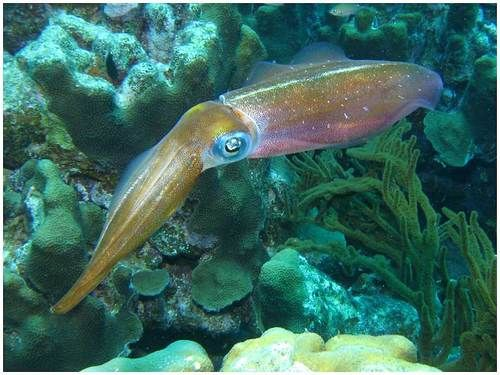

A reef squid[http://commons.wikimedia.org/wiki/File:Reef_squid.jpg](http://commons.wikimedia.org/wiki/File:Reef_squid.jpg)

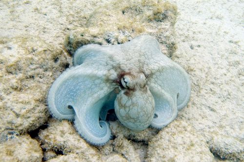

An octopus[http://commons.wikimedia.org/wiki/File:Common_octopus_Octopus_vulgaris_%284681010396%29.jpg](http://commons.wikimedia.org/wiki/File:Common_octopus_Octopus_vulgaris_%284681010396%29.jpg)

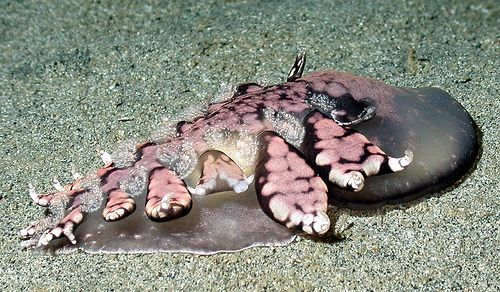

A sea slug (nudibranch)[http://www.flickr.com/photos/noaaphotolib/5117159619/](http://www.flickr.com/photos/noaaphotolib/5117159619/)

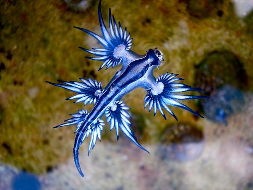

The Blue Dragon nudibranch[http://www.flickr.com/photos/87895263@N06/8599051974/](http://www.flickr.com/photos/87895263@N06/8599051974/)

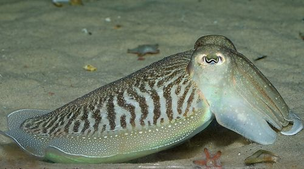

A cuttlefish[http://www.flickr.com/photos/wwarby/4695864776/](http://www.flickr.com/photos/wwarby/4695864776/)

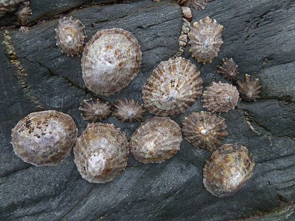

Limpets in a rock pool[http://www.flickr.com/photos/atoach/6575875147/](http://www.flickr.com/photos/atoach/6575875147/)

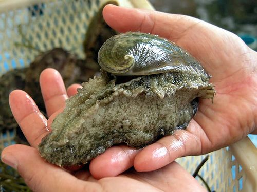

An abalone[http://www.flickr.com/photos/verzo/869167288/](http://www.flickr.com/photos/verzo/869167288/)

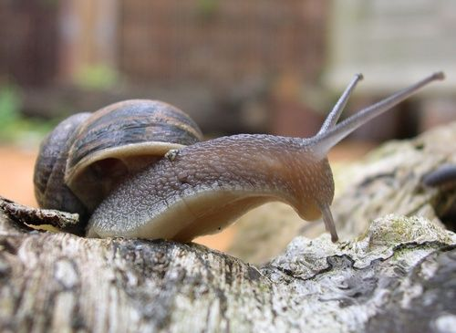

A garden snail

<Callout type="note" title="Note">
Video on Cuttlefish: The chameleons of the sea
</Callout>

# Observing molluscs

**INSTRUCTIONS:**

2. Carefully study the above photos of different animals that form part of the phylum mollusca.
4. Answer the following questions.

**QUESTIONS:**

**Problem:**
Identify some characteristics that molluscs have in common.

**Solution:**
Molluscs have soft bodies, which are often slimy to touch. Most molluscs have one or two hard shells to protect their bodies, sometimes the shell is inside, like that of the cuttlefish, squid and octopus. Molluscs live in moist environments, mostly in the sea.

**Problem:**
Most of the molluscs shown in the photographs live in the sea. What do you think would happen if these molluscs were exposed to the air for a long time?

**Solution:**
They would dry out and die.

**Problem:**
Walk through the school garden and see if you can find any garden snails. If you do, or perhaps you have seen them elsewhere before, think about their habitat. Describe the areas where you found snails.

**Solution:**
Learner-dependent answers - they might say that they found more snails in low-traffic areas and in shady, less-exposed places, often where it is damp or under foliage.

**Problem:**
If possible, collect a few snails to study in class. If you have a glass terrarium or an old aquarium, keep the snails in there, or else keep a few in large clean glass jars.

**Solution:**
**Note:**In the last section of this term's work learners are going to study variation and survival of the strongest / fittest. They will need snails for that activity too, so if possible keep the snails from this activity for then. Just make sure the lid is securely shut on the terrarium as snails will escape and arriving to a slime-covered desk / class before school is no fun at all!

**Problem:**
Carefully study their bodies and especially their long, slimy foot.

2. What do you think the slime is used for?
4. Describe how the snail moves.
6. How many tentacles (**antennae**) does the snail have? What do you think these are used for?
8. What markings are on the shell? Why do you think the shell is marked in this particular way?
10. Try and see if you can find male and female snails. What conclusion can you draw from this.

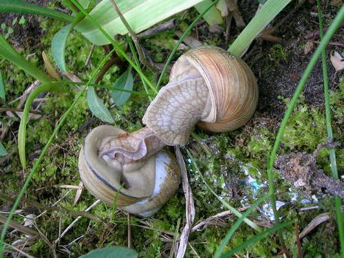

Garden snails mating.

**Solution:**
2. As the snail moves it leaves behind a trail of slime to make it easier for the rest of the body to slide or glide over. This allows it to move easily over any type of surface.
4. Muscles in the foot of the snail contract and relax causing it to move along.
6. Snails can have one or two pairs of tentacles (antennae) depending on the species (however they may be retracted). One pair of light-sensitive eyes are usually on the longest pair of antennae and the other pair of antennae are used for smell and touch.
8. The snails' shells are marked to blend into their environment and to break the outline of their shape to help to camouflage them.
10. Learners should say that they cannot see any difference and should be able to conclude that either they only collected one sex or that snails do not have a male and a female snail (which is in fact the truth). Most land snails have both male and female parts. They are hermaphrodites. When they meet with other snails during mating they will both conceive and lay eggs, so double the number of offspring are formed.

**Problem:**
Make a drawing of a snail. Include the following labels: hard shell, foot, head, mouth, tentacle, eyespot.

**Solution:**
Learner-dependent answer
