## Diversity of plants

<Callout type="note" title="Note">
- bulb
- rhizome
- root
- seeds
- shoot
- spore
- stem
- symbiotic
</Callout>

In this section we will take a closer look at the organisms in the **plant kingdom**. So how do we classify plants?

This section guides learners as they investigate the plant kingdom by grouping plants with seeds and those without seeds into two main groups.

### Classifying plants

As an introduction to the diversity of plants, you can do a short walk around your school, aimed at developing a greater awareness of the plants in and around the school, and specifically those that produce seeds and those that do not. Also encourage learners to take note of leaf shape, size, flowers, etc.

We can easily compare plants based on their characteristics. For example, their leaf size and shape, whether there are flowers or not and how the petals look, the length and depth of the **roots** and the type of root system, and many others.

<Callout type="note" title="Note">
If you would like to join and become a research scientist yourself, visit the iSpot website[http://www.ispot.org.za/](http://www.ispot.org.za/)
</Callout>

One particularly useful way is grouping plants according to how they reproduce sexually. If we group plants based on the way that they sexually reproduce we can quickly see two distinct groups:

- Plants with **seeds**
- Seedless plants

<Callout type="note" title="Note">
Plants can also reproduce asexually by making a clone or copy of themselves. In this way new plants can grow from cuttings and tubers (like potatoes), from **bulbs** and **rhizomes**, or from **shoots** and side branches.
</Callout>

Plants that do not produce seeds include ferns, mosses and algae. These plants produce **spores**. The spores often develop in structures found on the underside of the leaves or fronds. The spores grow into new plants.

If possible, pick some fern fronds to bring to school. You can also look for moss growing in moist environments, such as under a dripping tap and pick some to bring to class. You can then show learners the spore forming structures on the underside of the fern leaves.

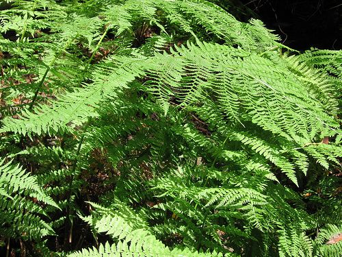

A common fern in South Africa. [http://www.flickr.com/photos/24918962@N07/2353233827/](http://www.flickr.com/photos/24918962@N07/2353233827/)

<Callout type="note" title="Note">
Ferns have been around for about 400 million years. That is even older than dinosaurs, and they are still living on Earth today.
</Callout>

The following photo shows a close-up of the underside of a fern leaf. Can you see the clusters of capsule-shaped structures that form the tiny spores?

A small hand lens is useful to examine the underside of the fern leaves (if available).

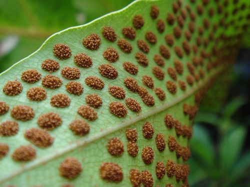

The structures that produce and release spores on the underside of a fern leaf [http://www.flickr.com/photos/honey-bee/500865399/](http://www.flickr.com/photos/honey-bee/500865399/)

The close-up photo on the right shows a moss sporophyte. This contains the spores of the moss plant.

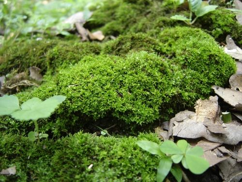

Moss growing on the forest floor

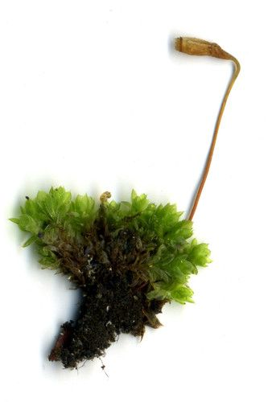

Close-up of a spore-producing moss plant

Do you know what lichen is? You often see it growing on rocks and tree trunks. Do you think lichen is a plant? Look at the photos of lichen below.

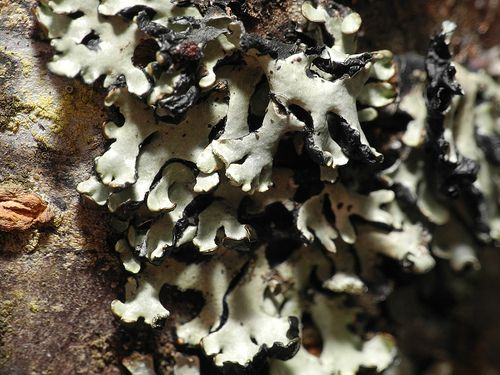

Lichen growing on a tree [http://www.flickr.com/photos/computerhotline/8434319385/](http://www.flickr.com/photos/computerhotline/8434319385/)

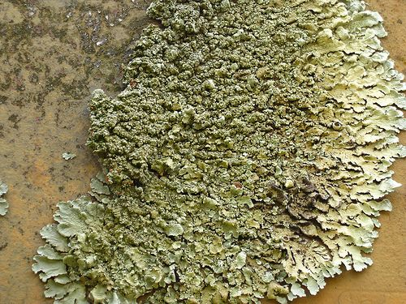

Lichen growing on an old tin drum [http://www.flickr.com/photos/antijoe/3318398036/](http://www.flickr.com/photos/antijoe/3318398036/)

Lichen actually consist of two different organisms growing together! A fungus and a green alga grow together in a **symbiotic** relationship. The fungus absorbs water from the environment and provides the algae with an environment to grow in. The green algae photosynthesizes, providing food for the itself and the fungus. Why can the fungus not make its own food? Is the fungus a plant? Can you come up with a definition for a symbiotic relationship? Discuss this with your class and take some notes.

<Callout type="note" title="Note">
Alga is singular and algae is plural!
</Callout>

Discuss this with your learners. Encourage them to take notes in the margins of their workbooks. A fungus is not a plant. Fungi are one of the five kingdoms of organisms. Fungi do not contain chlorophyll and cannot photosynthesize. They therefore need to obtain their nutrients from elsewhere. Ask your learners what they think a symbiotic relationship is. A symbiotic relationship is one in which one or both organisms benefit. A parasite is something which lives off another organism in some way and harms that organism. The relationship benefits the parasite, but not the host. It is not mutually beneficial. On the other hand, the honey bird and the badger, which learners may have learned about in Gr 6, both benefit from their relationship. It is a mutually beneficial symbiotic relationship. Start by asking learners if the relationship between the fungus and the alga is beneficial to one or both of them? Both the algae and fungus benefit from the relationship. Therefore it is a mutually
                  beneficial symbiotic relationship.

The other group of plants produces seeds. These plants can either produce seeds in flowers or they can produce seeds in cones. Most plants that you see around you, produce seeds. Plants that produce seeds in flowers are called **angiosperms** and plants that produce seeds in cones are called **gymnosperms**.

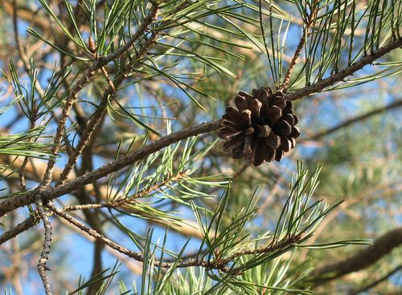

This is a gymnosperm plant as it produces seeds in cones. [http://www.flickr.com/photos/scoobygirl/89255754/](http://www.flickr.com/photos/scoobygirl/89255754/)

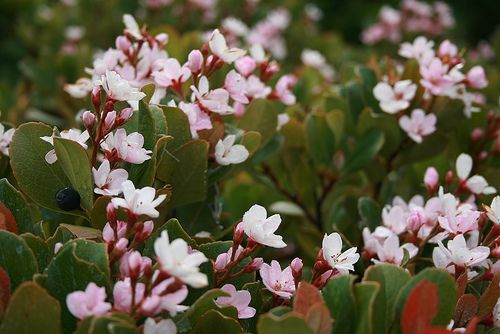

This is an angiosperm plant as it produces seeds in flowers. [http://www.flickr.com/photos/lofink/2374856187/](http://www.flickr.com/photos/lofink/2374856187/)

We can therefore classify plants as follows:

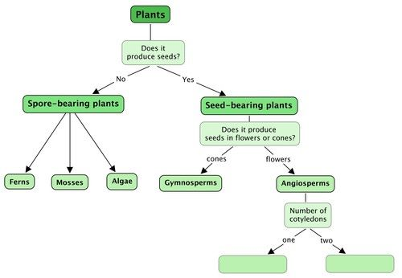

Come back to complete this diagram once we have learned more about angiosperms.

The words to fill in on the diagram are **monocotyledon** for one cotyledon and **dicotyledon** for two cotyledons.

### Seed-bearing plants

<Callout type="note" title="Note">
- cotyledon
- dicotyledon
- herbaceous
- leaf vein
- monocotyledon
- tap root
</Callout>

#### Gymnosperms

Have you ever seen a living prehistoric plant? If you thought about it, you probably have without even realising it!

In South Africa we have plants called cycads that are often referred to as 'living fossils'. Cycads grew in great numbers during the Jurassic period. They have not been around for as long as ferns and algae, but they have been on Earth for longer than all flowering plants. Flowering plants (angiosperms) evolved after gymnosperms.

<Callout type="note" title="Note">
South Africa is considered a diversity hotspot for cycads. Along with Australia,Mexico, China and Vietnam, we account for 70% of Earth's cycad species.
</Callout>

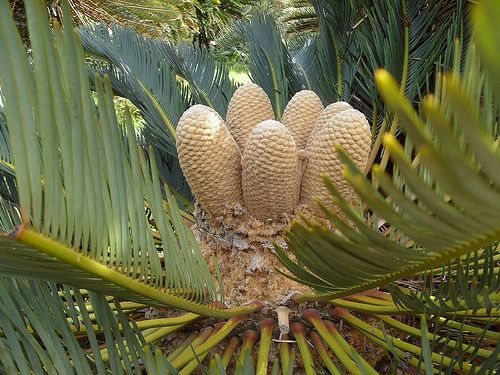

A cycad with cones. [http://www.flickr.com/photos/kiryna/6223985706/](http://www.flickr.com/photos/kiryna/6223985706/)

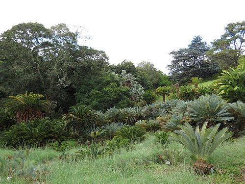

Cycads at Kirstenbosch Gardens in Cape Town. [http://www.flickr.com/photos/mmmavocado/7359493202/](http://www.flickr.com/photos/mmmavocado/7359493202/)

<Callout type="note" title="Note">
[http://www.plantapalm.com/vce/toc.htm](http://www.plantapalm.com/vce/toc.htm) for more information on cycads.
</Callout>

Can you see the large cones in the photo of the cycad above? They are in the centre of the plant. The cones are made up of many individual seeds. Look at the following close up images of cones.

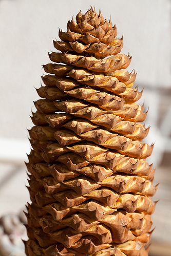

A cycad cone. [http://www.flickr.com/photos/elwillo/5461546631/](http://www.flickr.com/photos/elwillo/5461546631/)

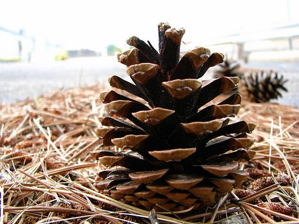

A cone from a pine tree. [http://www.flickr.com/photos/msvg/4794692330/](http://www.flickr.com/photos/msvg/4794692330/)

The word gymnosperm means 'naked seed'. Gymnosperms are considered to have naked seeds as the seeds are not covered in a fruit, like we will see in angiosperm plants.

Another gymnosperm which is native to South Africa, and grown a lot in the Cape is the Mountain Cypress, as shown in the photo. They grow especially well at high altitudes, such as in the Cederberg Mountains.

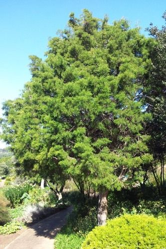

A Mountain Cypress.

There are several species of gymnosperms which are *not* indigenous to South Africa. What does this mean? Let's find out.

# Invasive plants in South Africa

**INSTRUCTIONS:**

2. Study the following photographs of various gymnosperm plants in South Africa.
4. Answer the questions that follow.
6. You will need to do some research in books and on the internet.

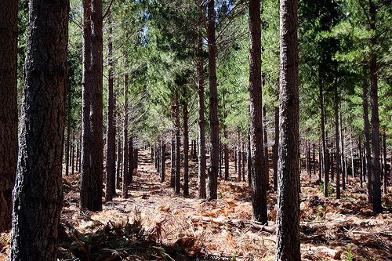

Pine trees in Tokai Forest, Cape Town. [http://www.flickr.com/photos/warrenski/5133005352/](http://www.flickr.com/photos/warrenski/5133005352/)

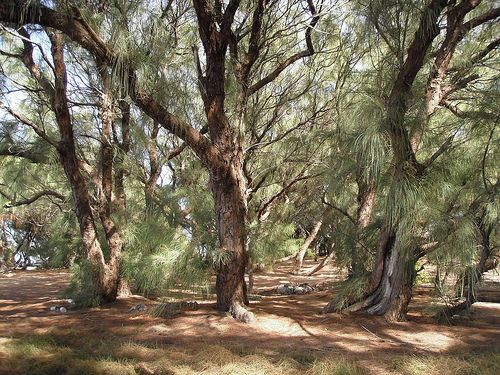

Casuarina trees growing along the North Coast of Kwa-Zulu Natal.

**QUESTIONS :**

**Problem:**
Find out what it means if a plant is indigenous to South Africa. Some examples of indigenous plants in South Africa are aloes, acacia thorn trees, strelitzia flowers, rooibos and the the king protea. Write a description below.

**Solution:**
An indigenous plant is one which occurs naturally in a particular geographical such as South Africa.

**Problem:**
What is an alien species? Why do we call it invasive? An example is the jacaranda trees with the purple flowers which are very common in Pretoria.

**Solution:**
An alien species is one which is not indigenous to South Africa, or a particular geographical area. It has been brought in by humans from another part of the world. They are said to be invasive as they invade (take over) the areas in which indigenous plants grow.

**Problem:**
The species of gymnosperm shown in the photos above are gymnosperms. How do these plants reproduce?

**Solution:**
They are gymnosperms so they reproduce by making seeds in cones.

**Problem:**
In many parts of South Africa, plantations of pine trees are regulated so that they do not impact on the biodiversity of the indigenous plants. But, there are some forests of pine trees which are not used for timber anymore. The Tokai Forest in Cape Town is one of these. Many mountain bikers and runners enjoy doing their activities in this forest. The city of Cape Town started to clear these trees in 2011 so that they could get natural, indigenous fynbos to grow again. There was an outcry from some people as they said their shady riding spot had been ruined. What are your thoughts on this? Do you think Cape Town should be cutting down these trees or not? Give reasons for your answer.

**Solution:**
Learner-dependent answer. Learners may either disagree or agree. There are many viewpoints on this at the moment. Perhaps they feel that this is one area which mountain bikers should be allowed to enjoy as a forest as the rest of Table Mountain is covered in fynbos. Alternatively, they may agree that we need to re-establish the local flora and fauna, and although it may take time for a forest and shade to regrow, it will be better in the long run from an ecological point of view.

<Callout type="note" title="Note">
Pretoria's Jacaranda trees are an 'alien' problem. (video)
</Callout>

Let's now take a look at the other group of seed-producing plants, angiosperms.

#### Angiosperms

Angiosperms are flowering plants. They produce flowers which develop into seeds that can grow into new flowering plants. We will learn more about reproduction in angiosperms in the next chapter. Most of the plants that you probably see around you in the gardens are flowering plants.

An idea to introduce this topic is to get sheets of paper and get learners to brainstorm the names of as many flowering plants as possible that they know. As many learners are not that familiar with the names of plants and animals in their area, we encourage teachers to use this to add names of plants as learners get to know them in this section. Encourage learners to review the chart they make and to add to it as they go along. Try and identify as many local examples as possible with your class. This is aimed at showing the diversity of flowering plants in South Africa. You can even cut some flowers to bring in to class.

We can group flowering plants into two major groups:

- **monocotyledons**
- **dicotyledons**

All the angiosperm plants that we are studying have the following characteristics in common:

- roots
- stems
- leaves
- flowers
- fruits
- seeds

A huge thorn tree does not look anything like a maize plant, yet they are both flowering plants. They both have roots, **stems**, leaves and their flowers produce seeds. So why can we group the one as a dicotyledon and the other as a monocotyledon? Let's find out!

If possible, bring some examples of monocots and dicots into class for this activity so that learners can study actual examples of the plants. Be sure to include some wind pollinated plants that do not have obvious flowers, as many learners don't realize that grasses form flowers.

# Discovering the differences between monocotyledons and dicotyledons

**INSTRUCTIONS:**

2. Study the photos of South African monocotyledons and then dicotyledons.
4. Answer the questions which follow about each group.

**Monocotyledons:**

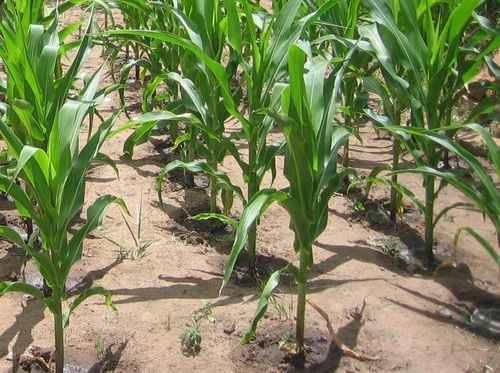

Maize.

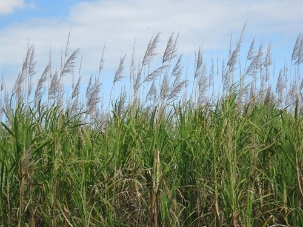

Sugar cane.

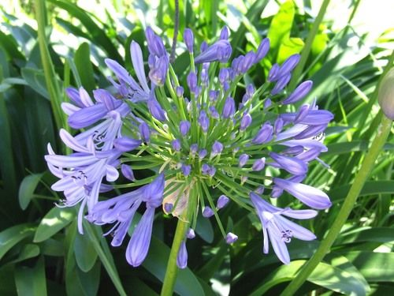

Agapanthas.[http://commons.wikimedia.org/wiki/File:Purple_Agapantha.JPG](http://commons.wikimedia.org/wiki/File:Purple_Agapantha.JPG)

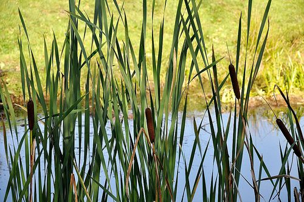

Bull rushes.[http://www.flickr.com/photos/mdpettitt/2949678953/](http://www.flickr.com/photos/mdpettitt/2949678953/)

**QUESTIONS:**

**Problem:**
Describe the leaves of the monocotyledons in the photos. How would you describe the veins in the leaves? Make a drawing to accompany your description.

**Solution:**
Learner-dependent answer. The leaves are generally long and narrow. The veins run parallel down the length of the leaves.

**Problem:**
Describe the stems. Are they woody stems or green (**herbaceous**) stems?

**Solution:**
The stems are all green, with no wood. They are herbaceous.

**Problem:**
Look at the following photos of typical monocotyledonous flowers. Count how many petals are on each flower. What can you generalize about the number of petals (and other flower parts) in monocotyledonous flowers?

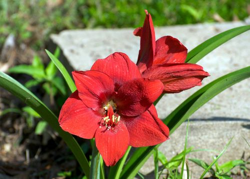

An amaryllis flower.[http://www.flickr.com/photos/nanoprobe67/4631031206/sizes/l/](http://www.flickr.com/photos/nanoprobe67/4631031206/sizes/l/)

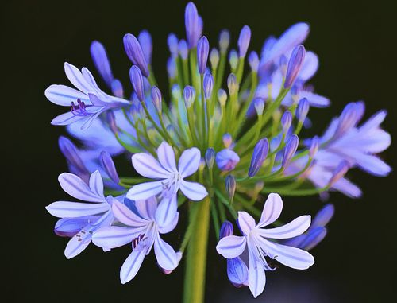

Agapanthus flowers.[http://www.flickr.com/photos/34094515@N00/5436138354/](http://www.flickr.com/photos/34094515@N00/5436138354/)

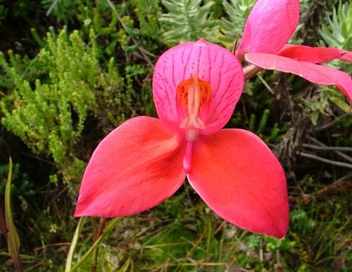

A disa.

**Solution:**
The amaryllis flower has six petals, the agapanthus flowers also have six petals, the disa has three petals. We can say that in general, monocotyledonous flowers have parts in multiples of three.

**Problem:**
Many of the crops that we grow are monocotyledons, such as maize and sugar cane. Name two others.

**Solution:**
Some examples include: wheat, rice, oats, barley, sorghum.

**Dicotyledons: **

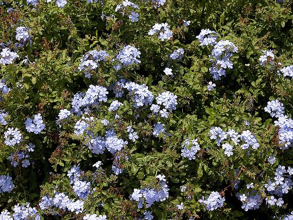

Plumbago bush. [http://www.flickr.com/photos/carllewis/1463713493/](http://www.flickr.com/photos/carllewis/1463713493/)

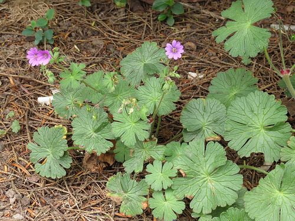

A geranium. [http://www.flickr.com/photos/dhobern/8871371203/](http://www.flickr.com/photos/dhobern/8871371203/)

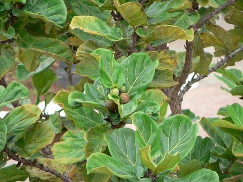

Fig tree.

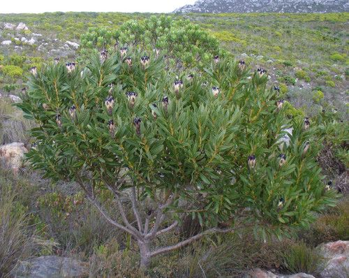

Protea bush. [http://commons.wikimedia.org/wiki/File:Protea_lepidocarpodendron.jpg](http://commons.wikimedia.org/wiki/File:Protea_lepidocarpodendron.jpg)

**QUESTIONS:**

**Problem:**
Describe the leaves of the dicotyledons in the photos. How would you describe the veins in the leaves. Make a drawing to accompany your description.

**Solution:**
The leaves are varied in shape and size. They are generally broad and the veins form a branching network across the leaves.

**Problem:**
Describe the stems. Are they woody stems or green (herbaceous) stems?

**Solution:**
The stems are varied, some are green and some are woody, for example in the tree species.

**Problem:**
Look at the following photos of typical dicotyledonous flowers. Count how many petals are on each flower. What can you generalize about the number of petals (and other flower parts) in dicotyledonous flowers?

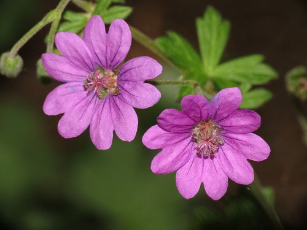

Geranium flowers.

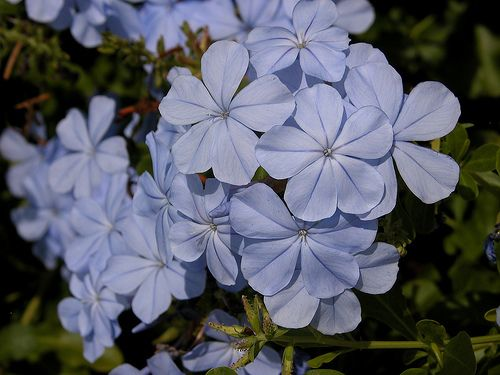

Plumbago flowers. [http://www.flickr.com/photos/carllewis/1464581424/](http://www.flickr.com/photos/carllewis/1464581424/)

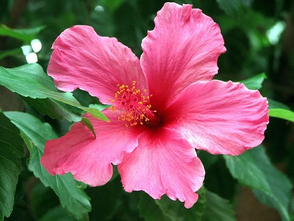

Hibiscus flower. [http://www.flickr.com/photos/7326810@N08/1454852761/](http://www.flickr.com/photos/7326810@N08/1454852761/)

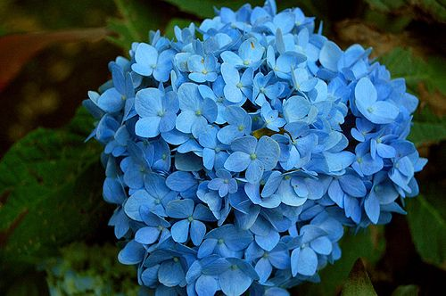

Hydrangea flowers. [http://www.flickr.com/photos/54439360@N04/5542609749/](http://www.flickr.com/photos/54439360@N04/5542609749/)

**Solution:**
The geranium flowers have ten petals, the plumbago flowers have five petals, the hibiscus flower has five petals, the hydrangea flowers have four petals. We can say the dicotyledons have flowers with parts in multiples of four or five.

**Problem:**
Look at the following image which shows the difference between monocotyledonous seeds and dicotyledonous seeds. Monocotyledons have one **cotyledon** and dicotyledons have two cotyledons.

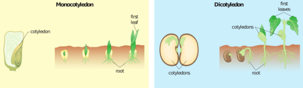

**Solution:**
Learners may be under the impression that the entire mielie pip is the cotyledon.You may want to explain that the little "yellow bit" that can be squeezed out of a maize pip is the cotyledon of the embryonic plant. The rest is just stored food.

**Problem:**
Using the information you have discovered in this activity, complete the following table to summarize the differences between monocotyledons and dicotyledons.

|  | Monocotyledons | Dicotyledons |
| --- | --- | --- |
| Cotyledons |  |  |
| Stems |  |  |
| Flowers |  |  |

**Solution:**
|  | Monocotyledons | Dicotyledons |
| --- | --- | --- |
| Cotyledons | One | Two |
| Stems | The stems are herbaceous, meaning they do not have much wood, are often green and soft. | The stems can be herbaceous or woody. |
| Flowers | Generally, the flower parts are in multiples of three. | Generally, the flower parts are in multiples of four or five. |

<Callout type="note" title="Note">
Hydrangea flowers can tell us about the soil acidity! An acidic soil (pH below 7) will normally produce blue flowers, whereas an alkaline soil (pH above 7) will produce more pink flowers.
</Callout>

<Callout type="note" title="Note">
The biodiversity of South Africa's fynbos. (video)
</Callout>

<Callout type="note" title="Note">
Find out which of South Africa's plants are most threatened and closest to extinction[http://redlist.sanbi.org/](http://redlist.sanbi.org/)
</Callout>
