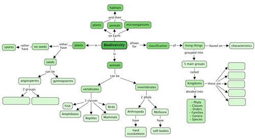
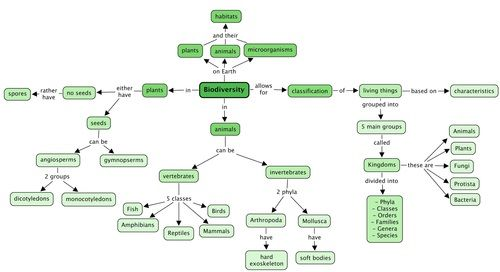

## Summary

<Callout type="note" title="Note">
- All the plants, animals and microorganisms and their habitats make up the total biodiversity of planet Earth.
- Living organisms are sorted and classified according to their shared characteristics.
- Many scientists have developed different systems to group and classify the living organisms on earth.
- We use a classification system that groups living organisms into five main groups or kingdoms: Bacteria, Protists, Fungi, Plants and Animals
- All living organisms have to perform the seven life processes and the way in which they perform these help us to classify them into different groups, putting plants into one group and animals into another for instance.
- We can divide a kingdom into smaller and smaller groups, in this order: phyla, classes, orders, families, genera and species.
- In the kingdom of animals, we can get two main groups of animals - this with a backbone called vertebrates, and those without a backbone called invertebrates.
- The vertebrates are divided into five groups: Mammals, Birds, Reptiles, Fish and Amphibians.
- The invertebrates make up the largest group of animals and there are many thousands of species. We also divide the invertebrates into different groups or phyla like the arthropods, molluscs, sponges and jellyfish, and many others.
- Arthropods all have a hard exoskeleton and jointed legs, such as insects, arachnids (spiders) and crustaceans (crabs).
- Molluscs have a soft body with or without a shell, such as snails and octopuses.
- In the kingdom of plants we also get two main groups: plants that produce seeds and plants that do not produce seeds but spores.
- Seedless plants produce spores - like ferns and some mosses.
- Seed producing plants can be further divided into angiosperms (seeds in fruit) and gymnosperms (seeds in cones).
- Angiosperms can be further divided into monocotyledons and dicotyledons.
- Monocotyledons have seeds that only have one part or cotyledon. Their stems are herbaceous. The leaves are simple, long and narrow and their flower parts are arranged in multiples of three.
- Dicotyledons have seeds with two parts or cotyledons from which their **tap root** grows deep into the soil. Their stems can be woody or herbaceous. The leaves are varied in shape and size and have a network of **leaf veins**. Flower parts are usually arranged in multiples of four or five.
</Callout>

**Concept map**

This concept map shows how the concepts in this chapter on Biodiversity link together. Complete the concept map by filling in the five Kingdoms that living things are classified into, and also giving the two major groups of angiosperm plants.

Can you see how the arrows show the direction in which you must "read" the concept map?

Teacher's version: Remember that concept maps are different to mind maps in that concept maps have a hierarchical structure and show how concepts link together using arrows and linking words. Whereas mindmaps generally contain a central topic and individual branches coming out which do not necessarily link together. Mindmaps can also be a useful way of summarizing information and studying, however, we are using concept maps as they help to show linkages, which is very important in science. Help your learners to "read" the concept map by showing them that the arrows show the direction in which concepts progress and are linked to each other.

