## Reproduction in angiosperms

As an introduction to this section, remind learners of the diversity and classification of plants which was discussed in Chapter 2 and how angiosperms fit into the classification. CAPS suggests that learners grow a bean plant during this topic in order to observe the stages in the life cycle of angiosperm plants. It is recommended that learners plant their seeds during the first lesson.

<Callout type="note" title="Note">
- angiosperm
- asexual reproduction
- cell
- fertilisation
- fuse
- genetic information (DNA)
- mate
- pollen
- pollination
- pollinator(s)
- sexual reproduction
</Callout>

How do plants make new plants? In this chapter we will learn about how **angiosperm** plants reproduce. Sexual reproduction in angiosperms results in the formation of seeds. Under the right conditions, these seeds will germinate and grow into a new plant.

# Growing a bean plant

**MATERIALS:**

- bean seed
- paper towel, toilet paper or tissue
- glass jar (or transparent plastic tub/ jar)
- water
- measuring tape or ruler

**INSTRUCTIONS:**

2. Place some kitchen roll, toilet paper or tissue in your transparent jar.
4. Insert the bean into the paper and place it against the side of the jar so that you can observe the changes that occur.
6. Add a little bit of water so that the paper towel is damp.
8. Place in an area which gets sunlight.
10. Add a little sprinkling of water every day to keep the paper towel damp.
12. Each day, starting on the day that you plant your seed, measure the length of the bean or height of the bean plant and record it in the following table.
   | Day | Height of plant (cm) | Comment/ notes |
   | --- | --- | --- |
   | 1 |  |  |
   | 2 |  |  |
   | 3 |  |  |
   | 4 |  |  |
   | 5 |  |  |
   | 6 |  |  |
   | 7 |  |  |
   | 8 |  |  |
   | 9 |  |  |
   | 10 |  |  |
   | 11 |  |  |
   | 12 |  |  |
   | 13 |  |  |
   | 14 |  |  |
14. Take notes of your observations from day to day. For example, on what day did your bean start to grow roots? On what day did the stem sprout? When did you see the first leaf (or leaves)? How many were there and what did they look like?

**QUESTIONS:**

**Problem:**
What is the term for when a seed starts to grow?

**Solution:**
Germination

**Problem:**
What are the requirements for a seed to grow?

**Solution:**
Moisture (water), warmth and light

**Problem:**
Use your table of measurement to draw a graph of plant growth (height) over the 14 days of your investigation.

**Solution:**
Learner-dependent answer

<Callout type="note" title="Note">
Watch a bean plant germinate and grow.
</Callout>

Now let's learn how plants make seeds. In sexual reproduction, half of the male's and half of the female's genetic material (DNA) fuses (combines) to create a new individual with the combined genetic materials of the parent plants or animals. In most animals we can usually easily identify two sexes of animals: a male or a female animal, which each have male and female parts. In angiosperm*s,* the flowers are the sexual organs of the plant. The flowers produce male and female structures that can either be on the same plant or can be on two separate plants. Let us have a closer look at the structures of flowers.

### Flower structures

<Callout type="note" title="Note">
- anther
- embryo sac
- filament
- ovary
- ovule
- peduncle
- petal(s)
- pistil (carpel)
- pollen
- receptacle
- sepal(s)
- stamen
- stigma
- style
</Callout>

Flowers are the sexual organs of angiosperms. Many plants have both the male and female reproductive organs in the same flower although some may have male and female structures on different plants all together.

<Callout type="note" title="Note">
Plants can be broadly divided into gymnosperms and angiosperms. Remember that angiosperms produce flowers, and their seeds are within a fruit, whereas gymnosperms produce seeds in cones.
</Callout>

Flowers come in many different shapes, sizes and colours, as in the photographs in the next activity illustrate, but there are components which can usually be identified in all flowers. These are:

- peduncle
- receptacle
- petals
- sepals
- the male structures
- the female structures

Flowers are typically set on a stem which may be long and rigid like a rose or agapanthas stem, or short and flexible like those on a petunia. The stalk or stem of a flower is called the **peduncle**.

<Callout type="note" title="Note">
Sunflowers are in fact composite flowers, made up of hundreds of individual flowers working together. The 'petals' are in fact individual flowers called ray florets and the centre is made of many disc florets. Each of these has a pistil and stamens.
</Callout>

The **receptacle** is the top part of the flower stalk where the different flower parts attach.

While the flower bud is forming, small green leaves protect and enclose the young bud. These are the **sepals**. The sepals are often green and look like small leaves, and since they are green they can also photosynthesise. Sometimes the sepals may be the same colour as the petals, like in lilies or tulips.

Flower **petals** are usually the brightly coloured parts of the flower. They attract **pollinators**, such as insects and birds and also bats and mice. We will look more at **pollination** a bit later. In some plants the petals are very small and may even be absent. This is often because these flowers depend on the wind to carry the **pollen** away and therefore do not need petals to attract animals, such as grasses.

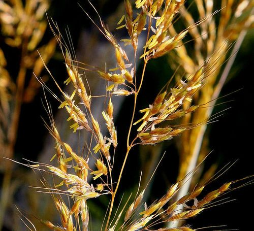

Grass flowers.

# Identify the outer structures of flowers

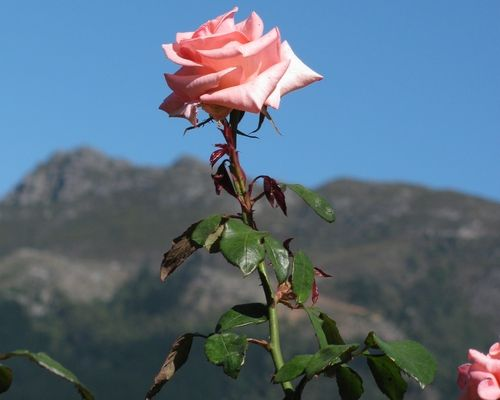

Rose.

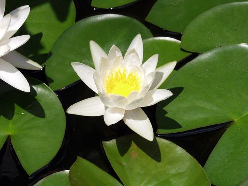

Water lilies.

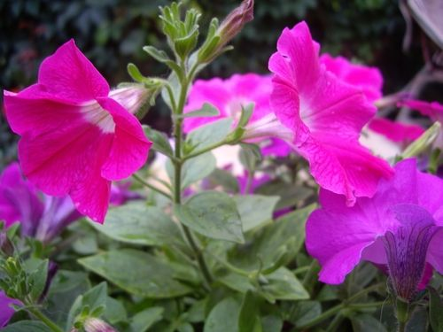

Petunias.

**QUESTIONS:**

**Problem:**
What do we call the part of the stalk where the flower petals and sepals attach to the flower stalk?

**Solution:**
Receptacle.

**Problem:**
Explain why the petals on some flowers are brightly coloured while on other plants we can hardly see the petals, and sometimes they are absent altogether.

**Solution:**
The brightly coloured petals attract pollinators. Plants pollinated by wind do not need to attract insects or animals to pollinate them and thus do not need brightly coloured petals. By not producing petals they can invest in producing more pollen instead.

**Problem:**
Study the photos of the different flowers above. Describe the outer structures of each of these flowers based on their peduncles (stalks) and receptacles, and their sepals and petals.

| Rose |  |
| --- | --- |
| Lily |  |
| Petunias |  |

**Solution:**
| Rose | Long straight peduncles (stalks) to hold the flowers high up to the sun; green sepals to protect the buds; flower petals are bright to attract pollinators |
| --- | --- |
| Lily | Long straight peduncle, which is underwater and less rigid than the sunflower so it can sway in the water; there is an inner layer of white petals, and the outer layer are actually white sepals, and not petals. |
| Petunias | Short peduncles that branch from a shrub; small green sepals, large pink petals to attract pollinators. |

The structures of the flower that we have discussed here are on the outside. The reproductive structures of the flower are in the middle of the flower. Flowers can contain either male structures or female structures, or both.

#### Male reproductive structures

Cells have not yet been taught in Natural Sciences, but a general understanding is useful for this section to know what is meant when males and female sex cells are referred to. A note has been included in the margin about cells, and it will be beneficial to your class to introduce what cells are, even though they only formally study cells in Gr. 9 Life and Living.

<Callout type="note" title="Note">
**What are cells?** Cells are the smallest building blocks of organisms. There are many different kinds of cells, for example, cheek cells, muscle cells and nerve cells in some animals; or leaf cells, root cells or petal cells in plants.
</Callout>

In this section, we will be talking about sex cells. These are either male or female sex cells and only carry half the genetic material (DNA) of a typical cell. When these sex cells fuse the two halves from the male and the female organism make a new organism with the combined genetic material (DNA) from both.

The **stamen** is the male part of the flower. There are two parts to the stamen: the **anthers** and the **filaments** on which the anthers rest.

Anthers produce the pollen that contain the male reproductive sex cells. The male cells in the pollen is carried to the female sex cells and when they fuse they will create a seed which can grow into a new plant.

Filaments are stalk-like structures that support the anthers. In some flowers the filaments may be long and in others relatively short.

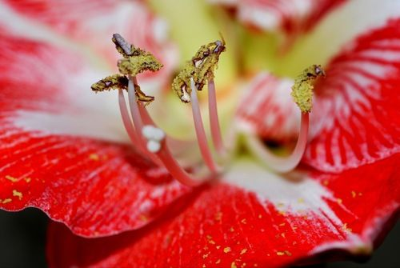

The male structures are clearly seen in this close up photo of a flower with the anthers covered in pollen and supported by the stalk-like filaments. [http://commons.wikimedia.org/wiki/File:GIPE25_-_Etamines_d-une_fleur_d-Amaryllis_%28by%29.jpg](http://commons.wikimedia.org/wiki/File:GIPE25_-_Etamines_d-une_fleur_d-Amaryllis_%28by%29.jpg)

#### Female reproductive structures

The **pistil** is the female organ of the plant and is usually at the centre of the flower. It consists of a stigma, style and ovary. All the parts of the pistil work specifically to help the plant receive pollen, transport it and have it fertilise the **ovules** (that contain female sex cells). Ovules become seeds after **fertilisation**.

<Callout type="note" title="Note">
Each carpel consists of a stigma, style and ovary. Some flowers have one carpel, and some have many. Therefore in some flowers, the carpel and the pistil are the same thing, but in others, many carpels make up one pistil!
</Callout>

The **stigma** is the structure that receives the pollen during pollination. It is on top of a long narrow style and when it is ready to receive pollen it becomes sticky providing a place for the pollen to stick to.

The **style** is a long tube that connects the stigma with the ovary and the ovules. The style supports the stigma and holds it in the best possible position to receive the most pollen grains. After the pollen has landed on the stigma, the pollen grows long tubes called pollen tubes down through the style from the stigma to the ovules in the ovary.

The **ovary** is the enlarged structure at the base of the pistil. It may be divided into different parts (or locules) and produces the ovules that contain the female reproductive sex cells. Within the ovule is the **embryo sac***.* The embryo or tiny seed will develop in here.

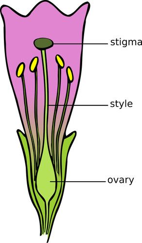

The female flowers parts making up the pistil.

# Flower dissection

**MATERIALS:**

- dissecting needle
- dissecting knife
- petunia or hibiscus flowers

Petunia or hibiscus flowers work best for a dissection, however, you can use any flowers from the gardens or surrounding area that you are able to find. You can watch the video of the flower dissection using a hibiscus flower in the visit link provided prior to your lesson so that you know how to do the dissection and guide learners.

**INSTRUCTIONS:**

2. Study the following diagram of a flower. Use your understanding of the **outer structures** of a flower to add the following labels: petal, sepal, receptacle and peduncle. Once we have done the dissection, we will come back to label the inner structures.

Learners must make sure to label in the correct way, using a ruler to draw straight, parallel label lines pointing and touching the structure to be named. Take note that the receptacle label should point to the green bulge in between the sepals and the peduncle label must point to the short stalk at the bottom.

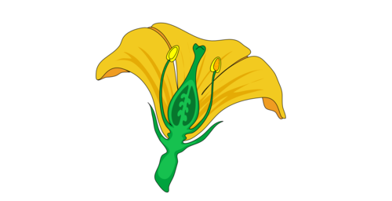

A labelled diagram should look as follows:

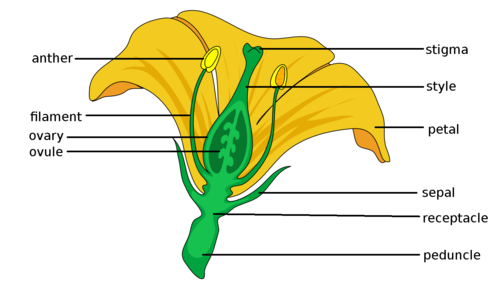

2. Go out into your garden or explore the school grounds and surroundings and select a flower of your own to dissect. If your teacher has petunias or hibiscus flowers, dissect one of those.
   2. First remove the outer sepals.
   4. Then remove the petals. You have now exposed the ovary.
   6. Identify the male and female structures. Label these on the diagram above.
   8. Using your dissecting knife or scalpel, cut the ovary in half.
   10. Use the dissecting needle to carefully open up the ovary. See if you can identify the ovules.
   12. Label the ovary and ovule on the above diagram.

<Callout type="note" title="Note">
Watch a flower dissection.
</Callout>

Now that we have learnt about the structures of flowers, let us take a look at how flowers are pollinated.

### Pollination

Take note that learners may confuse the processes of pollination and seed dispersal. Pollination is the process whereby the male pollen is transferred to the female stigma in order for fertilisation to take place. Seed dispersal occurs *after* fertilisation, and involves dispersal of the new seed (offspring) to a location where it will not compete with the parent plant.

In order for a flowering plant to reproduce sexually, the male sex cells need to fuse (join) with the egg inside the ovules. The stamen produces pollen that contain the male sex cells. The pollen grains are usually very small - about the size of a speck of dust.

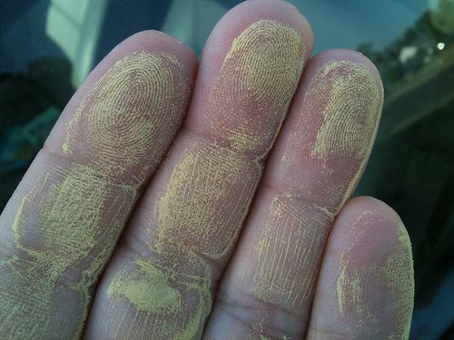

This person's hand is covered in millions of tiny grains of pollen. [http://www.flickr.com/photos/alastairvance/4498154629/](http://www.flickr.com/photos/alastairvance/4498154629/)

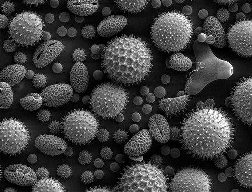

A photograph of a variety of pollen grains from different plants taken under a very strong microscope. [http://upload.wikimedia.org/wikipedia/commons/a/a4/Misc_pollen.jpg](http://upload.wikimedia.org/wikipedia/commons/a/a4/Misc_pollen.jpg)

The image of pollen here is taken using a scanning electron microscope. You can mention this to learners, but they will only formally learn about different microscopes in Gr. 9 Life and Living.

<Callout type="note" title="Note">
Watch some fascinating videos about pollination or
</Callout>

Pollen from the stamen needs to be transferred to the stigma of the flower, either on the same plant or another plant of the same species. This process is called **pollination**. If pollination does not occur, there will be no fertilisation and the plant will not be able to produce seeds or fruit.

Generally plants produce a large amount of pollen to maximise the chances of the pollen being transferred to as many different stigmas on as many different flowers (of the same species) as possible.

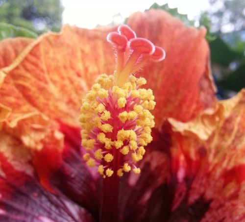

Can you identify the stamens covered in pollen and the stigma in this hibiscus flower?

There are numerous stamens covered in yellow pollen and the four 'stalks' with rounded heads sticking out the top are the stigma.

Pollination involves the pollen moving from the stamens to the stigma of the same or another flower. There are different ways that pollination of flowers can take place. For example, flowers can be pollinated with the help of the wind, water or animals. Angiosperm flowers have special adaptations which help a specific type of pollination. Let us look at some of these methods for pollination and how flowers are adapted to promote pollination.

<Callout type="note" title="Note">
An adaptation refers to the way a behaviour or particular structure of the plant has changed (evolved) over time to best perform its function.
</Callout>

#### Pollination by animals

Animals that pollinate flowers are called pollinators. These animals come to flowers to feed on the nectar produced by the flowers. As they are feeding, pollen sticks to their bodies. When they move on to the next flower to feed, some of the pollen rubs off onto the new flower parts. We call this process pollination.

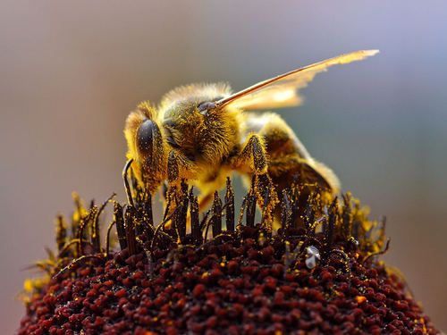

Can you see this bee has been covered in pollen as it is feeding on the nectar? [http://commons.wikimedia.org/wiki/File:Bees_Collecting_Pollen_2004-08-14.jpg](http://commons.wikimedia.org/wiki/File:Bees_Collecting_Pollen_2004-08-14.jpg)

Since pollinators feed on specific plants, they usually travel from flower to flower of the same species, therefore pollinating them effectively.

# Identifying pollinators

**INSTRUCTIONS:**

**Problem:**
There are many different types of pollinators, some of which are shown below. Identify the pollinator in each photo in the table and write the name on the line below. Answer the questions that follow.

| http://www.flickr.com/photos/fsnorthernregion/6330342852/ | http://www.flickr.com/photos/dkeats/5845889189/ |
| --- | --- |
| http://www.flickr.com/photos/dejeuxx/6924771739/ | http://www.flickr.com/photos/col_and_tasha/4716336027/ |
| http://www.flickr.com/photos/usdagov/7420019398/ | http://www.flickr.com/photos/shekgraham/127431519/ |

**Solution:**
| http://www.flickr.com/photos/fsnorthernregion/6330342852/ | http://www.flickr.com/photos/dkeats/5845889189/ |
| --- | --- |
| Moth | Sunbird |
| http://www.flickr.com/photos/dejeuxx/6924771739/ | http://www.flickr.com/photos/col_and_tasha/4716336027/ |
| Honey bee | Beetles |
| http://www.flickr.com/photos/usdagov/7420019398/ | http://www.flickr.com/photos/shekgraham/127431519/ |
| Butterfly | Bat feeds on nectar. |

**QUESTIONS:**

**Problem:**
What do you notice about most of these pollinators? (Which type of animal is most common?)

**Solution:**
They are mostly insects.

**Problem:**
What do you think these pollinators are getting from the flowers that they visit?

**Solution:**
These pollinators are mostly feeding on the nectar, and also on the pollen in some cases.

**Problem:**
What do you think attracts insects to flowers? In other words, how do you think flowers are adapted to attract pollinators to them? See if you can think of three adaptations and list them below.

**Solution:**
Flowers have large colourful petals to attract pollinators.

Flowers have sweet nectar for pollinators to feed on as a reward.

Flowers have a sweet scent to attract pollinators.

**Note: **A common misconception among learners is that they think flowers make pollen for the insects. Insects, such as bees, do collect the pollen and use it for the manufacture of the wax in their hives, but this is not why flowers make pollen. Also, flowers do not make nectar for the bees, rather you must stress that the nectar is made as a reward system for the pollinator.

**Problem:**
Flowers are also adapted so that when the pollinators visit them, they make sure the pollen rubs off onto the pollinator to be transferred to another flower. Look at the following image of a bird visiting a flower to drink nectar. How do you think this flower is adapted to make sure that it is pollinated by the bird?

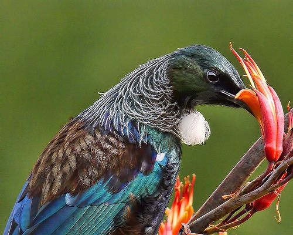

A bird drinking nectar from a flower. [http://www.flickr.com/photos/sidm/6570554993/](http://www.flickr.com/photos/sidm/6570554993/)

**Solution:**
The flower is long and thin so that the bird has to stick its beak down the flower and then it will rub its head against the stamens containing the pollen. The stamens and stigma are long and sticking out the top of the flower so that they brush against the head of the bird when it is drinking nectar and the pollen then either sticks onto the bird's head or some from another flower is rubbed off onto this flower. The flower stem needs to be strong to support the bird.

**Problem:**
The following flower is called a Voodoo Lily. Unlike the flowers we have looked at so far which give off a sweet scent to attract pollinators, this flower gives off a really bad smell, like rotting meat or cow dung. The colour of the petals are also dark, like meat. This shows that different flowers have adapted to different pollinators. What types of pollinators do you think will pollinate this flower? Hint: Think of which insects you normally find when there is rotting food around.

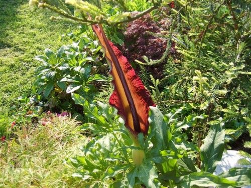

A Voodoo Lily.

**Solution:**
Flies are attracted to rotting meat and so the most likely pollinators of this flower are flies.

**Problem:**
**Work in pairs for the next 4 questions.** Take a walk around your school and identify plants that you think are pollinated by pollinators. Make a drawing of at least 3 of these.

**Solution:**
Learner-dependent answer.

**Problem:**
Identify the common names of these plants and try to find the correct scientific name.

**Solution:**
Learner-dependent answer. **Note: **If possible, invite the school's maintenance personnel to help learners identify the names of these plants. Let them do an Internet search to find the scientific names or have gardening books available in class for them to search in.

**Problem:**
Explain how each of these plants' flowers have been adapted to be pollinated by pollinators.

**Solution:**
Learner-dependent answer. Learners might refer to the brightly coloured petals, strong scent, the specific length of the stigma, stamen, nectar pouch, etc.

**Problem:**
How could you easily distinguish which plants used pollinators to pollinate them?

**Solution:**
Learner-dependent answer. Answers should include an explanation that these plants have brightly coloured flowers to attract certain insects for example, a strong odour or perhaps a long nectar producing pouch.

<Callout type="note" title="Note">
Some animals can only see certain colour ranges. Although butterflies, birds (and humans) can see red, bees cannot see red colours but they can see ultraviolet (UV) rays. Some flowers especially adapt their petal colours for this to attract different insects.
</Callout>

<Callout type="note" title="Note">
There is a direct relationship between the length of the tongue or beak of the main pollinator and the length of the nectar pouch in the flower! This is a very good example of natural selection at play. You will learn more about that in the last chapter of this term's work.
</Callout>

#### Pollination by wind and water

Many flowers are pollinated by animals, as we discussed in the last section, but wind and water can also help pollination. Do you think plants that are pollinated by the wind or water need colourful, sweet-smelling flowers with nectar? Why do you think this?

Before going through the next section with your learners, get them to first think about what the flowers of wind and water pollinated plants will look like and if they need the same or different adaptations to flowers that attract pollinators. For example, wind and water pollinated flowers do not need to attract animals so they do not need large, colourful flowers that emit scents. Wind pollinated plants will need large amounts of very light pollen that is easily wind-borne.

There are some challenges that plants face if they rely on the wind or water for pollination. These plants have adapted to overcome these challenges so that they can be pollinated by the wind or water.

# Studying the flowers of wind and water pollinated plants

Some images are supplied here, but if possible, collect some grass flowers beforehand and bring these to class. Alternatively, you could take a quick walk around the school to see if there are any grasses or reeds growing nearby with flowers that learners can observe. Learners can also do this in pairs and discuss their answers with each other before writing them down.

Afterwards, go through the questions with the class. This activity relies on and teachers learners making observations with real plants and flowers. Learners must use what they have already learnt about the adaptations in plants whose flowers are pollinated by animals. This will enable them to make conclusions/deductions about the adaptations in wind-pollinated plants.

**INSTRUCTIONS:**

2. Study the following photos of the flowers of different types of grasses that are pollinated with the help of the wind.
4. Answer the questions which follow.

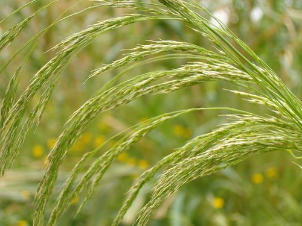

In this grass plant you can see the small yellowish flowers attached to the green stem.

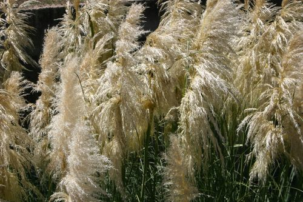

These white, feathery ends are the flowers of this grass.

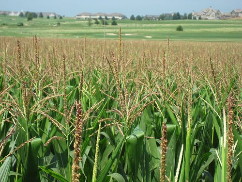

Can you see the small, brown flowers sticking up from the maize plants? These are the male flowers of maize. [http://www.flickr.com/photos/mrsdkrebs/5947866884/](http://www.flickr.com/photos/mrsdkrebs/5947866884/)

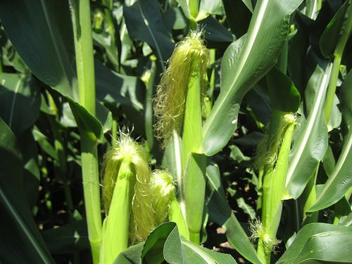

This image shows the silky female flower of the maize plant. [http://www.flickr.com/photos/mrsdkrebs/5947867990/](http://www.flickr.com/photos/mrsdkrebs/5947867990/)

Shown here are the male and female flowers of the maize plant. If you wish to do so, you can discuss cross pollination with your learners, meaning that the pollen from one plant has to travel to the female flowers of another plant.

**QUESTIONS:**

**Problem:**
Write a description of the flowers in the photos. Your description must show that you have observed the colour of the flowers, the size, the shape and how many there are on each plant.

**Solution:**
The flowers are not colourful like the flowers that are pollinated by animals. They are dull in colour (whites, browns and greens). The flowers are quite small, but there are many flowers per plant. The flowers are mostly long and slender and quite flimsy (loose). There are large number of anthers which hang out of the flower so the pollen can easily be swept away by the wind.

**Problem:**
Why do you think these flowers are not colourful like the flowers in the last activity?

**Solution:**
These flowers do not need to attract animals with their colourful petals as they rely on the wind for pollination.

**Problem:**
Do you think the flowers in wind pollinated plants produce nectar? Why do you say so?

**Solution:**
Generally these flowers do not produce nectar as they do not need to attract animals to feed on them in order to pollinate them. They rely on the wind.

**Problem:**
What types of plants are generally pollinated by the wind?

**Solution:**
Mostly grasses and reeds, and also many trees.

**Problem:**
The flowers in these photos generally produce a huge amount of pollen. They produce much more pollen compared to the flowers pollinated by animals. Why do you think this is so? Hint: Think of the chances of a flower being pollinated by an animal which visits it to drink nectar, compared to the chances of being pollinated by pollen that is carried in the wind.

**Solution:**
Learners may battle with this question so you could discuss it as a class.

These flowers produce large amount of pollen as they cannot predict which way the wind will blow, so the more pollen the greater the chances that pollen will land on other flowers when carried in the wind. In flowers that are pollinated by animals, the animals transfer the pollen directly from one flower to the next, so they can produce smaller amounts. In flowers that are wind pollinated, they have to rely on the chance that the wind will blow and that it will blow in the right direction. The more pollen there is the greater the chances of pollination.

**Note:** At this point you can also point out to learners that plants that are wind pollinated often grow in large populations where the huge numbers of plants increase the chances of these plants being pollinated (think of fields of grasses or reeds or forests of trees).

**Problem:**
In animal pollinated flowers, the pollen is often sticky and clumps together. This is so that it sticks to the animal which is visiting the flower for nectar and can then be carried to the next flower. In wind pollinated flowers, the pollen is very different. The pollen is smooth and not sticky. It is also very light and small. Why do you think this is so?

**Solution:**
In wind pollinated flowers, the pollen needs to be carried by the wind as it blows. Therefore, the pollen cannot be sticky, otherwise it will not be blown off the flowers when the wind blows. it also must not clump or stick together otherwise it will not be carried in the wind. The smaller and lighter the pollen grains are, the further the wind can carry it.

**Problem:**
The structures of the male and female parts in wind pollinated and animal pollinated flowers are also different. For example, in wind pollinated plants, the stamens (male structures) often have much longer filaments and the anthers hang down and can move easily. The stigmas (female structures) are also often large and look like feathers, as you can see in the photos in this activity. How do you think these adaptations of the stamen and stigma help the flowers to be pollinated by the wind?

**Solution:**
The long filaments of the stamens enables the anthers to be exposed to the wind so that the can blow and move in the wind and easily release the pollen. The stamens are large and feather-like so that they can 'catch' the pollen in the air as it blows through. They are still light so that they can blow and wave around in the wind.

**Problem:**
Fill in the following table to compare the structures of wind pollinated plants and pollinator (animal) pollinated plants.

| Structure | Wind pollinated plants | Pollinator pollinated plants |
| --- | --- | --- |
| Petals |  |  |
| Scent |  |  |
| Nectar |  |  |
| Amount of pollen |  |  |
| Structure of pollen |  |  |
| Anthers |  |  |
| Stigma |  |  |

**Solution:**
| Structure | Wind pollinated plants | Pollinator pollinated plants |
| --- | --- | --- |
| Petals | Very small or absent petals that may be brown or dull green - do not need to attract insects. | Large, brightly coloured petals to attract insects |
| Scent | No scent - do not need to attract insects. | Often specific scent to attract specific pollinator. |
| Nectar | No nectar - do not need to attract insects. | Many produce nectar to attract insects. |
| Amount of pollen | Very large quantities of pollen produced as there is a lot of wastage. | Smaller amounts of pollen produced because there is less wastage than in wind pollinated plants. |
| Structure of pollen | Pollen light and smooth to travel on the wind and not clump together. | Pollen often sticky or spiky to attach to pollinators. |
| Anthers | Anthers loosely attached and dangle down (mostly) to release pollen easily into the wind. | Anthers firmly placed inside flowers to brush against pollinators. |
| Stigma | Stigma is large and feather-like to filter the air and catch the drifting pollen. | Stigma is inside the flower where the pollinator will brush up against it and has a sticky coating that the pollen sticks to. |

Plants that are pollinated with the help of water usually live in water. We say they are aquatic. When pollen is released it floats on the surface of the water. The stigmas of the receiving plant are generally close to the water surface. This is so that they can be pollinated when the pollen in the water washes up against them.

#### Pollinators and us

Pollinators play an extremely important role in the life cycle of flowering plants. These flowering plants include the crops that farmers grow for us to eat, such as maize and sunflowers. Since angiosperms produce a very large amount of the world's food crops, without pollinators, we would be without most of the food crops produced for us to eat.

<Callout type="note" title="Note">
Watch this video about the mysterious disappearance of bees
</Callout>

# Article from "The Earth Times"

**INSTRUCTIONS:**

2. Imagine it is the future - it is the year 2056!
4. Read the following article from a newspaper called "The Earth Times".
6. Answer the questions that follow.

| Loss of pollinators lead to crop destruction - third year of famine 23 May 2056 The loss of pollinators in Southern Africa, specifically wild bees and butterflies, has lead to further crop failures three years in a row. Very few viable seeds remain to plant the next crop. The next crops planted might be the last ones unless another means of pollination can be found. The entire region has been severely affected by the sudden death of large swarms of bees and butterflies in the past 5 years. Bees and butterflies, that were once so common, are almost extinct. One group of researchers have been working to preserve the last remaining colony of bees. It was found hidden away in the mountains of the Helderberg Nature Reserve. So far they report that the colony is doing well and have added 127 new worker bees this week. It is hoped more colonies will be found in other remote mountain regions. The researchers are still trying to identify the cause of the extinction of these insects. They think that the huge increase in air pollution and acid rain has affected the wings and flight of these insects. They are therefore not able to fly to food sources, such as the nectar of flowers, and then die. The lead researcher, Dr Wimple, has indicated that they have wild bee larvae from other parts of the world which were frozen several years ago to preserve them. The team is now close to reintroducing these bee larvae into the remaining colony. They hope this will increase the diversity of the population. Dr Wimple's team is working closely with other similar teams around the world to find a possible solution. The team is also looking at ways to modify the crop plants to increase how efficient they are at being pollinated by the wind, for example maize crop plants. They hope that this will increase the production of maize. They need to do this by changing the DNA of the existing crop plants. This is called genetic modification. "It's a long shot but one we hope will bear fruits" commented Dr Wimple. Bees, and other pollinators, are dying due to air pollution. http://www.flickr.com/photos/calxfornia/4664313683/ |
| --- |

**QUESTIONS:**

**Problem:**
Find the following words in the article and underline them. Then look up a definition for each word and write it down. Identify whether the word is a noun, verb, adverb or adjective. Do not copy the definition word for word, but write it in your own words.

2. famine:
4. failure:
6. severely:
8. extinct:
10. preserve:
12. remote:
14. remote:
16. diversity:
18. modify:

**Solution:**
2. (noun) extreme hunger, starvation or lack (scarcity) of food.
4. (noun) when something does not work, and in this case, it specifically refers to crops which have produced a small amount or not produced at all
6. (adverb) very badly, or harshly
8. (adjective) the species has ended or died out, there are no more left
10. (verb) to keep something alive or make it last
12. (adjective) far away, out-of-the-way, away from human habitation
14. (noun) something that has variety and differences
16. (verb) to change

**Problem:**
Write down the title of this article.

**Solution:**
Loss of pollinators lead to crop destruction - third year of famine

**Problem:**
What is the message that is brought across by the title and article?

**Solution:**
The loss of the wild bees, butterflies and moths has caused major food shortages because they usually help pollinate the food crops; the message might also be a warning to us to value our bee and butterfly populations more, and to reduce air pollution.

**Problem:**
Explain what the link is between the loss of pollinators and crop failures.

**Solution:**
The pollinators are not around to pollinate the flowers of the crop plants. Therefore, the flowers are not fertilised and can then not produce seeds. There are then no seeds to plant the next crops for the next year, and therefore there is less food for humans.

**Problem:**
Which specific pollinators were lost?

**Solution:**
Wild bees, butterflies and moths.

**Problem:**
What reason did the article provide for the loss of these pollinators?

**Solution:**
The air pollution and resulting acid rain damaged the wings of the pollinators, who could not fly to reach nectar and therefore died of starvation.

**Problem:**
Explain at least two ways in which wind pollinated plants' structures are adapted for wind pollination.

**Solution:**
Learners could mention:

- Anthers are carried on long filaments that hang down. This allows the wind to move and carry away the pollen easily.
- Pollen grains are light and dry to prevent them clumping together and are easily carried on the wind.

Female stigma is feathery and branched and acts as a filter trapping the pollen that is blown through it.

**Problem:**
How do you think the researchers could modify the crops' flowers so that they are able to be pollinated more efficiently by wind?

**Solution:**
Learner-dependent answer. Learners should make reference to the above adaptations in plants which are already adapted to be pollinated with the help of the wind.

**Problem:**
Do you think the situation described in this article could happen in the future? Write a paragraph where you explain your reason why.

**Solution:**
Learners can either agree or disagree that this could happen in the future. Their reasoning is important in this question. For example, they could reason that it might happen as there is already lots of air pollution and it is not decreasing so it could get to a level where it affects pollinators. Or else, they could say that they do not think air pollution will get to the level where it affects the flight of pollinators, or there could be other pollinators that might not be affected, etc.

<Callout type="note" title="Note">
Pollinators and us. (video)
</Callout>

### Fertilisation

<Callout type="note" title="Note">
- disperse
- pollen tube
</Callout>

We have now looked at pollination, but what happens next? What happens after the pollen lands on the stigma of the flower?

Do you remember that the pollen grains contain the male sex cells, and the ovary contains the ovules or female sex cells. The male and female sex cells each contains only half of the genetic material (DNA) from the parent plant. After pollination, the male sex cell in the pollen grain needs to fuse with a female sex cell in the ovary to produce a fertile seed. This is called fertilisation.

In angiosperms, each pollen grain contains two male sex cells. See if you can identify the reason for this as you read through the steps for fertilisation.

The process of fertilisation in plants occurs in clearly defined steps:

2. After the pollen grain lands on the mature stigma of a flower from the same species, the pollen produces a tube.
4. This **pollen tube** starts to grow from the stigma and down the style. This transports the male sex cells to the ovules.
   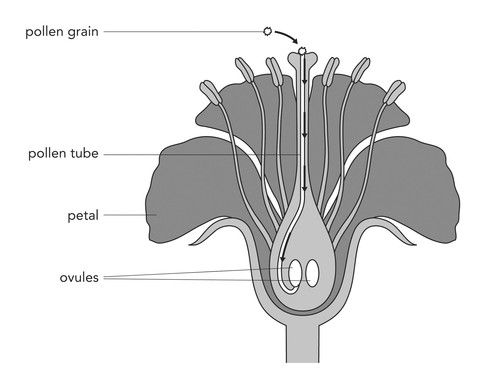
   The pollen tube growing down the style to the ovary.
6. There is a small structure inside the ovule called the **embryo sac**. When the pollen tube bursts into the ovule, one of the male sex cells fertilises the female sex cell in the embryo sac.
8. This fertilised egg develops into a seed.
10. The other male sex cell joins with another cell in the embryo sac to form the **endosperm**. The endosperm is the starchy food that is stored in the seed once it has ripened. Later this food is used to feed the germinating seed until it has formed leaves and can produce its own food through photosynthesis.
12. The ovary then starts to swell and enlarge, and becomes a fruit.

<Callout type="note" title="Note">
A simple animation of fertilisation.
</Callout>

<Callout type="note" title="Note">
An ovary can contain more than one ovule. If each ovule is fertilised, then the fruit will contain more than one seed. For example, think of an apple which has a few seeds inside the fruit.
</Callout>

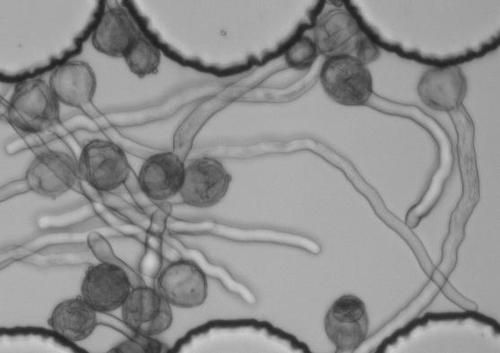

Can you see the pollen tubes growing here from individual pollen grains?

<Callout type="note" title="Note">
There is a difference between fruit and vegetables! **Fruits** are the ripened ovaries of flowering plants that contain seeds, such as tomatoes and oranges. **Vegetables** are produced by other parts of the plant, like the roots, stems, and leaves, such as carrots and cabbage.
</Callout>

After fertilisation, the ovule inside the ovary starts to develop into a seed and the ovary wall becomes the rest of the fruit. There is huge variety in the types of seeds and fruit in the world.

<Callout type="note" title="Note">
The Coco de Mer seed is larger than the size of the human head!
</Callout>

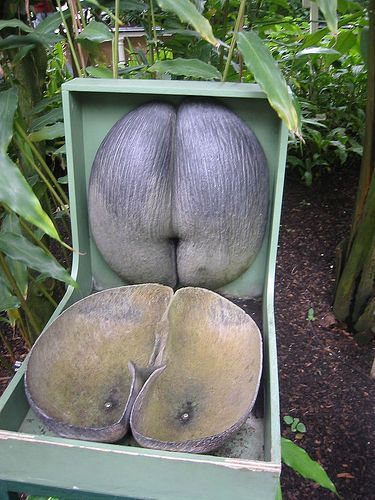

This is one seed from the Coco de Mer plant and it has been cut in half. [http://www.flickr.com/photos/lindah/23347241/](http://www.flickr.com/photos/lindah/23347241/)

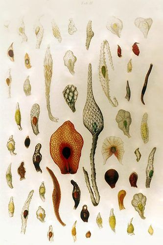

Seeds from different orchid species. They are really small - like dust particles.

Think about all the different fruits that you can buy in the shops - there are many different shapes, sizes and colours!

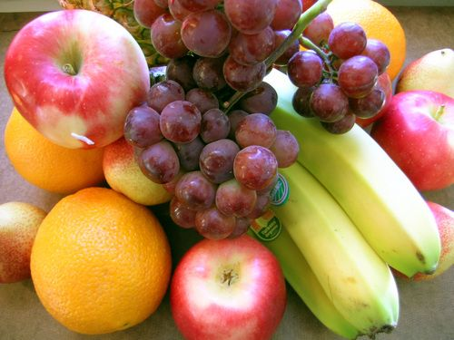

There are many colours, shapes and sizes of fruit!

So why do plants have so many different kinds of seeds and fruit? This is because the seeds need to be spread to other areas to grow into a new plant. The shapes and structures of seeds help with this, and so too does the fruit. We say the fruit and seeds are **dispersed**. Let's look at some ways that seeds can be dispersed.

### Seed dispersal

<Callout type="note" title="Note">
- gravity
</Callout>

<Callout type="note" title="Note">
Interactive website on the life cycle of plants[http://ictmagic.sharedby.co/share/QRDkMq](http://ictmagic.sharedby.co/share/QRDkMq)
</Callout>

Plants use different methods to disperse their seeds as far from the parent plant as possible. Why do you think seeds need to be dispersed? Discuss this with your teacher and your class and take some notes.

Hold a class discussion on why do seeds need to be dispersed. Learners must be encouraged to take notes as they will have a question on this at the end of the chapter. They will need to refer back to this discussion to formulate their answer so it is important that they start to learn to take notes. You can even write down some of the main points on the board.

Some points for the discussion:

- It is important that seeds are moved to different habitats than those directly around the parent plant.
- If the seeds that are produced by the parent plant germinate and start to grow directly under it, in some cases it may replace aging plants, but in most cases it would be in direct competition with the parent plant for light, minerals and water.
- When seeds grow too close to others, they grow long and spindly to reach enough light, making them weak and poor fruit producers.
- Therefore, in order to avoid being in competition with the parent plant and to produce stronger plants, the seeds are dispersed away from the parent plant with the hope that they will land in a 'better' habitat where they will receive enough minerals, light and water.

Different plants have different ways of dispersing the seeds and fruit. Let's have a look at some of these.

<Callout type="note" title="Note">
Watch a video that illustrates the different ways that plants can disperse seeds
</Callout>

**Gravity**: Fruit can fall off a tree and roll as far as possible from the parent tree. When the fruit has fallen it can then be taken further from the parent plant by water, by rolling along the ground or by animals.

**Animals**: Animals may eat the fruit from the plant or the fallen fruit, and carry the seeds in their digestive systems. The seeds have a tough outer covering so that they are not digested by the animal. Some seeds also have spiky structures that can stick to the fur of animals. They are then carried along as the animal walks and drop off later.

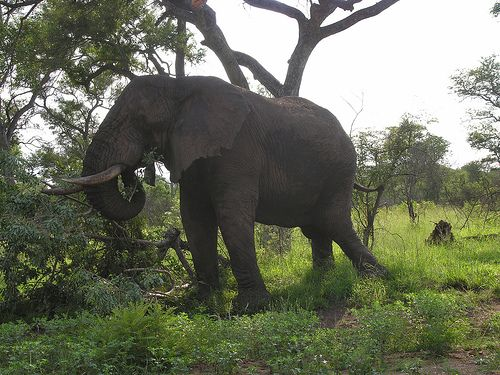

Many wild animals love to eat the fruit from the marula tree, such as this elephant, which has pushed the tree over to get to the fruit. The seeds are dispersed later far away in the elephant's dung. [http://www.flickr.com/photos/mister-e/394295611/](http://www.flickr.com/photos/mister-e/394295611/)

<Callout type="note" title="Note">
The tiny hooks on seeds and burrs that stick to fur inspired the design of Velcro. One part of Velcro tape hooks into the other part of the Velcro tape just like seeds hook into fur.
</Callout>

**Explosive force**: In some plants their seed capsules mature and then 'explode', shooting the small, light seeds far away from the parent plant.

The cells along the opening are specially designed so they rip open with force. (Three thickened walls and one very thin wall.)

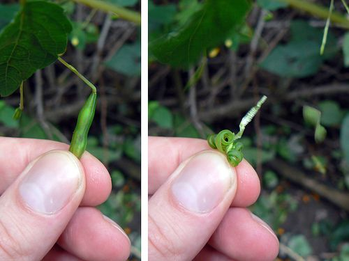

The seed pods of jewelweed (shown on the left) explode when they are touched (shown on the right) and shoot out the seeds to disperse them. [http://www.flickr.com/photos/benimoto/1386672443/](http://www.flickr.com/photos/benimoto/1386672443/)

<Callout type="note" title="Note">
The Sandbox tree that grows in the Amazon Rainforest can fling its seeds anything from 45 to 100 m away at speeds of up to 252 km/h!
</Callout>

<Callout type="note" title="Note">
Video showing how ripe yellow woodsorrel pods explode to release their seeds
</Callout>

**Wind**: Wind dispersal requires very light, small seeds that can be carried on the wind. Some seeds have 'wings' like dandelion seeds that can be carried across great distances by the wind.

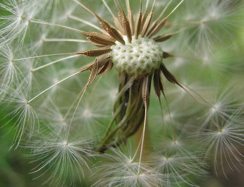

Dandelion seeds are dispersed by the wind.

**Water**: Plants that grow in or near water use the water to disperse their seeds. Mangrove seeds start to germinate while still on the parent plant, then drop into the ocean and wait until the sea washes them onto a shore where they can continue germinating and growing.

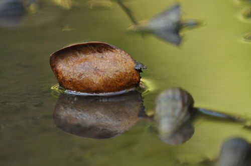

A mangrove seed floating in the water.

Do you remember how we spoke about the different flower structures and how they are adapted for pollination by either animals or wind or water? In the same way, the seeds and fruit are adapted for their method of dispersal.

<Callout type="note" title="Note">
Review all of the different ways that plants can disperse their seeds[http://www2.bgfl.org/bgfl2/custom/resources_ftp/client_ftp/ks2/science/plants_pt2/dispersal.htm](http://www2.bgfl.org/bgfl2/custom/resources_ftp/client_ftp/ks2/science/plants_pt2/dispersal.htm)
</Callout>

# Studying different kinds of seeds

If possible, try collect some of these different seeds, pods and fruit before you do this activity and bring them to class for learners to look at. They can also try throwing up some of the seeds that are wind dispersed to see how they move through the air. This will help them understand the adaptations. Explain to your learners how they should explain how something is adapted and how this structure suits the function. The most common way to do this is to state the structure and then state why this structure helps the function. This normally takes the format of: The seed has 'x structure' **so that** it can do 'y function.'

**INSTRUCTIONS:**

**Problem:**
Look at the following table which contains different kinds of seeds. Each one is dispersed in a different way.

**Solution:**

**Problem:**
In the second column, state how the seed or seeds are dispersed (for example, by an animal, by the wind, by water etc.)

**Solution:**

**Problem:**
In the third column, write a couple sentences describing how you think this seed is adapted for dispersal. You need to think about what would most help this seed to be dispersed.

| Seed | How is it dispersed? | What adaptations does the seed or plant have for dispersal? |
| --- | --- | --- |

**Solution:**
| Seed | How is it dispersed? | What adaptations does the seed or plant have for dispersal? |
| --- | --- | --- |
|  | By an animal (bird) | The seeds are within fruit (berries) which the bird likes to eat. Therefore, when they bird eats the fruit, the seeds pass through the bird and are dispersed far away in the bird's droppings. The seeds are also adapted by having a hard outer coat which is not digested by the bird so they can pass through its system. |
|  | By water | These trees normally grow near water so that when the seeds fall off, they fall into the water to be transported away. The seeds are adapted by being able to float (they are buoyant) so that they can travel down the river to a new place. |
|  | By wind | The seed is very light so that it can blow in the wind. It is 'feathery' so that it catches the wind and can travel. |
|  | By explosive force | This seed pod might respond to touch to cause the explosion. This is beneficial so that not all pods explode at the same time, but they do so in stages. The seeds are small and light so that they can travel when they are shot out of the pod. |
|  | By an animal (dog) | These seeds have burrs (little hooks) so that they can catch onto the fur of the dog and attach to the dog. As the seed dries or it is brushed against something else, they fall off. The seeds are often in position on a plant so that they are at a height to brush against an animal. |
|  | By wind | These seeds are sometimes quite large, but still light so that they can travel through the air. The 'wings' are light and have a large surface area to catch the air and the seed spins as it moves through the air enabling it to travel further. |
|  | By explosive force | These seed pods explode when they become dry and crack open. This makes sure the seeds are ready to be dispersed. The seeds are quite small to be able to travel. |
|  | By an animal (squirrel) | Acorns are dispersed by squirrels who gather the nuts. The nuts are tasty to the squirrel so the animal collects them and carries them to another place to store them. Some acorns will be eaten, but others will be buried and forgotten by the squirrel and will germinate and start growing later on. Acorns are also hard so that they can last a long time in storage before getting the chance to germinate. |

We have now finished looking at how angiosperm plants reproduce. We are now going to look at how animals reproduce. Specifically, we are going to look at how humans reproduce so that we can learn about our own bodies and how they function.
