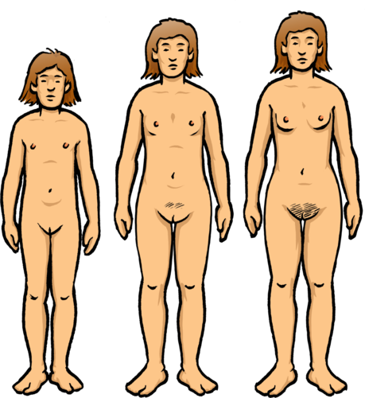
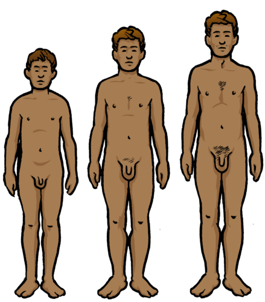
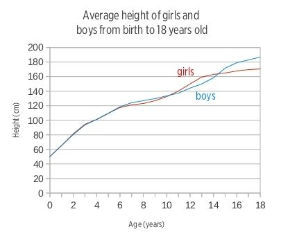
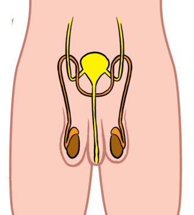
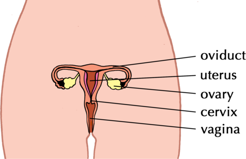
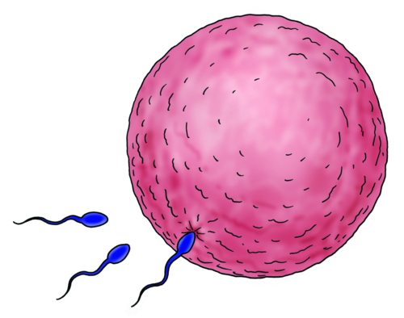
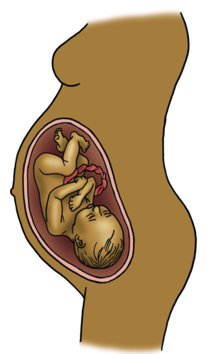
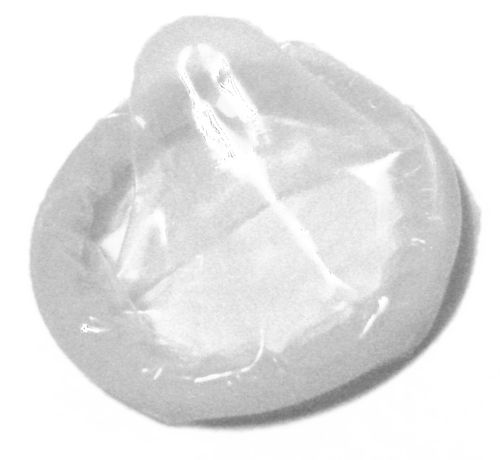

## Human reproduction

Be aware that learners might not feel comfortable discussing reproduction in the classroom, and might laugh or make inappropriate jokes to conceal their own discomfort.

**Some tips for teaching human reproduction:**

2. Respect your learners' questions and concerns. Some of them may not have had an opportunity before to ask questions about reproduction, especially if their parents have not felt comfortable discussing this with them. This is a sensitive topic, and learners might be embarrassed to ask questions. Encourage your learners to ask questions and not be inhibited or embarrassed.
4. Discuss processes openly so that learners are comfortable within the classroom environment to talk and learn about reproduction and how it influences their lives. Discourage and discipline any laughing or disrespectful behaviour from other students. Insist that learners use the appropriate scientific terms when asking questions and having discussions, as this should prevent some learners from being intentionally vulgar.
6. Possibly bring in a guest speaker. Learners might feel more comfortable asking a stranger questions. Also, if you bring in an expert, such as a gynaecologist or midwife, learners might take the subject more seriously. It may be helpful to have someone from FAMSA come in and talk to the learners. Trained FAMSA facilitators will divide the class into smaller groups so that it is easier to ask questions.
8. If necessary, you can separate boys and girls. For example, if you are showing a graphic video about the female reproductive organs, it might be useful to have the boy watch a similar video in another room that explains the male reproductive organs. It may be very helpful to divide the classes into boys and girls at least once during the section so that learners can feel comfortable asking questions that they do not feel comfortable asking in front of their opposite-sex classmates.
10. Avoid portraying the reproductive system in a negative light or "forbidden" as this will only add to some of the discomfort that learners might already feel. At this stage in their lives, learners are already very interested in reproduction and the changes that their bodies are going through. This is natural and should be embraced so that they are educated and can make informed choices about their sexual health going forward.
12. Here is a website to do some further reading:[http://ezinearticles.com/?Teaching-Teens-About-the-Reproductive-System&id=1471773](http://ezinearticles.com/?Teaching-Teens-About-the-Reproductive-System&id=1471773) and some extra resources and pdfs can be accessed at [http://www.gobookee.net/puberty-and-printable/](http://www.gobookee.net/puberty-and-printable/)

<Callout type="note" title="Note">
- hormone
- maturing
- menstruation
- penis
- puberty
- sperm
</Callout>

If you look around at your Gr. 7 classmates, you will probably notice that your friends, and you, have changed quite a bit since you started Gr. 1. Apart from growing taller, changing hairstyles or changing the way you dress, your bodies are changing and growing up. We say you are **maturing**.

Understanding the changes that occur in your body and more specifically understanding why they occur, will help you to manage and cope in the next few years until you become a young adult.

It may be useful before starting this section to have a box where learner's can put questions in advance of the lesson. Stress to learners that this is an anonymous exercise and that they do not need to identify themselves. You can then filter the questions in advance, and eliminate inappropriate questions, and also pick up on problem areas, misconceptions and concerns of some of the learners in the class who may be too shy to ask questions. You can then attempt to address these anonymous concerns while covering the material in this section. You can then ask the class in general what they might already know about human reproduction. Bear in mind that some learners might already know a significant amount, either from talking to their parents or from their own explorations, and some learners might not know much at all. You should point this out and let learners know that this is alright, and by the end of this section they will all know the basics of human reproduction. By asking them
                what they already might know, you are also encouraging them to start talking about it in class and not to be embarrassed or make jokes or tease each other. You can even ask some more basic questions, such as:

- Why do humans need to reproduce? (To produce children to continue the existence of our species. This is different to asking why humans have sexual intercourse, which is also for enjoyment with your partner.)
- Do you know how long pregnancy is before the baby is born? (9 months)
- What is the stage in your life called when you go through physical and emotional changes as you become sexually mature? (puberty)

Learners have a right to their privacy during this section. Teachers should also be aware and sensitive about possible victims of sexual abuse. It is also appropriate in this section to emphasise to girls in the class that is is perfectly okay to say "NO!" to persistent boys. Teachers should also encourage students to wait until they are older to become sexually active.

### Why do humans need to reproduce?

Humans need to reproduce to have children to continue the existence of our species. As with angiosperm plants, humans reproduce sexually. This means that human reproduction requires a male and a female and a new human being is formed by combining the genetic material (DNA) from the parents. The child will have half its genetic material (DNA) from its mother and half from its father. In order for this to happen, the **sperm** (from the male) has to combine with the **egg cell** (from the female) to produce a baby. Our sexual organs are adapted for these functions.

Our sexual organs need to reach maturity. This takes place during a stage in our life called **puberty**.

### Puberty

When a boy or girl reaches a certain point of growth and development, the sexual organs in the body also start to mature. Girls and boys do not, generally, go through puberty at exactly the same time:

- Girls go through puberty between 10/11 - 14/15 years of age
- Boys go through puberty between 12/13 - 15/16 years of age

During puberty, you will experience different physical and emotional changes as your body develops towards sexual maturity and adulthood. Let's take a look at some of these changes that take place during puberty.

# What happens during puberty?

**INSTRUCTIONS:**

2. Study the images above of a girl at 10, 12 and 17, and of a boy at 10, 12 and 17.

**QUESTIONS:**

**Problem:**
Identify the changes that both go through during puberty and fill these into the table.

| Changes in the girl | Changes in the boy |
| --- | --- |

**Solution:**
| Changes in the girl | Changes in the boy |
| --- | --- |
| Changing body shape and figure Body fat increases Breasts start to develop Facial features more mature Hair growth under arms and on legs Pubic hair starts to grow (Acne / pimples in some individuals) | Changing body shape and figure More muscular Penis grows bigger Facial features more mature Hair growth under arms, legs, face, chest Pubic hair starts to grow (Acne / pimples in some individuals) |

**Problem:**
Study the following graph and answer the questions that follow.

What type of graph is this?

**Solution:**
A line graph (or a growth curve graph)

**Note: **Make sure that learners are aware that this graph displays an AVERAGE height. It does not just show a comparison between one girl and one boy, but rather takes the average height of a large group of girls and a large group of boys. Ask the learners why they think this is important. (There will always be a few exceptions of older people who are shorter than younger people, and girls who are taller than boys, but using the average helps us to see the general trend that occurs in most people.)

**Problem:**
What information is this graph providing?

**Solution:**
The average increase in height of boys and girls between birth and 18 years of age.

**Problem:**
In a graph, there are two variables. The independent variable is placed along the horizontal x-axis. The dependent variable is the variable that changes according to the independent variable. It goes along the vertical y-axis. Identify the independent variable and the dependent variable that was used in this study based on the graph.

**Solution:**
Independent variable: the age of the boys and girls

Dependent variable: average height increase

**Note: **You can explain to learners that the height depends on the age of the boys and girls and so the height is the dependent variable. As children grow older, they also grow taller, so height is dependent on age.

**Problem:**
What is the unit of measurement that height is recorded in? What is the unit of measurement for age?

**Solution:**
Height is measured in centimetres (cm) and age is measured in years.

**Note: **Point out to learners that the axes of graphs must always have labels and if there is a unit of measurement, this must always be included in brackets after the heading.

**Problem:**
Explain in words what you think this graph is telling us about how boys and girls grow from 0 to 18 years old. Compare the two different lines for boys and girls and see what you can tell from the average heights as they grow older. Answer the following questions to help you interpret this graph.

2. There are two lines on this graph. What does each line represent? Use the colours in your answer.
4. Why are the graph lines for boys and girls overlapping from 0 to 6 years old? What does this tell us about the height of boys and girls up until 6 years old?
6. After 6 years old, and until 10 years old, the graph lines for boys and girls split. Which line is on top? What does this tell you?
8. At what age are boys and girls on average the same height again? How can you tell this from the graph?
10. At age 18, are boys or girls generally taller? What is the average height of boys and of girls at 18 years old? Read this off the graph.

**Solution:**
**Note: **Interpreting graphs is a crucial skill in Natural Sciences. Learners might find it hard to explain what they are seeing in this graph, so go through the following steps in interpreting a graph.

2. The blue line represents the average change in height of boys as they grow older. The red line indicates the average change in height of girls as they grow older.
4. This means that boys and girls are on average the same height up until 6 years old.
6. The graph line for boys is on top. This tells us that between age 6 and 10 years old, boys are generally taller than girls.
8. Around age 10, boys and girls are roughly the same height again. This can be read from the graph where the two lines cross (we say they intersect). At around age 14 and a half, boys and girls are the same height again.
10. Boys are generally taller than girls at age 18. The average height of boys at 18 years is about 187 cm and the average height of girls is about 171 cm.

**Note: **You may need to help learners and show them how to read the values off the graph. They should use their rulers and draw a line across from 18 years old to the y-axis to see where it intersects and make an estimate of the height of boys and girls.

**Problem:**
A growth spurt is when children grow quite rapidly over the years, faster than over other years. Answer the following questions to help you understand this.

2. What can you use to identify a growth spurt in the graph? Hint: A growth spurt means that the boys' and girls' height is increasing faster than at other times.
4. On the graph, we can see that there is a growth spurt for girls and a growth spurt for boys. Do the growth spurts take place at the same age for boys and girls?
6. At what ages do the growth spurts take place for boys and girls?
8. Why do you think these growth spurts took place when they did? Hint: Think back to the ages of puberty for boys and girls and how they differ.

**Solution:**
2. A sharp incline in the line of the graph indicates a growth spurt.
4. No.
6. Boys show a growth spurt between the ages of about 14 and 16. Girls show a growth spurt between the ages of about 11 and 13.
8. These growth spurts correspond to the ages when girls and boys go through puberty. Girls go through puberty slightly earlier than boys and so the growth spurts take place at different phases.

**Problem:**
Make an X on the graph to indicate where you are in this process according to your age.

**Solution:**
Individual learners to mark this on the graph.

**Problem:**
Using the data on the graph, what changes in your height can you expect to experience if you were to follow the typical growth trend?

**Solution:**
Learner-dependent answer.

**Problem:**
Based on your family history and the height of other members of your family, predict whether you will 'follow the curve' or whether you will be shorter or taller than the average person your age?

**Solution:**
Learner-dependent answer.

If you wish to challenge the students, ask them if they think this trend will continue between the ages of 25 and 35? (No, height should remain stable), What do they think they trend will look like between 65 and 85 (Older individuals often lose a bit of height in old age as their vertebra compress (or curve)).

The following table summarises some of the physical changes that occur during puberty.

| Physical changes in girls during puberty | Physical changes in boys during puberty |
| --- | --- |
| The sexual organs (vagina, uterus and ovaries) start to mature. Pubic hair starts to grow on the genitals. Menstruation and fertility : girls have their first menstrual bleeding. Menstruation is a sign that the ovaries have started secreting hormones and releasing eggs, and is therefore a sign that the girl is now fertile (able to fall pregnant). Body shape : changes occur, such as the waist becomes more defined and hips widen (to make space for childbirth). There is an increase in body fat. Breasts start to develop Body odour is typically part of puberty as the skin produces more oils and the smell of sweat changes. Acne and pimples can occur due to changes in hormones and increased oil secretion from the skin. | The sexual organs (testicles and penis)start to mature. Pubic hair starts to grow on the genitals. Fertility : the testicles start to produce sperm that can fertilise a female egg during sexual intercourse. Body shape: changes occur as the bones and muscle increase to give the young man a stronger, more muscular look. Voice changes occur becoming deeper and lower. Body odour is typically part of puberty as the skin produces more oils and the smell of sweat changes. Acne and pimples can occur due to changes in hormones and increased oil secretion from the skin. |

<Callout type="note" title="Note">
Learn more about puberty for girls[http://www.avert.org/puberty-girls.htm](http://www.avert.org/puberty-girls.htm)
</Callout>

<Callout type="note" title="Note">
Learn more about puberty for boys[http://www.avert.org/puberty-boys.htm](http://www.avert.org/puberty-boys.htm)
</Callout>

During puberty, many young people have commented that their emotions are like a roller-coaster. This time in your lives is not only about growing up and maturing physically, but also emotionally.

You should check with the Life Orientation teacher at your school about what learners are doing at this stage, particularly with reference to sexual maturity, emotional changes and becoming self-aware. Some of the things which learners will be experiencing are listed below. If time allows, you may wish to grant learners 10 minutes for self-reflection. Perhaps send them outside to sit by themselves in silence. After this self reflection exercise return to class and have a discussion. You may wish to discuss some of these topics:

- **Strong feelings**: puberty is for many a time when they move between very strong emotions; when these emotions last for more than a few minutes we call these 'moods'. Perhaps they feel excited and happy the one minute while they chat to friends but then walk home and arrive sombre, down and sad for no particular reason. This may lead to feelings of anxiety and frustration, which in turn leads to angry, emotional scenes with loved ones like parents or siblings. Since young people going through puberty are still learning how to deal with the many new feelings and emotions they are experiencing, they find this time particularly difficult. This might be alleviated as they learn to deal with conflict in a constructive way or they might choose to remove themselves from situations where they feel that there might be an emotional outburst that they cannot control.
- **More sensitive**: linked closely to the many new and perhaps uncomfortable feelings, young people going through puberty might be more sensitive to the actions and intentions of those around them and might often misread facial expressions. This often comes across as being 'over sensitive'. However, as they mature and learn to 'read' or interpret facial expressions and the body language of others more accurately young people soon become better at interpreting messages and understanding the hidden or figurative messages and learn how to respond to these in a more controlled manner.
- **More self-conscious**: some young people going through puberty and experiencing the different physical and emotional changes that this brings, are more self-conscious than others. They become more concerned with their physical appearance and tend to compare their bodies with those of famous celebrities, their friends and role models. If they do not look or sound the way they want to, this can affect the way they look at themselves and feel about themselves, what we call their self-esteem.
- **Looking for new experiences**: with the many physical changes being driven by the hormones in their bodies, young people going through puberty are more likely to look for new experiences and unknown 'paths' to explore. This may lead to dangerous, risk-taking behaviour that may put the young person's life in danger or derail their future plans. As they grow older, they start to learn to control these impulses and to make wiser decisions.
- **Exploring their sexual identity**: during this time young people start to form romantic relationships or go on 'dates'. Many young people prefer to wait until they are older to engage in sexual relationships. However, many others yearn for the thrill of a new experience and want to find out what sex is all about. It is therefore very important that they first make sure they know about the risks and take proper precautions to protect themselves (and their futures) if they do decide to have sex. (Which is one of the aims of this chapter!)

Many events are taking place in your life, so let's draw a timeline to show this!

# Draw a timeline of your life

This can be a very **sensitive task** for learners to do, especially if they have suffered trauma in their lives. You must approach it sensitively and cautiously, making sure that learners feel comfortable with doing it. Some learners might also not want their timelines displayed, so this should be a personal activity for learners to do, without the pressure of having to display their timelines to the class.

A timeline shows us a representation of how time passes and the events which take place. Look at the following timeline which shows how life developed on Earth. This is quite a complicated timeline.

**INSTR INSTRUCTIONS:**

2. Draw a personal timeline of your life so far.
4. You can include photos and pictures.
6. You can possibly include:
8. Your birth - where and when
10. Your first tooth, first word, first first step that you took, etc
12. Your different birthdays - perhaps you have some photos you can stick on for some of your birthdays.
14. Your first day at school, playing a team sport, on stage as a performer, etc
16. Celebrations and memorable events in your life.
18. Locate puberty on your timeline.

Let us now take a closer look at the male and female reproductive organs that mature during puberty.

### Human reproductive organs

<Callout type="note" title="Note">
- fallopian tube (oviduct)
- ovary (ovaries)
- ovulation
- scrotum
- testes
- uterus
- vagina
</Callout>

Puberty is a time when the human reproductive organs start to develop, maturing about 5 - 6 years after puberty started.

In males, the reproductive organs include the penis and two **testes** hanging in a pouch or bag of skin called the **scrotum**.

- At the start of puberty the scrotum starts to grow larger and pubic hair starts to appear. The penis also grows bigger.
- Inside the scrotum, the testes mature and start to produce sperm.

When the male reproductive organs are mature in an adult, they will look as they do in the following diagram:

The female reproductive organs include the **vagina**, **uterus**, two **fallopian tubes** (**oviducts**) and two ovaries.

- Inside the girl's body the uterus becomes longer and the lining of the uterus becomes thicker.
- When a girl is born she already carries millions of eggs (also called ova) in two organs called the ovaries. During puberty, the ovaries mature, and start to release one mature egg each month. This is called **ovulation**.
- Two tubes connect the uterus with the ovaries - these are called the fallopian tubes or the oviducts.

When the female reproductive organs are mature in an adult, they will look as they do in the following diagram:

We now know more about the male and female sexual organs and how these organs mature during puberty. Let's take a closer look at human reproduction and the different stages.

### Different stages in human reproduction

<Callout type="note" title="Note">
- conception
- ejaculate
- sexual intercourse
- umbilical cord
</Callout>

Although you are not ready for the responsibility of having a baby and parenthood, your body starts to prepare itself for reproduction during puberty. The main purpose of the human reproductive organs is to produce a mature sperm or egg that can fuse and create a new human baby.

#### Ovulation

Once a month, one of the ovaries in a girl or woman's body will release a mature egg into the fallopian tube (oviduct). From here it moves to the uterus. During this time the uterus develops a thick lining of blood in preparation for the possible arrival of a fertilised egg.

#### Fertilisation and pregnancy

In order for a baby to develop in the mother's uterus, the egg needs to be fertilised. During **sexual intercourse**, the male **ejaculates** (releases) millions of sperm into the woman's vagina. From the vagina, the sperm travel into the uterus and up into the oviducts and to the egg cell.

The sperm reach the egg cell, and only one of them enters through the outer layer of the egg cell. The layer then hardens and no other sperm are allowed to enter. This moment, when the male sperm and the female egg cell fuse is referred to as the moment of **conception**, or **fertilisation**, and this leads to pregnancy as the baby starts to develop.

<Callout type="note" title="Note">
You are 100% unique - there is no one like you on Earth!
</Callout>

Only one sperm will fertilise the egg cell. The other millions will not be able to enter.

Once the egg cell is fertilised, it continues its journey to the uterus. When it arrives in the uterus, it is safely attached in the thick lining of the uterus. The foetus starts to grow and develop. An **umbilical cord** grows between the foetus and the uterus. A placenta forms to supply food and oxygen to the developing baby and to remove waste. The developing foetus receives food and oxygen from the mother through the placenta and umbilical cord.

A baby developing inside the mother's uterus. Can you see the umbilical cord?

<Callout type="note" title="Note">
If the mother consumes drugs and alcohol while she is pregnant, these harmful substances will also pass through the placenta to the baby. They can cause serious damage to the baby. For example, if a pregnant mother drinks alcohol, the baby can develop Foetal Alcohol Syndrome (FAS).
</Callout>

At the end of pregnancy, the mother gives birth to the baby through the vagina. Sometimes there are complications and the doctors perform a Caesarean section. this is a surgical procedure where a cut is made in the mother's abdomen and the baby is removed.

As we have seen, if the egg is fertilised after sexual intercourse, the mother falls pregnant. But what happens to the egg if it is not fertilised?

#### Menstruation

After ovulation, if the egg in the oviduct does not fuse with a sperm and fertilisation does not take place, then the egg cell will still travel down to the uterus. But instead of implanting into the uterine wall, the unfertilised egg cell will be discarded through the vagina, together with the thick blood-rich uterus lining that had developed in case of fertilisation. This is called menstruation.

Do you know what a myth is? A myth is a story that may or may not be true. Often, myths are quite old stories that are passed down from one generation to the next. Myths are often told and people believe them even when there is no proof that they are actually true.

One such Greek myth is about a lady called Medusa. She had hair made of real snakes and could turn anyone into stone if they looked directly at her. One day, the hero Perseus fought her and rather looked at her reflection in his shield. He was protected from her deathly stare and managed to cut off her head and kill her.

Do you think the myth about Medusa is true?

There are many myths about menstruation and sex which are told by people in our society. A lot of these myths are not based on proof. Now that you know more about human reproduction, you need to decide if these stories and myths are true or not. Let's discuss this some more.

# Conduct a survey

This should be done as a homework assignment in the lead up to the lesson about menstruation. The questions can then be answered in class and discussed.

**INSTRUCTIONS:**

2. Read some of the following comments people have made about menstruation and sex.
4. As a homework assignment, read these to at least five separate members of your family and friends.
6. Make a small cross if the person thinks it is not true and tick if they think it is true or correct.

| Myth | Responses (tick or cross) |
| --- | --- |
| "Women who are menstruating are dirty and unclean." |  |
| "During your period you should never have cold food or walk with bare feet. If you get cold your period will be worse." |  |
| "Exercise is bad for you when you menstruate." |  |
| "Don't ever swim when you are having a period!" |  |
| "Virgins cannot use tampons - they will lose their virginity." |  |
| "It is unhealthy to have sex at the time of the month when you are menstruating." |  |
| "You cannot fall pregnant during your period." |  |
| "You cannot fall pregnant or make someone pregnant if you have sex in water." |  |
| "Women are always moody and irrational during menstruation." |  |
| "Drinking and drugs make sex more fun." |  |
| "If you have a shower after sex, you will not fall pregnant." |  |
| "You cannot fall pregnant if it is your first time." |  |
| "Everyone is having sex." |  |

<Callout type="note" title="Note">
A virgin is someone who has not had sexual intercourse.
</Callout>

**QUESTIONS AND DISCUSSION:**

**Problem:**
How many people in the homework survey believed that the comments were in fact true?

| Most believed they were true | About half believed they were true and the other half believed they were not. | None believed they were true |
| --- | --- | --- |

**Solution:**

**Problem:**
Discuss with your class which of the comments were most widely believed to be true by the people you surveyed. Take some notes on the following lines.

**Solution:**
Learner-dependent answer.

**Problem:**
Which of these comments had the strongest reaction from the people you surveyed? (Either positive or negative reaction.) Discuss their reactions with your class. Take some notes on the following lines.

**Solution:**
Learner-dependent answer.

**Problem:**
Did anyone laugh at any of the comments? Which ones? Did they tell you why they laughed? Share this with the class.

**Solution:**
Learner-dependent answer.

**Problem:**
Which of these statements do you think are true? Discuss this with your class and take some notes on the following lines.

**Solution:**
Learner-dependent answer.

You should go through each of the myths to show that they are in fact all myths - they are NOT true. Read through these explanations and refer back to them during your discussion with your class.

**"Women who are menstruating are dirty and unclean ."**

- Women are not dirty and unclean during menstruation as menstruation is a perfectly natural process. Some people do believe this for religious reasons and you should be sensitive to their religious beliefs, while still stating that women are not "dirty".

**"During your period you should never have cold food or walk with bare feet. If you get cold your period will be worse."**

- This is not true. The uterus is the organ that controls menstruation and cold feet or food have nothing to do with the uterus.

**"Exercise is bad for you when you menstruate."**

- Menstruation is a normal, natural function of the body and not in any way a disability. Therefore you should continue with life as if nothing out of the ordinary is going on.

**"Don't ever swim when you're having a period!"**

- If using the right protection (tampons) there is no reason why girls should not be able to swim while they are having their periods.

**"Virgins can not use tampons - they will lose their virginity."**

- Virginity is about whether a woman has had sexual intercourse or not. Long ago, a woman's virginity used to be assessed by whether her hymen was intact, as this breaks during sex. However, nowadays, there are many times in a girl's life when her hymen can break without having sex, such as by using a tampon or horseriding, or by doing gymnastics or ballet. This does not mean she has lost her virginity.

**"It is unhealthy to have sex at the time of the month when you are menstruating."**

- Although some people might find it off-putting, there is no medical reason why sex should be avoided. It is not unhealthy or unclean. It is the personal preference of the couple.

**"You cannot fall pregnant during your period."**

- There is a chance that you can get pregnant if you have sex during your period. Once in the vagina, sperm can stay alive for several days. That means that, even if the last time you had sex was three days ago during your period, you could now be ovulating and therefore you could get pregnant.

**"You cannot fall pregnant or make someone pregnant if you have sex in water."**

- This is not true. The water does not in any way prevent pregnancy, or the spread of STDs.

**"Women are always moody and irrational during menstruation."**

- Many women (not all) experience different pre-menstrual syndrome symptoms, which can include emotional changes, but this is not always so, and a woman's mood or emotional state should not automatically be attributed to PMS. After all, teenage boys can be similarly moody and emotional.

** "Drinking and drugs make sex more fun."**

- If you are drunk or on drugs, it is hard to make good decisions about sex. 20% of 15 to 17 year-olds say they have done something sexual while using alcohol or drugs that they might not have done if they were sober. At the time, it may seem like fun and a good idea, but it also means you are much less likely to practice safe sex and could then fall pregnant or contract an STD. Being under the influence of drugs or alcohol also makes girls more vulnerable to unwanted approaches.

**"If you have a shower after sex, you will not fall pregnant."**

- This is not true. The water will not 'wash off' the sperm. The sperm have already entered the vagina. As with STDs, showering after sex will not prevent pregnancy nor the transmission of STDs.

**"You cannot fall pregnant if it is your first time."**

- If you are ovulating, it does not matter if it is the first time you have sex, you can still fall pregnant. if your body has produced an egg during ovulation there is no reason why sperm will not fertilise the egg and result in pregnancy, even if it is the first time you are having sex.

**"Everyone is having sex."**

- To learners it may seem like everyone is having sex, but in reality, less than half (48%) of all high school students have ever had sex. Point out to learners that people often lie and exaggerate when it comes to sex. But, also point out that in the end it does not matter what others are doing and who is telling the truth or not, it matters what is best for you. Partners may apply pressure by saying things like "If you love me, you will". However, a truly loving and committed partner will wait until you are ready.

At the end of this lesson, you should make a point of discussing derogatory words that are used with reference to women and men. It might be useful to brainstorm bad name choices and to discuss the use of the correct terminology to avoid this.

If there are different cultural and religious groups in the class, it might be an opportune time to discuss religious laws and views on menstruation and what girls in the class experience as part of this group. However teachers should be very careful to not degrade or embarrass girls that act in accordance to the religious beliefs of their families but should instead create an open and caring space where learners can discuss this.

### Ways to prevent pregnancy and STDs

As we discussed above, your body prepares itself to reproduce during puberty. However, you are in control of your body and can make the decision when you are ready to become a parent and to fall pregnant.

If you decide to become sexually active, it is important to think very carefully of two risks involved in sexual activity:

2. Pregnancy
4. Being infected by a Sexually Transmitted Disease (STD) like HIV/AIDS, Herpes or Syphilis.

Teenagers may be more frightened by a possible pregnancy than by contracting a STD. This is a sad fact, as some STDs are incurable and life-threatening. It is useful to point out to learners in this section, that hormonal contraceptive pills DO NOT protect against STDs and that a mistake made when they are young may affect the rest of their lives.

There are different things that you can do to prevent pregnancy.

#### Contraceptives

To avoid falling pregnant, you can use **contraceptives**. There are different contraceptives available today. They prevent the sperm from reaching the egg and thus prevent fertilisation from taking place. Or else, they can prevent the fertilised egg from implanting in the uterus wall.

<Callout type="note" title="Note">
'Contra-' means against, so contraception means against conception
</Callout>

**Male condoms** are rubbery sheaths that are placed over a man's erect penis before sex, and are worn during sexual intercourse to prevent the sperm from entering the woman's vagina. Condoms also help to prevent the spread of STDs.

**Female condoms** also prevent the sperm from reaching the egg. However these are placed in a woman's vagina to act as a barrier to the sperm, and are much less commonly used.

**Oral contraceptive pills** are used by many women today. Many of these prevent ovulation. Pills need to be taken at the same time every day, otherwise they are not effective. If the woman has an infection with a high temperature, or is on antibiotics, this may also reduce the pill's effectiveness. While the pill is excellent at preventing pregnancy, it offers NO protection against STDs.

#### Sexually Transmitted Diseases (STDs)

There are various very dangerous and harmful diseases that are spread from one person to another during sexual intercourse. Some of these are life-threatening, like the Human Immunodeficiency Virus (HIV), while others cause very painful and long-term symptoms.

You can prevent yourself from being infected with an STD by doing the following:

- Get the facts: Make sure you know up-to-date information about STDs and how they are spread, their symptoms and how you can protect yourself during sexual intercourse.
- Take control of your sex life: The more sexual partners you have, the higher your risk will be of contracting an STD.
- Be faithful: If you or your partner has sex with someone else you risk infecting the other person with the STD.
- Using condoms significantly reduces the risk of contracting STDs.

You may want to point out to learners that due to the way that STDs are transmitted from person to person, when having sexual intercourse with a partner you are putting yourself at risk of catching disease from them, or ANY of their previous sexual partners, who in turn could have contracted an STD from any of their sexual partners etc.

It is your decision whether you want to participate in sexual intercourse with a romantic partner or not. There are two very important points to remember here:

2. No one, no matter who they are, has the right to force you or pressure you to have sex with them or with anyone else. Therefore you are the only one who should be permitted to decide when you are ready to have a sexual relationship.

Emphasise to learners that if someone is forcing you to have sex with them or threatening you in any way to have sex with someone else, you have the right to say no. Our country's constitution protects your right to say no. If this is happening to you, go and speak to someone you trust and ask them to help you solve the problem.

2. If you decide to have sex, you should do so in a responsible manner. This includes protecting yourself against possible pregnancy and against any STD infection.

Emphasise to learners that when you decide that you want to have sex with someone, go and speak to a medical professional like the sister at your local clinic or the health care professional that works at the pharmacy. They will help you get the correct contraceptives and protection that you need. Emphasise that it is not only boys who can carry condoms. Girls can carry condoms too. If girls have condoms available, then they can INSIST on using protection.

<Callout type="note" title="Note">
If you have been a victim of sexual abuse you can receive guidance and help by contacting Lifeline at 0800 150 150. The Lifeline website for victims of sexual abuse can be found at[http://www.lifeline.co.za/need-support/rape/](http://www.lifeline.co.za/need-support/rape/).
</Callout>

# Write a letter

This activity is designed to empower the learners to take charge of their own sexual health. This is therefore a very personal activity and should not be for assessment purposes. Learners may choose to keep their letters entirely private.

So often we make promises to other people and work very hard to keep them, but when we make promises to ourselves we often neglect to honour these.

Write a letter to yourself in which you explain what you want to do with regards to sexual activity. Do you want to engage in sex or do you want to wait until you are older? Explain why you made this decision.

Then add to your letter what you promise yourself that you will do to protect yourself from contracting an STD or from a pregnancy before you are ready to be a parent. Explain how you see yourself practising responsible choices regarding sex.

Put your letter in a safe place at home where you can often see it to remind yourself of your promise to yourself. Remember this is a private letter and you can choose whether you want to show it to anyone else or not.
