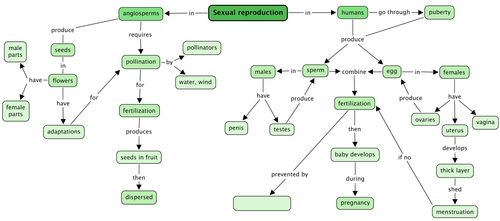
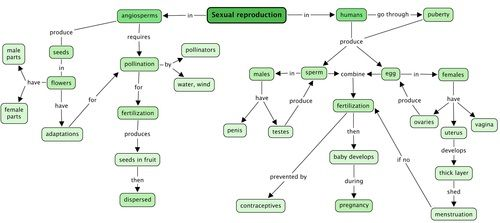

## Summary

<Callout type="note" title="Note">
- Sexual reproduction occurs when a sperm and an egg from two people combine to make offspring which look similar but not identical to the parents.
- In angiosperm plants, seeds are produced in the flowers.
- The male structures of flowers are the anthers and filaments, making up the stamens.
- The female structures of a flower are the stigma, style and ovary, forming the pistil.
- Pollination occurs when pollen is transferred from the anther of one flower to the stigma of another flower of the same species.
- Pollination is assisted by animals (pollinators), the wind and/ or water.
- Pollinators play an important role in the production of crops for humans.
- The pollen grows a pollen tube down the style to deliver the pollen nucleus to the ovules in the ovary.
- The fertilised ovules become seeds and the ovary may swell to form a fruit.
- Seeds are dispersed in various ways by animals, the wind, water and explosive force.
- In humans the main purpose of reproduction is for the sperm and egg to fuse and develop into a baby during pregnancy.
- Puberty is the stage in the human life cycle when sexual organs mature for reproduction.
- During puberty, boys and girls experience physical and emotional changes.
- The male reproductive organs include the penis and testes that produce sperm.
- The female reproductive organs include the vagina, uterus, oviducts and the ovaries.
- The ovaries produce one mature egg each month during ovulation which is then transported to the oviduct.
- If sexual intercourse takes place, the sperm travel to the egg and one will fuse with it in the process of fertilisation.
- The fertilised egg then moves to the uterus, is embedded in the lining of the uterus and grows for approximately 9 months before the baby is born.
- If fertilisation does not take place the egg moves to the uterus from where it is discarded in the vagina. The uterus lining is broken up and discarded through the vagina during menstruation.
- Pregnancy and STDs can be prevented mostly by wearing a male condom.
</Callout>

Concept map

Study the concept map below. Does it make sense to you? Are you starting to see what concept maps do? To complete the concept map below, fill in the blank spot. Look at the concept it is linked to in order to find the answer: 'In humans, fertilisation is prevented by …....'

Teacher's version

