## Variation within a species

<Callout type="note" title="Note">
- inheritance
- natural selection
- variation
</Callout>

In the last chapters we looked at how to classify organisms on Earth. Do you remember what the classification levels are? What is the smallest group in the classification system?

The classification system is: Kingdoms, then phyla, then classes, then orders, then families, then genera and the smallest group is species.

A species is a group of organisms that can interbreed with each other to produce fertile offspring. In this section you will learn why the ability to create a fertile offspring is the single most defining characteristic of a species.

Wherever organisms in a species live, they need to survive in those conditions. We say they are adapted to their environment. Those individuals of a species, which have characteristics that make them more successful at surviving, will reproduce more and pass on their characteristics to their offspring. However, environments change over periods of time. This means that the species needs to constantly change over time to better survive the conditions of their changing habitat. If the organisms do not adapt to their environment, they may not survive, and the species will die out. But how do species adapt? Does it happen quickly or over a long time?

What does variation mean when we use it in Natural Sciences? Let's take a look at some animals with which we are all familiar to find out what variation means.

# Small, big, long-haired, short-haired, black, white, brown or spotty?!

Do you have a dog, or have you seen some dogs in your neighbourhood? Think of those dogs, and use the following image to answer the questions.

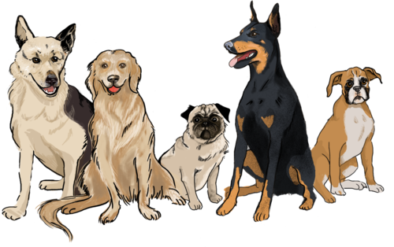

**QUESTIONS:**

**Problem:**
What kingdom of animals do dogs belong to?

**Solution:**
The animal kingdom.

**Problem:**
What phylum do dogs belong to? Why do you say so? Give a reason for your answer.

**Solution:**
Dogs are from the phylum Chordata as they are vertebrates, having a backbone and internal bony skeleton.

**Problem:**
What class do dogs belong to? Give three reasons why you would classify dogs in this class.

**Solution:**
Dogs are mammals as they are endothermic (warm-blooded), they have fur, they have mammary glands, they give birth to live young.

**Problem:**
Look at the dogs in the above picture and write down some common characteristics of the animals.

**Solution:**
Some common characteristics include: four legs, fur, tail, sharp teeth, snout (elongated nose), pointy ears, paws with claws, a snout.

**Problem:**
Do you think these dogs are part of the same species? How would you know? Discuss this with your class and teacher.

**Solution:**
Yes, they are. All the different types of domestic dogs can reproduce with each other to create offspring. The ability to reproduce and have fertile offspring is the definition of a species.

**Problem:**
Although these dogs share many characteristics, there are many differences between them. What are some of these differences?

**Solution:**
Some differences include fur colour, fur length, body shape, body size, length of legs, length of tails, length of snout, shape of ears, etc.

**Problem:**
Another example of variation is horses. Horses all belong to the same species as they can mate and produce offspring which are fertile. This means their offspring are able to reproduce. But there are many different colours and sizes of horses.

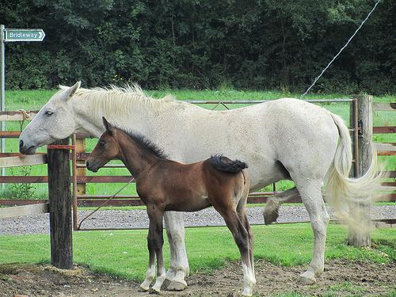

A white horse with a brown foal. [http://www.flickr.com/photos/mikemcsharry/5061749757/](http://www.flickr.com/photos/mikemcsharry/5061749757/)

Horses and ponies are from the same species. But what about donkeys?

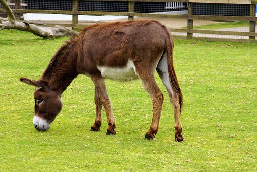

A donkey [http://www.flickr.com/photos/mdpettitt/2680351435/](http://www.flickr.com/photos/mdpettitt/2680351435/)

If a horse and a donkey mate, they are able to produce offspring, but the offspring are infertile. They are called mules or hinnies. Do you think donkeys and horses are the same species? Give a reason for your answer.

**Solution:**
Horses and donkeys are not the same species as they are not able to produce fertile offspring which can reproduce.

Both belong to the family Equidae and the genus Equus, but they are different species. The domestic horse is from the species *Equus caballus* and the domestic donkey is from the species *Equus asinus*. This question was included to reinforce the concept of a species being organisms which can reproduce to produce fertile offspring.

All living organisms that reproduce sexually produce offspring that are different from the parent organisms. Remember that we learned about sexual reproduction in angiosperms and humans in the last chapter. This allows the new organisms to be different to other organisms within the same species. We call this difference **variation**. As we saw in the last activity, all dogs on Earth are actually the same species, as well as horses, but there are huge differences between all the individuals. We say there is variation.

Even animals from the same litter or children from the same parents have differences. Take a look at the kittens in the box below. They are all from the same litter so they share the same parents, but they all look different.

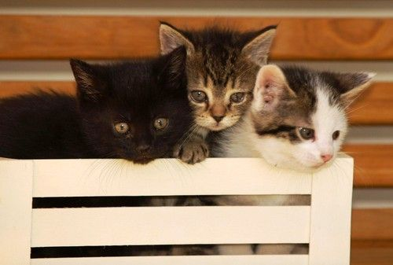

Three kittens from the same litter but they all look different!

Humans are all one species. Do you remember what the species name is for humans?

*Homo sapiens.*

All humans on Earth are from the same species, and yet there is huge variation among us. Look at the following photos of people from around the world.

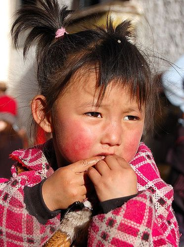

A Tibetan girl. [http://www.flickr.com/photos/star_trooper/849678040/](http://www.flickr.com/photos/star_trooper/849678040/)

A Swedish man. [http://www.flickr.com/photos/shankbone/6224544138/](http://www.flickr.com/photos/shankbone/6224544138/)

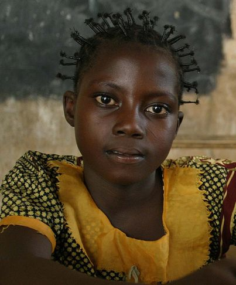

A schoolgirl in Congo. [http://www.flickr.com/photos/hdptcar/2530173319/](http://www.flickr.com/photos/hdptcar/2530173319/)

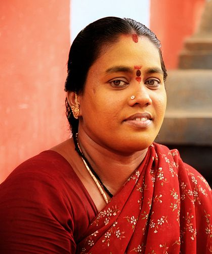

An Indian lady. [http://www.flickr.com/photos/vinothchandar/5645156569/](http://www.flickr.com/photos/vinothchandar/5645156569/)

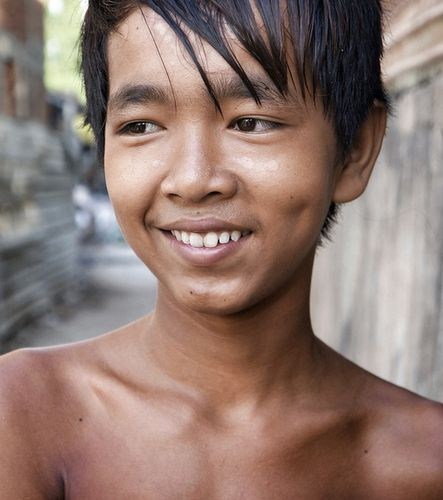

A Cambodian boy. [http://www.flickr.com/photos/strupler/7800131730/](http://www.flickr.com/photos/strupler/7800131730/)

A Dutch girl. [http://www.flickr.com/photos/charlottemorrall/3868699640/](http://www.flickr.com/photos/charlottemorrall/3868699640/)

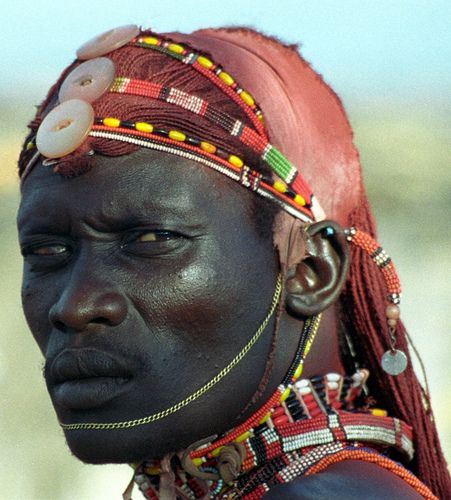

A Masai warrior in Kenya. [http://www.flickr.com/photos/waltercallens/3736366270/](http://www.flickr.com/photos/waltercallens/3736366270/)

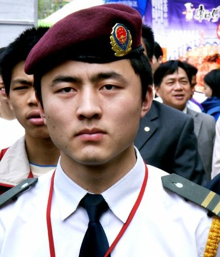

A Chinese soldier. [http://www.flickr.com/photos/fungo/82574635/](http://www.flickr.com/photos/fungo/82574635/)

An English boy. [http://www.flickr.com/photos/jsorbie/5870148690/](http://www.flickr.com/photos/jsorbie/5870148690/)

An Iranian woman. [http://www.flickr.com/photos/peter_curb/5462113048/](http://www.flickr.com/photos/peter_curb/5462113048/)

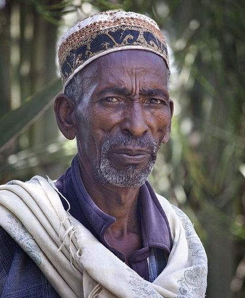

An Ethiopian man. [http://www.flickr.com/photos/babasteve/3103127147/](http://www.flickr.com/photos/babasteve/3103127147/)

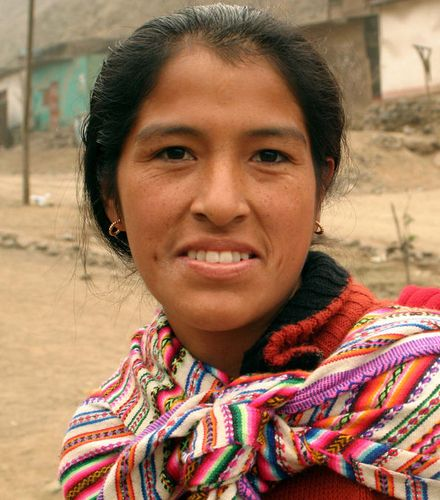

A Peruvian woman. [http://www.flickr.com/photos/ifrigginan/3261348/](http://www.flickr.com/photos/ifrigginan/3261348/)

South Africa is an amazing example of diversity amongst our people. Just have a look at your class and how much variation there is between all of you in one class. Some learners may be tall and others may be shorter, some have dark hair, some have blonde or brown hair, and there is a range of skin colours in South Africa. Since you are all from the same species this is another example of variation. Let's have a look at how your class varies in height.

# The height of learners in your class

As a homework task, outlined in question 4 below, learners need to measure the heights of some of the adults in their family. First ask learners if this is possible. You can either get learners to do this the day before you do this activity and bring this information to class with them so that you can finish the activity and discussion off in one lesson, or you can do the activity, then complete the homework task afterwards.

If measuring adults in their family might be awkward for some learners (culturally, no adults at home or other difficulties) then you could arrange to measure the height of the Grade 6 and Grade 9 learners as an investigation.

**MATERIALS:**

- 2 m measuring tape
- pencil, table drawn on scrap paper and clipboard to work on

**INSTRUCTIONS:**

2. Attach a measuring tape or similar apparatus to a wall in your class.
4. Learners who are having their length measured must be barefoot and must place their heels against the wall, standing up straight against the wall.
6. Learners who are taking the measurement must stand on a chair and place a ruler or pencil horizontally on the person's head (and flatten the hair) when taking the measurement.
8. Another learner should record the name and height of each learner.

This activity could be used to introduce the concept of reliability in scientific investigations. Explain to your learners that sometimes mistakes creep into our scientific measurements and we record the wrong results. We overcome this by repeating the same experiment a few times and if we get the same (or very similar) results we can trust our results as being reliable. To illustrate this you can set up a couple of measuring stations where learners can take turns being measured and taking the measurements. Each learner can be measured 3 times and then you can calculate an average.

2. Use this method to record the height of each learner in the class.
4. Draw a table to record the measurements.
6. Represent these results on a bar graph in the space provided.

Use the following space to record the heights of learners in your class in a table.

If you have a big class, you can divide learners up into groups of 10 and they can just record the heights of their group and use this to draw a graph.

Now use this information to draw a graph to represent the information. You will need to draw a bar graph. Think about what must go along the horizontal x-axis and what must go along the vertical y-axis. Remember, the x-axis is for the independent variables and the y-axis is the dependent variable. Give your graph a heading.

Guide learners through this activity to draw a graph. The learners' names are the independent variables in this activity and so their names must go along the x-axis. The heights are dependent on the learner so the height goes along the y-axis.

**Problem:**

**Solution:**
Learner-dependent answer

As an extension, you can draw a histogram graph to illustrate the difference between these two types of graphs. To do a histogram graph, you will need to create ranges of heights and then count how many learners fall into each range. The height ranges go along the x-axis and the number of learners that fall into each category goes along the y-axis. Using this graph, you can easily see what the most common height range in the class is.

**QUESTIONS:**

<Callout type="note" title="Note">
Do you remember how to calculate an average? You need to add up all the individual measurements, then divide by the number of learners you have measured.
</Callout>

**Problem:**
Who is the tallest and who is the shortest in your class?

**Solution:**
Class-dependent answer.

**Problem:**
What is the average height of all the learners in your class? Use the following space to show your working for this calculation.

**Solution:**
Learner-dependent answer.

**Problem:**
What is the average height of the boys and what is the average height of the girls? Use the space to show your working.

**Solution:**
Learner-dependent answer.

**Problem:**
As a homework activity, measure the heights of some of the adult members in your family. Record these heights in the following space to discuss with your class the next day.

**Solution:**
Learner-dependent answer.

2. Discuss these results with your class.
   2. Do the shorter people in your class also have shorter family members and do the taller people in your class also have taller family members?
   4. Is there a correlation (relationship) between the heights of learners in your class and the adults in their family?
   6. What other similarities are there between family members?
   8. Write down some notes from your class discussion below.

<Callout type="note" title="Note">
A correlation is a relationship between two or more sets of measurements or objects (items or things).
</Callout>

This discussion is meant as an entry point into the next section on inheritance. We will do one more short activity on similar characteristics between family members, before looking at inheritance in more detail. Use this discussion as an opportunity to introduce the concept of correlation. See if you can find some examples of correlation between the tallest learner in the class and the heights of his or her family members and the shortest learner in the class and the heights of his or her family members to illustrate that height is a trait that is often passed down in families.

We have now seen that there is huge variation between all the people on Earth, and even in your class. But, there are also lots of similarities, especially between family members, such as height and skin colour. These characteristics (or traits) are passed down from one generation to the next in a family. We say they are inherited traits. Let's look at this a bit more.
