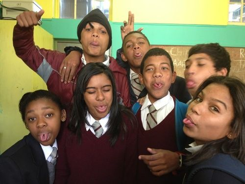
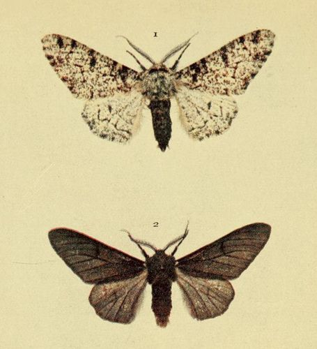
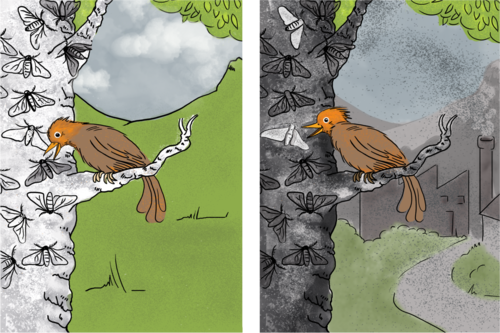

## Inheritance in humans

We say that certain traits are passed down from generation to generation over many years, from parent organisms to their offspring. This is called **inheritance**.

<Callout type="note" title="Note">
We can use the word**inheritance** in different ways. When someone dies they may leave an inheritance of money, a home, car or other physical belongings to their children or other people. In Science, inheritance is how parents pass on traits or characteristics to their children.
</Callout>

There are some traits which are very easy to see how they are inherited, such as skin colour or height. Did you know that some people are able to wink with one eye but not with both? Or that others can only see some colours but not all the colours - this is called colour blindness. Let's find out a bit more about some of these inherited traits.

# What is your inheritance?

**Problem:**
Think about your most recent family event or family photo. Is there something that you all have in common? It can be something about your physical appearance, or your behaviour or something that you can each do. Discuss any inherited traits or characteristics that get passed down from generation to generation in your family.

**Solution:**
Learner-dependent answer.

**Problem:**
One of the very interesting inherited traits is the ability to roll your tongue.

Can you roll your tongue?

Can you roll your tongue? Can your family members roll their tongues?

**Solution:**
Learner-dependent answer.

2. There are many other traits and abilities that are inherited from our parents, that they inherited from their parents, which they inherited from their parents and so on. Below is a table detailing some of these traits.
4. Count how many people in your class can do each or have each of these traits or characteristics.
6. Record the number of learners in your class who have each characteristic.
8. Calculate the percentage of learners that have this characteristic.

You may need to help learners to work out the percentage. To calculate the percentage, you need to:

- Add up the number of learners with a particular characteristic
- Divide that number by the *total* number of learners tested
- Multiply that number by 100.
- Draw a bar graph to show the percentages of learners who have each of the characteristics.

| Characteristic | Illustration | Number of learners with the characteristic | Percentage of learners with the characteristic |
| --- | --- | --- | --- |
| Tongue rolling |  |  |  |
| Thumb shape |  | Hitchhiker thumb: Straight thumb: |  |
| Dominant hand |  | Right-handed: Left-handed: |  |
| Attachment of earlobe |  | Attached earlobe: Unattached earlobe: |  |
| Dimples |  |  |  |
| Second toe length |  | Longer second toe: |  |
| Vulcan sign |  |  |  |

When you have collected all the data and have worked out the percentage of learners that have a certain trait, draw a bar graph in the space provided. Remember to label your graph and to give it a heading.

A possible homework activity: Use the above characteristics and see what family members at home can do and if they share the same characteristics or not. Calculate the percentage of family members that can roll their tongues or not.

How does variation in a species help it to survive?

### Natural selection

This section is extra information and not crucial for you to go through with your learners if time does not permit. But it links well with what learners will do in later grades if they carry on with Life Sciences.

Have you ever heard the saying: "survival of the fittest or strongest"? This refers to the way in which the organisms are able to survive in their environments because they have adapted the best or they have certain characteristics which allow them to survive better than others.

<Callout type="note" title="Note">
Watch a video that explains how natural selection works
</Callout>

Survival refers to the characteristics that allow the members of a species to thrive and reproduce successfully so their advantageous characteristics are passed on successfully. Thus over generations the entire species can survive as the majority of its members happen to have inherited the advantageous characteristics.

For example, imagine some impala in one group in a game reserve started to develop a characteristic, which was passed down from the parents to the offspring, allowing them to run faster for longer. The impala in this group can then run faster than the impala in another group. Over time, the faster impala will be able to escape the predators such as cheetahs and lions more often and so they will live long enough to reproduce and raise their offspring successfully. They will therefore pass on the swift running characteristic. The slower impala will get caught more often and so they will not survive to produce offspring. The slower impala are slowly removed over time. The characteristic making some of the impala faster allows those impala to survive and pass this trait on to their offspring. This is the principle of **natural selection**.

<Callout type="note" title="Note">
Explore natural selection by controlling the environment and causing changes in rabbits. (simulation)[http://phet.colorado.edu/en/simulation/natural-selection](http://phet.colorado.edu/en/simulation/natural-selection)
</Callout>

Visit the PhET website for ideas on how to construct a lesson around the simulation on Natural Selection identified here in the visit box. [http://phet.colorado.edu/en/simulation/natural-selection](http://phet.colorado.edu/en/simulation/natural-selection)

Let's look at a famous and interesting example of how variation in the peppered moth allowed for natural selection.

<Callout type="note" title="Note">
Play the evolution game and hunt for peppered moths
</Callout>

# Natural selection in the peppered moth

This is an extension activity that you can do with your learners if they have time, or get them to do it as a homework activity.

**INSTRUCTIONS:**

2. Read the following information about the peppered moth.
4. Answer the questions that follow.

**The peppered moth's story of evasion**

The peppered moth has been studied in a lot of detail over the past 200 years as it has a very interesting evolution over a short time period. Originally, most of the peppered moths were a light, speckled colour, as you can see in the top moth in the image. This colouring allowed the moths to be camouflaged when they rested upon the light-coloured trees and lichens in their habitat. However, not all the peppered moths were this light colour. There was some variation and there were a few which were a much darker, grey colour. They could not camouflage themselves as well as the light coloured one. The darker coloured moth is shown below in the following image.

<Callout type="note" title="Note">
The location of this fabulous example of natural selection was the city of Manchester in England. The first observation of a dark black peppered moth occurred in 1848. However, by 1895 98% of peppered moths in the city were dark!
</Callout>

The light and dark variation in the peppered moth.

During the Industrial Revolution in England, there was a huge increase in the number of factories. These factories mainly burnt coal as an energy source, which increased the amount of pollution and soot in the air. The pollution caused the lichen on the trees to die off. The soot coated the trees in the peppered moths' habitat. These trees now did not have any lichen and they were a dark grey colour because of the soot covering them.

The light coloured moths were therefore not camouflaged anymore and could be seen easily by predators when they rested on the trees. As a result, more of the light-coloured moths were eaten by birds and didn't have a chance to mate and lay eggs. Therefore the number of light-coloured moths decreased. In comparison, the few moths that were a dark grey colour were now at an advantage as they were now the same colour as the soot covered trees and could hide. These darker-coloured moths could therefore go on to have more offspring. Over time, this resulted in more and more of the moths being dark-coloured.

**QUESTIONS:**

**Problem:**
When the moths land on the trees and they are camouflaged, what are they hiding from?

**Solution:**
The camouflage helps them to hide from predators such as birds which eat them.

**Problem:**
Why do you think there were only originally a few of the dark coloured moths, and there were lots of light-coloured moths?

**Solution:**
The light-coloured moths were originally dominant. The dark ones were a variation which started to develop. But, originally, they could be easily seen on the light-coloured trees covered in lichen and so the birds could see them more easily than the light ones and so ate them. This kept the number of dark moths down.

**Problem:**
Why do you think the dark grey moths started to increase over time after the Industrial Revolution?

**Solution:**
After the industrial revolution, the dark moths were now better camouflaged on the dark, soot-covered trees. The birds could not see them as easily, and the light moths were clearly visible, so the birds started to eat the light coloured moths more than the dark coloured moths. The dark moths were able to survive and reproduce more, thereby passing on their dark trait to their offspring. This increased the numbers.

**Problem:**
Since the Industrial Revolution, the numbers of light-coloured moths have started to increase again due to improved environmental standards. Why do you think this is?

**Solution:**
We are now more environmentally aware, and use more electrical machines and fewer coal-powered machine. As a result, there is less pollution and soot in the air. This means these habitats are more protected, so the trees are not covered in soot and lichen is able to grow. Therefore, the light moths are once again better camouflaged on the trees and so avoid predation, whilst the dark grey moths are now clearly visible again.

We have now looked at how variation within a species helps it to adapt to its changing environment and therefore survive. But, these changes do not happen quickly. Although small changes can happen within a few generations, big changes take a very, very long to happen over thousands of years.

<Callout type="note" title="Note">
10 reasons to love science (video)
</Callout>
