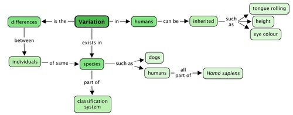

## Summary

<Callout type="note" title="Note">
- A species is a category within the classification system.
- Living organisms of the same type belong to the same species.
- Organisms from the same species can reproduce sexually and produce offspring that are fertile and can reproduce.
- People belong to the species *Homo sapiens*.
- Variation is the difference between individuals from the same species.
- This variation can be inherited from one generation to the next.
- The individuals that are better suited (adapted) to their environment will survive to reproduce. This is called natural selection.
- Small changes can take place in a species over shorter periods, like from one generation to the next.
- Over very long periods these small changes can accumulate so that big changes occur over time.
</Callout>

Concept map

This was a short section and so we have a smaller concept map than in the previous sections.

