## Physical properties of materials

<Callout type="note" title="Note">
- property
- durable
- ductile
- malleable
- flexible
- mould
</Callout>

### What are properties and why are they important?

You may remember that properties are distinctive characteristics that describe an object or material. For instance, we can describe a metal by saying that it is strong and **durable**. A metal is is also **malleable**. This **property**, malleability, means that a metal can be formed into sheets which can be used for a variety of different purposes. For example, metal sheets can be used as roof panels for a house, or to press body panels for a car.

Here you could also remind learners of a property they learnt about in Term 2 of Gr. 5. **ductile**: the property of a material that allows it to be drawn out into a wire

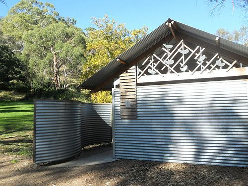

The walls and roof of this house are made of sheets of corrugated metal. [http://www.flickr.com/photos/mikecogh/5640031275/](http://www.flickr.com/photos/mikecogh/5640031275/)

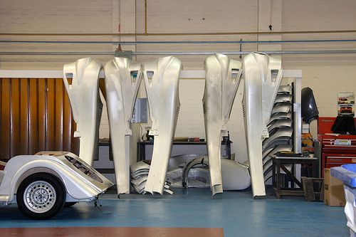

Can you see some parts of a car hanging up inside a car factory? These are made of sheets of metal. [http://www.flickr.com/photos/exfordy/3469617474/in/photostream](http://www.flickr.com/photos/exfordy/3469617474/in/photostream)

What other properties of metals do you remember? Discuss this as a class.

Metals conduct electricity and heat. Learners may also remember that metals are ductile. (Ductile describes a material which can be drawn out into a wire.)

Let's do a warm-up activity to get us thinking about materials and their properties.

# Thinking about materials and their properties

**INSTRUCTIONS:**

2. Complete the following table by adding the names of different materials that have the properties listed.
   | Property | Materials |
   | --- | --- |
   | Strong |  |
   | Flexible |  |
   | Conducts electricity |  |
   | Conducts heat |  |

**Problem:**

**Solution:**
| Property | Materials |
| --- | --- |
| Strong | Learner-dependent answer: metals, plastics, leather, concrete and wood are all examples of materials that learners could mention. |
| Flexible | Learner-dependent answer: some plastics, rubber, some metals (especially in thin sheets) are all examples that learners could mention. |
| Conducts electricity | Metals |
| Conducts heat | Metals |

**QUESTIONS:**

**Problem:**
What does it mean when a material is flexible?

**Solution:**
Flexible means supple and bendy; able to flex and bend.

**Problem:**
Suggest three possible uses of flexible materials?

**Solution:**
Flexible materials can be used to make clothing that needs to bend and fold; tubing or a pipe that needs to bend; coverings for electrical wiring that need to bend around corners; soles of shoes that need to flex when walking, etc.

**Problem:**
Suggest three possible uses of a material that is a good conductor of electricity.

**Solution:**
Transmission cables for electricity, electrical wiring, electronic components for computers and other electronic equipment, electrical fencing (to protect property), etc.

**Problem:**
Suggest three possible uses of a material that is a good conductor of heat.

**Solution:**
Good conductors of heat can be used for making pots and pans, heating elements, etc.

**Problem:**
Which of the above properties would be important if you were choosing a material for making cookware (cooking pots)?

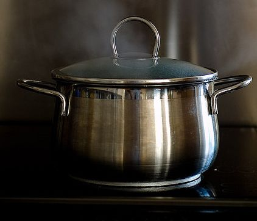

A metal pot.[http://www.flickr.com/photos/txberiu/2608488360/](http://www.flickr.com/photos/txberiu/2608488360/)[http://www.flickr.com/photos/txberiu/2608488360/](http://www.flickr.com/photos/txberiu/2608488360/)

**Solution:**
Materials for cookware would need to be strong, rigid, and able to conduct heat.

**Problem:**
Which of the above properties would be important if you were choosing a material for making the wires used for distribution of electricity (shown in the next photo)?

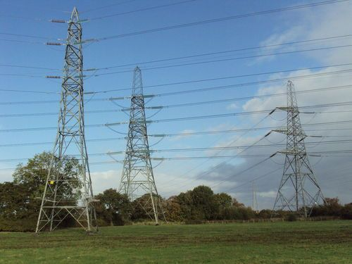

These electrical wires carried by pylons are made of metal. [http://commons.wikimedia.org/wiki/File:Pylons,_Ledsham,_Wirral_1.JPG](http://commons.wikimedia.org/wiki/File:Pylons,_Ledsham,_Wirral_1.JPG)

**Solution:**
These electrical wires need to be strong, flexible and able to conduct electricity.

**Problem:**
Which of the above properties would be important if you were choosing a material to make a barbed wire fence?

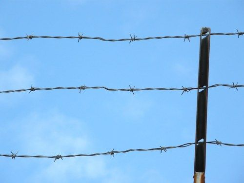

A barbed wire fence.

**Solution:**
The material used to make barbed wire fences needs to be strong, but also ductile so that it can be made into long thin wires, and also flexible so that the wires can be bent.

<Callout type="note" title="Note">
An interesting video on a new type of 'concrete canvas' with varying properties.
</Callout>

We can think of certain properties of materials in terms of advantages and disadvantages. Do you know what those are? Let's find out.

Learners should be encouraged at this stage to start thinking about scientific processes and products in terms of their advantages and disadvantages. This will create awareness that whatever payoff is created by scientific endeavour, one always has to consider the cost. Sometimes the cost is purely financial; at other times the cost may be damage to the individual (as in the case of the irresponsible use of medicines and drugs), or to the environment (some examples follow).

### Advantages versus disadvantages

We have seen that strength and durability are desirable properties in some materials. We want things to be strong and to last long. Let's think of an example.

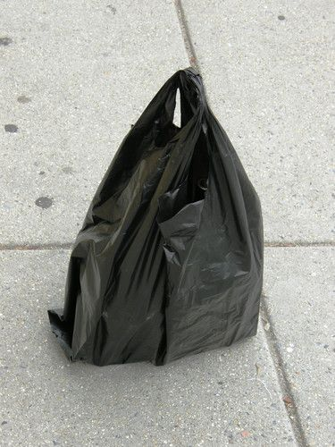

A black, plastic shopping bag.

Why would plastic shopping bags need to be strong?

Learners could be encouraged to imagine carrying a shopping bag filled with heavy items, that would simply fall through a shopping bag that is too weak or thin.

Why would plastic shopping bags need to be durable?

Learners could be encouraged to think in terms of reusing shopping bags. Encourage them to also think of not-so-obvious uses for old shopping bags, like making artworks or weaving mats for instance.

We call the desirable properties of materials advantages. Disadvantages are unfavourable features, as can be seen in the images of plastic in the environment.

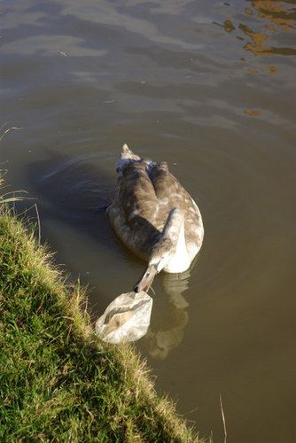

A goose about to eat a plastic bag in a river. [http://commons.wikimedia.org/wiki/File:Cygnet_on_the_Oxford_Canal_-_geograph.org.uk_-_1056892.jpg](http://commons.wikimedia.org/wiki/File:Cygnet_on_the_Oxford_Canal_-_geograph.org.uk_-_1056892.jpg)

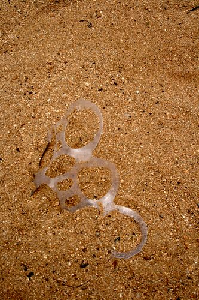

These plastic rings from soft drink packaging are very dangerous in the wild as they can entangle an animal's neck. [http://commons.wikimedia.org/wiki/File:Plastic_left_in_the_sand_near_the_Hilton_Hawaiian_Village._.jpg](http://commons.wikimedia.org/wiki/File:Plastic_left_in_the_sand_near_the_Hilton_Hawaiian_Village._.jpg)

When we throw a shopping bag away, its durability may mean that it takes years and years to break down, so it pollutes the environment for a long period of time. Its strength may mean that, when an animal becomes entangled in a piece of plastic that has been thrown away, the plastic would be too strong for the animal to escape from. The animal may eventually die as a result.

<Callout type="note" title="Note">
A Hawaiian student looks at plastic objects found in the stomachs of albatrosses.
</Callout>

The following activity has another example of advantages versus disadvantages.

# Advantages versus disadvantages

This is an optional activity.

Can you imagine a car made of solid gold? A car like this would be very valuable!

**INSTRUCTIONS:**

2. Look at the image of a gold car then answer the questions that follow.
4. Discuss some of the questions with your classmates before writing down your answers.

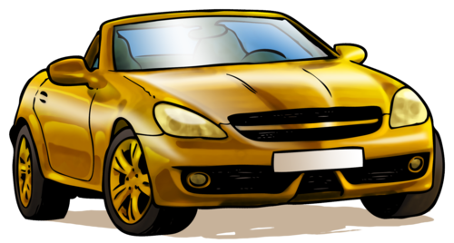

**QUESTIONS:**

**Problem:**
What are your feelings about the golden car in the picture?

**Solution:**
Learner-dependent answer. Encourage learners to write what they think of the golden car, what their thoughts and feelings are. Do they think it looks great? Would they like to own one?

**Problem:**
What are the advantages of having a car made of gold?

**Solution:**
A practical advantage is that gold doesn't rust. To some people, it may be important to display their wealth to everyone else.

**Problem:**
Do you think a golden car would be very strong? Would it perhaps be safer in the event of an accident?

**Solution:**
Allow learners to debate this for a short while. You may want to point out that gold is actually quite a soft metal, and that driving a golden car would not offer more protection to the passengers than a car which has an exterior made mostly of steel would. Avoid the misconception that cars are made entirely out of steel. Cars have crumple zones to increase safety.

**Problem:**
What are the disadvantages of a car made of gold?

**Solution:**
Gold is very expensive, and so the car would be unaffordable to most people. Gold is also very heavy (learners may need to be reminded of this), so the car would be heavy to move around. It would require lots of fuel to make it move and fuel is expensive. It would probably also scratch easily. Some learners may also say that because it is so valuable, it might get stolen. You could add that it could be insured against theft, but that insurance on a car this valuable would be very expensive. The conclusion is that although a gold car may seem like a nice idea, it is not practical or safe or fuel efficient.

We always have to weigh up the advantages against the disadvantages when we choose materials for a particular job.

How would you test how strong a material is? Let's imagine you have different types of paper. How would you test which paper is the strongest? Discuss this as a class and write some notes on the lines provided.

Encourage learners to make their own notes as you are talking in class as this is a valuable skill. They can do it either here in the workbook or in a separate notebook if you make use of these. Some points to guide the class discussion:

- Something that is durable lasts long.
- Learners may say that something is strong when it is difficult to break.
- Allow learners to discuss how to test how strong a material is for a few minutes and come up with a few ideas.
- Learners may say the paper that is most difficult to tear would be the strongest.

The strength of paper is important because we use paper for many different things.

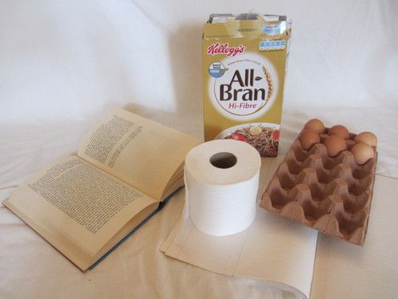

All these objects are made from different types of paper with different properties that suit the function of the object.

In the next activity we are going to investigate the tearing strength of different types of paper.

# Which type of paper is the strongest?

Learners can help you prepare for the activity by bringing different types of paper to school: newspaper, tissue paper, paper towel, or old magazines and gift wrap. Tell them to bring the biggest pieces they can find.

**AIM:** To compare the tearing strengths of different types of paper.

You could let the learners cut the paper into strips of 20 x 5 cm each, or you could do this beforehand to save time. Learners will compare the force required to tear the different types of paper. They have not yet encountered force as a concept (force is covered in Gr 9 Energy and Change) but you could encourage them to think about what they are doing when they hang the heavy marbles on the strip of paper. For example, ask learners: "What do more marbles in the yoghurt tub mean?" It means the yoghurt tub is heavier, and `pulls' harder on the strip of paper. (If you cannot get hold of marbles you could try finding small stones or pebbles that are more or less the same size. You would just have to explain to the learners that the stones do not all have a mass of 5 grams, but you will imagine that they do to simplify the calculations.)

**HYPOTHESIS:**

When you write a hypothesis, you must state what you think will happen in your investigation.

Possible hypotheses are: 'The thicker and stronger the paper, the more marbles it can hold before breaking.', 'Paper X is the strongest', where X is one of the papers supplied.

**MATERIALS AND APPARATUS:**

- strips of different types of paper (20cm x 5cm)
- hole puncher
- strong paper clips
- yoghurt tub
- marbles
- string
- hand lens (optional)

Make sure to use strong paper clips so that they do not bend under the strain of the marbles during the investigation. Make sure to use a range of papers, such as filter paper, tissue paper, crepe paper, wax paper, newspaper, normal white paper, harder card, etc. A suggestion is to also number the pieces of paper so that learners can easily reference them and then use the number to place them in order of strength later on in the questions. If you have time you can also test some other materials such as plastic shopping bags or aluminium foil.

**METHOD:**

You can introduce the idea of a fair test here. Ask learners why they think they should punch the holes the same distance from the edge in each type of paper. This is because you want it to be a fair test - each piece of paper must be tested fairly and equally. If the holes were punched at different distances from the edge, this might make some papers appear stronger or weaker than they actually are. You need to control all other variables so that the only thing you are changing is the type of paper.

2. Punch a hole at both ends of each paper strip. This is so that you can test the paper twice on each side. Make sure that the holes are in the middle, and also at the same distance from the end of each strip. This will make it a fair test.
4. Form the paper clip into an S-shape and hang it from the hole in the paper.
6. Make a handle for the yoghurt tub, using the string.
8. Hang the yoghurt tub from the paper clip and hold it in your hand.
10. Add marbles one-by-one to the yoghurt tub until the paper tears. Count the number of marbles in the tub. (Tip: Place the marbles very gently into the yoghurt tub or the shock of dropping them in might tear the paper).
12. Repeat steps 1 - 5 using the other end of the strip and count the marbles again. Take the average of the number of marbles.
14. Repeat this using the other strips of paper, doing each twice and taking the averages.
16. If each marble has a mass of 5 grams, work out the mass in grams that was needed to tear each strip of paper and write the number in the final column of your table.
18. If you have time, you can also test different kinds of materials, such as a plastic shopping bag, aluminium foil or plastic wrap.

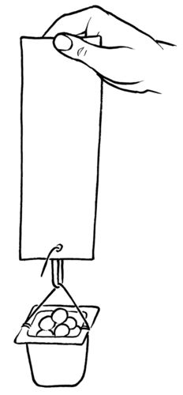

Tip: To calculate the **average** of a set of numbers, you add all the numbers together and then divide by how many numbers there were in the set. In this investigation, you will add the number of marbles together for each time you tested the paper strength (this was twice for each strip of paper) and then divide by 2 to calculate the average number of marbles that each piece of paper can hold before it tears.

For example, if you had 5 marbles in the first attempt, and 3 marbles in the second attempt, the average will be calculated as follows:

\(5+3=8\) marbles

\(8\div{}2=4\) marbles on average

Therefore, the paper type could hold an average of 4 marbles.

**RESULTS AND OBSERVATIONS:**

Record your results in the table.

| Type of paper | Number of marbles (Trial 1) | Number of marbles (Trial 2) | Average number of marbles | Mass of the marbles |
| --- | --- | --- | --- | --- |

Now answer the following questions:

**Problem:**
Look carefully at the surface of one of the paper strips. Now look carefully at the torn edge. Can you see anything special? Describe what you think the paper is made of.

**Solution:**
Learners should notice that the paper appears to be made of a layer of fibers. The fibers cling to each other because they have tiny branches on them, that become entangled to give the paper extra strength.

**Problem:**
Which paper is the strongest?

**Solution:**
Learner-dependent answer based on the evidence from the investigation.

**Problem:**
Which paper is the weakest?

**Solution:**
Learner-dependent answer based on the evidence from the investigation.

**Problem:**
*in order of increasing tearing strength*. (That means from weakest to strongest.)

**Solution:**
Learner-dependent answer

**ANALYSIS AND EVALUATION:**

Let's now analyse and think about the results of the investigation.

**Problem:**
What do you think causes one paper to be stronger than another?

**Solution:**
More than one factor play a role here, but generally paper that is thicker tends to be stronger. This is because the layer of fibers is thicker, so more fibers to cling to each other. Papers in which the fibers are longer and more tightly packed are also stronger, and coating the paper with a super thin layer of plastic also adds additional strength. Learners could be encouraged to look for signs of these treatments.

**Problem:**
How would you modify the investigation to test the strength of different types of plastic?

**Solution:**
Plastics are generally stronger than paper, so for a start, the testing method should allow for greater weights to be hung from the plastic strips. This is a good opportunity to introduce the notion of fair testing: As many variables as possible should be kept the same: length of the plastic strips, method of fastening the weight to the plastic strips, etc.

**Problem:**
What did you do to ensure fair testing?

**Solution:**
- We used paper strips of the same length and width.
- We punched identical holes in all the different paper strips.
- We punched the hole in exactly the same place on all the strips.
- We used the same method to hang the marbles from the paper strip for all the different types of paper.
- We repeated each measurement (by testing both sides of the paper strip).

**Problem:**
How would you modify the investigation to test the flexibility of different types of materials?

**Solution:**
Learner-dependent answer. One suggestion might be to cut strips of the same size of the materials to be tested, and lay them across the edge of a table, hang a weight on the overhanging edge and find a way to measure the amount of flexing that occurs. Learners could discuss ways of ensuring the test is fair.

**Problem:**
Why did you repeat the experiment for the same type of paper?

**Solution:**
It is important to repeat experiments to be sure you get the same/similar answers every time. Repeating an experiment and calculating an average value helps to eliminate errors, or results that arise by chance (or luck). We say it makes the answer more reliable.

**CONCLUSION:**

What can you conclude from this investigation?

Possible conclusions include: 'The stronger the paper, the more marbles it can hold before tearing', or 'Paper X is the strongest as it can hold the most marbles before tearing and paper Y is the weakest', etc.

Strength, **flexibility** (the ability to flex or bend), electrical conductivity and heat conductivity are important properties of materials that we learnt about in Gr. 5 and have revised again here.

Can you think of materials that are both strong and flexible? Most people will immediately think of plastics! Most plastics can easily be melted and **moulded** into different shapes for different purposes. Why do you think plastics can be 'melted and moulded' with ease?

Most plastics melt easily because they melt at relatively low temperatures. We say they have *low melting points*. Note that this is not true for all plastics.

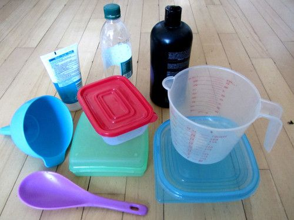

All of these items are made of plastic in different shapes, sizes and colours.

We are going to learn about two new properties of materials, namely boiling point and melting point.

First, let's check if everyone knows that there is a difference between the words heat and temperature. The two words, heat and temperature, are connected but they do not mean the same thing:

- **Heat** is the transfer of energy from one object to another. This happens because of the difference in temperature between the two objects. The transfer of energy will be from the hotter object to the cooler object until they are the same temperature. You cannot measure heat directly, but you can detect its effect on a substance. Changes in heat can usually be detected as changes in temperature.
- **Temperature** is used to describe how hot or cold something is. Temperature can be measured directly with a thermometer.

Adding heat energy usually results in a temperature rise, so people often confuse heat and temperature. But they are not the same thing! We will look more at heating as a transfer of energy next term in Energy and Change.

### Boiling and melting points

<Callout type="note" title="Note">
- temperature
- thermometer
- heat
- melting point
- boiling point
</Callout>

Do you remember learning about the state changes in previous grades? We will be focusing on boiling and melting in this section. Have a look at the following diagram to refresh your memories about the different changes of state between solids, liquids and gases.

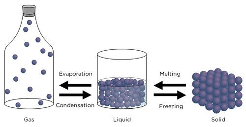

**Problem:**
Melting is when a solid changes into a liquid. Look at this photo of a candle burning. What is happening to the wax around the flame?

**Solution:**
The wax is melting.

**Problem:**
Discuss with your partner why you think this is happening to the wax. Write your answer below.

**Solution:**
Discuss this with your class. The heat energy from the flame on the burning wick is transferred to the wax causing the temperature of the wax to rise. When the temperature gets to a certain point (called its **melting point**), the wax starts to melt as it changes state from a solid to a liquid.

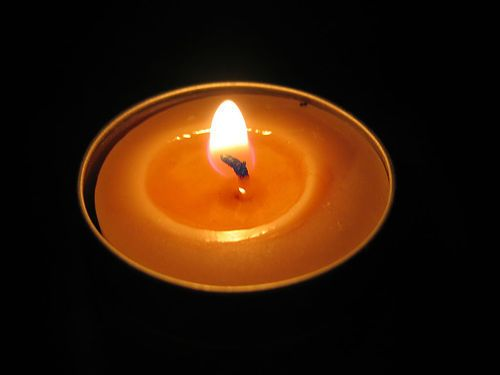

A burning candle. [http://www.flickr.com/photos/skyseeker/20220695/](http://www.flickr.com/photos/skyseeker/20220695/)

As you can see in the previous diagram, a liquid can change into a gas by evaporation. For example if you leave a saucer of water out in the sun, the water will evaporate. Evaporation can take place at any temperature. But, in boiling, the liquid needs to be heated to reach its **boiling point**. Bubbles of water vapour then form in the liquid and rise up.

There are some important differences between evaporation and boiling. Evaporation can take place *below* the boiling point of a liquid, but boiling takes place only once the liquid is heated and reaches its *boiling point*. Also, evaporation occurs at the *surface of a liquid* as *individual* particles gain enough energy to overcome the forces holding them in the liquid and become individual particles in the gas state. Boiling occurs *within the liquid* when enough particles *escape en masse and form bubbles* of gas in the liquid. The gas bubbles then rise to the surface of the liquid and the liquid is said to boil.

Can you think of at least three different ways to boil water? Discuss this with your class and write your answer down.

Ask your learners this question and get some answers. Encourage them to take notes:

- Water can be boiled in the kettle.
- Water can be boiled in a pot on the stove.
- Water can be boiled in a microwave oven.

What would happen if you tried to put the kettle into the microwave or on the stove? We will soon find out!

# Boiling and melting

This is an optional activity.

Look carefully at the picture below. It looks as if something has gone wrong here!

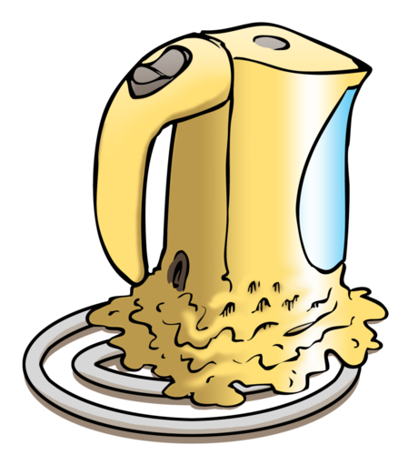

**QUESTIONS:**

**Problem:**
Write a short story to explain what you think happened to the kettle in the picture.

**Solution:**
Just a few sentences are required here. The learners should note that someone placed the plastic kettle on the stove. When the person tried to heat the water, the kettle melted as a result of contact with the flame/heat. The kettle is meant to be plugged in to heat the water.

**Problem:**
Why do you think the person made the mistake of heating the kettle on the stove?

**Solution:**
Learners can come up with their own reasons here. Perhaps the person was used to heating water on the stove in a metal kettle. Perhaps the person did not know that the plastic would melt. Perhaps the person was just absent-minded and made a mistake.

**Problem:**
Do you think plastic is a good choice of material for making a whole cooking pot? Why do you say so?

**Solution:**
No. Plastic is not a good choice because it melts when it is heated above a certain temperature.

**Problem:**
Why does a plastic kettle not melt when we boil water in it?

**Solution:**
The water boils at a temperature that is lower than the temperature needed to melt the plastic of the kettle.

**Problem:**
Sometimes, just the handles of the cooking pot are made from plastic or wood. Why do you think this is so?

**Solution:**
This is because wood and plastic are not good conductors of heat, unlike metal, and so you can pick up the pot easily.

This is also an extension question as we have not specifically dealt with heat conductivity yet in this grade, but it has been covered in previous grades.

At what temperature does water boil? We are going to do an investigation to find out! Since we have to make temperature measurements in the investigation, we are going to first check if everyone knows how temperature is measured.

Some learners may know that water boils at a temperature around 100°C (100 degrees Celsius), depending on factors such as altitude above sea level and atmospheric pressure. Do not answer this question directly, but rather use it to introduce the next activity.

Have you ever been so sick that you had a fever? Have you ever had your temperature taken?

Perhaps you have had your temperature taken with a **thermometer .**A thermometer can be used to find out how hot or cold something is. A thermometer is an instrument for measuring temperature.

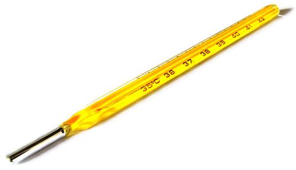

This is a thermometer used to take your temperature when you have a fever. [http://www.flickr.com/photos/andresrueda/3407340937/](http://www.flickr.com/photos/andresrueda/3407340937/)

<Callout type="note" title="Note">
The mercury inside these kinds of thermometers is toxic and dangerous so they must be handled with care.
</Callout>

<Callout type="note" title="Note">
- contract
- expand
- constant
- independent variable
- dependent variable
- altitude
</Callout>

Here is an optional, extension activity on how a thermometer works. It links to what learners will do in Gr 8 Matter and Materials. Next year, learners will look at the Particle Model of Matter, and within this, cover density and the contraction and expansion of materials. However, this is a good extension exercise to get learners thinking about how a thermometer works and introduce the idea that materials **expand** (when heated) and **contract** (when cooled) due to the increase in kinetic energy of the particles (the size and number of the particles do not change, it is only the spaces between the particles that get bigger or smaller).

**Note:** An exception is water which actually expands when it becomes a solid (ice). This will be covered in detail in later grades.

**Activity: How does a thermometer work?**

The common glass thermometer that you see in the image is called a bulb thermometer. All bulb thermometers consist of a fairly large bulb, connected to a long thin tube. The thermometer usually contains some type of brightly coloured liquid. Liquids take up less space when they are cold and more space when they are warm; we say they contract when they are cooled and expand when they are warmed.

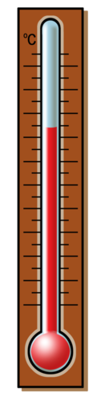

**QUESTIONS:**

2. What do you think will happen to the liquid level in the thermometer when the liquid inside expands?

*The liquid level will rise when the liquid expands.*

2. What do you think will happen to the liquid level in the thermometer when it is put into the refrigerator? Say *why* this would happen.

*The inside of the refrigerator is cold. This will make the liquid inside the thermometer contract. The liquid level will drop.*

<Callout type="note" title="Note">
This video shows you how to use a laboratory thermometer.
</Callout>

Let's now investigate boiling and melting.

# What is the boiling point of water?

The investigation in the learners books includes only that of investigating boiling point of water, as suggested in CAPS. However, if you would also like to look at melting point of ice, this second part has been included in the teachers guide later.

**AIM:** To observe boiling and to determine the boiling point of water.

CAPS suggests that this investigation could be performed on `other liquids' such as orange juice, apple juice and cola. One issue to be aware of is that the suggested beverages are all solutions of substances*in water*. Their boiling points will be slightly higher than that of pure water, but this is because adding some substances to water elevates the boiling point of the solution. It is still water that is boiling in all these instances (the phenomenon is called *boiling point elevation*). Sometimes, adding substances (such as ethanol) to water can bring the boiling point down (refer to Raoult's Law). This is a lot of detail and not necessary for the learners to know about at this stage.

Here are some suggestions for extensions for this investigation:

2. Determining the boiling point of methanol (methylated spirits) or ethanol (available as 'surgical spirits' from the pharmacy). The point of this extension would be to show that different substances have different boiling points.

**Note:** Methylated spirits can be used instead of methanol but it only contains about 9.5 % methanol in more than 80 % ethanol. This means there may not be a big difference between the experiments carried out with ethanol and methylated spirits.

**Warning:** Take care when working with these substances, especially methanol, since it is dangerous. Wear gloves if possible, and avoid inhaling the fumes. Furthermore, ethanol and methanol are both extremely flammable and care should be taken when heating them. A safe way of heating ethanol or methanol to its boiling point is shown in the following diagram. The test tube containing the ethanol or methanol should be suspended in a beaker of tap water, and slowly heated. The principle of thermal equilibrium means that the water and ethanol/methanol will be at the same temperature, so the temperature of the water can be substituted for the temperature of the ethanol/methanol.

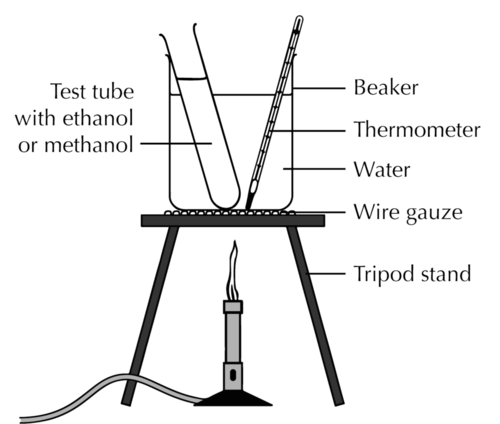

2. Determining the boiling point of water by another method, for instance in a pot on the stove, or in a kettle. The point of this would be to show that the boiling point of water is constant (at constant pressure, of course, so it would make sense to do the extensions concurrently with the prescribed procedure below).

**HYPOTHESIS:**

What is your hypothesis for this investigation?

Possible hypotheses that learners could give include stating the boiling point of water that they might know from previous knowledge.

**MATERIALS AND APPARATUS:**

- glass beakers x 2 (or small pot)
- Bunsen burner (or stove plate)
- tripod with gauze
- tap water
- thermometer
- funnel
- ice blocks

Before starting the investigation, divide the class up into groups in which they will perform the investigation and get learners to discuss the following questions first in their group to revise concepts from Gr 6.

Before you start, discuss the following questions in your group:

**Problem:**
Discuss what you know about gases, liquids and solids; the three states of matter. Write down your ideas from your discussion.

**Solution:**
- The particles in solids are tightly packed into fixed positions, so solids retain their shape. They cannot be compressed.
- The particles in liquids are also close to each other, but they are not in fixed positions and can move around, that means liquids can fill the container they are in. They are not really compressible either.
- The particles of gases are really far apart, they are not ordered in any way, they can move anywhere they want. Gases are compressible as a result.

Learners should be encouraged to think about the different states of matter in terms of the particle model which was first introduced in Gr 6 and is built upon more next year in Gr 8.

**Problem:**
What needs to happen to water to make it freeze?

**Solution:**
In order for water to freeze, it needs to be cooled down.

**Problem:**
What needs to happen to water to make it boil?

**Solution:**
In order for water to boil it needs to be heated.

**Problem:**
How do we measure temperature?

**Solution:**
We measure temperature with a thermometer.

**Problem:**
Can you remember the boiling point and freezing/melting point of water? If you can, write them in the space below.

**Solution:**
It is not important that learners remember these temperatures, as they will be determining them experimentally shortly. This question has been added to allow you to gauge how many learners know them.

**Problem:**
Let's make some predictions. Read the two statements below, and indicate whether you AGREE, DISAGREE or are NOT SURE, by drawing a cross in the matching column:

**Solution:**
Learner-dependent answers.

The concept of making predictions in science investigations is introduced here.

| Statement | AGREE | DISAGREE | NOT SURE |
| --- | --- | --- | --- |
| Water can get hotter than 100°C. |  |  |  |
| Water always freezes at 0°C. |  |  |  |

Safety precautions

- Your teacher will demonstrate how to handle the Bunsen burner safely.
- Remember that boiling water can cause painful burns.
- The thermometer is made of very thin glass. Hold it gently, and do not use it to stir the water. Be careful not to drop it or bump it against the bottom or sides of the beaker.

When lighting the burner, always light the match (or lighter) before opening the gas.

It might be best to try this experiment in advance to determine how frequently water temperature should be measured. Time intervals would depend on the volume of water. CAPS suggests intervals of 3 minutes, but shorter intervals will provide more data points to plot on the graph.

**METHOD:**

2. Set up your apparatus as shown in the image. Remember that when you want to take the temperature, the thermometer must not be touching the sides.
   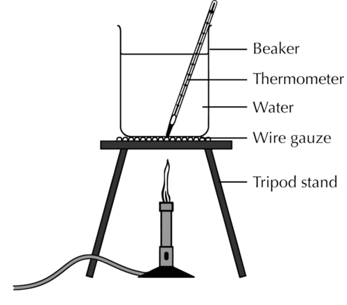

2. Take a measurement of the water temperature before you start heating the water. This will be your measurement at time 0.
4. Light the burner and heat the water.
6. Measure the temperature of the water at regular intervals. Record the temperature in the table provided.
8. After a while you will notice that the temperature of the water becomes **constant** (this is when the temperature stops going up). Continue to take the temperature three more times (once every three minutes) after this happens. What do you notice about the water?

Learners should observe that the water is starting to boil. When boiling starts the temperature of the water remains constant. The best graph is obtained when the water is stirred gently throughout; this ensures that the water is heated uniformly.

**RESULTS AND OBSERVATIONS:**

<Callout type="note" title="Note">
Perhaps you measured the boiling point of the water as slightly less than 100°C. This does not mean that your measurements were incorrect. The boiling point of water depends on the atmospheric pressure. At sea level (close to the ocean) water boils at 100°C. Water boils at a lower temperature at higher**altitudes** (for example, on a mountain) because the air pressure is less.
</Callout>

Record your results in the table.

| Elapsed time (minutes) | Temperature of the water (°C) |
| --- | --- |
| 0 |  |

We are now going to draw a graph of the results recorded in the table. Here are some guidelines for drawing the graph:

2. The title of your graph should be: **Determining the boiling point of water**.
4. The independent variable should be 'Time'. Label the axis, and use minutes as units. Remember that the** independent variable** should always be drawn on the horizontal axis of your graph, or the x-axis.

Learners should be reminded that the independent variable is the one that was `manipulated'; in this case the total amount of energy added to the water increased with time. Since we have no real measure of the energy added to the water, but since we do know that the energy was added at a constant rate, we can use the **time** that the water was heated as our independent variable.

2. The dependent variable should be 'Temperature'. Label the axis, and use degrees Celsius (°C) as units. The **dependent variable** should always be drawn on the vertical axis of your graph; this is the y-axis.

Learners could be reminded that the dependent variable is the one that was 'measured' or observed; in this case the temperature of the water as it increased with time.

2. Plot the data on a line graph using the graph paper - each data point must be marked with a small, neat cross.

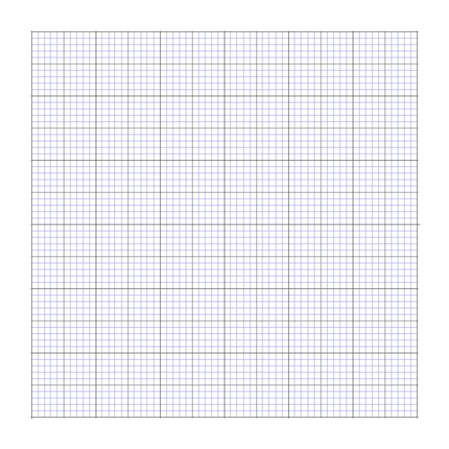

Learners' graphs should have the following general shape and features:

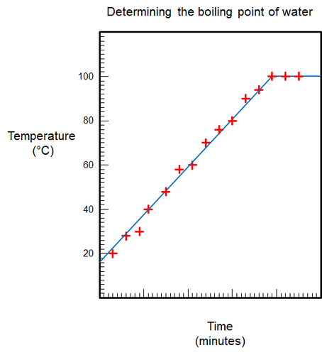

<Callout type="note" title="Note">
Water can boil at room temperature, inside a vacuum
</Callout>

<Callout type="note" title="Note">
The boiling point of water also depends on the purity of the water. Water which contains impurities (such as salt or sugar) boils at a higher temperature than pure water. This is why orange juice or apple juice will boil at temperatures slightly above 100°C.
</Callout>

**ANALYSIS:**

<Callout type="note" title="Note">
Different thermometers from different batches might also give slightly different readings. This is because they might have been calibrated differently.
</Callout>

**Problem:**
What did you see when the water started to boil?

**Solution:**
I saw bubbles in the water.

**Problem:**
What do you think happened to the water when it boiled?

**Solution:**
Some of the liquid water turned into gas, that is why there were bubbles.

**Problem:**
Describe the shape of your graph. Is it a straight line?

**Solution:**
The first part of the graph has a positive slope, then the graph becomes a horizontal line.

**Problem:**
How did the temperature of the water change over time?

**Solution:**
The temperature of the water increased gradually, then it became constant.

**Problem:**
How does the shape of the graph show the way the temperature changed over time?

**Solution:**
The left part of the graph where the slope is positive, shows that the temperature of the water increased. The right part of the graph where the graph is horizontal, shows that the temperature of the water did not change over time, but stayed constant.

**Problem:**
What happened to the temperature of the water when it started to boil?

**Solution:**
The temperature did not go up anymore, it stayed constant.

**Problem:**
How long did it take for the water to start boiling?

**Solution:**
Learner-dependent answer.

**Problem:**
At what temperature did the water boil?

**Solution:**
Learner-dependent answer.

The boiling temperature depends on the elevation above sea level and the air pressure at the time of measurement. Water boils at 100°C at sea level and at temperatures slightly below that at elevated altitudes.

**Problem:**
What do we call the temperature at which the water boils? Indicate this temperature on your graph.

**Solution:**
The temperature at which water boils is called the boiling point of water.

The next question refers to a bigger flame. A bigger flame simply means that energy is added to the water at a higher rate. This question helps learners to realise that for a fixed amount of water, a fixed amount of energy will be needed to bring it to the boiling point. This may help them to understand the concept of specific heat later on.

2. Suppose we used a Bunsen burner with a bigger flame.
   **Problem:**
   Do you think the water would boil at a temperature that is higher, lower or the same as the boiling point you just measured? Why do you say so?
   **Solution:**
   The water will boil at the same temperature. The bigger flame gives more energy to the water but does not affect the boiling point.
   **Problem:**
   Do you think the time required for the water to boil would be longer, shorter or the same? Why do you say so?
   **Solution:**
   The water will boil in a shorter time. The bigger flame gives more energy to the water per time unit. That means less time will be needed to heat the water.

**CONCLUSION:**

Write a conclusion for this investigation. When writing a conclusion, you must go back to look at your initial aim.

Learners should write a conclusion stating the boiling point of water that they determined from this investigation, for example, "From this investigation, it can be concluded that the boiling point of water is 100°C.

This is the second part of the investigation if you would like to look at melting point of ice.

**Part 2: Measuring the melting point**

**METHOD:**

2. Set up your apparatus as shown in the following picture.
   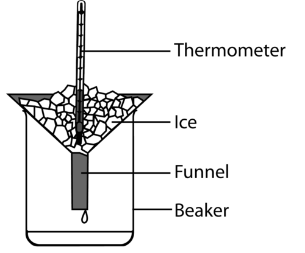
   **Note:** It is better to use crushed ice rather than larger blocks of ice, because it gives better contact between the thermometer bulb and the ice.
4. Leave the thermometer in the ice for a few minutes. Read the measurement on the thermometer. What do you notice about the ice?
   **Note:** Learners should notice that, even though the ice is starting to melt, the temperature remains constant.
6. Wait 3 minutes and measure the temperature again. Is the ice getting warmer or does the temperature remain constant?
   **Note:** The temperature remains constant.
8. Do step 3 one more time.
10. Take some of the ice pieces and drop them into the beaker. Swirl the ice with a small amount of water for about 20 seconds and then measure the temperature of the ice-water-mixture in the beaker. Is it different from the original temperature of the ice?
   **Note:** The temperature of the ice-water-mixture should be the same as the original temperature of the ice.
12. Place the beaker in a warm spot (you could even heat it carefully over the Bunsen burner). Measure the temperature of the ice-water-mixture every three minutes. What do you notice about the temperature when all the ice has melted?
   **Note:** Once all the ice has melted, the temperature of the water begins to rise.
14. Once all the ice has melted, continue to measure the temperature every 3 minutes, 3 more times.
16. Record your measurements in a table in the space provided.

**RESULTS AND OBSERVATIONS:**

Use the space provided to draw your own table to record your results. Have a look at the table that you filled in for part 1 to give you some hints.

Now draw a graph of your experimental data. Here are some guidelines for drawing the graph:

**Problem:**
The title of your graph should be: **Determining the melting point of ice**.

**Solution:**

**Problem:**
Which is the independent variable?

**Solution:**
The independent variable is Time.

**Problem:**
Which is the dependent variable?

**Solution:**
The dependent variable is Temperature.

**Note:** See explanation given for variables within the first part of the investigation.

2. Plot the data on your graph, and draw a smooth line through the data points.

**Note:** Learners' graphs should have the following general shape and features:

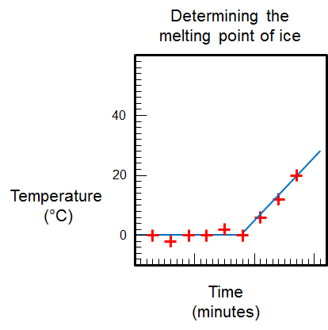

Beware that temperatures below 0°C may be recorded, so learners' graphs may not be identical.

**ANALYSIS:**

**Problem:**
What did it look like when the ice started to melt?

**Solution:**
The ice became wet where it melted.

**Problem:**
Describe the shape of your graph. Is it a straight line?

**Solution:**
The first part of the graph is a horizontal line, then the graph goes up (the line has a positive slope).

**Problem:**
How did the temperature of the ice (and water) change over time?

**Solution:**
At first, the temperature of the ice-water-mixture stayed constant, then after all the ice had melted, the temperature of the water started to go up.

**Problem:**
How does the shape of the graph show the way the temperature changed over time?

**Solution:**
The horizontal part of the graph represents the stage when the temperature stayed constant. The right side of the graph, where the slope is positive, shows that the temperature was going up.

**Problem:**
What happened to the temperature of the water when all the ice had melted?

**Solution:**
Once all the ice was melted the temperature of the water started to go up.

**Problem:**
How long did it take for all the ice to melt?

**Solution:**
Learner-dependent answer.

**Problem:**
At what temperature did the ice melt?

**Solution:**
The ice melted at 0°C.

**Problem:**
What do we call the temperature at which the ice melts? Indicate this temperature on your graph.

**Solution:**
The temperature at which ice melts is called the melting point of ice.

**Problem:**
At what temperature do you think water will freeze?

**Solution:**
Water freezes at 0°C.

**Note:** The purpose of this question is to make learners realise that melting and freezing are the reverse of each other. The phase transition between water and ice (liquid and solid water) always occurs at 0°C (in pure water).

2. Suppose we used a Bunsen burner to melt the ice.
   **Problem:**
   Do you think the ice would melt at a temperature that is higher, lower or the same as the melting point you just measured? Why do you say so?
   **Solution:**
   The ice would melt at the same temperature because the melting point stays the same.
   **Problem:**
   Do you think the time required for the ice to melt would be longer, shorter or the same? Why do you say so?
   **Solution:**
   The ice would melt in a shorter time, because the burner gives it more energy in a shorter time.

**Note:** Once again, this has been included to bring learners to the realisation that a fixed amount of energy will be needed to melt a fixed amount of ice. Heating the ice with a burner simply delivers the energy at a faster rate, so melting occurs sooner. Melting occurs at the melting point which is 0°C. The melting point is not affected.

<Callout type="note" title="Note">
Ice melts at 0°C. Water freezes at 0°C. Coincidence, or not?
</Callout>

We will learn more about changes of state in Gr. 8 Matter and Materials. In order to melt ice, we need to add energy to it to raise the temperature to **melting point**. However, if we want to freeze water, we need to remove (take out) energy from it until the temperature decreases to freezing point.

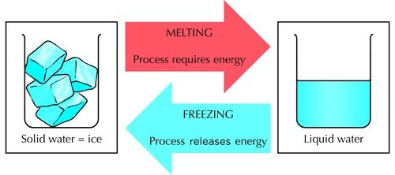

Does boiling have a reverse process? Boiling is when liquid water changes to water vapour or steam. The reverse process, when steam turns back to water, is called condensation. In order to boil water, we need to add energy to it. But if we want to condense the water vapour, we need to cool it down (take energy out of it).

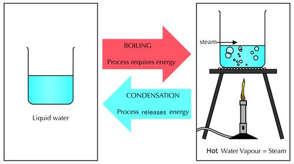

The following diagram summarises what we have learned so far.

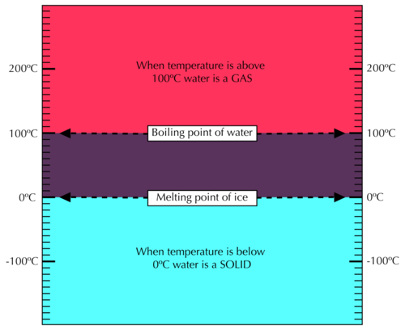

In words, the summary of the diagram is:

- Boiling occurs when a liquid turns to a gas at boiling point.
- Water boils at a temperature of 100°C when the air pressure equals 1 atmosphere. This is called the normal boiling point of water.
- When water is heated, its temperature will rise until the water starts to boil. While the water is boiling the temperature will remain constant.
- Melting occurs when a solid turns to a liquid.
- Ice (the solid form of water) melts at a temperature of 0°C. This is called the melting point of ice. This is also called the freezing point of water.
- When ice is heated, its temperature will remain constant until all the ice has melted. Only then will the temperature of the water (that was ice before it melted) rise above 0°C.

Ask your learners what 'room temperature' is and if they can find room temperature on the diagram? Get them to mark where it is on the diagram. Room temperature is 25°C. Once they have located where this is on the diagram, ask them what state water will be at 25°C? Water is a liquid at 25°C.

Do all liquids boil at 100°C? No, of course not! Not all substances melt at 0°C either.

Can you think of a few substances that are solids at low temperatures, but have low melting points? (Think of things that melt easily when it is hot outside. Ice cream is an example.)

Discuss this in class and get your learners' input. Some examples are: Ice cream, butter, and chocolate.

In the next activity we are going to explore the boiling and melting points of a few substances other than water.

# Boiling and melting points of other substances

This is an **optional** activity.

**INSTRUCTIONS:**

2. Place the boiling and melting points of the substances listed below on the blank template provided and then answer the questions.
4. The boiling point of nitrogen is - 200°C. Draw a green line at this temperature on the diagram and label it 'Boiling point of nitrogen'.
6. The boiling point of ethanol is 78°C. Draw a red line at this temperature on the diagram and label it 'Boiling point of ethanol'.
8. Now draw a blue line at the boiling point of water and also label this line.
10. What is room temperature? Draw a black line at this temperature and label it.

Learners' diagram should look like this:

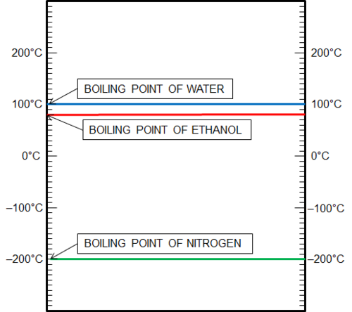

Room temperature is normally at 21°C.

**QUESTIONS:**

**Problem:**
What state would nitrogen be in at room temperature? Why do you say so?

**Solution:**
Nitrogen would be a gas at room temperature, because room temperature is higher than the boiling point of nitrogen.

**Problem:**
Suppose you mix some water and some ethanol. They are mixed but they have not changed into something else. The mixture is at room temperature to begin with. Now suppose you start heating the mixture. What temperature would be reached first: 78°C or 100°C?

**Solution:**
78°C

**Problem:**
What do you think will happen when the mixture reaches a temperature of 78°C? Do you think the ethanol will start to boil?

**Solution:**
Learners may be unsure, but you could say that the ethanol is still ethanol, it has not been changed in the process of mixing, so it will most certainly start to boil at 78°C.

**Problem:**
Will the water boil at the same time?

**Solution:**
No. Water only starts to boil at 100°C.

This question was included to prepare learners for the concept of distillation that will be introduced in the next chapter. Boiling point is a property of a substance. Boiling point can be used to identify a substance. You can explain this to your learners after you have done this question.

<Callout type="note" title="Note">
Play an interactive game based on the melting points of solids.[http://www.sciencekids.co.nz/gamesactivities/meltingpoints.html](http://www.sciencekids.co.nz/gamesactivities/meltingpoints.html)
</Callout>

So far we have seen that materials have different properties such as their strength, their flexibility and their melting and boiling points. These properties determine how these different materials are used.

We also briefly mentioned how some materials can conduct heat better than others. This is called heat conductivity. Think of some objects which you want to be able to conduct heat well and what material they should be made of. Write some of your ideas down.

Possible answers are the metal of cooking pots conducts heat well to cook food and boil water, the metals that make up some heaters also need to conduct heat well.

Why do you think you put a jersey on when you are cold? What can we say about the wool that the jersey is made from in terms of heat conductivity?

The wool or fabric that the jersey is made of does not conduct heat well. It therefore acts as a heat insulator, keeping the body warm.

We will learn more about heat transfer later in the year. Another property of materials is how well they can conduct electricity. This is called electrical conductivity. We will look more at how different materials can be used as electrical insulators (meaning they do not conduct electricity well), later in the year.
