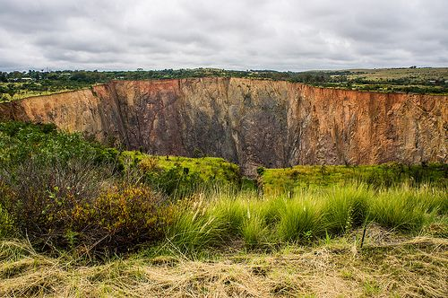
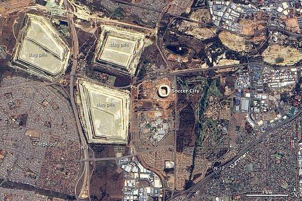
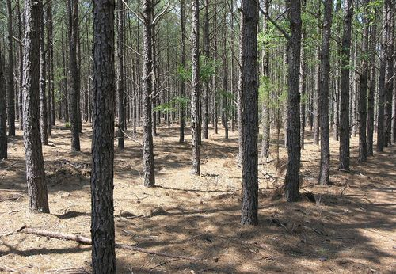
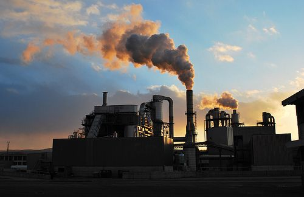

## Impact on the environment

<Callout type="note" title="Note">
- impact
- concern
- environmental concerns
</Callout>

Earlier, we saw how some of the properties of materials may be advantages under certain circumstances, but can become disadvantages under a different set of circumstances, such as plastics and other materials which, if they end up in nature, can have serious consequences and cause harm to other animals. Every process used to produce materials for our benefit has an **impact** on the environment. Some processes have a small impact and others have a large impact.

<Callout type="note" title="Note">
What is fracking? (An article)[http://www.bbc.co.uk/news/uk-14432401](http://www.bbc.co.uk/news/uk-14432401)
</Callout>

<Callout type="note" title="Note">
A major**environmental concern** at the moment is the proposal to start fracking in the Karoo. Fracking is a process where water is injected at very high pressures into small fractures in underground rock to crack it further and release gas and oil which are used as fuels.
</Callout>

<Callout type="note" title="Note">
An article on fracking in South Africa.[http://mg.co.za/article/2013-06-28-00-new-us-study-inflames-sas-fracking-feud](http://mg.co.za/article/2013-06-28-00-new-us-study-inflames-sas-fracking-feud)
</Callout>

We have already seen how the use of materials, such as plastics and paper, has a negative impact on our environment, but what about their production?

# Environmental impact of material production

**INSTRUCTIONS:**

2. Look at the pictures and answer the questions that follow about the production of different materials in South Africa.
4. You will need to do some extra research for this activity. Some information about each of the processes has been provided, but you will need to research them in more detail and answer the questions that follow.

**Mining:**

Mining in South Africa has been one of the main reasons for our development. South Africa is still one of the top gold mining countries in the world. We also mine and produce other metals such as chromium, platinum, as well as coal and iron ore. Although this is hugely beneficial for the economy, it has devastating effects on the environment.

**Problem:**
This huge hole is actually a diamond mine about 40 km outside of Pretoria. What effects do you think this has had on the environment?

The Premier Diamond Mine outside of Pretoria. [http://www.flickr.com/photos/vaizha/8524241048/](http://www.flickr.com/photos/vaizha/8524241048/)

**Solution:**
The local habitats are affected by the digging of the hole, the roads that are built and the other infrastructure put in place. Diamond mines require huge amounts of diesel which produce greenhouse gases which build up in the atmosphere.

**Problem:**
In this photograph, the 2010 World Cup Soccer Stadium can be seen in the centre. In the top left are huge areas called slag piles. These are huge piles of crushed rock left over from decades of gold mining. What impact do you think this has on this area?

An aerial view of the Soccer City Stadium and surrounding area. [http://www.flickr.com/photos/gsfc/4691437306/](http://www.flickr.com/photos/gsfc/4691437306/)

**Solution:**
**Note:** Learners may battle with this question so you can ask them if they think anything can grow or live on these dumps again?

As can be seen, these slag piles do not have anything growing on them as they are not green, and they have been there for decades, so they are reducing the possibilities for habitats and natural vegetation to grow back. The rock can contain toxic chemicals (such as cyanide) which seep into the ground and contaminate soil and water.

**Problem:**
Coal mining in South Africa also has a major impact on the environment. Not only the mining, but the use of coal in power stations has negative impacts. What are some of these?

**Solution:**
Huge amounts of land are destroyed when mining coal. Coal mining also requires large amounts of water, which reduces the water for surrounding areas. Water runoff can also contaminate water supplies. There is air pollution in coal mining and in the use of coal in power stations. when coal is burning, greenhouse gases are released which contribute to acid rain formation and the greenhouse effect. It also contaminates the air for other organisms.

<Callout type="note" title="Note">
Video on the environmental impact of coal mining in South Africa.
</Callout>

**Paper making:**

Can you imagine your world without paper? Probably not! We use it every day of our lives. South Africa has a big paper-making industry. Although paper is important in our lives today, the production has negative impacts on the environment.

A tree plantation for paper. [http://www.flickr.com/photos/soilscience/5096641213/](http://www.flickr.com/photos/soilscience/5096641213/)

A paper-making factory. [http://www.flickr.com/photos/78752351@N03/8464430910/](http://www.flickr.com/photos/78752351@N03/8464430910/)

**Problem:**
Huge areas of land are used to plant the trees that are then harvested to make pulp and then paper. What impact do you think this has on the environment? Hint: Also think about what you learnt about in Life and Living about biodiversity.

**Solution:**
Plantations take up a lot of space and therefore natural, indigenous vegetation has to be cleared (deforestation). This destroys habitats for other organisms. These trees also use a lot of water and prevent anything from growing underneath them. They reduce the biodiversity in the area.

**Problem:**
Look at the photo of the paper-making factory. What effects does this have on the environment?

**Solution:**
There is a huge amount of air pollution from paper-making factories, which contributes to a build up in greenhouse gases. Paper mills use huge amounts of water, and the waste water contains many chemicals and substances which damage the environment.

<Callout type="note" title="Note">
For a list of the 10 most serious environmental concerns of the 21st century, visit the website. Each of the environmental issues is accompanied by a short video.[http://planetearthherald.com/top-10-environmental-issues/](http://planetearthherald.com/top-10-environmental-issues/)
</Callout>
