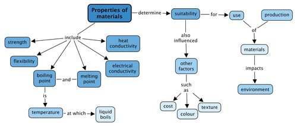

## Summary

<Callout type="note" title="Note">
- The properties of a material determine the purposes for which it can be used.
- Some of the properties of materials include strength, flexibility, heat and electrical conductivity and they have specific boiling and melting points.
- Boiling point is the temperature at which a liquid boils.
- Melting point is the temperature at which a solid melts.
- The suitability of a material for a certain use is also influenced by other factors such as its cost, its colour and its texture.
- The ways we use materials and the processes we use to produce them always have an impact on the environment.

Concept map:

Below is a concept map for what we have learnt about the properties of materials. We discussed several properties of materials in this chapter. Can you see how we can summarise a lot of information onto one page?
</Callout>

