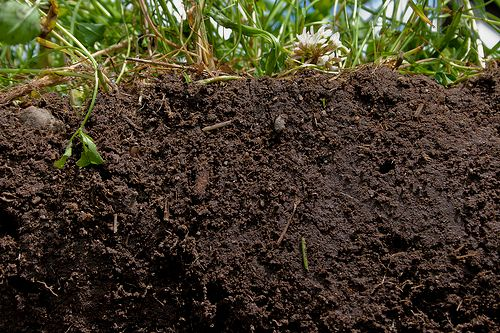
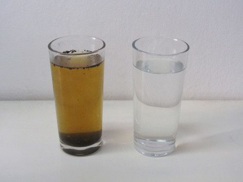
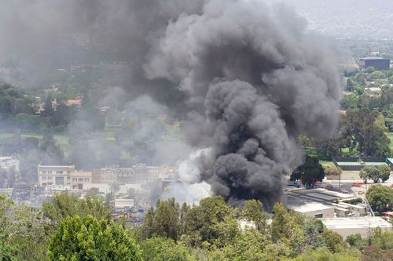
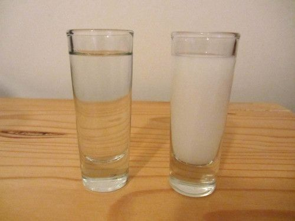
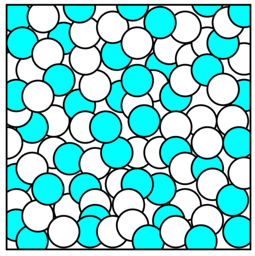
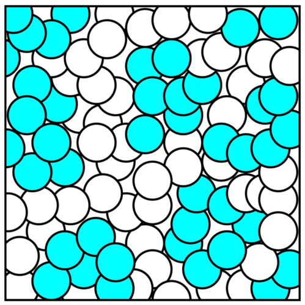
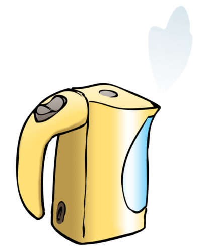
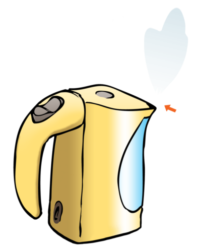
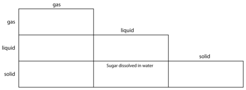
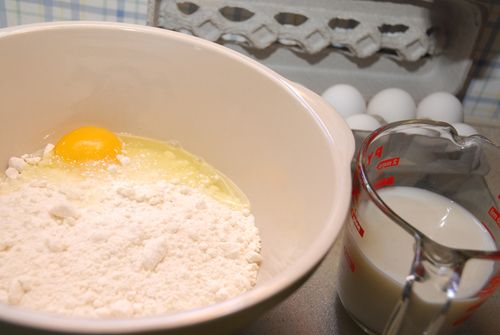

## Mixtures

<Callout type="note" title="Note">
- mixture
- suspension
- opaque
- solution
- clear
</Callout>

In the first section of this chapter, learners will learn how to identify mixtures. One of the central ideas in this section is that the components in a mixture are not chemically joined. They still exist as separate compounds that have not reacted with each other in any way. For that reason, mixtures can be separated using physical methods. Physical methods can not be used to separate elements that are chemically joined.

In order to make this section more interesting you could provide small samples of each of the mixtures discussed and ask learners to draw them, paying close attention to any features that a particular mixture may have. When they are faced with a solution (water and sugar, for instance) they might notice that there are no visible features to draw. This will help establish in their minds that solutions are mixtures where the substances are so intimately mixed (literally on the level of individual particles) that we cannot make out separate substances anymore.

What does it mean to *mix* something? Can you mime an explanation (that means you have to explain without saying a single word!)

Get your learners to act out the word 'mix'. Learners might make stirring motions with their arms. This exercise may seem trivial but their attention will immediately be focussed (and their learning enhanced) if they are engaged in this way. Using gestures that require learners to move their bodies has been shown to enhance learning even at university level!

Is it possible to mix water? Discuss this with your class.

Some learners may say no, you need two or more things mixed together to have a mixture. Other learners may answer that it is possible to mix hot water with cold water. Point out that the end result would just be water, and not really a mixture of hot and cold water; once mixed, the water would have the same temperature throughout.

One substance alone cannot be a mixture. A **mixture** is made up of two or more different substances.

A mixture can contain solids, liquids and/or gases. The components in a mixture are not chemically joined; they are just mixed. That means we do not need to use chemical reactions to separate them. Mixtures can be separated using physical methods alone and that is what this chapter is all about: how to separate mixtures.

There are many different kinds of mixtures. Before we learn how to separate them, it is worth looking at all the different kinds of mixtures briefly.

### Different kinds of mixtures

This is a revision of the types of mixtures that one can get, which has been done in Gr. 6 Matter and Materials. If you feel your learners have already grasped this, you can go through it briefly by just looking at the different pictures provided and ask learners what types of mixtures they are.

<Callout type="note" title="Note">
- emulsion
- abundant
- condense
- alloy
- pigment
</Callout>

#### A mixture of a solid and a solid

Can you think of an example of a mixture of a solid and a solid? Soil is an example of a mixture of solids. What are the substances found in soil?

Soil can contain clay, sand and small pebbles. Soil can also contain bits of plant matter. Clay and dust particles are very small, and sand particles are larger. Pebbles are even larger.

Soil is a mixture of different components. [http://www.flickr.com/photos/eggrole/7373500718/](http://www.flickr.com/photos/eggrole/7373500718/)

#### A mixture of a solid and a liquid

What happens when clay or sand is mixed with water? Would you be able to see through a mixture of clay and water? The mixture of clay or sand with water is muddy. The small clay particles become suspended in the water. This kind of mixture is called a **suspension**. Suspensions are **opaque**; that means they are cloudy and we cannot see through them very well.

What happens when sugar is mixed with water? Does the mixture become muddy? Why not? The sugar dissolves in the water and the mixture is called a **solution**. Solutions are **clear**; that means we can see through them.

Keep in mind that some mixtures that we expect to be solutions end up being suspensions. A good example is table salt and water that could end up looking cloudy because of the starch (free-flowing agent). In this case it would be better to use pure sea salt. (You could also use this apparent paradox as the basis of an extension activity about what appearances allow us to infer in certain situations.)

Can you see the difference between an opaque suspension of sand and clay in water (on the left) and a clear solution of sugar in water on the right?

#### A mixture of a solid and a gas

Have you ever seen smoke from a fire? What is the smoke made of? Do you think it is a mixture?

Smoke is actually made of tiny solid lumps of soot and ash and dust that mix with the air (which is a gas) and water vapour (also a gas). That makes smoke a mixture of one or more solids and gases.

The black smoke from a burning building. [http://commons.wikimedia.org/wiki/File:Universal_Fire_Smoke.jpg](http://commons.wikimedia.org/wiki/File:Universal_Fire_Smoke.jpg)

#### A mixture of a liquid and a liquid

Milk is not a single substance, but actually a mixture of two liquids! The one liquid component in milk is water, and the other is fatty oil. The reason milk is opaque is that tiny droplets of the oil is suspended in the water. Can you remember what a mixture is called when a solid is suspended in liquid?

We use milk as an example of a suspension, however, milk is actually more complex since it also contains solutes. It is a great example of a mixture that has both solution and suspension (emulsion) components. Flour or maizena mixed with water also makes a good suspension which settles after some time. This is also a good opportunity to revise the terms solute, solvent and solution, namely the solute (for example sugar) is the substance that is dissolved in the solvent (for example water) to form a solution (for example sugar water).

When some liquids are suspended in liquid, we call the mixture an **emulsion**. Like suspensions, emulsions tend to be opaque.

A clear, transparent solution on the left and an opaque emulsion on the right

Are all liquid-liquid mixtures emulsions? (One way to recognise an emulsion is that it is opaque). Are all liquid-liquid mixtures opaque? Can you think of a liquid-liquid mixture that is not an emulsion? Discuss this with your class and give an answer below.

Firstly, no, not all liquid-liquid mixtures are opaque. Secondly, most solutions that learners will be able to think of are essentially solid-liquid mixtures at the fundamental level. It is good enough for learners at this level to offer examples of liquid-liquid mixtures such as 'a mixture of apple juice and water'.

A better example of a liquid-liquid solution is vinegar, which is a mixture of ethanoic acid (acetic acid) - a liquid at room temperature - and water. This example might be a sensible inclusion since it would serve as early introduction to households acids that will feature prominently in the next chapter (Acids and Bases). If learners are given a vinegar sample to draw, it would be better to provide a sample of white vinegar, since it contains less solid matter. Once again they will be confronted with the realisation that the solution does not have visible features. Another opportunity to establish that solutions are mixtures where the substances are so intimately mixed that we cannot make out separate substances anymore.

A mixture of vinegar and water is clear, and that is a clue that the mixture is a **solution**.

Solutions are special kinds of mixtures in which the particles are *so well mixed* that they are not separated from each other. We cannot make out separate substances anymore - everything looks the same when we look with the naked eye.

The particle model of matter will only be dealt with in detail in Gr. 8, but the following kinds of visual representations may aid understanding of abstract concepts. You can draw these on the board with different colours. Learners were exposed to similar images in Gr. 6. However, it is not critical at this stage and you do not need to go into detail. Solutions look glassy/translucent, and the solid particles cannot be seen. The substances cannot be separated by filtration (dealt with later in this chapter).

Particles in a solution. Notice that the blue particles are more or less evenly spaced amongst the white ones.

Particles in a suspension or emulsion. Notice that the blue particles are present in little clumps or clusters amongst the white ones.

In a suspension, one of the substance's particles are always clumped together. Sometimes one can even see little globs of oil (in the case of an emulsion) or little lumps of solid (in the case of a suspension) suspended in the liquid.

### A mixture of a gas and a gas

We learnt in Gr. 6 Matter and Materials that the particles of gases are far apart. This means that gases can mix very easily, because it is easy for their particles to move in amongst each other. The air we breathe is not a single gas but actually a mixture of gases! Do you know what the two most **abundant** components are?

Nitrogen gas and oxygen gas. Learners may say oxygen and carbon dioxide; nitrogen is actually the main component of air (roughly 80%) followed by oxygen (roughly 18%). Carbon dioxide is present in much smaller quantity.

#### A mixture of a liquid and a gas

Do you remember that we discussed boiling in the previous chapter (Properties of Materials)? What happens to a liquid when it boils?

The liquid turns to a gas.

Can you see the water vapour in the following picture of a boiling kettle? Point to it with your finger. Discuss this with your teacher and classmates and when you have agreed on an answer, draw an arrow onto the picture to indicate the water vapour.

A suggestions is to do a demonstration of this in class if you can get a kettle and plug it in to show learners the colourless steam at the spout of the kettle. Learners may point to the cloud in front of the kettle. This is not actually water vapour, which would be invisible to the human eye. The cloud forms when the water vapour cools down sufficiently to condense into micro-droplets that are visible to the human eye.

We will only see the water when it starts to condense. When the water particles condense, they become liquid water again. That means the particles start clinging together in tiny micro-droplets, which grow into larger droplets when they come together. The small cloud of in front of the kettle is actually a cloud of micro-droplets of liquid water suspended in air. This is an example of a liquid suspended in a gas.

The image below indicates where the arrow should be drawn:

Can we see most gases? Why do you think so?

Most gases are colourless and cannot be seen. We cannot see individual particles as they are too small. However, some gases (such as Chlorine and Fluorine) can be seen because they are coloured.

Clouds and fog or mist are all examples of tiny water droplets suspended in air.

<Callout type="note" title="Note">
An artists, Berndnaut Smilde, uses a fog machine to make small clouds inside a room which only last a few seconds. A wonderful example of science as art
</Callout>

We have learnt that mixtures can be made of substances in the same state or in different states. The following activity will help us apply our new knowledge about mixtures to more examples.

# Types of mixtures

**INSTRUCTIONS:**

2. Look at the list of mixtures. Discuss in your group, or with your partner, what each mixture consists of.
4. Identify the type of substances (solid, liquid or gas) that are mixed in each of the examples on the list.
6. Write the name of each example in the appropriate block on the diagram.

Mixtures:

- air
- smoke
- hair oil (emulsion of oil and water)
- clear fruit juice (eg. apple juice)
- cloudy apple juice
- salty water
- **alloys** such as brass (used for coins) and stainless steel (used for rust-resistant metal items)
- foam plastic (like the material used for making mattresses and pillows)
- spray deodorant
- air freshener (aerosol type)
- paint
- dust cloud
- soil

For instance, sugar dissolved in water would go in the middle block of the bottom row, to show that it is a solid (sugar) mixed with a liquid (water).

Gas-gas mixtures: Air

Gas-liquid mixtures: spray deodorant and air freshener

Gas-solid mixtures: smoke, dust cloud and foam plastic

Liquid-liquid mixtures: Clear fruit juice, hair oil

Solid-liquid mixtures: Salty water, paint (an emulsion/suspension of solid pigments particles in water or oil), cloudy apple juice (tiny bits of pulp are solid, and suspended in the juice)

Solid-solid mixtures: Alloys, soil

Why do we make mixtures? Mixtures have many uses: perhaps we are mixing ingredients to bake a cake, or mixing metals to make a really strong alloy.

A cake is a mixture of ingredients, including flour, eggs and milk.

Many things around us occur naturally as mixtures: salty sea water, moist air, soil, compost, rocks (mixture of minerals) to name a few. Many mixtures are man made, for instance; Coca Cola, paint, salad dressing and so forth.

You can ask your learners what we use paint for. Paint is used to cover walls and other surfaces. Sometimes we want to protect these surfaces against water or wind (for instance when we are painting an outside wall or roof) and sometimes we just want to make them look attractive (for instance when we paint an inside wall, or when we create a beautiful artwork). The water or oil in the paint helps us to spread the pigments more evenly over the surface that we want to cover and binds the pigments tightly so that the paint forms a protective layer.

Mixtures are very useful. However, sometimes we need to separate mixtures into their components. Remember that the substances in a mixture have not combined chemically. They have not turned into new substances, but are still the same substances as before - they have just been physically combined. That is why we can use physical methods to separate them again.
