## Methods of physical separation

Now that we know about the different kinds of mixtures that are possible, we are going to learn about some ways of separating them.

As an introduction to this you can ask learners about why they think we would want to separate mixtures. For example, imagine that our drinking water comes from a well in the ground and it is muddy. Muddy water is not good to drink. We would want separate the water from the solid material (sand or clay) before using it! Once separated, we would keep the water to drink and throw the sand away. Ask learners if they can think of a way to separate the water from the sand? *Learners may suggest filtration (filtering) as a method for separating the sand and water.*

### How do we separate mixtures?

<Callout type="note" title="Note">
- sieve
- filtration
- filtrate
- magnetic
- grain
- residue
</Callout>

Suppose you were given a basket of apples and oranges. How would you sort them? You would probably pick out all the oranges from the apples by hand. The same method may not be suitable for all mixtures. You would probably not consider sorting sugar and sand **grains** by hand. Why not?

Sugar and sand grains are too small to be sorted by hand, and they look very much the same. It would not be practical to sort them in this way.

Let us look at some of the most commonly used methods of physical separation.

#### Hand sorting

How would you separate the mixture of beads in the picture below into the different colours?

The most practical method would probably be to hand sort them into different colours.

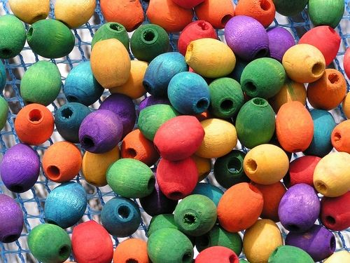

A mixture of different coloured beads.

<Callout type="note" title="Note">
Sometimes people create machines to perform tasks for them, like this Skittles sorting machine.
</Callout>

The video about the Skittles sorting machine is merely for entertainment, but it could be used to introduce discussions on fun 'explorations' and hobbies that challenge us as a starting block for innovation and useful applications of technology.

# Thinking about hand sorting

**Problem:**
Would hand sorting also be a practical way to sort out the mixture of rice and lentil beans in the picture below?

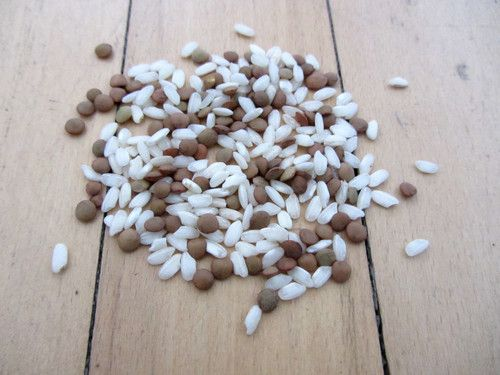

A mixture of rice and lentils

**Solution:**
Yes, as long as there are not too many of them to sort.

**Problem:**
Would hand sorting be a practical way to sort the pebbles out of a large pile of sand?

**Solution:**
Probably not. It would take way too long!

**Problem:**
Besides what we discussed in the chapter, think of at least three other examples of mixtures that could be hand sorted.

**Solution:**
Learner-dependent answer. Suggestions may include:

- Sorting thorns from wool
- Sorting lego blocks into different sizes or colours
- Sorting stones from a packet of dried lentils or beans
- Sorting mail
- Sorting fruit or eggs according to size or grade

**Problem:**
When is hand sorting a good method for separating the components in a mixture?

**Solution:**
When the 'particles' in the mixture are relatively large and when there are not too many of them to sort.

#### Sieving

Can you think of a practical way to sort stones or pebbles from sand? Do you think picking the pebbles out by hand would work?

It probably is not a good idea to hand sort as it would take too long.

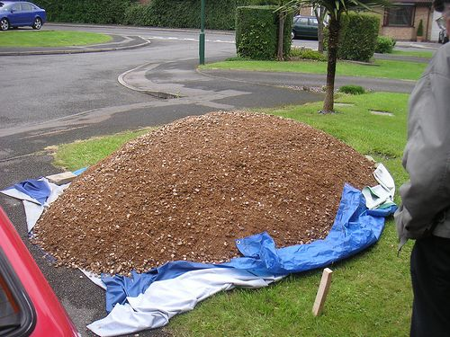

How would you separate the pebbles from the sand in this pile? [http://www.flickr.com/photos/leehaywood/4203909236/](http://www.flickr.com/photos/leehaywood/4203909236/)

When we have large quantities of materials to sort and the different particles have different sizes, we can **sieve** the mixture. The smaller particles will fall through the openings in the sieve, while the larger particles stay behind.

#### Filtration

When the particles in a mixture are too small to be caught by a sieve and when the components of the mixture are in different states, we can separate them by **filtration** using a filter.

Learners did an exercise in Chapter 6 of Matter and Materials in Gr. 6 on cleaning muddy water. The chapter entitled 'Processes to purify water' required learners to design, make and evaluate their own filter. You can demonstrate the process again to refresh their memories. To set up a filter (as shown below), place a folded piece of filter paper in a funnel and place the funnel into a flask. Then, pour a mixture of muddy water into the filter and let the learners observe that clean water passes through the filter, whilst the mud/sand/clay remains behind.

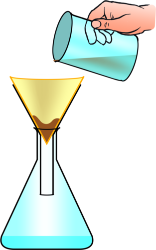

Muddy water is poured through a funnel lined with filter paper to remove the small sand and clay particles.

What type of mixture is the muddy water in the glass an example of?

It is a mixture of solid and liquid, it is a suspension. You can get learners to label the suspension, the filtrate and the residue on this diagram.

<Callout type="note" title="Note">
The clear liquid that has passed through the filter paper is called the**filtrate** and the particles that are left behind on the filter paper is called the **residue**
</Callout>

Have you ever noticed how, when people have to work in dusty or smoky environments, they wear dust masks or smoke masks? Why do you think that is necessary?

Inhaling dust or smoke is harmful to our lungs. The masks help to clean the air before it enters the respiratory tract.

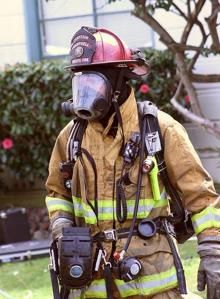

A firefighter wears a mask to filter out the smoke. [http://www.flickr.com/photos/humblog/2381521496/](http://www.flickr.com/photos/humblog/2381521496/)

The diagram below shows how a gas mask works. Layers of very fine filters trap harmful substances and dust or smoke particles, so that only clean air is let through.

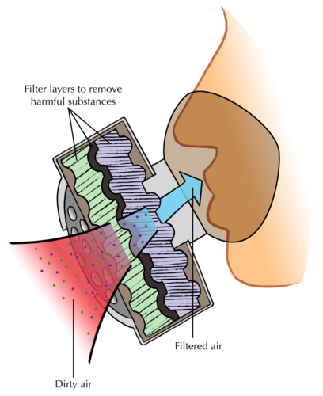

A smoke mask consists of filter layers which clean the dirty air before it is breathed into the body.

# Thinking about sieving and filtering

**Problem:**
Besides what we discussed in the chapter, think of at least three other mixtures that could be sieved, and write them in the space below.

**Solution:**
Learner-dependent answer. Suggestions may include:

Sieving flour to remove lumps, husks and other large bits

Pouring tea through a sieve to catch the tea leaves (this is a crude way of filtering)

Rinsing sand or soil from spinach leaves before we cook them

Filtering leaves out of a swimming pool (we call it filtering, but what we are actually doing is sieving the leaves out of the water)

**Problem:**
When is sieving a good method for separating the components in a mixture?

**Solution:**
When the components of the mixture have different sizes and there are many of them to sort.

**Problem:**
Nowadays most people use tea bags to make tea, but there was a time when people brewed tea from leaves and then poured the tea through a sieve into the cup. Why do you think they did this?

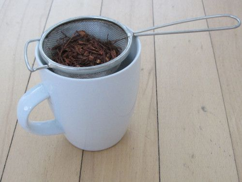

Tea leaves and bits have collected in the sieve after pouring the tea into the cup.

**Solution:**
To remove the tea leaves from the tea before drinking it.

**Problem:**
Sometimes the particles that we want to remove from a mixture are so small that they will pass easily through a sieve (think of the example of the muddy water from before). Can you think of a way to overcome this?

**Solution:**
Learners may realise that they need to make the openings in the sieve smaller if they want to catch smaller particles.

**Problem:**
Besides what we discussed in the chapter, think of at least three other mixtures that could be filtered, and list them below.

**Solution:**
Learner-dependent answer. Suggestions may include:

Filtering coffee grounds through a coffee filter or in a plunger

The vacuum cleaner has a filter for trapping dust particles inside the machine and letting clean air through. That is how it removes dust particles from the carpet and furniture.

Air conditioners contain filters to filter out dust before the air from outside enters a building.

**Problem:**
When is filtering a good method for separating the components in a mixture?

**Solution:**
When the 'particles' in the mixture are very small, and in different states.

Can you remember the activity from Gr. 6 when Tom used magnetism to separate different kinds of metals at his uncle's junk yard? The **magnetic** properties of the metals allowed them to be separated in this way.

#### Magnetic separation

You could demonstrate how, or let the learners try, to separate a mixture of sand and iron filings by using a magnet. It might help to place the magnet in a small plastic bag so the iron filings are attracted to the magnet, but do not stick to it.

The following diagram shows how magnetic separation can be used to separate a mixture of components. In the example, mineral ore that contains two compounds (one magnetic, and the other non-magnetic) is being separated. The ore grains are fed onto a revolving belt. The roller on the end of the belt is magnetic. This means that all the magnetic grains in the ore will stick to the belt when it goes around the roller, while the non-magnetic grains will fall off the end. As soon as the magnetic grains move past the magnetic roller, they will also fall down.

In the above diagram, what colour are the non-magnetic grains and into which container do they fall? Label this on the diagram. What colour are the magnetic grains and which container do they fall into?

The non-magnetic grains are yellow-orange and fall into the container on the left. the magnetic grains are grey-brown and fall into the container on the right. The diagram should be labelled as follows:

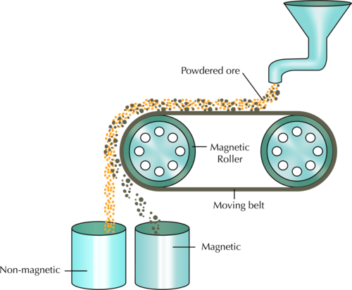

# Thinking about magnetic separation

**Problem:**
Besides what we discussed in the chapter, can you think of two other mixtures that could be separated magnetically? Write them in the space provided.

**Solution:**
Learner-dependent answer. Suggestions may include:

Removing iron filings (magnetic) from sand or sugar (non-magnetic).

Separating aluminium cans (non-magnetic) from steel cans (magnetic).

**Problem:**
When is magnetic separation suitable for separating the components in a mixture?

**Solution:**
When the components in the mixture have different magnetic properties, in other words when one or more components in the mixture is magnetic and the others are non-magnetic.

How can we separate the components in a solution? Let's find out.

### Separating solutions

<Callout type="note" title="Note">
- evaporation
- condensation
- distillation
- still
- chromatography
- chromatogram
- solute
- solvent
</Callout>

The substances in a solution are mixed on the level of individual particles. In a sugar and water solution, the sugar particles and the water particles are mixed so well that we could not distinguish them with the naked eye. You might think that mixtures that are so 'well-mixed' are impossible to separate! But as we shall soon see, this is not true.

<Callout type="note" title="Note">
In ancient cultures, grain and chaff was separated by a process called winnowing. They would throw the mixture into the air and the wind would blow away the lighter chaff, but not the heavier grain.
</Callout>

#### Separation by evaporation

Demonstrate this in a lesson by dissolving some salt in water in front of the class at the beginning of the lesson. Make sure they take note of the clear solution. Then pour a little into a shallow aluminium pan, like those used for baking. Place this out in a sunny spot for the duration of the lesson and allow the water to evaporate. The rate of evaporation will depend on how hot and humid it is on the day you do this. At the end of the lesson, collect the pan and show the dried salt that is left behind, just as in a salt pan. You might have to leave it out until the end of the day, depending in how hot it is.

Do you know where most of the salt that we use in South Africa comes from? South Africa gets it salt from inland salt pans, coastal salt pans and seawater. A salt pan is a shallow dam in the ground where salt water **evaporates** to leave a layer of dry salt.

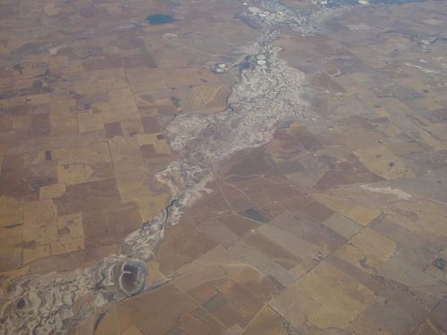

An aerial view of salt pans. [http://commons.wikimedia.org/wiki/File:Salt_pans.jpg](http://commons.wikimedia.org/wiki/File:Salt_pans.jpg)

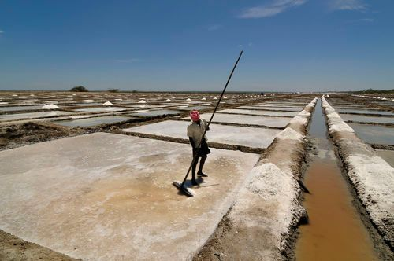

Salt pans in India. A man is busy collecting the dried salt to be packaged and sold.

When sea water is allowed to stand in shallow pans, the water gets heated by sunlight and slowly turns into water vapour, through evaporation. Once the water has evaporated completely, the solid salt is left behind.

Do you think this is a good method for separating salt from water? Do you think it would work for a sugar and water solution?

Yes, it would.

# What if we want to keep both the water and the salt?

If you have time to do this in class, you can demonstrate this practically. Get learners to taste the salt water before boiling and then getting them to taste the condensed water afterwards. This way they will realise that only the water has evaporated and the salt has remained behind in the kettle. You could put the ice in a small plastic bag to ensure that the ice does not slip off the plate, but the plate is still cold enough for water vapour to condense. Keeping the ice in a plastic bag will also ensure that the melting ice does not drip into the beaker collecting condensed water. You can also use a beaker or glass of salt solution over a bunsen burner and use a cold piece of glass or mirror to condense the water and collect it in another beaker.

**QUESTIONS:**

**Problem:**
Do you think separation by evaporation would be a good method to separate a salt-water-solution if you wanted to keep both the salt and the water? Why do you say so?

**Solution:**
Evaporation by itself is not a good method of separation if you want to keep both the salt and the water. Once the water evaporates, it is lost.

**Problem:**
Can you think of a way to modify the method so that the water that evaporates is not lost? Perhaps the following diagram will help you to formulate a plan. Write an explanation below.

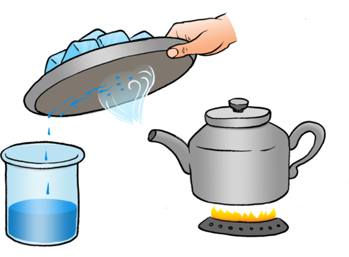

**Solution:**
In the picture, the salt-water solution is heated in a kettle, and a metal plate (with some ice inside to keep its outer surface cold) is held in the water vapour that is escaping from the spout of the kettle. The water vapour cools when it touches the cold metal plate and condenses. It then runs off the plate and into the collection beaker. The salt is left behind in the kettle once all the water has evaporated. But, you still have the water in the beaker.

**Problem:**
What is happening in the kettle?

**Solution:**
Salt water is boiling.

**Problem:**
Can you say what change in state is happening inside the kettle? What is the process called?

**Solution:**
Liquid water is changing to water vapour. The process is evaporation.

**Problem:**
What change of state is occurring on the cold surface of the metal plate? What is the process called? (Hint: the change of state from gas to liquid was covered in the previous chapter, under *Physical properties of materials*.)

**Solution:**
Water vapour is changing to liquid water. The process is called condensation.

**Problem:**
Does the salt evaporate with the water? How would you find out?

**Solution:**
No. You can taste that the water is salty before evaporation, and not salty after condensation. If you boil the water until all of it has evaporated, you can see salt crystals form.

**Problem:**
What can you tell about the purity of the water after it has evaporated and condensed?

**Solution:**
It does not taste salty after evaporation/condensation so we assume that it is pure, but it may have other things in it which we can't taste.

Some things we can't detect or taste, for example, if we were using sea water.

The water that is lost through evaporation can be **condensed** on a cold surface. The cold metal plate will do the job, but it would be difficult to recover all the condensed water, because it will be dripping off the surface of the plate in many different places. Scientists have a solution for that problem: they use a special technique to separate mixtures like these without losing any of the components. The technique is called **distillation**.

#### Distillation

If you have the equipment to set up this distillation process, then you can demonstrate it in class. Otherwise there are alternative materials and equipment that you can use. For example, if you do not have a Liebig condenser, you can use a piece of copper pipe. Here are two links which explain how to build your own distillation equipment: [http://www.instructables.com/id/Build-a-Lab-Quality-Distillation-Apparatus/](http://www.instructables.com/id/Build-a-Lab-Quality-Distillation-Apparatus/) and [http://nukegingrich.files.wordpress.com/2009/06/diy-still.pdf](http://nukegingrich.files.wordpress.com/2009/06/diy-still.pdf). Another suggestion is to get learners to also do the research to see how to make their own distillation apparatus, specifically looking at materials which are easy and cheaper to come by. You do not have to have laboratory equipment to demonstrate many science experiments - many can just be
                    done by thinking of the materials which you use in everyday life and making a plan! This also makes science more accessible to everyone.

Distillation is the separation of one substance from another by evaporation followed by condensation. The apparatus used in this technique is called a **still**.

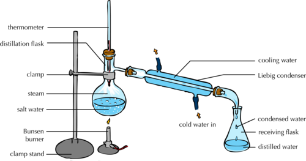

Experimental setup for distillation

Suppose we want to separate the water and salt in seawater. We would place the seawater in the round flask on the left of the picture (in the distillation flask). We would then boil the seawater to produce water vapour, or steam. The salt would not evaporate with the water, because only the water evaporates. The water vapour rises through the top of the flask and passes into the Liebig condenser.

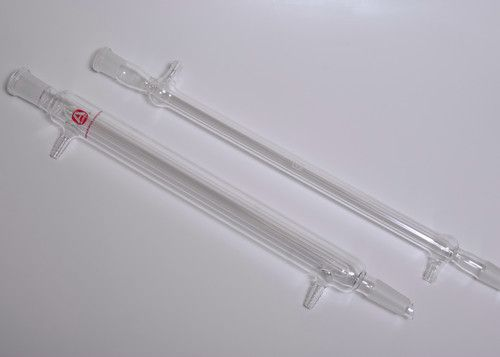

Two Liebig condensers which are used in the distillation process [http://commons.wikimedia.org/wiki/File:Liebig_condensers-two_2.jpg](http://commons.wikimedia.org/wiki/File:Liebig_condensers-two_2.jpg)

The Liebig condenser consists of a glass tube within a larger glass tube. The condenser is designed in such a way that cold water can flow through the space between the tubes. This cools the surface of the inner tube. The water vapour condenses against this cold surface and flows into the receiving flask. Since the salt has not evaporated, it stays behind in the distillation flask.

<Callout type="note" title="Note">
A video describing how a solar still can desalinate (take salt out of) water.
</Callout>

The solar still video is short but provides an interesting topic for discussions: applications of separating methods; inventions; advantages and disadvantages; you could even discuss open-source projects and sharing information. The Italian inventor of the Eliodomestico solar still designed it with developing countries in mind. It is relatively cheap, easy to assemble, and requires no electricity. It is described as an eco-distiller that runs on solar power. All you need to do is pour in 5 litres of salty or impure water, tighten the cap, and leave it out in the sun. By the end of a day it can provide bacteria-free, salt-free water that is suitable for drinking. It is also an open-source project which means that anybody can use the design and replicate, modify or upgrade it, but not sell it for profit.

Distillation is also the best way to separate two liquids that have different boiling points, like water and ethanol for example. Let us have a look.

# How can we separate two liquids with different boiling points?

This is an optional activity, or else it could be done as a homework task. It is an extension of what learners would have learnt about using distillation.

**QUESTIONS:**

**Problem:**
Can you remember the temperature at which water boils? Write it down below.

**Solution:**
100°C

**Problem:**
What is this temperature called?

**Solution:**
The boiling point of water.

**Problem:**
Ethanol boils at a temperature lower than the boiling point of water, namely 78°C. Suppose you mix some water and some ethanol. The mixture is at room temperature to begin with. Now suppose you start heating the mixture. What temperature would be reached first: 78°C or 100°C?

**Solution:**
78°C

**Problem:**
What do you think will happen when the mixture reaches a temperature of 78°C? Do you think the ethanol will start to boil?

**Solution:**
Learners could be reminded that the ethanol is still ethanol, it has not been changed in the process of mixing, so it will most certainly start to boil at 78°C.

**Problem:**
Will the water boil at the same time?

**Solution:**
No. Water only starts to boil at 100°C. As long as the temperature is below 100°C, the water will not boil.

These questions are identical to the ones posed in the original activity. They were included in the original activity to serve as introduction for the concept of distillation.

We can use the same distillation method that we used for separating seawater, to separate the two liquids. The principle is exactly the same, except that we will distill the mixture more than once. Here is how it works:

The mixture of the two liquids is placed in the distillation flask and heated to the lowest boiling point. In the case of an ethanol/water mixture, that temperature would be the boiling point of ethanol, namely 78°C. All of the liquid with that boiling point will evaporate, condense in the Liebig condenser, and pass into the receiving flask. The liquid with the higher boiling point will remain in the distillation flask. Suppose it contains a third substance that we want to separate. How would you do this?

We replace the receiving flask with a clean one and heat the distillation flask again, but this time to the boiling point of the second liquid. The second liquid will evaporate, condense in the cooler and flow into the clean receiving flask, leaving the final component in the mixture in the distillation flask.

<Callout type="note" title="Note">
Crude oil is separated into different components using distillation. The components are evaporated, starting with lighter fuel (which has the lowest boiling point), then jet fuel, then petroleum, then motor car oil, until only tar is left. We call the separated components fractions, and the process, fractional distillation.
</Callout>

<Callout type="note" title="Note">
Find out more about the distillation of crude oil in this video
</Callout>

The video about distillation of crude oil may be a bit too advanced, but it summarises the process of fractional distillation quite well and mentions relevant, real-world examples of products that are produced. Take note that the video repeatedly mentions 'hydrocarbons'. You can put the learners at ease and tell them it is not important for them to know what this means yet. The periodic table is only dealt with in Chapter 4, but you could help the learners 'decipher' that the crude oil contains a lot of **hydro**gen particles and **carbon** particles put together in different combinations (ratios). Each of the fractions that are eventually collected contain one kind of hydrocarbon combination.

There is one more separation technique for us to explore. Have you noticed how ink on paper will sometimes 'run' when it gets wet?

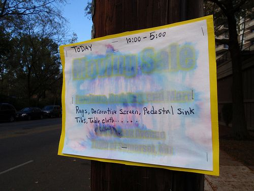

Can you see how the ink on this sign has run after being wet, probably by the rain? [http://www.flickr.com/photos/daquellamanera/4304246279/](http://www.flickr.com/photos/daquellamanera/4304246279/)

Most inks are a mixture of different pigments, blended to give them just the right colour. A **pigment** is a chemical that gives colour to materials. When a mixture contains colourful compounds, it is often possible to separate the different components using a separating method called chromatography. Let's have a look at this next.

#### Chromatography

<Callout type="note" title="Note">
Chromatography comes from from the Greek words *chroma* (meaning 'colour') and *graph* (meaning 'to write').
</Callout>

**Chromatography** is a method for separating coloured substances into individual pigments. We are going to explore this in the next investigation.

<Callout type="note" title="Note">
Pen colour science.
</Callout>

# Is black ink really black?

**AIM:** To separate the pigment components in ink using different liquids.

This is a fun activity that can be done quickly. If the class is divided into small groups and each group gets a different black marker to experiment with, the chromatograms can be stuck up on the wall afterwards for everyone to see and compare. By looking for matching chromatograms, learners can say which group had the same brand of marker, or which markers are filled with the same ink. If the ink from a certain marker will not separate in one liquid, try using another liquid in the beaker.

You could even build a story around the investigation: Stage a murder mystery in which the murderer can be identified by his (or her) black pen. Use three or four black or blue pens of different brands, and produce the unique chromatograms associated with each brand. The inks may look the same when used for writing, but they will behave differently when they are analysed by chromatography.

**HYPOTHESIS:**

What do you propose the answer to our investigative question is? This is your hypothesis.

Learner-dependent answer. A hypothesis could be 'Black ink is made up of different coloured pigments.'

**MATERIALS AND APPARATUS:**

- absorbent paper cut into strips approximately 3 cm wide and 12 cm long

Laboratory Whatman filter paper no. 1 is ideal for chromatography. Alternatively, you can use coffee filters, watercolour paper or strips of paper towel. Even ordinary copy paper works, but more slowly and often this makes the colours separate better. For softer papers you may need longer strips of paper and taller containers, since the liquid is carried up the paper much faster.

- clear drinking glass or beaker
- assorted black pens and markers
- tap water
- pencil
- paper clip or clothes peg
- filter paper
- dropper
- variety of liquid solvents (ammonia, surgical spirits, methylated spirits, and nail polish remover)

<Callout type="note" title="Note">
A **solvent** is a substance that dissolves a **solute**, resulting in a solution. A solvent is usually a liquid, but can also be a solid or a gas.
</Callout>

**Possible hazards:**

- Ammonia is a dissolved gas and a weak base. It is not likely to cause burns but ammonia fumes can irritate the mucous membranes of your nose.
- Surgical spirits and methanol contain alcohol. Nail polish remover contains acetone. Alcohol and acetone are flammable and should be kept away from heat and flames. You should not inhale the vapours of these solvents.

Safe laboratory practice is extremely important. Take a moment to discuss risks, precautions and safety with learners. Discuss the fact that scientists often need to handle dangerous substances and/or equipment to be able to make observations.

When working with ammonia, take care to work in a fume hood or in a well-ventilated space. Leave the door and windows open, so that the fumes do not linger. Similarly, substances containing alcohol should be used in a well-ventilated space, but these are also flammable, so avoid using them in the presence of open flames.

It is always advisable to wear latex/nitrile gloves (available from pharmacies) to prevent the absorption of hazardous substances through your skin. Wear safety goggles to protect your eyes from harmful chemicals. Always have clean water nearby to rinse your eyes or wash your hands if chemicals do splash or spill.

Careful laboratory practice will not only ensure your own safety, it will also set a good example to learners.

**METHOD:**

**To make a strip chromatogram**

2. Use a black pen or marker to draw a line across one end of the paper strip, 2 cm from the end.
4. Pour tap water into the beaker to a depth of approximately 1 cm.
6. Wrap the unmarked end of the paper strip around the pencil and secure it in place with a paper clip.
8. Before putting it into the glass, adjust the strip of paper so that the height of the inked line is approximately 1 cm above the surface of the liquid by holding it against the outside of the beaker.
10. Lower the strip into the glass and rest the pencil across the top of the glass as shown in the diagram. The end of the strip should be in the water, but the inked line should be above the surface of the water.
12. Allow the liquid to soak up into the paper, rising through the inked line.
   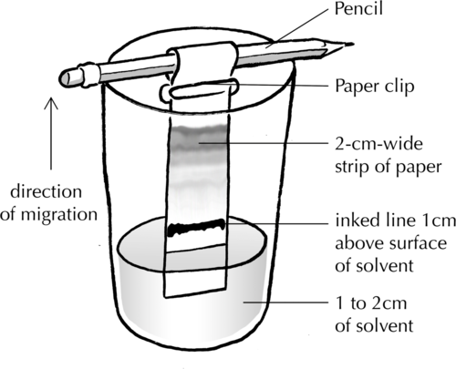
14. When the migrating pigments approach the top of the strip, near the paper clip, remove the paper strip and allow it to dry on a flat, non-porous surface.
16. Make a similar strip chromatogram for each of the black pens you have collected.
18. Compare the chromatograms. Are they the same or are they different?
20. When you have finished comparing your chromatogram with those of the rest of the class, you can either stick your chromatogram in the space below, or draw a picture of it in the space.

You can also use a clothes peg to hold the strip in place while drying.

**To make a circular chromatogram**

2. Lay a large round piece of filter paper on a smooth non-absorbent surface, like the surface of your desk, for instance.
4. Use one of the coloured pens to make a 0.5 to 1 cm ink spot in the centre of the disk.
6. Lay the paper disk flat over the top of a beaker.
8. Place a drop of water in the centre of the ink spot.
10. Add another drop of water every minute or so to make the chromatogram spread toward the edges of the paper disk.
   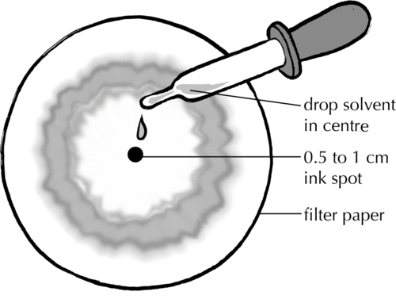
12. Repeat the experiment with one of the other solvents (ammonia, alcohol or nail polish remover).

**OBSERVATIONS:**

**Problem:**
Do the two chromatograms look the same or different? If they look different, and you have used the same pen, why do you think that is?

**Solution:**
Learner-dependent answer

**Problem:**
Which colour pigments were you able to observe?

**Solution:**
Learner-dependent answer

**Problem:**
Draw pictures of your chromatograms in the space below.

**Solution:**
Learner-dependent answer

**CONCLUSION:**

**Problem:**
What can you conclude about the pigments that make up black ink?

**Solution:**
Learners should note that black ink is actually made up of a number of different coloured pigments.

**A closer look at how this works:**

In paper chromatography, liquid is drawn through the paper fibers. But, why do the pigments in the ink separate into bands of different colours?

The pigments in the ink are carried along by the liquid, but because they are different compounds, they get carried upward at different speeds. This causes them to appear as bands of different colours on the chromatogram.

Look at the picture of the chromatogram below.

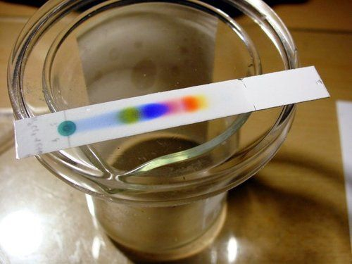

An example of a strip chromatogram [http://commons.wikimedia.org/wiki/File:TLC_black_ink.jpg](http://commons.wikimedia.org/wiki/File:TLC_black_ink.jpg)

**Problem:**
Which colour pigment is moving up the paper at the fastest speed? Why do you say so?

**Solution:**
The yellow pigment is moving the fastest because it has travelled the longest distance.

**Problem:**
Which colour pigment is moving up the paper at the slowest speed?

**Solution:**
The green pigment is moving the slowest because it has travelled the shortest distance.

Why are the different pigments carried at different speeds?

Pigments migrate at different speeds because of differences in their properties: large pigment particles tend to move more slowly. Furthermore, particles that dissolve well in the liquid will tend to stay in the liquid and be carried to the top quickly, while particles that bind well to the paper will tend to move more slowly.

<Callout type="note" title="Note">
Is black really black? (video)
</Callout>

Now that we have learnt about some of the different ways in which mixtures can be separated, we are going to apply what we know to separate a mixture made of many components.

# Separating a complex mixture

Some schools also use combo plates for the various practical tasks in Matter and Materials. This is encouraged and the activities in these workbooks can be adjusted slightly to work with whichever equipment and apparatus you have available to you in your school.

Also, if learners find the flow chart too complex at this stage, you can alternatively get them to write out the steps they would follow to separate all the materials in the mixture and why they have chosen each method of separation.

Imagine you are a member of a team of scientists working together in a laboratory. Your team has been given an important job. You have been given a beaker that contains a mixture of substances to separate.

The mixture contains the following components:

- sand
- iron filings
- salt
- ethanol
- water

Your job is to design a procedure for separating the mixture into its individual components. How would you do that? Your procedure should be summarised in the form of a flow chart.

Before you start, imagine what the mixture would look like. Draw a picture of the a clear container and the different contents in the mixture in the space.

This may be a difficult task for the learners to accomplish, but it is very important for the learners to be able to visualise the mixture before they start to plan the experiment. If they do not, the ideas will remain abstract and the learners may have difficulty sequencing the different separation steps correctly. You could guide them by asking the following questions. Alternately, you could prepare the mixture for them to look at it before drawing it:

- What does the container look like? Draw it on your page.
- Which liquids are in the container? (Ethanol and water). Now draw the container with a mixture of ethanol and water in it. Would you be able to see the ethanol AND the water when they are mixed? (No, they would just look like liquid in the container.)
- Now add the sand. Would it mix with the water or sink to the bottom? (Most of it would sink to the bottom.)
- Now add the iron filings. Would it mix with the water or sink to the bottom? (It would sink to the bottom.)
- Now add the salt. Would the salt sink to the bottom or dissolve in the water? (It would dissolve in the water.) Would we be able to see it if it was dissolved in the water? (No.)

To help you design your procedure, here are a few guiding questions and a template for your flow chart:

**Problem:**
What is the physical state (solid, liquid or gas) of each of the components in the mixture? Fill these into the table.

| Component (substance) | State (solid liquid or gas) | Dissolved or undissolved? |
| --- | --- | --- |

**Solution:**
| Component (substance) | State (solid liquid or gas) | Dissolved or undissolved? |
| --- | --- | --- |
| Iron | solid | undissolved |
| Sand | solid | undissolved |
| Salt | solid | dissolved |
| Ethanol | liquid | dissolved (in solution with the water and salt) |
| Water | liquid | dissolved (in solution with the ethanol and salt) |

**Problem:**
Name the solids that will not dissolve in the mixture. These are the undissolved solids.

**Solution:**
The sand and iron filings are undissolved.

**Problem:**
Name the dissolved solids in the mixture.

**Solution:**
Salt is the only dissolved solid.

**Problem:**
What would be the best method for separating the undissolved solids from the liquids in the mixture? Write the name of this method in the block numbered 1 of the flowchart below.

**Solution:**
Learners should write FILTRATION in block 1.

**Problem:**
Write the names of the undissolved solids in block 2 of the flowchart.

**Solution:**
Learners should write SAND and IRON FILINGS in block 2.

**Problem:**
What remains after the undissolved solids have been removed from the mixture? Write the names of these compounds in block 3.

**Solution:**
Learners should write SALT, ETHANOL and WATER in block 3.

**Problem:**
How could we separate the undissolved solids? (Hint: look at the flow chart for some ideas.) Write the name of this process in block 4.

**Solution:**
Learners should write MAGNETIC SEPARATION in block 4.

**Problem:**
Write the names of the two undissolved solids in blocks 6 and 7.

**Solution:**
Learners should write IRON FILINGS in block 6 and SAND in block 7.

**Problem:**
How could we separate the liquids from the dissolved solid? We could evaporate them, but then they would be lost. What other option is available if we want to separate the components in a solution? Write the name of this process in block 5.

**Solution:**
Learners should write DISTILLATION in block 5.

**Problem:**
Which liquid would be distilled first? (Hint: which liquid has the lowest boiling point?) Write the name of this liquid in block 8.

**Solution:**
Learners should write ETHANOL in block 8.

**Problem:**
What remains in the solution when the first liquid is removed? Write the names of these components in block 9.

**Solution:**
Learners should write WATER and SALT in block 9.

**Problem:**
How can we separate the liquid from the dissolved solid? (Hint: this process is the same as the one in block 7.) Write the name of the process in block 10.

**Solution:**
Learners should write DISTILLATION in block 10.

**Problem:**
Write the names of the final two components in blocks 11 and 12.

**Solution:**
Learners should write WATER in block 11 and SALT in block 12.

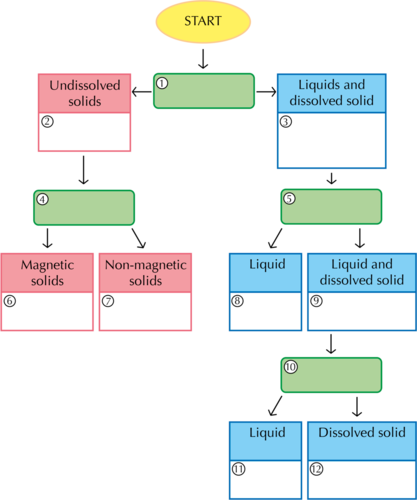

Completed flowchart should look as follows:

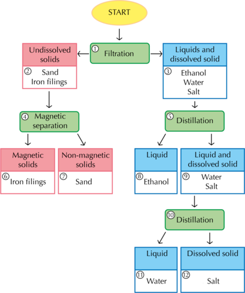

So far, we have been discussing materials, their properties, how to mix them and how to separate them if they are mixed. The final section of this chapter deals with waste materials and what we can do to reduce their impact on the environment.

<Callout type="note" title="Note">
Summary of separating mixtures in short slideshows[http://www.bbc.co.uk/bitesize/ks3/science/chemical_material_behaviour/compounds_mixtures/revision/9/](http://www.bbc.co.uk/bitesize/ks3/science/chemical_material_behaviour/compounds_mixtures/revision/9/)
</Callout>
