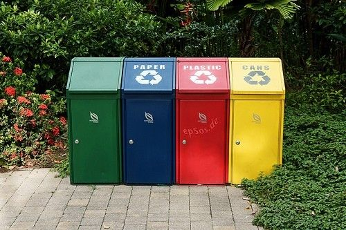
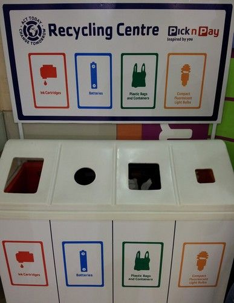

## Sorting and recycling materials

Over time, some of our things get old and break and we need to throw them away. When we buy food or other items, the packaging used for wrapping these items is also thrown away. But what does 'away' mean? Does it mean these waste items just disappear? Where do you think our rubbish goes once we 'throw it away'?

Allow learners to discuss this for a while. Some may know that rubbish eventually ends up on a rubbish dump somewhere, and this is a good starting point for the next activity that will require learners to think about the implications of dumping.

<Callout type="note" title="Note">
Have you ever heard of the Great Pacific Garbage Patch? Millions of tonnes of plastic waste end up in the ocean, and stay there.
</Callout>

# What happens when we throw things away?

**INSTRUCTIONS:**

2. Work in groups of 3 to 4.
4. In your group, spend 5 minutes discussing the posters and what you think they mean.

**QUESTIONS:**

'There is no away' and 'There is no Planet B' refers to the same issue, namely that everything that we throw away remains part of our environment. We should be thinking of ways to reintegrate our waste by making it part of the environment in ways that will not harm the environment; reusing, recycling and repurposing waste items and materials in creative and innovative ways. 'There is no Planet B' is also a play on words that refers to the well-known notion of a 'Plan B' that can be reverted to if the original plan (plan A) fails.

**Problem:**
Write a paragraph to explain the messages on the posters. What do you think they mean?

**Solution:**
Learner-dependent answer

**Problem:**
Do you think it is possible to stop throwing things away altogether?

**Solution:**
Many things can be reused or recycled. Many of the waste that is not recyclable can be turned into compost for the garden. Learners may have interesting opinions about this question, and hopefully it will get them thinking about creative ways of reusing and repurposing waste.

**Problem:**
Can you suggest ways to reduce the amount of trash that is thrown away in your home?

**Solution:**
Learner-dependent answer. Learners should generate suggestions centred on reusing, recycling and repurposing.

An optional additional activity for this section is to get learners to assess how poor waste management techniques impact the environment.

For this activity, learners must use materials that would ordinarily go into the rubbish bin in your home (cereal boxes, cardboard, plastic wrappers etc) to make a poster that will create awareness for the environmental problem that concerns them the most. The poster should also contain suggestions for solving the problem. Here are a few ideas, but they only need to choose one:

- Cigarette butts can start veld fires.
- Broken glass bottles can start fires.
- Discarded plastics ensnare animals.
- Discarded plastic pollutes rivers and other natural habitats.
- Waste causes health hazards and spreads disease.
- Land is wasted when it is used to dump or bury garbage (landfills).
- Materials and other resources are wasted when it could have been recycled.

Once learners have created their posters, you can stick them up around the classroom and they can also do a short report back to the class. There is also potential to do this activity as a group.

### How is household waste managed by local authorities?

In some suburbs, recycling is actively encouraged and special transparent recycling bags are provided for this purpose. Do you have recycling in your community? Is the recyclable waste collected from your home or do you have to drop it off at a container or a depot? Did you know that some people even make money selling recyclable waste that they collect?

Do you know which materials from household waste can be recycled? What are the four main categories?

Ask your learners this question before moving on to the next section where this will be discussed. The answers are:

- paper and cardboard
- glass
- metal (tins and cans)
- plastics

Items that have to be disposed of with care and not dumped in regular trash, include batteries, and fluorescent light bulbs.

Have you seen colourful bins similar to these around your school or in shopping areas? They are for recycling. [http://www.flickr.com/photos/epsos/5575089139/](http://www.flickr.com/photos/epsos/5575089139/)

If you ever need to dispose of objects, like batteries and fluorescent light bulbs that contain harmful substances, be sure to use the correct recycling bin.

Here is an additional, optional activity, which you could get learners to do as a homework task.

**Activity: Other things we throw away**

In this short activity, we are going to think about creative ways of dealing with household waste items that are not in the 4 categories discussed above. For each item in the table, some recycling ideas have been given.

Can you think of other ideas to add to the table? Discuss this in a group and write them into the table.

| Item | Recycling ideas |
| --- | --- |
| Garden waste and other organic waste such as vegetable peelings and foods that have spoiled. | These items can be turned into compost. Cooked food, spoiled meat or fish and bones should preferably be buried because they can attract flies and other pests. In this way they can decompose underground and provide nutrients to growing plants in the garden. |
| Old clothes and other textile items; old shoes. | Clothes, shoes, curtains, and blankets that are still good enough to be used can be donated to shelters for the homeless. Clothes that are too worn can be turned into cloths for washing the car or the windows. Old jerseys can be sewn into blankets or other items. |
| Old and expired medicine | Medicine that is old or expired should never be repurposed. It should be dropped off at your nearest clinic or pharmacy, where they have methods for destroying it. |

### Careers in chemistry

**Invite a chemist/scientist:** Do you know someone who is a chemist or a chemical engineer? Perhaps you live near a university? If you do, you could invite a chemist to come to your school and talk to your class about the work that chemists do. Alternatively, you could visit the chemist at their workplace and ask them to show you around. You can get learners to prepare a few questions beforehand; for instance, you could ask them about their work, their training and what they think are the qualities needed if one wanted to become a chemist. Just remember to make an appointment first!

This activity could be turned into a small group project and learners could be required to write a short report on the information they have gathered.

Do you know what chemists do? Let's discover the possibilities of chemistry!

Chemists study various chemical elements and compounds, their properties and how they react with each other. We will learn about elements and compounds in the next chapter. Chemists are also responsible for developing new materials with specific properties; such as new medicines; innovative materials for building buildings and other structures; materials that could be used for making fuels from renewable sources and many others.

If you study chemistry after you have finished school, you can work as a researcher, a laboratory technician, a science teacher and many other important and stimulating jobs! Be curious and discover the possibilities! Science can help us solve problems in the world around us.

# Careers research task

This is not for assessment purposes and is aimed at getting learners to start thinking about the possibilities for their futures. The emphasis should be on discovering the possibilities that science, technology maths and engineering give us, not just work opportunities, but using them to solve problems in the world.

<Callout type="note" title="Note">
A useful site to find out more about some chemistry-related careers.[http://portal.acs.org/portal/acs/corg/content?_nfpb=true&_pageLabel=PP_SUPERARTICLE&node_id=1188&use_sec=false&sec_url_var=region1&__uuid=964e0712-eaa0-4f2a-a03d-689d0a3cd62c](http://portal.acs.org/portal/acs/corg/content?_nfpb=true&_pageLabel=PP_SUPERARTICLE&node_id=1188&use_sec=false&sec_url_var=region1&__uuid=964e0712-eaa0-4f2a-a03d-689d0a3cd62c)
</Callout>

**INSTRUCTIONS:**

2. Below is a list of different careers that all use chemistry in some way. Have a look through the list and then select one that you find most interesting.
4. Do an internet search to find out the career involves.
6. Write a short description of this career. Find out what level of chemistry you will need for this particular career.
8. There are many other careers besides the ones listed here which use chemistry in some way, so if you know of something else which is not listed here and it interests you, follow your curiosity and discover the possibilities!

**Some careers involving chemistry:**

- Chemical education/teaching
- Chemistry researcher
- Environmental chemistry
- Mining industry
- Oil and petroleum industry
- Pharmaceuticals and drug discovery
- Space exploration
- Waste management

**Your descriptions of the career you are interested in:**
