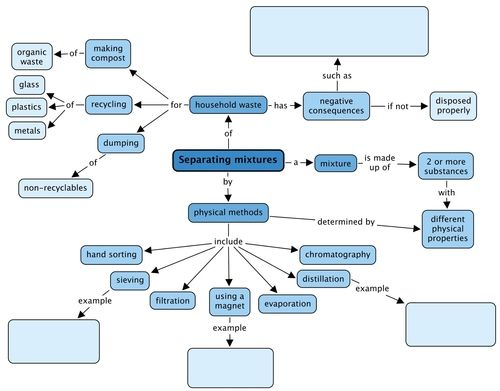
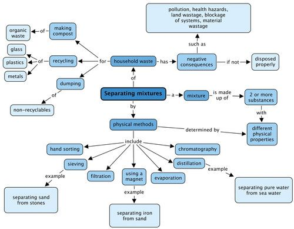

## Summary

<Callout type="note" title="Note">
- A mixture consists of two or more components that have different physical properties.
- The components in a mixture are not chemically joined; they do not change their chemical identities and they retain their physical properties as well.
- When we want to separate a mixture, we can use the differences in the physical properties of the components of the mixture to separate the components from each other.
- Hand sorting is a suitable separation method for a mixture that contains a relatively small number of large items.
- Sieving is a suitable separation method when the pieces to be separated are sized differently.
- Filtration is a good method for separating an undissolved solid from a liquid.
- Components with different magnetic properties can be separated using magnetic separation.
- Evaporation is a suitable separation method for removing a liquid from a solid.
- Distillation is a suitable method for separating two liquids with different boiling points.
- Chromatography is a good method for separating coloured pigments from each other.
- Waste disposal should be managed in a responsible way so that the negative impact on the environment is as small as possible.
- Metals, plastics, paper and glass can be recycled.
- Organic waste can be turned into compost.
- Responsible waste disposal is everyone's responsibility, but it is usually managed by the local authorities, who have systems for sorting and recycling waste.
- Poor waste management leads to negative consequences for humans, animals and the environment. Some of these are:
  - pollution of the soil, water resources and the environment;
  - health hazards and the spread of disease;
  - blockage of sewers and drainage systems;
  - land wasted when it is used to dump or bury garbage (landfills); and
  - materials and other resources wasted when they could have been recycled.
</Callout>

Concept map

We looked at physical methods to separate mixtures and these are shown in the concept map. Give an example of the types of mixtures you could separate using three of these methods. What negative consequences does human waste have on the environment? Fill these in the concept map.

Teacher's version

