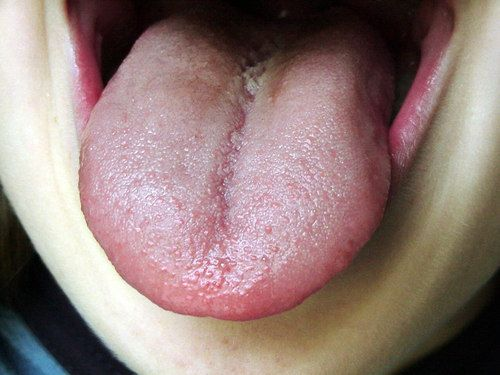
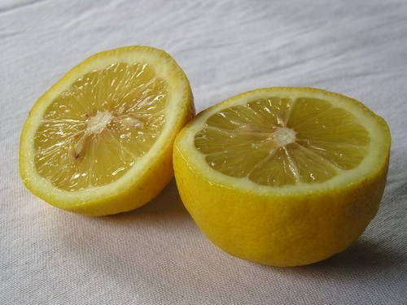
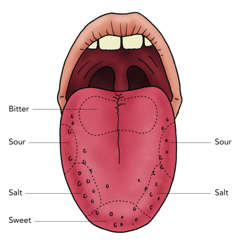
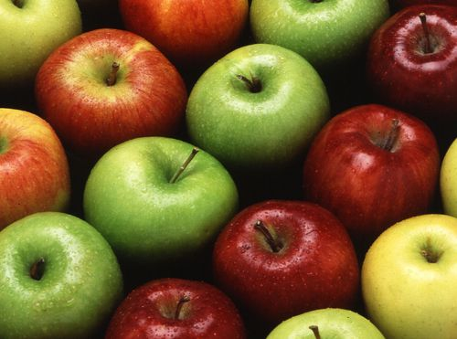
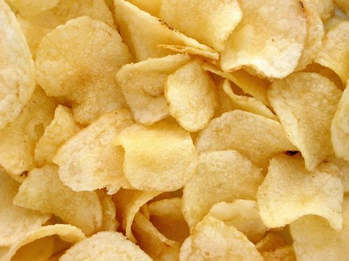
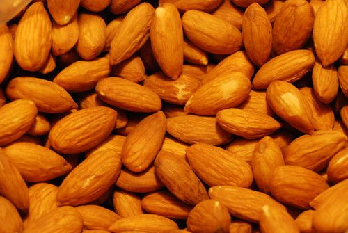
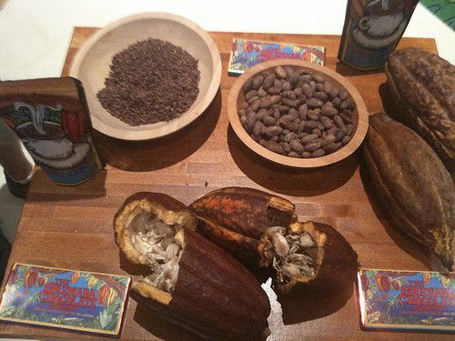

## Tastes of substances

<Callout type="note" title="Note">
- flavour
- sense
- taste buds
- chemoreceptor
- savoury
- instinct
- tongue map
</Callout>

What is your favourite food? What do you like most about your favourite food? You will probably say that you just LOVE the taste of it! The taste of our favourite foods make us feel good. How do we taste our food?

We taste food with tiny structures on our tongues!

Look in the mirror, and stick out your tongue. Look for small, round bumps. These are called **papillae**. Most of them contain **taste buds**. The taste buds are very small structures which have sensitive hairs. The chemicals in the food that you eat dissolve into your saliva in solution. The chemicals then stimulate the tiny hairs within the tastebuds and turn these signals into impulses. These impulses travel to the brain allowing us to experience the sensation of taste.

<Callout type="note" title="Note">
Insects have the most highly developed sense of taste. They have taste organs on their feet, antennae, and mouthparts.
</Callout>

Learners will study the nervous system in more detail in Gr. 9 Life and Living, as well as in Life Sciences if they carry on with the subject in Gr. 10. For now, this is just interesting information about how we taste foods and distinguish between different tastes.

<Callout type="note" title="Note">
We have more than 10 000 taste buds in our mouth. You even have taste buds on the roof of your mouth.
</Callout>

# Have a look at your own tongue

As a homework exercise, learners can do the following activity. Otherwise, if you have some mirrors available in the classroom, learners can have a look at their tongues. If you do this in class, try bringing some lemons to class for learners to taste and then describe their experiences.

**MATERIALS:**

- mirror
- pencil
- sugar water
- lemon juice

**INSTRUCTIONS:**

2. Look in the mirror at your tongue.
4. Stick it out as far you can and try to see the papillae. Are they larger in some areas?

Have you tasted a lemon before?

Close your eyes and imagine biting into a slice of lemon. Can you describe the experience? What does the lemon taste like? Sweet, sour, salty or bitter?

Sour

If you have sugar solution and lemon juice available in the class, taste these different substances. See if you can identify *where* on your tongue you taste the two different tastes.

### Your tongue can only sense four flavours

You can only sense four different tastes with your tongue. Can you name them?

Sweet, sour, bitter and salt.

The tongue map.

The four main tastes that are most common, are sweet, sour, salt and bitter. These tastes combine to make up the different flavours of our foods.

<Callout type="note" title="Note">
A flavour is a combination of tastes and smells.
</Callout>

How would you classify the taste of apples? Sweet or sour? Bitter? Perhaps a combination?

Many people really enjoy the sour-salty taste of salt and vinegar chips!

There is a good reason for why we like certain tastes, but not others.

### Our sense of taste protects us

Just as we like and seek out foods that taste good, our bodies have also been programmed to avoid food with strong bitter or sour tastes. This helps to protect us against poisons, which often have a strong bitter taste. 'Bitter' is also the basic taste that our tongues are most sensitive to. Spoiled food often tastes sour and it may also have a bad smell. Our instinct will be to avoid it, which will protect us from becoming ill from ingesting the organisms that have spoiled the food.

<Callout type="note" title="Note">
Almond nuts can be sweet or bitter, depending on the type of tree they come from. The sweet almonds (which we eat) do not contain poisonous chemicals. Bitter almonds from another tree species contain chemicals which are toxic to humans.
</Callout>

Sweet almonds, such as these, are edible as they do not contain toxic chemicals, unlike the wild bitter almonds.

Cocoa beans come from cocoa pods. Chocolate is made from cocoa, but cocoa is very bitter. Lots of sugar is added to chocolate to make it sweet. [http://www.flickr.com/photos/michaelsgalpert/3681442211/in/photostream/](http://www.flickr.com/photos/michaelsgalpert/3681442211/in/photostream/)

Soon the link between the tongue and chemical substances will become clear.
