## Properties of acids, bases and neutral substances

<Callout type="note" title="Note">
- corrosive
- acid
- chemical formula
- essential
- immune system
</Callout>

<Callout type="note" title="Note">
When we want to say something has the properties of an acid, we use the adjective acidic. When we want to say something has the properties of a base, we use the adjective basic.
</Callout>

In the previous section you had to imagine what it would feel like if an acid burned your tongue. In the next section we are going to learn more about acids. We will learn that they taste sour (and also why it is not a good idea to taste them!).

We will also learn about other substances that have a special relationship with acids. They are called bases. Finally, we will also learn about substances that are neither acids or bases, but neutral substances.

### Acids

<Callout type="note" title="Note">
- ascorbic acid
- citric acid
- formic acid
</Callout>

Do you know the names of any acids? Think about this as a class and make a list of all the acid names you have heard.

You can do this on the board and ask learners for their answers to write down. Some examples might be vinegar (which contains acetic acid), citric acid (found in citrus fruits such as lemons, oranges and grapefruit), ascorbic acid (also known as Vitamin C, which comes in tablets, capsules or chewable sweets, and it occurs naturally in citrus fruit, tomatoes, strawberries), tartaric acid, etc).

There are many different acids. You might have already tasted an acid in class. Was it the sugar water or the lemon juice?

Ask your learners these questions. The answers are: The lemon juice contains an acid. The lemon juice was sour. **Encourage learners to write in their workbooks and make notes in the margins and empty spaces!** They should not be afraid of scribbling and taking notes during class whilst you are talking or explaining a concept. Taking notes is a very important skill to learn.

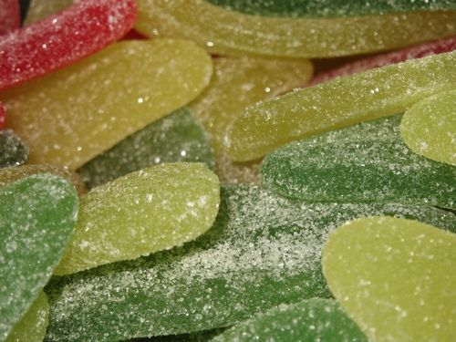

Do you like sour sweets, such as sour worms? The sour taste comes from fumaric acid. Fumaric acid is a natural acid with a sour taste, that is often added to foods.

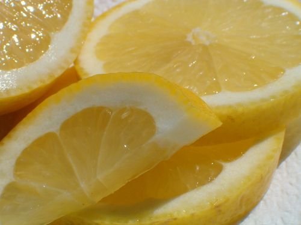

The juice of lemons is rich in ascorbic acid (vitamin C) and citric acid, which makes it taste sour.

All acids taste sour. Does this mean that all acids are safe to taste? Definitely NOT! Next, we will learn which acids should not be tasted under any circumstances.

<Callout type="note" title="Note">
The word acid comes from the Latin word *acidus*, meaning 'sour'.
</Callout>

#### Laboratory acids

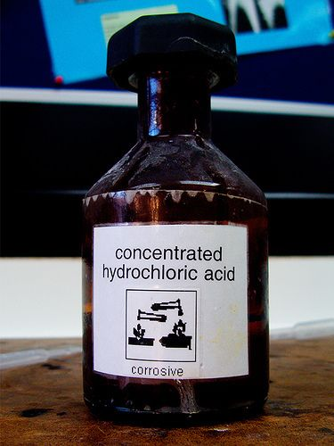

Concentrated hydrochloric acid is very corrosive and dangerous. [http://www.flickr.com/photos/maticulous/2552655853/](http://www.flickr.com/photos/maticulous/2552655853/)

Some acids are very dangerous and must be handled carefully. These acids are **corrosive**. They can cause serious burns on your skin. Scientists always wear protective clothing when handling these acids. It would be very dangerous to taste them. These acids are most often found and used in laboratories and certain industrial processes. We will refer to them as laboratory acids.

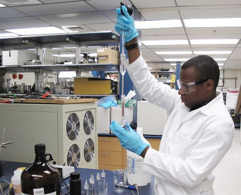

This scientist is handling an acid. Can you see he is wearing protective clothing, gloves and safety glasses? [http://www.flickr.com/photos/rdecom/4968163345/](http://www.flickr.com/photos/rdecom/4968163345/)

Look out for this label on bottles which contain corrosive substances, such as strong acids.

The following table contains the names and **chemical formulae** of the three most common laboratory acids. Even though you have not learnt how to write chemical formulae yet, we have included them here. You should handle containers with these formulae printed on them with care.

Learners will only study chemical formulae in detail in Gr. 9 Matter and Materials, however, this is a good opportunity to introduce them to the concept especially so that learners are able to recognise dangerous chemical substances.

<Callout type="note" title="Note">
The chemical formula of a substance tells us which elements it contains.
</Callout>

| Name of the acid | Formula of the acid |
| --- | --- |
| hydrochloric acid | HCl |
| nitric acid | HNO 3 |
| sulfuric acid | H 2 SO 4 |

There are many other laboratory acids that we have not listed. These are only the most common ones.

<Callout type="note" title="Note">
You have a laboratory acid inside your body?! Your stomach contains hydrochloric acid (HCl). HCl helps break down the food for digestion. Your stomach has a very mucous lining which helps protect it from the strong acid.
</Callout>

Other acids in the foods we eat are not dangerous. In fact, some are even vital for our health and well-being. Let's now have a look at acids that are safe to handle.

#### Natural and household acids

Not all acids are dangerous. One such acid is called ascorbic acid, or vitamin C. Vitamin C helps our immune system. Which foods contain vitamin C? Have a look at the pictures.

<Callout type="note" title="Note">
Most people associate oranges with a high vitamin C content, but there are other foods which are much higher in vitamin C. These include chillies, guavas, strawberries, bell peppers, broccoli, kiwi fruits and papaya.
</Callout>

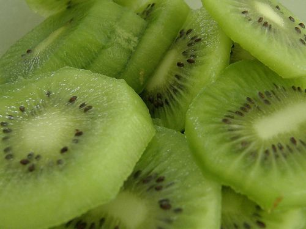

Kiwi fruit. [http://www.flickr.com/photos/dan4th/5317566258/](http://www.flickr.com/photos/dan4th/5317566258/)

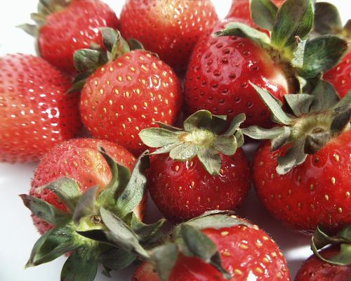

Strawberries.

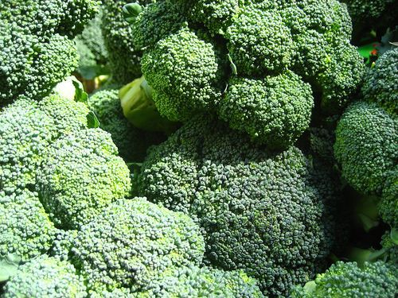

Broccoli. [http://commons.wikimedia.org/wiki/File:Brocolli_%284700583979%29.jpg](http://commons.wikimedia.org/wiki/File:Brocolli_%284700583979%29.jpg)

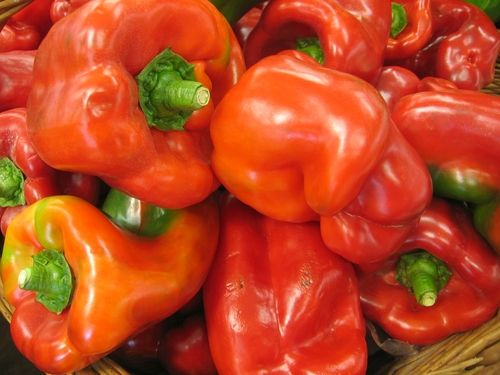

Bell peppers.

<Callout type="note" title="Note">
If you do not have enough vitamin C in your diet you may develop a number of symptoms: you may become tired easily, bruise easily, develop bleeding gums, dry skin and hair, become moody and lose weight. These are all symptoms of a weakened immune system.
</Callout>

We will call the acids that we find in food natural acids. Many of these natural acids are found in the kitchen. For this reason they are also sometimes called household acids.

One very well-known household acid is acetic acid. Vinegar is a mixture of a small amount of acetic acid dissolved in water. So vinegar is a solution of acetic acid in water.

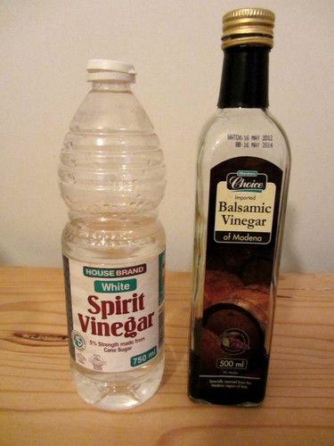

Spirit vinegar and balsamic vinegar.

This is a good place to briefly revise some of the concepts learnt in Gr. 6 about solutions and mixtures, and to refer back to Chapter 2 about separating mixtures.

<Callout type="note" title="Note">
Formic acid is what gives ants their sting when they bite. 'Formic' comes from the Latin word for ant 'formica'*.*
</Callout>

# True or false?

**INSTRUCTIONS:**

- Let's briefly revise some of the concepts we have learnt so far.
- Below are some statements. You need to state whether they are true or false. If they are false, explain why.

**True or false?**

**Problem:**
We can sense three tastes with our tongues.

**Solution:**
False, we can sense four tastes, namely salty, sweet, sour and bitter.

**Problem:**
Acids taste sour.

**Solution:**
True

**Problem:**
If we want to know if something is an acid, we can just taste it.

**Solution:**
False, not all acids are safe to taste, such as laboratory acids.

**Problem:**
All acids are dangerous.

**Solution:**
False, there are many household acids which are not dangerous, such as acetic acid and acids in foods.

**Problem:**
Vinegar is a mixture of a small amount of acetic acid dissolved in water.

**Solution:**
True.

**Problem:**
Laboratory acids must be handled with care and using protective clothing.

**Solution:**
True

**Problem:**
The following symbol means you can wash your hands using this substance.

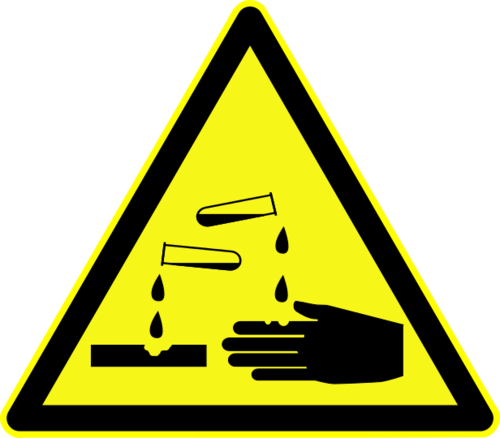

**Solution:**
False. This symbol means that the substance is corrosive, it is a warning.

**Problem:**
Formic acid is commonly referred to as Vitamin C.

**Solution:**
False, ascorbic acid is commonly referred to as Vitamin C.

**Problem:**
Oranges are the food which contain the highest amount of ascorbic acid.

**Solution:**
False, there are many other foods with higher ascorbic acid (Vitamin C), such as strawberries and chillies.

<Callout type="note" title="Note">
Many of the fizzy drinks that we drink contain carbonic acid.
</Callout>

Do you think that it would be possible for acids to lose their strength? There is one class of compounds that can make acids lose their strength. These compounds are called bases.

### Bases

<Callout type="note" title="Note">
- base
- neutral substance
- neutralise
- alkali
</Callout>

Bases can **neutralise** acids and vice versa. What does it mean to neutralise something?

At this level, learners can think of neutralisation as a process in which something potent (and potentially harmful) is changed into something harmless (or at least less harmful). Later on (in Gr. 9) they will learn the proper scientific definition of neutralisation: "the process in which an acid reacts with a base to form a salt and water". It is important to note that a neutralisation reaction **does not** necessarily result in a neutral solution.

<Callout type="note" title="Note">
When an acid and a base are mixed together in the**correct ratio**, they will neutralise each other. This means that the solution made up of the acid and the base becomes something that is neither an acid nor a base, but neutral. In the process, both the acid and the base will lose their unique characteristics.
</Callout>

Bases and acids have chemical properties that are the opposite of each other. We can think of bases as the chemical opposite of acids.

As with acids, there are some bases that are extremely dangerous. The same hazard symbol that is used to warn people of the dangers of acids, is also used for these bases. Strong bases react corrosively with other materials and can burn your skin. They must be handled carefully and always while wearing appropriate protective clothing, such as lab coats, gloves and safety glasses.

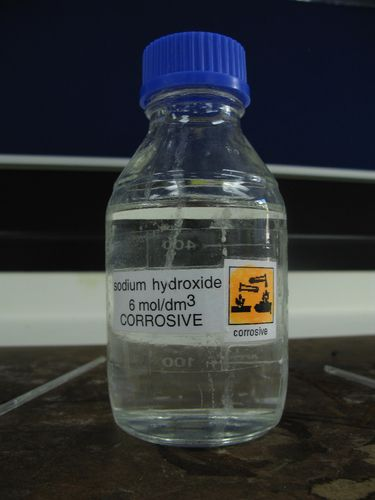

Sodium hydroxide is a strong base used in laboratories. Do you see the yellow corrosive warning symbol? [http://commons.wikimedia.org/wiki/File:Sodium_hydroxide_solution.jpg](http://commons.wikimedia.org/wiki/File:Sodium_hydroxide_solution.jpg)

Other bases are mild enough to be used as cleaning materials in and around the home. This does not mean that they are completely harmless. It just means that they have been mixed with other substances so that they are not so corrosive.

# Acids and bases in our homes

For this activity, learners must first identify the products in the photograph provided. All of these household products contain bases. The next part of the activity is a demonstration which you can set up beforehand in the front of your classroom. Instructions and materials for the demonstration are supplied here:

**MATERIALS**:

- five bowls
- water
- washing powder
- handy andy
- bicarbonate of soda or baking powder
- lemon juice
- vinegar
- labels for each bowl showing the product that is in them
- a towel for drying hands

**INSTRUCTIONS**:

2. Place the bowls in a row on a desk in the front.
4. Mix each of the bases (washing powder, handy andy, baking powder) in separate bowls with some water.
6. Pour some lemon juice into another bowl and some vinegar into the last bowl.
8. Arrange the bowls in a row, alternating between a base and an acid.
10. Once the learners have filled in the table to identify the products, get them to come up to the front in groups to put their fingers in the bowls to feel the different substances.
12. They must take note of what they are feeling and should dry their hands between each substance.
14. After feeling the difference between the acids and bases, the learners can go back to their desk to complete the activity.

As an extension, you can also let learners take note of the difference between the dry powder for washing powder and then how it feels when it is mixed with water. Bases which dissolve in water are called alkalis.

All of the products in the picture below contain bases. Which of the products do you recognise? Write their names and what they are used for in the table.

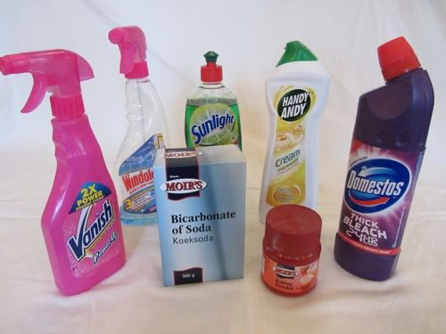

Some household products which are bases.

Many household products (such as certain apple-scented shampoos and dishwashing liquids) contain apple or lemon scents or essences as additives. It has been noted that some of these products may be more acidic than basic. Make sure to test all the products you will be using in the class beforehand, to make sure the bases all react as expected.

**Problem:**
| Product | What is it used for? |
| --- | --- |

**Solution:**
| Product | What is it used for? |
| --- | --- |
| Stain remover (Vanish) | Removing stains from clothes |
| Windowlene | Cleaning windows |
| Handy Andy | Cleaning surfaces (stove, bathroom, kitchen tops, etc.) |
| Baking powder | Ingredient in baked goods |
| Bicarbonate of soda | Ingredient in baked goods, also a mild disinfectant |
| Bleach | Disinfecting and removing stains |
| Sunlight liquid | Cleaning dishes, cutlery and crockery |

Next, your teacher will let you come up to feel different substances which are either bases or acids. All of these substances are safe to touch. Take note of how they feel between your fingers and then come back to fill in the table.

**Problem:**
| Substance | How did it feel between the fingers? | Is it an acid or a base? |
| --- | --- | --- |

**Solution:**
| Substance | How did it feel between the fingers? | Is it an acid or a base? |
| --- | --- | --- |
| Washing powder | Slippery | Base |
| Lemon juice | Feels slightly rough between the fingers | Acid |
| Handy andy/soap | Slippery | Base |
| Vinegar | Leaves a rough feeling on the skin | Acid |
| Baking powder | Slippery | Base |

The bases will be easy to describe as they mostly feel quite slippery between the fingers. Acids generally leave a "rough" feeling on the skin and are not slippery like bases.

**QUESTIONS:**

**Problem:**
What can you conclude about how bases feel?

**Solution:**
Bases feel slippery.

**Problem:**
What can you conclude about how acids feel?

**Solution:**
Generally, acids feel rough on the skin.

**Problem:**
What did your teacher have to do to the dry washing powder before you could feel it in the bowl? Do you know what we call the solution which forms? If so, write it down, otherwise your teacher will help you.

**Solution:**
She/he had to add water to make it slippery. A solution of a base and water is called an alkaline solution.

**Problem:**
Although we have spoken about acids and bases as being chemical opposites, what property do many of them have in common?

**Solution:**
Many acids and bases are dangerous to touch or taste - they are corrosive.

<Callout type="note" title="Note">
Bases that can dissolve in water are called**alkalis**. For this reason, the terms base and alkali are sometimes considered to have the same meaning. (Words that have the same meaning are called synonyms.)
</Callout>

Finally, there is a class of substances that are neither acids nor bases. They are called **neutral** substances. We will explore them next.

### Neutral substances

We have learnt that when an acid and a base are mixed (in the right amounts), they will neutralise each other. That means that, together, they will change into something that is neither an acid nor a base. So the acid will lose its properties and so will the base. And the new substance that forms from the two substances will be neither an acid nor a base. We call it a neutral substance.

Some neutral substances are formed when an acid is mixed with a base and a neutralisation reaction occurs. Other substances are neutral to begin with. They are not the product of a neutralisation reaction. The neutral substances that are the most well known are: water, table salt, sugar solution and cooking oil.

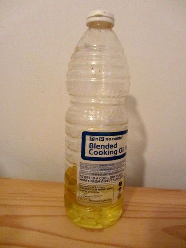

Cooking oil is a neutral substance.

We have learnt about three classes of substances: acids, bases and neutral substances. But, we cannot tell whether a substance is an acid, base, or a neutral substance, just by looking at it. We know that acids taste sour, but we have also learnt that it is never a good idea to taste chemicals.

Let's imagine we have an unknown substance. It is colourless and looks just like water. It is also odourless (that means it has no smell). There are no physical signs to show whether it is acidic, basic, or neutral. How can we tell what it is?
