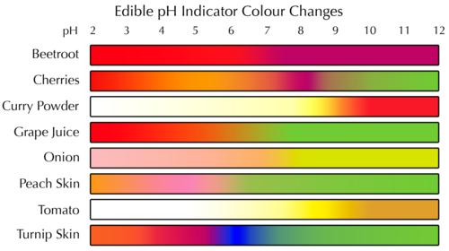
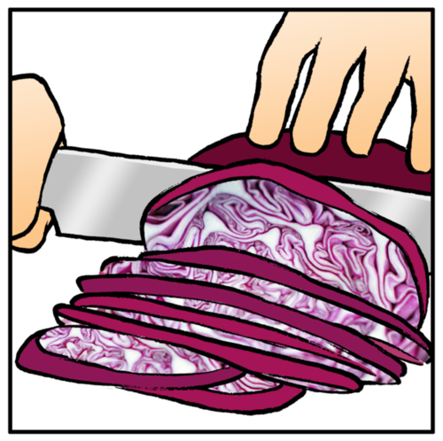
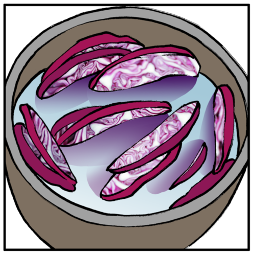
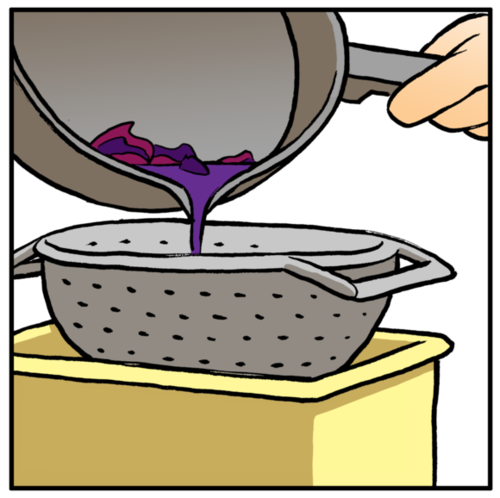
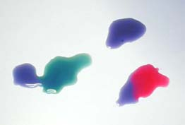
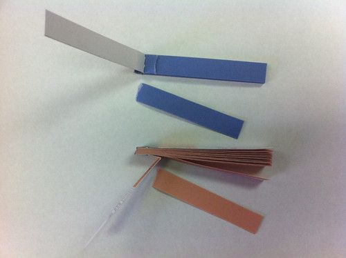
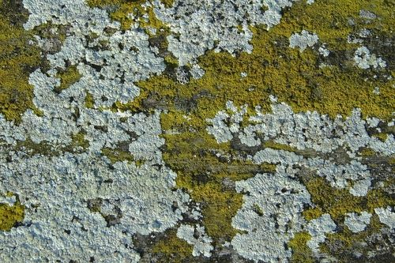

## Acid-base indicators

<Callout type="note" title="Note">
- indicator
- litmus
</Callout>

What do the indicators on a car do?

Ask your learners this question to highlight the meaning of the word "indicate", which is to show. When the indicators on a car light up, they *show* other motorists that the driver of the car intends to turn left or right.

<Callout type="note" title="Note">
To indicate means to show.
</Callout>

Acids and bases can change the colour of some substances. In the next activity, we are going to investigate a substance that changes colour when we mix it with an acid or a base.

<Callout type="note" title="Note">
This website has a list of other household products that will also change colour when mixed with acids or bases. Make sure you ask your parents if you may experiment before you start
</Callout>

It has been noted that some household indicators that appear on the list above are not very effective, such as tea and beetroot. Some are more sensitive, including curry powder and turmeric. If you explore other indicators with the class, make sure to test a few to determine which ones produce the best results. Here is a table of other naturally occurring indicators which you could use in class:

Have you ever eaten red cabbage? It is not only tasty, but also very healthy. We are going to see how red cabbage juice changes when we mix it with different substances.

<Callout type="note" title="Note">
Video on red cabbage and black tea as indicators
</Callout>

# Preparing and testing red cabbage juice with acid and base

You will need to buy a red cabbage prior to this activity. Red cabbages are available during winter and spring. One cabbage should make enough extract for an entire class of learners. You can prepare the extract in the class, or you could make it ahead of time and simply demonstrate the method (cutting the cabbage, boiling and straining it) to the learners without boiling the cabbage in class.

If you are not able to get red cabbage, you can try using some of the other foods listed in the previous table which are also natural indicators. Another example which is easy to use and obtain is black tea.

**MATERIALS:**

- one large, red cabbage
- pot with water for boiling
- hot plate (or stove)
- strainer
- sharp knife
- container for red cabbage juice (ice cream tub or large yoghurt tub will work well)
- white plate
- vinegar
- baking soda solution

**INSTRUCTIONS:**

**Prepare the cabbage juice:**

2. Cut the cabbage into thin slices and place it in the pot.

2. Add just enough water to cover the cabbage slices.
4. Boil it over low heat for approximately 30 minutes, adding water to keep the cabbage covered if necessary.

2. Remove the pot from the heat and let it cool completely.
4. Strain the juice off the cabbage slices into the ice cream tub. The boiled cabbage slices can be eaten (or placed in the compost).

2. If kept in the fridge the red cabbage juice will last about 3 days.

**Test the cabbage juice indicator**

2. Carefully place three large drops of the cabbage juice on a smooth, white surface (a white plate or tile will work well).
4. Pour a few drops of vinegar into one of the drops of cabbage juice. What do you see?
6. Pour a few drops of baking soda solution into one of the remaining drops of cabbage juice. What do you see?

Red cabbage juice mixed with baking soda (left) and with vinegar (right). The blue drop at the top is the unmixed juice.

<Callout type="note" title="Note">
These two videos are both demonstrations of the cabbage juice indicator experiment you just completed and .
</Callout>

These demonstration videos extract the red cabbage juice by blending it with some water in a blender instead of boiling it. Both methods are equally effective in extracting the juice from the cabbage leaves.

In the next activity we are going to preserve the red cabbage juice by absorbing it on some filter paper, and drying it, so that we can use it later.

# Making red cabbage indicator paper

If time permits, you can make these indicator strips in class with your learners using the cabbage juice from the previous experiment. If you do not have time, do this yourself outside of class and then just go through the steps below explaining to your learners what you did. If you do not have time to do it in class, you can also encourage learners to do it at home with their parents if they have capacity and resources.

**MATERIALS:**

- pieces of absorbent paper
- red cabbage juice from the previous activity in a container
- scissors
- container

Filter paper is best, or paper used for painting with watercolours (available from stationery or art supply shops); coffee filters or even paper towel would also work. The cabbage juice should not be too dilute; you can concentrate it by heating it over low heat for 20 minutes and allowing it to cool.

**INSTRUCTIONS:**

2. Place the absorbent paper in the cabbage juice.
   
4. After 30 minutes, remove the paper and leave it in a warm place to dry.

You can also dry the paper with a hair dryer, but do not leave it in direct sunlight.

2. When the paper has completely dried, cut it into strips (approximately 1 cm wide). You can keep the strips for a long time if you store them in a dry place.

We will use the red cabbage paper strips later, as part of an investigation.

Some other substances also change colour when an acid or a base is added to them. By changing their colour, they show that they have reacted with an acid or a base. That is why we call them **acid-base indicators**.

The most well-known acid-base indicator is a substance called **litmus.**

Blue and red litmus paper.

<Callout type="note" title="Note">
Litmus is a coloured substance that comes from the pigments of a living organism called *lichen*. Pigments are coloured substances found in nature.
</Callout>

Litmus comes from pigments in the lichen which are found growing in many different places, mostly on rocks.

Litmus solution is most commonly soaked into paper, the paper is then dried and cut into strips we then call "litmus paper". It is just like the red cabbage paper we made earlier. Litmus paper is available in two colours: blue and red.

How does litmus paper indicate whether a substance is an acid or a base? In the next activity, we will investigate how litmus responds to some household acids and bases.

<Callout type="note" title="Note">
Colourful chemistry with acids and bases using household products (video)
</Callout>

# How does litmus respond to acids and bases?

CAPS suggests that you also test various beverages to see whether they are acids, bases or neutrals. A suggestion is to do this investigation presented here first where learners first determine how litmus responds to acids and bases, and then if you have time as an extension, get learners to test various drinks, such as water, Ceylon tea, rooibos tea, orange juice, milk, coffee and any fizzy drink to see whether they are acids, bases or neutrals.

**AIM:** To determine how litmus responds to some household acids and bases.

**HYPOTHESIS:** What is your hypothesis for this investigation?

Learners may not yet know how litmus reacts to acids and bases, so they may have to come back to propose a new hypothesis when they are writing their conclusions. They should not be encouraged to come back to this space, cross out the hypothesis and write a new one which they know to be true. This is an important concept in science investigations - a hypothesis is a proposed explanation, which needs to be **tested** further using the scientific method. One can then verify whether the hypothesis was true (and it is accepted) or it is false (and it is rejected) and you come up with a new proposed hypothesis.

**MATERIALS AND APPARATUS:**

It would be advisable to label the containers to prevent learners from confusing the substances.

- small containers (test tubes or yoghurt tubs) filled with the following substances:
  - water
  - soda water
  - vinegar
  - lemon juice
  - sugar water (1 tablespoon dissolved in a cup of water)
  - baking soda (1 tablespoon dissolved in a cup of water)
  - Handy Andy (1 tablespoon dissolved in a cup of water)
  - aspirin (Disprin) (1 tablet in 2 tablespoons of water)
  - dishwashing liquid (1 teaspoon dissolved in a cup of water)
  - any other substances commonly used at home that are not dangerous
- litmus paper (blue and red)
- glass or plastic rods (plastic teaspoons will also work well).

**METHOD:**

2. Cut a small piece (1 cm long) of blue and red litmus for each substance that you will be testing.
4. Use the plastic teaspoon or rod to place just 1 drop of water on the blue litmus. Do the same with a piece of red litmus.
6. Did the blue litmus change colour? Did the red litmus change colour? Write the new colours in your table, in the appropriate place.
8. Repeat the procedure to test all the substances you have been given. You must rinse the teaspoon or rod with water in between substances.
10. Save all your test substances, because you will need them for another investigation later.

**RESULTS AND OBSERVATIONS:**

Record your observations in the table. If you did not use some of these substances, cross them out and write headings for your substances in the empty rows.

| Substance | Colour with blue litmus | Colour with red litmus |
| --- | --- | --- |
| Water |  |  |
| Soda water |  |  |
| Vinegar |  |  |
| Lemon juice |  |  |
| Sugar water |  |  |
| Baking soda |  |  |
| Handy Andy |  |  |
| Aspirin |  |  |
| Dishwashing liquid |  |  |

**ANALYSIS:**

Let us now have a look at our observations to see what we can conclude.

**Problem:**
How does the litmus paper indicate when a substance is an acid?

**Solution:**
In an acid, the blue litmus changed to red and the red litmus remained red.

**Problem:**
Which of the substances you tested are acids?

**Solution:**
Depending on the substances you use, but according to those listed here, the acids are: soda water, vinegar, lemon juice and aspirin.

**Problem:**
How does the litmus paper indicate when a substance is a base?

**Solution:**
In a base, blue litmus remains blue and red litmus changes blue.

**Problem:**
Which of the substances you tested are bases?

**Solution:**
Depending on the substances you use, but according to those listed here, the bases are: baking soda, handy andy, dishwashing liquid.

**Problem:**
How would you describe a neutral substance?

**Solution:**
Learner-dependent answer.

**Problem:**
How does the litmus paper indicate when a substance is neutral?

**Solution:**
Neither the red or the blue litmus paper will change colour when a substance is neutral.

**Problem:**
Which of the substances you tested were neutral?

**Solution:**
Water and sugar solution.

**Problem:**
Why do you think you had to rinse the glass rod or teaspoon in between testing each substance?

**Solution:**
You need to do this to avoid contamination and mixing of the substances otherwise, for example, there might be some acid left over when testing a base which would change the litmus paper resulting in an incorrect result for the base.

**CONCLUSION:**

Write a conclusion based on your results in response to the initial aim for this investigation.

A conclusion must respond to the aim and hypothesis for the investigation. In this case the aim was to determine how litmus paper responds to some household bases and acids. Therefore a conclusion is: In response to some household acids and bases, red litmus paper turns blue in bases and remains red in acids, and blue litmus paper turns red in acids and remains blue in bases. Both red and blue litmus paper will remain red or blue, respectively, in the presence of neutral substances. Learners can see whether they reject or accept their hypotheses.

**Extension**: If you have time in class with your teacher, use your knowledge of how litmus responds to acids and bases to test some of the beverages that you drink every day. You can use litmus paper to indicate whether beverages such as ceylon tea, rooibos tea, orange juice, milk, coffee and fizzy drinks are acids, bases or neutrals. If you do so, record your findings here:

The first five minutes of this video () contains a very clear demonstration of acids and bases using a universal indicator. The entire video is more than an hour long and touches on a range of chemical experiments and demonstrations. The demonstrations are very well designed and executed and the video can be used as a very useful tool to illustrate many concepts of chemistry in the classroom, though only the first part is relevant to this chapter.

We can say the following about litmus:

- Blue litmus is used to test for acids:
  - acids turn blue litmus red.
  - Bases and neutral substances do not change the colour of blue litmus.
- Red litmus is used to test for bases
  - bases turn red litmus blue.
  - Acids and neutral substances do not change the colour of red litmus.

What about the red cabbage paper that we made earlier? Can these paper strips be used to tell if something is an acid or a base? Let's find out.

# Is red cabbage paper suitable as acid-base indicator?

This is an **optional, extension** activity.

**AIM:** To determine whether red cabbage is a suitable acid-base indicator.

**MATERIALS AND APPARATUS:**

Learners can use the saved substances from the litmus investigation they did earlier. Top up the solutions if necessary.

- small containers with the same substances as in the previous investigation
- red cabbage paper strips
- glass or plastic rods

**METHOD:**

2. Use a small strip (2 cm long) of red cabbage paper for each substance that you will be testing.
4. Dip a fresh piece of paper into each of the test solutions. Does the paper change colour? Write the colour of the paper with each substance in your table in the appropriate place.

**RESULTS AND OBSERVATIONS:**

Record your observations in the table.

| Substance | Colour with red cabbage paper |
| --- | --- |
| Water |  |
| Soda water |  |
| Vinegar |  |
| Lemon juice |  |
| Sugar water |  |
| Baking soda |  |
| Handy Andy |  |
| Aspirin |  |
| Dishwashing liquid |  |

**QUESTIONS:**

**Problem:**
Which of the test substances are acids? (Check the results from the litmus investigation that you did earlier.)

**Solution:**
Learner-dependent answer.

**Problem:**
What colour did the red cabbage paper turn in the test substances that were acids?

**Solution:**
The red cabbage paper should turn a red-pink colour in an acid.

**Problem:**
Which of the test substances are bases? (Check the results from the litmus investigation that you did earlier.)

**Solution:**
Learner-dependent answer.

**Problem:**
What colour did the red cabbage paper turn in the test substances that were bases?

**Solution:**
The red cabbage paper should turn a blue-green colour in a base.

**Problem:**
Did the red cabbage paper change colour with all the substances? If there were some substances that did not change the colour of the paper, write their names below.

**Solution:**
Learner-dependent answer.

**Problem:**
Are these substances acidic, basic or neutral (also check your litmus test results)?

**Solution:**
Learner-dependent answer.

**Problem:**
Do you think red cabbage paper makes a good acid-base indicator? Why do you say so?

**Solution:**
Learner-dependent answer. They should note that a good indicator is something which can tell you if it is an acid or a base, in that the same paper turns different colours whether in an acid or a base.
