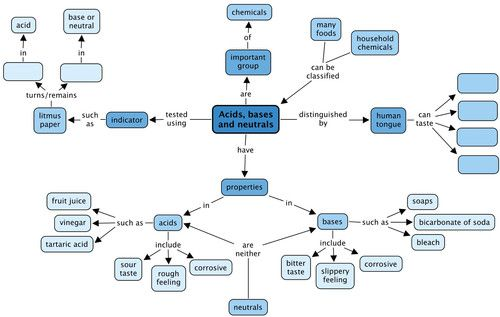
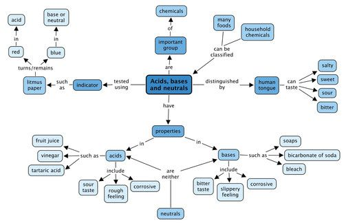

## Summary

<Callout type="note" title="Note">
- Our tongues can sense 4 different flavours namely, sweet, salty, sour and bitter.
- Our sense of taste protects us from eating foods that are harmful and stimulates us to eat foods that are nutritious and energy-rich.
- Acids and bases are chemical opposites of each other.
- Though it is not a good idea to taste chemicals, acids have a sour taste and bases taste bitter.
- When they are in solution with water, acids feel rough and bases feel slippery.
- Some acids and bases are present in foods and in household items. These are relatively safe to handle. Others are often very corrosive and should only be handled when you are wearing protective clothing.
- Substances which are neither acidic nor basic, are called neutral substances.
- When an acid is mixed with a base in the right quantities, they neutralise each other. That means they lose their power.
- Some substances change colour when they react with an acid or a base. These substances are called acid-base indicators. One household example of an acid-base indicator is red cabbage juice.
- Litmus is the best known of all acid-base indicators. It does not change colour in the presence of a neutral substance, but responds to acids and bases in the following way:
  - litmus is red in the presence of an acid; and
  - litmus is blue in the presence of base.
</Callout>

**Concept map**

The human tongue can taste 4 main different tastes. What are these? Fill them in the spaces below. You also need to complete the section of the concept map about indicators. Can you work out how to do this? You need to fill in the colour that litmus turns (or remains) in each either an acid or a base (or neutral).

Teacher's version.

