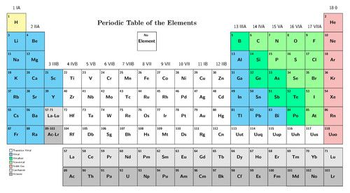
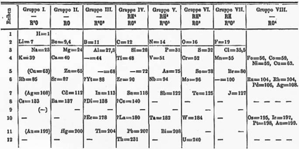

## Arrangement of elements on the Periodic Table

This website contains an interactive version of the Periodic Table. It is a wonderful tool to show some of the trends and information that the Periodic Table contains. This website can also be used in the later grades when the Periodic Table is covered again, in more detail. For now, it is a useful teaching tool to give an overview[http://www.rsc.org/periodic-table/](http://www.rsc.org/periodic-table/).

Another interesting website which contains mostly photos of the elements is [http://periodictable.com/](http://periodictable.com/) This is a very useful site to illustrate to learenrs what elements actually are.

<Callout type="note" title="Note">
- element
- Periodic Table
- symbol (or element symbol)
- atomic number
</Callout>

<Callout type="note" title="Note">
A tour of the Periodic Table
</Callout>

The video above includes a bit more history about Dmitri Mendeleev, reviews Mendeleev's organisation of the period table and then moves on to relationships of elements on the Periodic Table. Just before the end of the video, the host mentions the importance of electrons (to be discussed in another video). Atoms, electrons and protons are concepts that are only discussed in Gr. 8.

<Callout type="note" title="Note">
In Life and Living, we looked at the classification of living organisms in our world. Now in Matter and Materials, we are looking at the classification system for elements!
</Callout>

The Periodic Table is a classification system for the elements that make up the matter and materials in our world. Today, there are more than 100 different elements known! Each element has its own name, symbol, atomic number and position on the Periodic Table.

### Element names

<Callout type="note" title="Note">
Hafnium takes its name from the Latin name for Copenhagen, which is*Hafnia*, as the element was discovered by two scientists working in Copenhagen at the time.
</Callout>

What is your name? Perhaps it is Thando. Or David. Or Megan. Perhaps you are lucky enough to be the only person in your class with that name. Perhaps you are lucky enough to be the only person in the world with that name! That would make your name unique.

Each element has a unique name. We can think of each name as a unique 'label' we can use to identify the element. There are two other unique labels that we can use to identify elements. They are the chemical symbol and the atomic number. We will learn more about these in the next section. Each element has some of its own unique properties and later on we will see that those with some similar properties can be grouped together.

<Callout type="note" title="Note">
There are TWO songs to help you remember the elements of the Periodic Table: and . Which one is your favourite? Can you learn one (or both) of them?
</Callout>

The Periodic Table of elements as it is today.

<Callout type="note" title="Note">
There is a bigger version of the modern Periodic Table of elements on the inside cover of your workbook. You can use it for easy reference.
</Callout>

### Chemical symbols

If you are a scientist and you work with elements every day, writing out the names can become very tedious. To make writing about elements easier, scientists have given each element a short **symbol.** To make sure we do not become confused with different elements when we write about them, the symbol for each element must be unique, just like its name is.

The names and symbols for some common elements are shown in the following table.

<Callout type="note" title="Note">
You need to know the names and symbols of these elements listed here.
</Callout>

| Element | Symbol | Element | Symbol |
| --- | --- | --- | --- |
| Aluminium | Al | Magnesium | Mg |
| Bromine | Br | Nitrogen | N |
| Calcium | Ca | Oxygen | O |
| Carbon | C | Phosphorus | P |
| Chlorine | Cl | Potassium | K |
| Copper | Cu | Silicon | Si |
| Gold | Au | Silver | Ag |
| Hydrogen | H | Sodium | Na |
| Iodine | I | Sulfur | S |
| Iron | Fe | Tin | Sn |
| Lead | Pb | Zinc | Zn |

The symbol for carbon is C, the symbol for sulfur is S and the symbol for nitrogen is N. It is easy to see why these symbols were chosen: they simply represent the first letter of each name. This letter is always capitalised (upper case).

What happens when the different elements all start with the same letter? For example: calcium, carbon, chlorine and copper all start with the letter 'C'! To ensure they all have a unique symbol, a second letter was added to their symbol. This letter is always a small letter (lower case).

Some chemical symbols are more difficult to understand. Na, for example, is the symbol for sodium. The Na comes from the Latin name for sodium, which is *natrium*. These symbols were chosen very long ago, when many subjects were studied in Latin. Can you imagine how difficult that must have been?!

Some simple rules to remember when using chemical symbols:

2. Every element has its own, unique symbol.
4. The symbol is usually (but not always) the first one or two letters of the name of the element.
6. The first letter of the symbol is always a capital letter.
8. If the symbol has two letters, the second letter is always a small letter.
10. Some elements have symbols that come from their Latin names.

<Callout type="note" title="Note">
The symbol for lead (Pb) comes from plumbum, the Latin word for lead. For many years, lead was used to make water pipes. This is also where the word plumber comes from.
</Callout>

### Atomic numbers

This site contains an interactive explanation of the history of the Periodic Table and the atom and explains how the concepts are related. It contains more information than learners need at this level, but you can read through it as an extension:[http://www.learner.org/interactives/periodic/basics_4_periodicity.html](http://www.learner.org/interactives/periodic/basics_4_periodicity.html) .

**Important note:** We have briefly introduced the atom here, (although it was not specified in CAPS), so that the idea of the atomic number makes sense and is not just an abstract number. However, these concepts will be explored further in Gr. 8. For now it is important the learners understand that each element has a unique atomic number and that the Periodic Table of elements is a way of classifying the elements so that they are grouped together in terms of similar properties.

When introducing the **subatomic particles**, you can draw the model of the atom on the board if you would like to show this to your learners. However, it is not crucial that learners understand the arrangement of the subatomic particles at this stage. Here is a simple model of the atom which you can illustrate on the board:

(This model here illustrates nitrogen atoms as there are 7 protons. Take note that there are equal numbers of protons and neutrons. Together they make up the nucleus of the atom. Protons have a positive charge, electrons have a negative charge, and neutrons are neutral. If the number of electrons equals the number of protons, then the atom is neutral and does not have a charge. The atom can gain or lose electrons resulting in a charge, and it is then called an ion.)

If you look at the Periodic Table, you will see that each element also has a unique number. This is called the **atomic number**. To properly understand what the atomic number is, we need to know what an **atom** is. We will learn more about atoms in Gr. 8, but for now, let's briefly go back to our history lesson!

Do you remember we said Mendeleev developed the first periodic table in 1869? Well before that, at the beginning of the 1800's, a man by the name of John Dalton said that all matter is made up of very small particles called atoms. These atoms vary in mass and size. Do you remember we said an element is a pure substance? We can now also say that an element is a substance that contains *only one particular type of atom.* The atoms of one element are different from the atoms of any other element.

<Callout type="note" title="Note">
You do not need to know about the atom in detail for now. We will learn more about this in Gr. 8!
</Callout>

All atoms are made up of even smaller particles which we call subatomic particles. These are protons, neutrons and electrons. All you must remember for now is that the protons, electrons, and neutrons of one element *are exactly the same* as the protons, electrons, and neutrons of any other element. It is their number and arrangement that make the elements different.

The atomic number of an element refers to *how many protons* that element has in its atoms. Since each element has a different number of protons in its atoms, each element also has a unique atomic number.

Have a look at the Periodic Table. What is the atomic number of hydrogen? How many protons are there in its atoms?

Hydrogen has atomic number 1 and therefore has 1 proton.

What is the atomic number of carbon? How many protons are there in its atoms?

Carbon's atomic number is 6. It has 6 protons in its atoms.

Can you see how the elements are arranged so that their atomic numbers increase from left to right across the Periodic Table? This is not a coincidence! When Mendeleev first created the Periodic Table, he arranged the 60 elements that he knew of at the time in order of increasing mass. He then saw that there was a regular pattern in other characteristics of these elements. Mendeleev then grouped them into columns and rows according to their properties. These were physical and chemical properties which the scientists had observed from doing many different experiments. This resulted in the arrangement of the elements on the Periodic Table.

Mendeleev's Periodic Table from 1872. The spaces marked with blank lines represent elements that Mendeleev thought existed, but they were not yet discovered at the time, so he left places for them.

<Callout type="note" title="Note">
When things show a regular, repeating pattern, we say it is**periodic**. When the elements were arranged in order of increasing mass, Mendeleev observed a pattern in their properties, which allowed him to arrange the elements into rows and columns in a table, the **Periodic** Table. Elements in the same rows and columns in the table, have similar properties to each other.
</Callout>

<Callout type="note" title="Note">
A game to learn about the Periodic Table[http://ictmagic.sharedby.co/share/aplaL2](http://ictmagic.sharedby.co/share/aplaL2)
</Callout>

The Periodic Table that we use today looks a lot more modern than Mendeleev's original version. You will notice that there are no empty blocks in the modern version of the table. That tells us that all the elements that were still undiscovered in Mendeleev's lifetime, are now known.

In the next activity, we will compare Mendeleev's original Periodic Table with the version that we use today. This will help show us how scientific discovery is sometimes a slow process.

# Comparing Mendeleev's table with the modern version of the Periodic Table

This is an optional, extension activity.

When Mendeleev first arranged the elements according to their mass and their properties, it resulted in there being some gaps in the rows. But, as a good scientist, Mendeleev did not see this as a problem! Instead, he thought it simply meant that there were elements that had not been discovered yet. And he was right!

Mendeleev put a blank line and the atomic number to show that he thought there is an element which should go there, but it had not been discovered. Look carefully at Mendeleev's original table. See if you can find where it says '_ = 44' in the table.

See if you can find the 2 other elements that had not been discovered at that time. Write their numbers down in the space below.

They are 68 and 72.

Now look at the modern version of the Periodic Table. Can you find the elements with these numbers? What are their symbols? What are their names? Write your answers in the table provided.

As an extension of this activity you could look up the names of these elements, and research when they were discovered, and add this information to the table.

This final task could be shared in groups of 3 or 6 learners, who could then bring their data to class where it can be pooled. If the dates for each element do not correspond exactly, it provides an opportunity to discuss the validity of information. When is data 'the truth'? Can we always believe what we read? When is a source of data reliable?

| Number of the element | Symbol of the element | Name of the element | When was this element discovered? |
| --- | --- | --- | --- |

| Number of the element | Symbol of the element | Name of the element | When was this element discovered? |
| --- | --- | --- | --- |
| 44 | Ru | Ruthenium | 1844 |
| 68 | Er | Erbium | 1843 |
| 72 | Hf | Hafnium | 1923 |

In the next activity we are going to use our new knowledge of element symbols and atomic numbers to hunt for a very valuable 'treasure'. We will find the treasure by following some clues about the Periodic Table.

# Periodic Table treasure hunt

This is a fun activity aimed at getting learners to interact with the Periodic Table and learn the names and symbols of the first 20 elements.

Your job is to follow the clues, in order to find the treasure. The instructions will help you to spell out the name of the treasure in the blocks below.

**Problem:**
Clue 1: What is the symbol for carbon (atomic number 6)? Write this symbol in the first block above.

**Solution:**
C

**Problem:**
Clue 2: Hydrogen is the lightest element. Can you find it on the Periodic Table? Write its symbol in the second block.

**Solution:**
Very first element on the Periodic Table (top left). The symbol for hydrogen is H.

**Problem:**
Clue 3: Which element represents the gas that we breathe to stay alive? Here is a hint: It is represented by atomic number 8. Write its symbol in the third block and give the name of the element below.

**Solution:**
O (oxygen)

**Problem:**
Clue 4: This element is in the fourth row and the ninth column of the Periodic Table. It is a metal that is used in magnets. Write its symbol in the fourth block. Do you know its name? Write its name below.

**Solution:**
Co (cobalt)

**Problem:**
Clue 5: This element is represented by atomic number 57. Write its symbol in the fifth block. See if you can find out the name of this element and write it down below.

**Solution:**
La (lanthanum)

**Problem:**
Clue 6: This element is represented by atomic number 52. It is a semi-metal that is used in the manufacture of solar panels. Write its symbol in the last (sixth) block. See if you can find out the name of this element and write it down below.

**Solution:**
Te (tellurium)

**Problem:**
What is the 'treasure' that you have found?

**Solution:**
Chocolate

| C | H | O | Co | La | Te |
| --- | --- | --- | --- | --- | --- |

It is important to point out to learners that this is not a 'formula' for chocolate, but simply a fun activity aimed at finding elements on the Periodic Table. Later we will learn how to put element symbols together into formulae that represent actual compounds.

Complete the following sentence by replacing the names of the elements with chemical symbols. You would have to look up some of the symbols!

SCIENCE...Fluorine Arsenic Carbon Iodine Nitrogen Astatine Einsteinium... ME!

Science... F As C I N At Es (fascinates)... me!

Complete the following table to see how many of the names and symbols of the elements you remember. Try to do this without referring to the Periodic Table.

| Element | Symbol | Element | Symbol |
| --- | --- | --- | --- |
|  | Al |  | Mg |
| Bromine |  |  | N |
| Calcium |  | Oxygen |  |
|  | C | Phosphorus |  |
|  | Cl |  | K |
| Copper |  |  | Si |
|  | Au | Silver |  |
|  | H |  | Na |
| Iodine |  | Sulfur |  |
|  | Fe | Tin |  |
| Lead |  |  | Zn |

| Element | Symbol | Element | Symbol |
| --- | --- | --- | --- |
| Aluminium | Al | Magnesium | Mg |
| Bromine | Br | Nitrogen | N |
| Calcium | Ca | Oxygen | O |
| Carbon | C | Phosphorus | P |
| Chlorine | Cl | Potassium | K |
| Copper | Cu | Silicon | Si |
| Gold | Au | Silver | Ag |
| Hydrogen | H | Sodium | Na |
| Iodine | I | Sulfur | S |
| Iron | Fe | Tin | Sn |
| Lead | Pb | Zinc | Zn |

<Callout type="note" title="Note">
The Periodic Table is made up of 103 elements, but only 90 of the elements occur in nature. The rest have been made by man.
</Callout>
