## Properties of metals, semi-metals and non-metals

**New words**

- semi-metal
- semi-conductor

The Periodic Table is an amazing tool! Did you know that the position of an element on the Periodic Table can tell a scientist what properties the element can be expected to have? This is because the elements have not just been arranged randomly! But, rather, they are grouped and arranged according to similar properties. Let's find out what this means.

# What do some of the elements look like?

We suggest doing this activity when you start to look at the arrangement of elements into metals, non-metals and semi-metals on the Periodic Table. This kind of activity is important to learners at this stage so that they understand that elements are actual substances that they can see. Often, learners battle to grasp the concept that elements are substances in the world around us that we can see.

**Instructions for you to do this activity:**

2. If possible, collect actual samples of the elements in this activity. You do not need all of the elements, but at least some of them listed here in the activity. You can use materials that you find around you such as a piece of coal or graphite stick (for carbon), a piece of copper piping, a tube with sulfur powder, a bottle of iodine solution from the chemist, a piece of aluminium foil, an iron/steel nail, etc.
4. Once you have collected your samples, preferably in little containers, arrange them on the table up front.
6. Next, stick up a blank cardboard cut out of the Periodic Table. You will need to create this yourself. You can draw out the table large on a sheet of cardboard, or else you can print one on a large piece of paper. There are many different websites where you can download blank Periodic Tables, such as this one: [http://igoscience.com/blank-periodic-table-of-elements-free-pdf/](http://igoscience.com/blank-periodic-table-of-elements-free-pdf/). A blank Periodic Table has also been provided in the workbook for learners to write the symbols of the elements you discuss if you are not able to obtain samples and produce a large cardboard print out. They can still do this even if you do have the print out at the front of the class.
8. Then, go through the different elements that you have. Pass the sample around the class, or get learners to come up to your desk to look at them.
10. Ask for a volunteer from the class to come select an element and find its place on the Periodic Table by looking at the one in their workbooks. They must then stick the sample into the correct square on the blank cardboard table. Use adhesive tape or Prestik.
12. Do this for as many samples as you have. You can also print out some colour photos of different elements to do some more. Here is a website where you can download public domain images of the elements and print them: [http://images-of-elements.com/](http://images-of-elements.com/).
14. if you do not have actual samples, or colour print outs, some images have been provided in the workbooks which you can refer to, and then just write the symbols on the cardboard cut out.
16. Once you have done this for as many samples as you have, ask learners to describe what the elements on the left hand side of the table look like, and what those on the right hand side look like. This is the introduction to metals and non-metals. They should be able to see that those on the left are generally shiny and metallic (as they are metals), and those on the right are generally in powder form, brittle, dull, colourful, etc (as they are non-metals.
18. Learners must then answer the questions that follow at the end of the activity.

**INSTRUCTIONS:**

2. Your teacher will guide you through this activity. You will either look at real samples of some of the elements, or else refer to the photos below of some of the elements.
4. Your task as a class is to identify the different elements and find their place on the Periodic Table. You will either stick the real samples onto a large blank Periodic Table, or use the blank one here in your workbook, or both.
6. You must then look at what the different elements look like and see if you can identify any similar properties. The questions at the end will help guide you through this.

**Here are some photos of the different elements:**

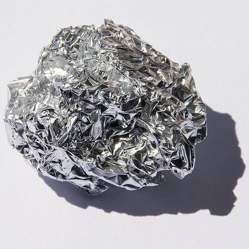

Aluminium foil. [http://images-of-elements.com/aluminium.php](http://images-of-elements.com/aluminium.php)

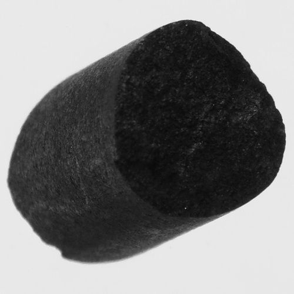

Carbon (graphite). [http://images-of-elements.com/carbon.php](http://images-of-elements.com/carbon.php)

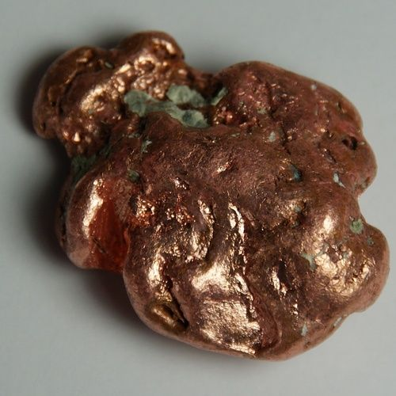

Copper. [http://images-of-elements.com/copper.php](http://images-of-elements.com/copper.php)

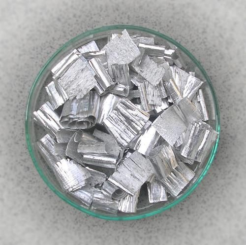

Magnesium.

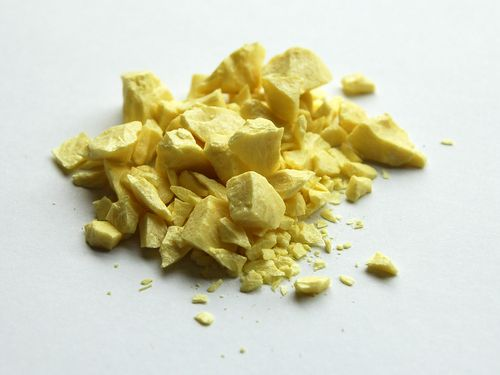

Sulfur.

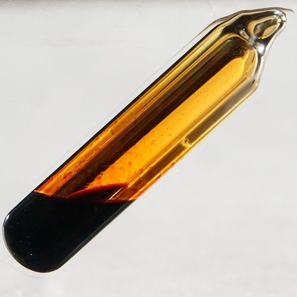

Bromine in tube. [http://images-of-elements.com/bromine.php](http://images-of-elements.com/bromine.php)

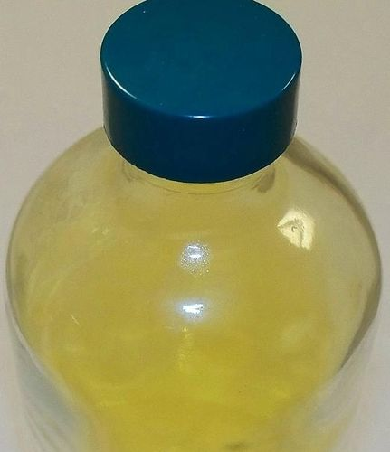

Chlorine gas.

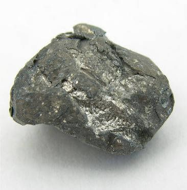

Calcium.

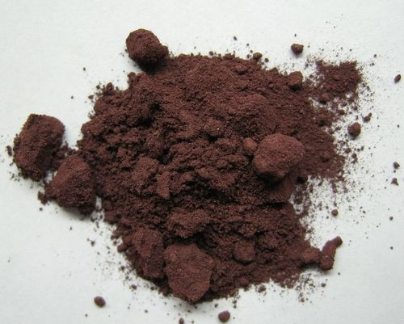

Phosphorus. [http://commons.wikimedia.org/wiki/File:Phosphor.JPG](http://commons.wikimedia.org/wiki/File:Phosphor.JPG)

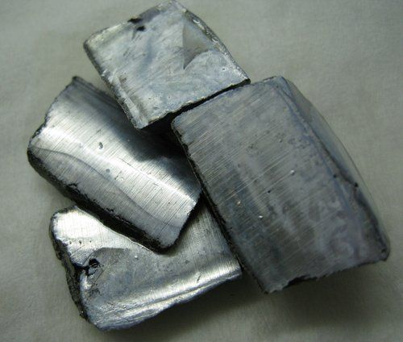

Potassium. [http://commons.wikimedia.org/wiki/File:Potassium.JPG](http://commons.wikimedia.org/wiki/File:Potassium.JPG)

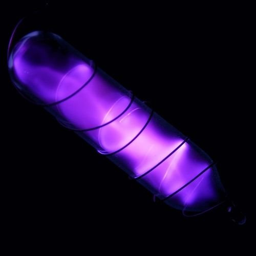

Nitrogen gas. [http://images-of-elements.com/nitrogen.php](http://images-of-elements.com/nitrogen.php)

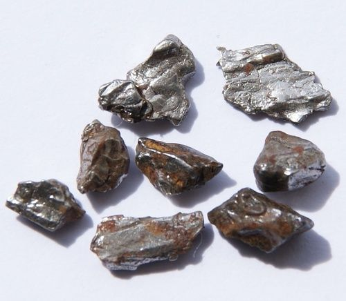

Iron. [http://images-of-elements.com/iron.php](http://images-of-elements.com/iron.php)

If you do not have a large cardboard Periodic Table to work with at the front of the class, write the names of the elements you discuss on the blank table provided here:

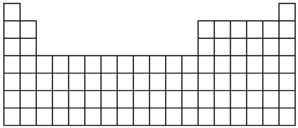

After completing this activity, either by sticking actual samples onto a cardboard cut out, or looking at the photos provided here in your workbook and seeing where they are positioned on the Periodic Table, answer these questions.

**QUESTIONS:**

These questions should also be discussed in class. The aim is for learners to see that there is a difference in the elements on the left (and middle) and those on the right of the Periodic Table. In later grades, the concepts of periodicity and the patterns evident in the Periodic Table in the chemical and physical properties of the elements will be explored in much more detail. For now, the emphasis is on the main distinctions between metals and non-metals, and then also semi-metals.

**Problem:**
How would you describe the elements that are mostly on the left side of the Periodic Table?

**Solution:**
Learners should note here that these elements look mostly like metals. They have looked at metals in previous grades, and so should be familiar with the properties of metals. They are mostly shiny and hard. Learners could also note the state of these elements, namely that at room temperature they are solids.

**Problem:**
How would you describe the elements that are mostly on the right side of the Periodic Table?

**Solution:**
Learners should note that these elements look distinctly different to the metals on the left and middle of the Periodic Table. They are not shiny and metallic, but rather dull or have a colour. If you are able to use actual real samples, learners might also note that these elements are not as hard and durable as the metals, for example you can show learners how the graphite is brittle, or show them the various powder forms of these elements. Learners should also be able to see that these elements are not all solids, some are liquids and also gases.

You probably saw from the last activity that there is a difference in the elements on the left and right of the Periodic Table. Were you able to identify what these elements are classified as. You have learnt about them before in previous grades. They are **metals** and **non-metals**.

Let's do a quick revision of what we have already learnt about metals and non-metals in previous grades.

<Callout type="note" title="Note">
Francium (Fr) is the rarest element on Earth. Only 20 to 30 g exists at any one time on Earth in nature!
</Callout>

### The properties of metals and non-metals

Metals and non-metals have distinct properties. That means their properties are unique and different from each other. Can you remember what the unique properties of metals and non-metals are? The next activity will refresh your memory.

# Blitz revision of the properties of metals and non-metals

Below is a block with different properties of metals and non-metals in it. They have been jumbled and are not sorted. You need to decide whether these properties describe metals or non-metals and sort them into the columns in the table which has been provided. Make sure that all the properties in the block are in your table. If you can think of properties that are not listed in the block, you may also add them to the table.

| Properties shiny lustrous dull brittle malleable ductile conducts electricity conducts heat usually a solid can be solid/liquid/gas electrical insulator thermal insulator (other) |
| --- |

Do the activity as quickly (but also as neatly) as you can, and time yourself!

| Properties of metals | Properties of non-metals |
| --- | --- |

| Properties of metals | Properties of non-metals |
| --- | --- |
| shiny lustrous malleable ductile conducts electricity conducts heat usually a solid | dull brittle can be solid/liquid/gas electrical insulator thermal insulator |

Most elements fall into one of these two categories: metals and non-metals. We use the *properties* of an element to categorise it as a metal or a non-metal.

Think of chromium, for example, which is shiny (lustrous), bends easily (malleable) and conducts heat and electricity well.

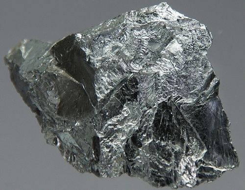

A piece of chromium. [http://commons.wikimedia.org/wiki/File:Chromium.jpg](http://commons.wikimedia.org/wiki/File:Chromium.jpg)

**Problem:**
What are the properties of chromium?

**Solution:**
Chromium is lustrous, malleable and conducts heat and electricity.

**Problem:**
Based on these properties, would you categorise chromium as a metal or a non-metal?

**Solution:**
Chromium is a metal.

**Problem:**
Can you find chromium on the Periodic Table? (Hint: It may help to find its symbol first.) What is its atomic number?

**Solution:**
24

Now think of sulfur. Sulfur is usually a dull, yellow powder. It does not conduct electricity or heat well and large crystals of sulfur break easily when they are dropped.

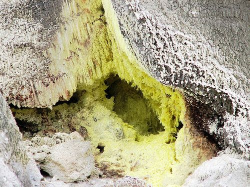

Sulfur crystals forming on a rock wall inside a volcano.

**Problem:**
What are the properties of sulfur?

**Solution:**
Sulfur is dull, brittle and does not conduct electricity or heat well.

**Problem:**
Based on these properties, would you categorise sulfur as a metal or a non-metal?

**Solution:**
Sulfur is a non-metal.

**Problem:**
Can you find sulfur on the Periodic Table? (Hint: It may help to find its symbol first.) What is its atomic number?

**Solution:**
14

We have now looked at the properties of metals and non-metals. But, when scientists were doing their experiments to observe the properties of the elements, they sometimes found some elements which were difficult to classify as either a metal or a non-metal.

### The properties of semi-metals

Some elements are not quite metals, but they are not quite non-metals either. They just don't fit into either category! Does this sound strange to you? Let us explore.

# Classifying element X

Pretend that you are a member of a team of scientists that has just discovered a new element. The element has not been named yet, so it is simply referred to as 'element X'.

The team has a sufficient amount of element X to make several disks of the material. They create a file about element X. In the file, they place the following picture of one of the disks.

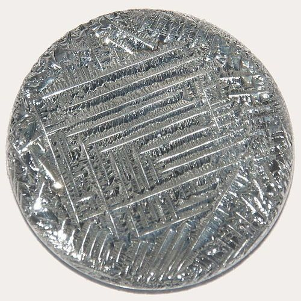

A disk of element X. [http://en.wikipedia.org/wiki/File:Tellurium2.jpg](http://en.wikipedia.org/wiki/File:Tellurium2.jpg)

Look carefully at the picture. How would you describe the appearance of element X?

The material (element X) has a shiny, lustrous appearance. It also looks as if there are parallel ridges on the disk.

The team performs experiments on element X and adds the following data to the file:

2. In an attempt to bend a disk of element X, the disk shattered, like glass. The same result was observed when a second disk was dropped from a height.
4. The material is found to be a poor conductor of heat and electricity at room temperature. Element X was then cooled down significantly by placing it in a freezer. At very low temperatures, it becomes a good conductor of electricity.

<Callout type="note" title="Note">
Room temperature is 25oC.
</Callout>

Fill out the following checklist for element X by placing crosses next to each property that was observed.

| Metallic properties | YES | NO |
| --- | --- | --- |
| Is the material shiny (lustrous)? |  |  |
| Is the material malleable and ductile? |  |  |
| Does the material conduct electricity at room temperature? |  |  |
| Does the material conduct heat? |  |  |
| Non-metallic properties | YES | NO |
| Is the material brittle? |  |  |
| Does the material have a dull appearance? |  |  |
| Is the material an insulator? |  |  |
| Additional comments (what else did you observe?): |  |  |

| Metallic properties | YES | NO |
| --- | --- | --- |
| Is the material shiny (lustrous)? | X |  |
| Is the material malleable and ductile? |  | X |
| Does the material conduct electricity at room temperature? |  | X |
| Does the material conduct heat? |  | X |
| Non-metallic properties | YES | NO |
| Is the material brittle? | X |  |
| Does the material have a dull appearance? |  | X |
| Is the material an insulator? |  | X |
| Additional comments (what else did you observe?): The material does not conduct electricity at room temperature. It does conduct electricity at very low temperatures. |  |  |

**QUESTIONS:**

**Problem:**
Which of the properties of element X are typical of metals?

**Solution:**
Element X is shiny and lustrous. It has the appearance of a metal.

**Problem:**
Which of the properties of element X are typical of non-metals?

**Solution:**
Element X is brittle. It does not conduct heat and it does not conduct electricity at room temperature.

**Problem:**
Would you classify element X as a metal or a non-metal?

**Solution:**
Learners may say that they don't know how to categorise element X, because it looks as if it might fit into both categories.

Element X does not quite fit into either category. Some of its properties are metallic and others are non-metallic. Element X is a real element, and its name is tellurium (chemical symbol: Te). Can you find it on the Periodic Table?

There are other elements, like tellurium, that are difficult to classify as either metals or non-metals. This is because they have some properties that are typical of metals and some properties that are typical of non-metals. A special category was invented for these elements: they are called **semi-metals**.

<Callout type="note" title="Note">
The semi-metals are also sometimes referred to as metalloids.
</Callout>

There are not many semi-metals. They are all listed in the following table. You do not have to remember all their names.

Names and symbols of the semi-metals:

| Name | Chemical symbol | Atomic number |
| --- | --- | --- |
| Boron | B | 5 |
| Silicon | Si | 14 |
| Germanium | Ge | 32 |
| Arsenic | As | 33 |
| Antimony | Sb | 51 |
| Tellurium | Te | 52 |
| Polonium | Po | 84 |

Now that we have looked at some of the elements and where they are found on the Periodic Table, you might have already recognised that there is a trend in where the metals, semi-metals and non-metals are positioned on the Periodic Table. We are now going to do a colouring activity to see where on the Periodic Table we will find each of the categories of elements.

# The regions of the Periodic Table

We are going to colour areas on the following version of the Periodic Table. This will help us identify the regions on the table where the metals, non-metals and semi-metals are located.

**MATERIALS:**

For this activity you will need coloured pencils or kokis or crayons in the following colours:

- Blue
- Yellow
- Red

**INSTRUCTIONS:**

2. **Semi-metals:**
   Find all the semi-metals on the Periodic Table. You will need to consult the table (names and symbols of the semi-metals) to help you remember which elements are semi-metals. Colour the block representing each of the semi-metals yellow.
   Any colour other than yellow should be fine, as long as all the semi-metals have the same colour. The purpose of this activity is that learners must identify regions on the period table for each category, but the different regions do not have specific colours associated with them.
4. **Metals:**
   Colour all the blocks to the left of the semi-metals blue. Do not colour hydrogen (H), as it is not strictly a metal. All these elements are metals.
   Once again, any colour other than blue should be fine, as long as all the metals have the same colour.
6. **Non-metals:**
   Colour all the blocks to the right of the semi-metals red. All these elements are non-metals. Now you can also colour hydrogen (H) red. On most versions of the Periodic Table hydrogen is placed with the metals, even though it has physical properties similar to those of the non-metals (it is a gas at room temperature). Hydrogen is placed with the metals, because it tends to behave like the other members of its column in chemical reactions.
   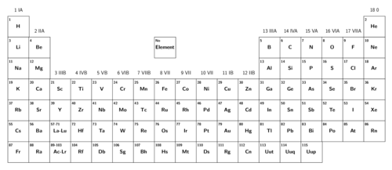
   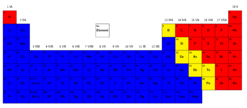

Now answer the following questions, using your colourful Periodic Table.

**QUESTIONS:**

**Problem:**
Which category contains the most (biggest number of) elements: metals, non-metals or semi-metals?

**Solution:**
Metals

**Problem:**
Which category contains the least (smallest number of) elements: metals, non-metals or semi-metals?

**Solution:**
Semi-metals

**Problem:**
State which category of material (metal, non-metal or semi-metal) each of the following elements belongs to:

| Element | Chemical symbol | Category: (Metal, non-metal or semi-metal?) |
| --- | --- | --- |
| Iron | Fe |  |
| Silicon | Si |  |
| Fluorine | F |  |
| Titanium | Ti |  |
| Nitrogen | N |  |

**Solution:**
| Element | Chemical symbol | Category: (Metal, non-metal or semi-metal?) |
| --- | --- | --- |
| Iron | Fe | Metal |
| Silicon | Si | Semi-metal |
| Fluorine | F | Non-metal |
| Titanium | Ti | Metal |
| Nitrogen | N | Non-metal |

We have learnt that the Periodic Table can be divided into regions where metals, non-metals and semi-metals can be found. This is useful information because the elements in different regions share similar properties. Their properties help us to decide what we can use them for. For example, metals are durable, malleable and shiny so they are suitable for making jewellery, pots and pans and motor car parts.

Let's look at some more examples. Where can we find all these elements in the real world? Where do they occur, and what are they used for?

We all know that oxygen (O) is one of the elements in the air we breathe. Rings and other jewellery are often made of gold (Au), silver (Ag) or platinum (Pt). But what do we know about calcium? And what is nickel used for?

<Callout type="note" title="Note">
Stainless steel is an alloy, meaning it is made up of a mixture of elements, including iron, carbon, chromium and nickel.
</Callout>

**Problem:**
Think about how long coins are used for. How are properties of metals useful to us when making coins?

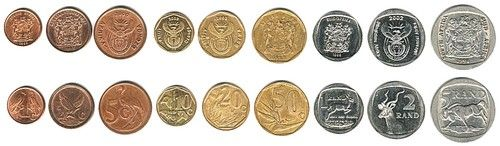

Our South African coins are made from various metals and mixtures of metals, such as copper, nickel and stainless steel.

**Solution:**
Metals are strong and durable which is what is needed for coins as they are used for many years in a country. They need to be strong so that they do not break and last a long time. Metals can also be melted and then harden again in a fixed shape. This is useful when making the coin shape and also creating the pattern on the faces.

**Problem:**
Why do you think we make jewellery out of the metals gold, silver and platinum, and not for example out of a non-metal such as sulfur? What are the properties of these metals?

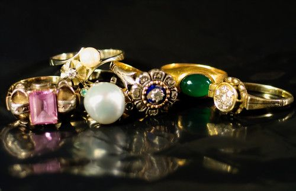

Jewellery is made from metals such as gold, silver and platinum.

**Solution:**
Gold, silver and platinum are shiny, whereas non-metals are not. This makes these metals appealing to make jewellery. They are also hard and strong so they can be shaped, but they retain their shape and do not break.

**Problem:**
Why do you think these electrical wires are made out of copper? What property of copper is useful in this situation?

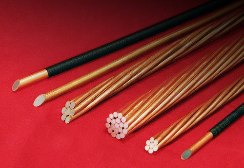

These electrical wires are made out of copper. [http://www.flickr.com/photos/commscope/6750826805/](http://www.flickr.com/photos/commscope/6750826805/)

**Solution:**
Metals, such as copper, conduct electricity, which is what is needed in an electrical wire.

**Problem:**
Do you think you could make electrical wires out of a non-metal such as bromine or phosphorus? Why or why not?

**Solution:**
No, you could not, as non-metals do not conduct electricity.

What do we use some of the non-metals for? We use carbon (coal) as a fuel, we use chlorine as a disinfectant to purify water, iodine is used as an antiseptic for wounds and helium is used to fill balloons. Arsenic, a semi-metal, is poisonous and therefore used as a pesticide for insects, bacteria and fungi. Another semi-metal, antimony, is used to make an alloy with lead which is very hard and has many applications. As you can see, the elements have many uses all around us! In the final activity of this chapter, we will explore some of the uses of the elements in more detail.

# Uses of the elements

Your teacher will divide the class into small groups. Your group must choose one element from the Periodic Table (if you are unsure, your teacher will help you choose) and research the following questions about this element:

2. Where is this element found?
4. What do we use this element for?
6. What are some of the properties if the element?

Your group must make a poster to present all the information you found about your element.

<Callout type="note" title="Note">
These websites of the Periodic Table highlight some of the uses of the elements:[http://periodictable.com/](http://periodictable.com/) and [http://www.webelements.com/uses.html](http://www.webelements.com/uses.html).
</Callout>
