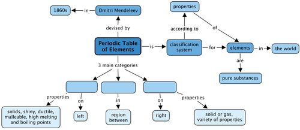
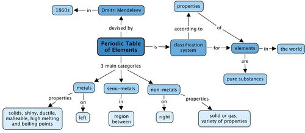

## Summary

<Callout type="note" title="Note">
- All the elements that are known, can be arranged in a table called the Periodic Table.
- The discoveries of many scientists over many years contributed to the information in the Periodic Table, but the version of the table that we use today was originally proposed by Dmitri Mendeleev in the 1800s.
- Each element has a fixed position on the Periodic Table. The elements are arranged in order of increasing atomic number, with the lightest element (hydrogen: H) in the top left hand corner.
- An element's position on the Periodic Table tells us whether it is a metal, a non-metal or a semi-metal.
  - metals are found on the left hand side of the table;
  - non-metals are found on the far right hand side of the table; and
  - semi-metals are found in the region between the metals and non-metals.
- An element can be identified in 3 different ways:
  - each element has a unique name;
  - each element has a unique chemical symbol; and
  - each element has a unique atomic number.
- Metals are usually shiny, ductile and malleable. Most are solids at room temperature, and have high melting and boiling points.
- Non-metals can be solids, liquids or gases at room temperature. They have a great variety of properties that usually depend on the state they are in.
- The semi-metals are all solids at room temperature. They usually have a combination of metallic and non-metallic properties.
</Callout>

Concept map

We learnt that the elements in the Periodic Table fall into 3 main categories. What are these? Fill these in the concept map by looking at the concepts which come after each category.

Teacher's version

