## Renewable and non-renewable energy

The concept of renewable versus non-renewable energy sources was introduced in Grade 6. Remind the learners of the meanings of the terms and then use the activity to see how much they remember from Grade 6. This will give you an indication of how well they remember the work. If they cannot answer the questions you will need to spend some extra time revising.

<Callout type="note" title="Note">
- reservoir
- consistent
- renewable
- non-renewable
- nuclear
- hydropower
- hydrocarbon
- biofuel
- methane
- fossil fuel
- greenhouse gases
</Callout>

All living things need energy. We learned in Life and Living that energy is one of the requirements for life. However, it is not only living things which need energy to move and carry out various processes. The machines and appliances in our world around us also need energy to do work. Where does the energy come from?

Many substances and organisms store energy which can then be used. We call them **energy sources**. Energy sources have energy that is stored within them and can be used to make something happen, for example, energy stored in petrol can be used to make a car go. In Grade 6 you learnt about the two main sources of energy: **renewable** and **non-renewable sources**. Do you remember what these terms mean?

Renewable sources are ones which can be recycled or reused. Non-renewable sources cannot be reused and so there is a limited amount available and when that runs out there will be none left. Let's do a quick revision to see how much you remember from Grade 6.

# Classify sources of energy

**INSTRUCTIONS:**

2. Study the following images which show different sources of energy.
4. Use the images to answer the questions that follow.

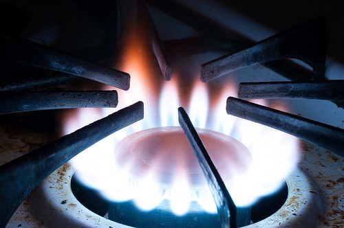

Natural gas - gas burning on a stove top.

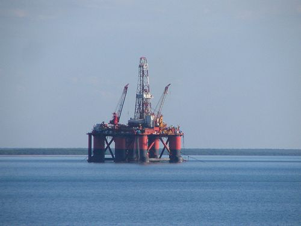

Oil - An oil rig sinks a drill into the ocean floor to reach the oil deposits.

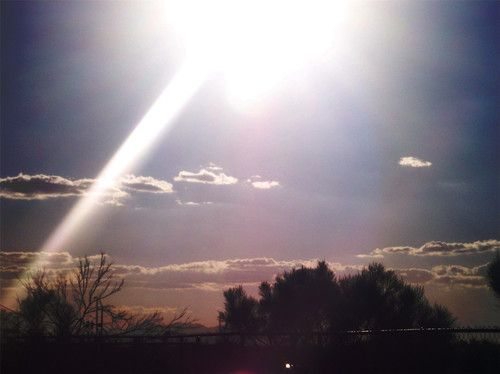

Sunlight - The Sun is a source of energy.

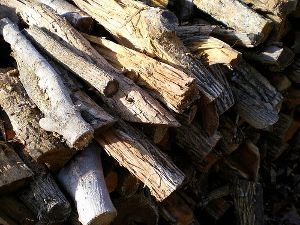

Wood.

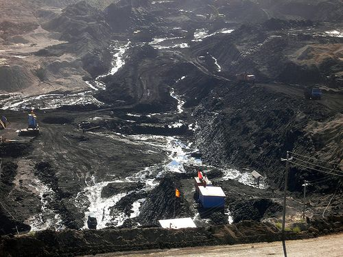

Coal - A coal mine.

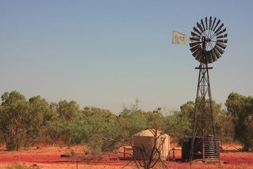

Wind - wind turns this windmill.

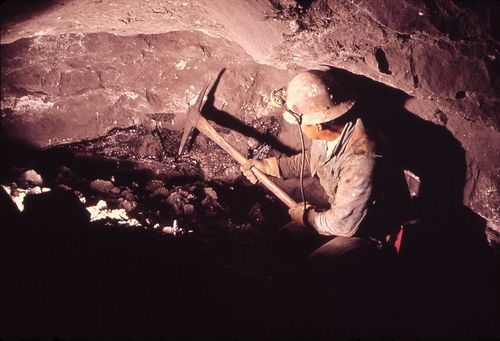

Uranium - mining for uranium underground.

<Callout type="note" title="Note">
Uranium is the source of energy for nuclear power stations.
</Callout>

**QUESTIONS:**

**Problem:**
Draw a table in the following space to classify the energy sources in the images as either renewable or non-renewable. Give your table a heading.

**Solution:**
Different renewable and non-renewable energy sources

| Renewable energy sources | Non-renewable energy sources |
| --- | --- |
| wind sunlight wood | coal oil natural gas uranium |

**NOTE:**

Learners may find it confusing that wood is a renewable energy source. Explain to them that it is renewable in terms of the time it takes to grow more trees and produce wood to generate the fuel. The time to renew this source is short, compared to non-renewable sources, for example, fossil fuels take millions of years to form. Some learners may also confuse 'deforestation' with the sustainable use of wood as a fuel for cooking or heating.

**Problem:**
What do we mean when we say that something is renewable or non-renewable? Explain this in your own words.

**Solution:**
Renewable energy sources can be used again or recycled or replaced. There is an unlimited supply of the energy source. Non-renewable energy sources cannot be used again or recycled. There is a limited supply of the energy source.

**Problem:**
Why do you think we mostly use non-renewable energy sources?

**Solution:**
Non-renewable energy sources usually have a large amount of energy stored in them and the energy is easier to harness than that of renewable sources.

Let's now have a closer look at some of the most common sources of energy.

### Non-renewable sources

South Africa uses a variety of different energy sources for generating electricity. Most of the South African power stations are coal-fired power stations. We only have one nuclear power station, Koeberg near Cape Town. The South African government is encouraging the development of alternative energy sources but does not currently have any that are connected to the main grid.

In the 4th term, we will look at how the fossil fuels are formed under the section 'Stored solar energy'. This is an introduction to the different sources to link back to later.

The non-renewable energy sources most commonly used in our world today are **fossil fuels**. Fossil fuels are the non-renewable sources, oil, coal and natural gas. Why do you think they are called **fossil** fuels?

Coal, oil and gas are called **fossil** fuels because they have been formed from the remains of prehistoric plants and animals (fossils) over millions of years.

#### Fossil fuels

Where do we most often see fossil fuels in our everyday lives? Look at the following images for a clue.

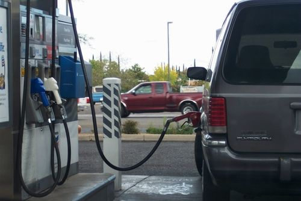

Putting petrol into a car at a petrol station. Petrol is made from crude oil.

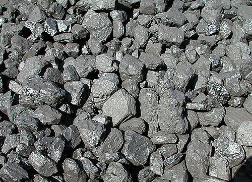

Coal is used in most of our power stations in South Africa.

<Callout type="note" title="Note">
The story of petroleum (video).
</Callout>

**Petrol and diesel** are used mainly as fuel for cars, trucks and motorbikes. They are produced from**crude oil**, which is a fossil fuel formed from the remains of dead prehistoric animals. Crude oil contains a lot of energy which can be used. Crude oil is a non-renewable energy source because it takes millions of years to produce crude oil and so we cannot produce more when the existing reserves are finished.

**Coal** is most commonly used as a source of energy by power stations to generate electricity. We will learn more about this later in the term. Coal can also be burned in fires to keep warm or in coal stoves to cook our food.

<Callout type="note" title="Note">
Coal comes from the Old English term*col*, from the 13th century which meant 'mineral consisting of fossilized carbon'.
</Callout>

<Callout type="note" title="Note">
The formation of coal.
</Callout>

**Natural gas** is the common name used to describe a mixture of gases. Natural gas is found in deep underground rock formations and usually with other fossil fuels, such as oil and coal. The biggest part of the gas mixture is a gas called **methane**. Methane is a gas which burns easily and releases a lot of energy when it is burnt. Natural gas is used for cooking, heating and producing electricity.

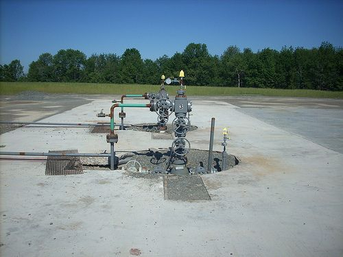

Natural gas has to be reached in underground reservoirs by drilling down wells such as these.

When talking about the methane component of natural gas, we are talking about non-renewable resources. Gas formed over thousands of years as organic matter decayed and the gas became trapped in wells which we now mine. However, as we we will see later, methane can also be considered a renewable resource. This is when methane is produced from degrading organic matter, such as animal waste, with the help of microorganisms.

Non-renewable energy sources play a huge role in our lives and the way our world works today. However, there are some major concerns about our reliance on non-renewable energy sources. Firstly, there is only a limited supply, so these energy sources will run out one day. We will then need to find alternative energy sources. Currently alternative energy sources are being explored, and used in a small scale in some places.

Another major disadvantage of burning of fossil fuels is that it releases **greenhouse gases** into our atmosphere. Greenhouse gases are present in our atmosphere and help to control the Earth's temperature. The Sun's radiation enters Earth's atmosphere. Some of the radiation is reflected by the atmosphere and Earth's surface. Most of the solar radiation is absorbed by the Earth's surface and converted to heat to warm the Earth. The Earth's surface emits heat. Some heat escapes out into space, but most is absorbed and re-emitted by the greenhouse gases to further warm the atmosphere and Earth's surface. This natural process is called the **greenhouse effect**.

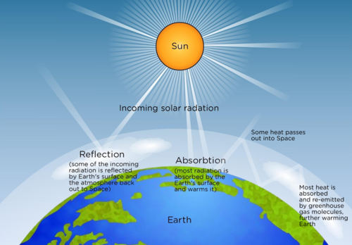

Do you know what an actual greenhouse is? It is normally a house made of glass, used to grow plants in. The glass also traps the Sun's energy and keeps the internal environment warm enough for the plants to grow. This is the same effect of the gases in the atmosphere.

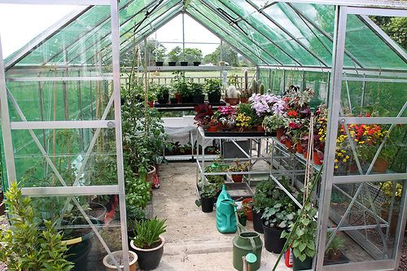

A glass greenhouse traps the Sun's energy and provides a warm environment for the plants, just as the greenhouse gases in our atmosphere do.

But, our use of fossil fuels has released even more greenhouse gases, such as carbon dioxide. There is now an **excess** of greenhouse gases in the atmosphere. This reduces the amount of heat which escapes into Space and traps more heat within the Earth's atmosphere than before. This is causing the temperature of the atmosphere to rise, known as global warming.

<Callout type="note" title="Note">
Play a simulation to learn more about the greenhouse effect[http://phet.colorado.edu/en/simulation/greenhouse](http://phet.colorado.edu/en/simulation/greenhouse)
</Callout>

Find out what else, besides burning fossil fuels, is contributing to an increase in greenhouse gases and write it below.

Other sources that contribute to an increase in greenhouse gases are:

- **Deforestation**which is the clearing of large areas of natural forest such as in the Amazon, Central Africa and Southeast Asia. These forests are cut down to provide farmland and the large trees, which have taken hundreds of years to grow, are used for making wood products. Forests usually act as a sink, absorbing \(\text{CO}$_{\text{2}$}\) from the atmosphere, therefore deforestation contributes to an increase in greenhouse gases.
- **Agriculture** as greenhouse gases are given off from livestock such as cows, the soil and rice production.
- **Certain products** also give off greenhouse gases.

#### Nuclear fuels

Energy can be produced by nuclear reactions. Do you remember that we spoke about the atom last term in Matter and Materials? Within the atom, the nucleus is held together by very strong forces. When the nucleus is broken apart, a huge amount of energy is released. This energy can be used in nuclear power plants to generate electricity. Two different nuclei can also collide at very high speeds to form a new atomic nucleus. The energy released is also used in nuclear power plants, however on a smaller scale than when nuclei are broken apart.

<Callout type="note" title="Note">
When nuclei are broken apart, it is called**nuclear fission** and when two nuclei combine to form one nucleus, it is called **nuclear fusion**.
</Callout>

Some materials are better to use than others as nuclear fuels. One such substance is uranium. Uranium is an element. Find it on the Periodic Table and write its symbol and atomic number below.

Uranium has the symbol U and atomic number 92. It is located at the bottom in the Actinides. This question is a revision of what learners covered last term in Matter and Materials and serves to reinforce learning.

<Callout type="note" title="Note">
There is only one nuclear power station in South Africa. It is the Koeberg power station near Cape Town. The majority of the power stations in South Africa are coal-powered and some others use hydropower, for example the Gariep Hydroelectric Plant on the Orange River near the Gariep Dam.
</Callout>

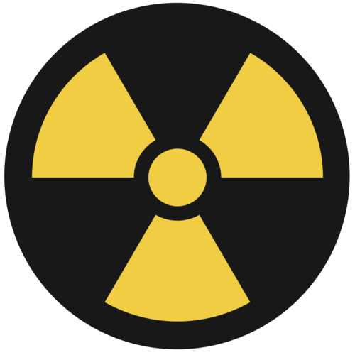

This is the international symbol for radioactivity.

There is limited supply of uranium in the world, which is why we classify it as a non-renewable source. But there is enough uranium for nuclear energy to be used for a very long time because you need small amounts to produce lots of electricity. Therefore, many people see nuclear fuels as an alternative to fossil fuels. But there is a huge debate about this and many people also disagree about the use of nuclear fuels. Let's find out why.

# Nuclear fuels - a debate

Get your learners to first do some of their own research about nuclear power and write down their own points. Then hold a class discussion where you compile the list of advantages and disadvantages and then discuss and debate the use of nuclear fuels. Encourage learners to give their own opinion.

This website provides a list of many of the arguments both for and against the use of nuclear power. Have a look at this website to help guide the discussion at the end of this activity. [http://world-nuclear.org/info/Current-and-Future-Generation/The-Nuclear-Debate/#.UguLTbzzu-w](http://world-nuclear.org/info/Current-and-Future-Generation/The-Nuclear-Debate/#.UguLTbzzu-w)

**INSTRUCTIONS:**

2. You will need to do some research and extra reading to answer these questions.
4. Then you will have a class discussion about the topic.

**QUESTIONS:**

**Problem:**
What are some of the advantages of using nuclear fuels instead of fossil fuels? Write down your own findings below and then add to it when you have a class discussion.

**Solution:**
Some of the advantages are listed here (there are others):

- There are almost no greenhouse gas emissions (no carbon dioxide gas is given off)
- There is no smoke pollution
- A very small amount of radioactive material can be used to generate a very large amount of energy as it is an efficient fuel
- Nuclear power plants require less space, than for example a wind farm or coal station
- It produces small amounts of waste (although it is radioactive, which is a disadvantage - see below)
- The price of uranium does not fluctuate (go up and down) as much as coal and oil does, so it is more reliable

**Problem:**
Find out why many people, especially environmental activists are opposed to nuclear power. In other words, what are the disadvantages?

**Solution:**
Some of the disadvantages are listed here (there are others):

- The nuclear waste produced is dangerous as it is radioactive and needs to be stored for long periods of time as the used fuel remains radioactive for hundreds of years. There are environmental concerns about what is done with the radioactive waste as it damages plant and animal life.
- The nuclear power plants are expensive to build.
- There are many safety concerns about what happens if a plant is not maintained properly and there is a meltdown (such as what happened at the Fukushima nuclear reactor in Japan in 2011), or a reactor leaks. This is dangerous to the workers and the environment. An accident or mishap can have devastating effects for years, decades or even longer.
- There are concerns about the general health of employees who work at nuclear power plants for extended periods.

**Problem:**
Although there are many disadvantages to nuclear fuels and power plants, many environmentalists and other people are now starting to change their minds and think that the advantages outweigh the disadvantages. This is happening as concern about climate change is increasing. Some people think the nuclear fuel is a more realistic alternative to fossil fuels than renewable energy sources, such as solar and wind power, which will not provide us with the energy to replace coal and oil. What do you think? Which side of the debate do you support? Discuss this with your class and then write down your thoughts below.

**Solution:**
Learner-dependent answer. Make sure that learners offer their opinions during the class discussion and that they are then able to justify their choices in their written answers.

<Callout type="note" title="Note">
51% of South Africa's electricity is generated using nuclear fuels.
</Callout>

### Renewable sources

<Callout type="note" title="Note">
Read more about renewable energy in South Africa.[http://www.renewableenergy.co.za/](http://www.renewableenergy.co.za/)
</Callout>

Let's now take a closer look at some of the renewable energy sources that we have mentioned so far.

Wind is moving air and it can be used as a source of energy. The energy from moving air particles is used to turn large turbines. The turbines are connected to a generator which produces electrical energy.

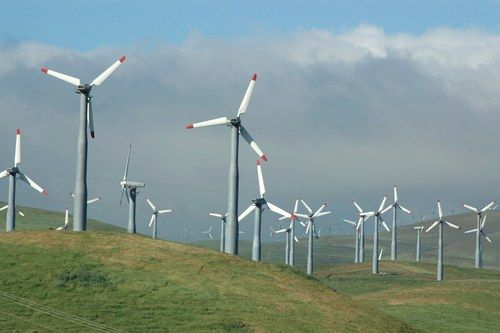

Wind turbines use wind to generate electricity.

You need a steady, strong wind blowing in order to produce a large, consistent amount of electricity. This means that wind farms cannot be put up in areas where there is not a lot of wind. Wind farms are noisy and many people do not like the look of them.

Water can also be used as an energy source. This is called **hydropower**. The energy from falling water is used to drive turbines in a power station. Unlike coal power stations, the water does not need to be heated and the water can be reused. These power stations must be at waterfalls or dams because there needs to be a strong flow of water to harness the energy.

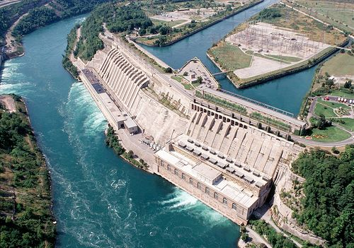

Hydropower - A large hydroelectric power station.

<Callout type="note" title="Note">
How does hydroelectricity work?
</Callout>

Explain why you think we can classify wind and hydropower as renewable energy sources.

The wind and water is not used up in the process, the source of water or wind is continuously being replenished, the water can be reused, so it is renewable.

There is a lot of energy in sunlight. Solar panels are used to absorb the radiant energy from the Sun and to transform the energy from the Sun into stored potential energy. The Sun is a star and the lifetime of a star is measured in billions of years. This means that our Sun can provide energy to the Earth for millions of years to come. Sunlight is considered a renewable energy source because it will not run out in the foreseeable future.

<Callout type="note" title="Note">
You will learn more about the Sun and its relationship to the Earth later in the year.
</Callout>

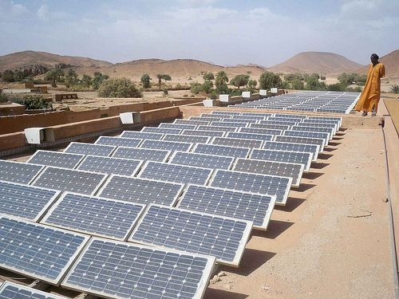

Solar panels on a rooftop.[[link]](http://www.flickr.com/photos/magharebia/5263617050/)

<Callout type="note" title="Note">
Solar technology (video).
</Callout>

A **biofuel** is any fuel which is produced from plant or animal waste. Methane can be produced by decomposing plants and animal waste. This is useful for farms as they can produce enough methane gas to help run their farms. The most common biofuels are made from maize, sugarcane and sorghum. The biofuels that are made can be used in vehicles or heating and cooling systems.

<Callout type="note" title="Note">
The world could never produce enough biodiesel to replace fossil diesel. But it can be a part of the solution.
</Callout>

# A case study on biofuels

**INSTRUCTIONS:**

Read the following article about biofuels and answer the questions that follow.

| Dairy finds a way to let cows power trucks 27 March 2013 A large dairy farm, Fair Oaks Farms, in the United States of America has found a way to use the endless supply of manure from the cows to generate electricity. This electricity is in turn used to run the equipment that milks about 30 000 cows, three times a day. For several years, the farm had been using the waste from the cows to create natural gas. The cow manure is swept up from the barn floors each day. The manure is then allowed to decompose in a digester and as it does so, it releases methane gas. The gas is collected and stored and used to power their buildings and barns. This gas is enough to power 10 barns, a cheese factory, a small restaurant, a gift shop and even a 4D movie theatre in the kids entertainment area. Fair Oaks Farms was doing all of this, but only using about half of the manure they swept up from the cows each day. But, they have now become even more energy efficient. Fair Oaks Farms is now using the rest of the manure and turning it into fuel to power its delivery trucks and tractors. This is the largest group of vehicles on the roads in the US using livestock waste to power them. This is a huge saving in the amount of diesel which would otherwise be used. Gary Corbett at Fair Oaks said "We are taking about half a million litres of diesel off the roads each year." Another advantage is that natural gas is about half the price of diesel fuel for the same amount of power. Mike McCloskey, a co-owner of Fair Oaks, said he first started looking into renewable energy options for the farm more than a decade ago. This was a way to become more energy efficient, save money and he also said the smell of the manure, used as fertilizer on the fields, started to make some neighbours complain! The leftover byproducts from producing the natural gas is still spread over the fields as fertilizer, but it has much less of a smell. This shows that nothing goes to waste. Other farmers, landfill management companies and other large industries that produce large amounts of methane-rich material are now also starting to take interest. If used, this could provide an endless supply of 'biogas', a cleaner, safer, sustainable alternative which also reduces greenhouse gas emissions. A digester used to decompose manure to produce methane gas. This has been adapted from an article which appeared in the New York Times on 27 March 2013. |
| --- |

<Callout type="note" title="Note">
Find out more about how a digester works to produce biogas.[http://www.biogassa.co.za/digesters.html](http://www.biogassa.co.za/digesters.html)
</Callout>

**QUESTIONS:**

**Problem:**
What is the name of the farm in the article and in which country is it based?

**Solution:**
Fair Oaks Farms in the United States of America.

**Problem:**
What made the owners of Fair Oaks Farm decide to use manure as a form of energy?

**Solution:**
They wanted to be more energy efficient, save money and also the neighbours were complaining about the smell of the tons of manure on the farm.

**Problem:**
In the article, the renewable energy source referred to is an example of a biofuel. What is this renewable energy source and why can we call it a biofuel?

**Solution:**
The renewable energy source is methane gas. It is a biofuel as it is obtained from animal waste and turned into a fuel source. It is renewable.

**Problem:**
How does the farm harvest methane from manure?

**Solution:**
The farm sweeps up the manure from the barn floors. As the manure decomposes, it releases methane gas. The methane gas can be collected and stored.

**Problem:**
Why is it a good thing that the farm is taking "about half a million litres of diesel off the roads each year"?

**Solution:**
Diesel is a fossil fuel which is a non-renewable energy source. Using less diesel means that the supply will last longer. The biofuel is renewable and so it is a more sustainable source.

**Problem:**
What is another advantages of using the biogas to power the delivery trucks and tractors?

**Solution:**
The biogas/natural gas is about half the price of diesel, so it is much cheaper.

**Problem:**
Do you think that South Africa could benefit from a setup such as the one at Fair Oaks Farms? Explain your answer.

**Solution:**
Learner-dependent answer.

Make sure that learners justify their answers. Essentially, South Africa could benefit as we have multiple livestock farms and agricultural areas which produce a lot of manure and other methane-rich material, which mostly just goes to waste at the moment and is not used. Investing in processes that harness the natural gas to use it to power the farms and delivery trucks would help save money, be more energy efficient and also have less of an effect on the environment than using petrol and diesel.

<Callout type="note" title="Note">
Biofuels have been around as long as cars have. At the beginning of the 20th century, Henry Ford planned to fuel his cars with ethanol. But then the discoveries of huge oil deposits kept fossil fuels cheap for decades, and biofuels were mostly forgotten.
</Callout>

<Callout type="note" title="Note">
You can make your own house more efficient in its use of waste. Have a look at this website.[http://www.thegreentimes.co.za/stories/waste/item/1114-free-energy-from-your-own-waste-%E2%80%93-biodigesters-make-sense](http://www.thegreentimes.co.za/stories/waste/item/1114-free-energy-from-your-own-waste-%E2%80%93-biodigesters-make-sense)
</Callout>

Now that we have looked at non-renewable and renewable energy sources, let's summarize the disadvantages and advantages of each.

# What are the advantages and disadvantages?

While the learners are discussing in their groups, walk around and listen to some of the discussions. Try to make sure that each learner gets a chance to speak and that they are not being overshadowed by more confident learners. If groups are sitting quietly, ask leading questions to give their discussion direction.

If you can, give the learners some newsprint and pens so that they can write down their main ideas. They can then use these newsprints as visual aids during their report back. You can also extend this activity by comparing all the newsprints from the different groups at the end of the report back. Learners can then choose what they consider to be the best responses and a summary can be written down. You can display the summary in the classroom so that the learners can refer to it again.

**INSTRUCTIONS**

**Problem:**
Sit in groups of 3 or 4.

Discuss, in your groups, the advantages and disadvantages of using non-renewable energy sources.

**Solution:**
A major advantage of non-renewable energy sources is the massive amounts of energy that they contain which is relatively easy to access. A disadvantage is that they produce excess greenhouse gases when they are burnt and that the supply is limited.

**Problem:**
Discuss, in your groups, the advantages and disadvantages of using renewable energy sources.

**Solution:**
A major advantage of renewable energy sources is that the supply will not run out and so their use is sustainable. They are more environmentally friendly. A disadvantage of renewable energy sources is that they store smaller quantities of energy than non-renewable sources and so it takes more effort to access the stored energy.

**Problem:**
Why do you believe that fossil fuels are still burnt as a source of energy? Write your own answer below.

**Solution:**
Learners will provide their own interpretation of the information gathered in this discussion. They should mention the disadvantages of burning fossil fuels and then explain that it is often cheaper, and certainly easier to access large amounts of energy from burning fossil fuels than it is to use renewable sources. Wind, solar and hydroelectric power are expensive and sometimes the yield of energy from those sources is less cost-effective than using fossil fuels.

**Problem:**
Choose a spokesperson for your group and share your ideas with the rest of the class.

Choose two of the sources of energy discussed so far in this chapter. Use your school library or the internet to find more information about how they are used to generate electricity in South Africa.

**Solution:**
This answer depends on which 2 sources the learner chooses. Learners will discover that renewable sources are not used for large scale electricity production in South Africa. In fact most renewable sources are used in homes to run geysers and swimming pools. Coal is the main source of electricity in South Africa. Nuclear power is used to supplement coal fired power stations in South Africa.

<Callout type="note" title="Note">
Six myths about renewable energy sources.[http://www.greenpeace.org/africa/en/campaigns/Climate-change/renewable-energy-myths/#medupi](http://www.greenpeace.org/africa/en/campaigns/Climate-change/renewable-energy-myths/#medupi)
</Callout>
