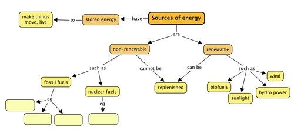
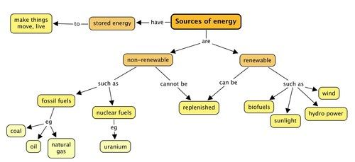

## Summary

<Callout type="note" title="Note">
- Energy is one of the requirements for life on Earth.
- Energy is needed to make things move.
- Sources of energy have energy stored within them that is used make something happen.
- Non-renewable energy sources cannot be recycled or reused. There is a limited supply.
- Examples of non-renewable energy sources are fossil fuels (coal, oil and natural gas) and nuclear fuels.
- Burning of fossil fuels releases greenhouse gases into our atmosphere.
- Renewable energy sources can be recycled or reused. There is an unlimited supply.
- Examples of renewable energy sources are wind, hydropower, solar power and biofuels.
</Callout>

Concept map

This is our first concept map for Energy and Change. Complete it by filling in the three types of fossil fuels, and give an example of a nuclear fuel which was discussed in this chapter.

# Revision questions

**Problem:**
What do we need to make things move? [1 mark]

**Solution:**
Energy

**Problem:**
What does it mean when we say something is 'a source of energy'? [1 mark]

**Solution:**
It is something which has energy stored in it which can be used.

**Problem:**
Which of the following are sources of energy? [1 mark]

2. Sun
4. waves
6. wind
8. coal
10. all of them

**Solution:**
e

**Problem:**
What does it mean if something is a non-renewable source of energy? [2 marks]

**Solution:**
Non-renewable energy sources cannot be reused or replenished. There is a limited supply.

**Problem:**
Which of these are renewable energy sources. [1 mark]

2. coal
4. natural gas
6. sunlight
8. wind
10. crude oil

**Solution:**
c and d

**Problem:**
Which type of renewable energy uses the movement of air to generate electricity? [1 mark]

**Solution:**
Wind

**Problem:**
Complete the following sentences. Write them out in full on the lines provided and underline your answers. [5 marks]

Coal, natural gas and oil are all examples of _____ (renewable/non-renewable) energy resources. When they are burned, they release _____ (energy/electricity). Coal, natural gas and oil are also known as _____ (nuclear fuels/fossil fuels). Wind and solar energy are examples of _____ (renewable/non-renewable) energy sources because they _____ (can/cannot) be replaced.

**Solution:**
Coal, natural gas and oil are all examples of renewable energy resources. When they are burned they release energy. Coal, natural gas and oil are also known as fossil fuels. Wind and solar energy are examples of renewable energy sources because they can be replaced.

**Problem:**
How does the burning of fossil fuels contribute to global warming? [2 marks]

**Solution:**
Burning fossil fuels releases greenhouse gases into the atmosphere, causing an excess in the atmosphere. These gases then trap more of the Sun's energy causing the Earth to warm up even more, and results in global warming.

**Problem:**
Complete the following table. [18 marks]

| Energy source | Renewable or non-renewable | Disadvantage | Advantage |
| --- | --- | --- | --- |
| Wind |  |  |  |
| Coal |  |  |  |
| Uranium |  |  |  |
| Water (Hydroelectric) |  |  |  |
| Sunshine |  |  |  |
| Biofuels |  |  |  |

**Solution:**
| Energy source | Renewable or non-renewable | Disadvantage | Advantage |
| --- | --- | --- | --- |
| Wind | Renewable | Wind farms are noisy and take up a lot of space; Need strong winds | No greenhouse gases produced |
| Coal | Non-renewable | Burning releases greenhouse gases into the environment | Coal stores a lot of energy which is relatively easy to access |
| Uranium | Non-renewable | Production of nuclear waste which needs to be stored | Uranium has a vast amount of energy stored within |
| Water (Hydroelectric) | Renewable | Dams must be built and this damages/changes the landscape and affects ecosystems; Expensive to set up and maintain | Sustainable. No harmful emissions; Can be utilised anywhere there is enough water |
| Solar power | Renewable | Need a sunny climate all year round; expensive to set up | Non-polluting (no greenhouse gases) and renewable |
| Biofuels | Renewable | May affect food production and supply | Uses renewable biomass for energy |

The advantages and disadvantages in the table are just some examples. Learners may write other reasonable answers.

Total [30 marks]
