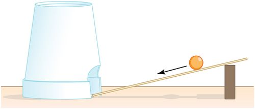
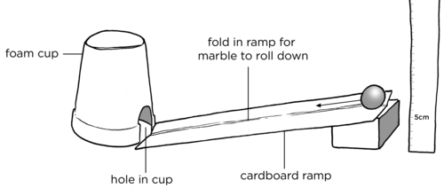
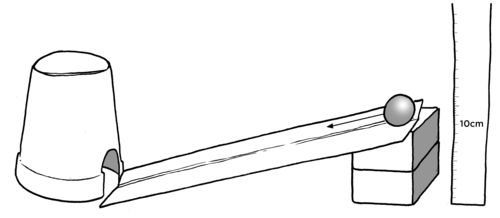
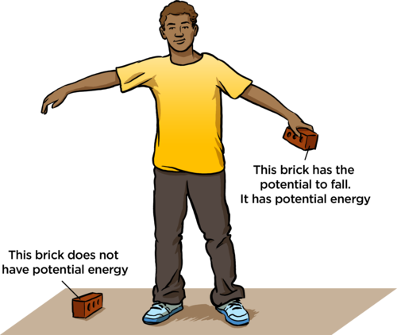
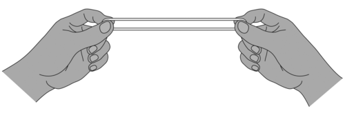
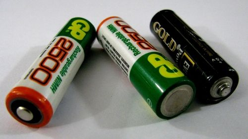
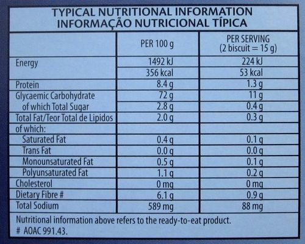

## Potential energy

Start this section by doing the investigations first and allowing the learners to draw their own conclusions. This will lead them to a better understanding of what energy is and what it can do rather than a verbal explanation. There are several activities which deal with potential energy. If you do not have enough time to do all of them, then choose at least one of them. You can base your choice on the resources that you have available at your school. Do not completely ignore the other activities, though. Take some time to talk through what the outcomes would have been and then you could ask the learners to answer the questions at home.

<Callout type="note" title="Note">
- joule
- potential energy
- system
</Callout>

Throughout our investigation and learning about the concepts surrounding energy, we will be talking about systems and how energy is transferred within a system. A system is a set of parts that work together as a whole. A change in one part of the system will affect the other parts. This will become more clear as we see some examples throughout this term.

We are going to find the difference between potential and kinetic energy. Look at the following diagram which shows a ramp with a marble rolling down into a foam cup. The marble will knock the cup and make it move.

A marble rolling down a ramp.

When the marble is released, it rolls down the ramp and transfers some of its energy to the cup. This transfer of energy is what makes the cup move. But where did the marble get energy from? Do you think you can make the cup move more or less depending on how far up the ramp you start the marble? Let's do an investigation to find out.

# How can we make the foam cup move further?

It is important to emphasise the importance of independent and dependent variables. Take special care to explain the difference between the two variables. The **independent variable** is the variable that you chose to change while doing the experiment. The **dependent variable** is what result you measure in your experiment. Learners would have encountered variables in the previous strands by now. Each group will need a set up and they will roll the marble from different heights into the cup. The higher up the ramp the marble starts, the further the cup will move.

**INVESTIGATIVE QUESTION**: If we roll a marble down a ramp and into a cup, how does the starting position of the marble affect how far the cup moves?

**VARIABLES:**

**Problem:**
What will we change when performing this investigation?

**Solution:**
The height from which the marble is released to roll down the ramp. This is the independent variable because the learners are changing it to see how far the cup moves.

**Problem:**
What will we be measuring in this investigation?

**Solution:**
The distance that the cup moves. This would be the dependent variable because the distance depends on how high the marble was before it was released.

**Problem:**
Which things must stay the same?

**Solution:**
The size of the marble must stay the same.

**HYPOTHESIS:**

Write a hypothesis for this investigation. When you do this, you need to write what you expect to observe. It does not have to be the correct answer to the investigative question.

The hypothesis should mention how the distance the cup moves would change if the height of the marble changes. Here are two possible examples:

- "The higher the marble is on the ramp, the further the cup will move."
- "The higher the marble is on the ramp, the less the cup will move"

Both of the above hypotheses mention how the height of the marble is expected to affect the distance the cup moves.

**MATERIALS AND APPARATUS:**

- a styrofoam cup
- a marble
- a pair of scissors
- a ramp (this can be a plank of wood or stiff card)
- books or wooden blocks to prop up the ramp
- rulers

**METHOD:**

2. Work in groups of 3 or 4.
4. Cut a hole in the lip of the cup so that when you turn it over on a table, there is a hole which a marble can now fit through, as shown in the previous diagram.
6. Build the setup as shown in the following diagram. Place the cup upside down on the table surface. Place the ramp so that it ends at the hole in the cup. Prop up the ramp with blocks or books. You will adjust the height of the ramp using different books or wooden blocks. Otherwise you can just hold the top of the ramp at the specified height.

2. Practice rolling the marble down the ramp and into the cup. You can use two rulers to create a path down the ramp to guide the marble into the hole so that it does not roll off the side of the ramp. Or else you can bend the cardboard so that the marble rolls down the middle on the fold. You can also try a cardboard tube like a roller towel inner. You will need to practice to see what works best with the materials that you have available.
4. Once you have found the best way to do this, you can start the measurements.
6. First set up the ramp so that the top of the ramp is at a height of 5cm. Roll the marble from a height of 5 cm and then measure how far the styrofoam cup moves.
8. Next adjust the height of the ramp by increasing by 5 cm each time. Each time place the marble at the top of the ramp and roll it down, measuring how far the cup moves.

The height of the ramp at each step will depend on what you use to prop it up with. Try and get blocks or books of equal thickness so that at each step the height increases by the same amount.

2. Repeat the measurements until you have at least 6 recordings.
4. Record your measurements in the table and draw a graph with a line of best fit.

If you make bigger ramps, you can also perform more measurements at different positions up the ramp.

**RESULTS AND OBSERVATIONS:**

Record your results in this table.

| Height of marble up the ramp (cm) | Distance the cup moves (cm) |
| --- | --- |

Use the information in your table to draw a graph of the height of the marble up the ramp versus the distance the cup moves. Before you draw the graph, answer the following:

**Problem:**
Which is the independent variable? This is the value which you changed in the investigation. The independent variable is written on the x-axis (horizontal axis).

**Solution:**
The height of the marble on the ramp.

**Problem:**
Which is the dependent variable? This is the variable you measured. The dependent variable is written on the y-axis (vertical axis).

**Solution:**
The distance the cup moves.

The independent variable is plotted on the horizontal axis. In this example the scale could be increments of 5 cm. The dependent variable is always plotted on the y-axis.

**CONCLUSION:**

**Problem:**
Write a conclusion for this investigation. Remember to refer to your graph and hypothesis when writing your conclusion.

**Solution:**
The conclusion should mention that as the height of release increases, the distance that the cup moves increases.

**Problem:**
Was your hypothesis shown to be true or false?

**Solution:**
This answer will depend on what the learner wrote for their hypothesis. If their hypothesis stated that the greater the height, the further the cup moves, then their hypothesis is shown to be true. If their hypothesis stated that the greater the height, the less the cup moves then their hypothesis has been proved to be false.

When you hold the marble at a distance up the ramp, you are preventing it from rolling down the ramp. This means that the marble has the potential to roll down and knock the cup. So, YOU gave the marble **potential energy** by picking it up and holding it at the top of the ramp. When the marble hits the cup, the marble transfers energy to the cup which then moves. The cup then comes to a stop after a while. Do you have any guesses about why the cup stops after a while?

Discuss this with your class. The cup moves along the surface and it experiences friction as it rubs along the ground. This causes it to come to a standstill. Friction will only be covered in more detail in Gr. 8 when learners look at friction in terms of static electricity and how rubbing objects transfers electrons resulting in a charge. A small demonstration that learners can do to briefly look at friction is to rub their hands together and observe that their hands become warm. When surfaces in contact with each other move against each other, the friction between them transfers kinetic energy to heat.

Your investigation will have shown you that the greater the vertical height of the marble, the further the cup moved. This tells us that lifting the marble to a higher position means that it has more potential energy than if it was released from a lower position.

So the higher an object is above a surface, the more potential energy it has. Think of another example of picking up a brick, as shown in the diagram. Here we are looking at a system consisting of: the arm, the brick and the Earth that pulls on the brick.

When the brick was on the floor, it had no potential energy. But when it is lifted up, it has potential energy. Where did the potential energy come from?

The potential energy came from the arm which lifted it.

The boy now lets go of the brick and it falls down to the ground and makes a hole in the sand. What received the energy of the falling brick?

Discuss this with your learners. The answer is the sand which goes flying up. Ask your learners where is the energy now? The answer is the molecules of the sand are moving faster. A sensitive thermometer would show that the sand is a little warmer than it was. Also, the energy went into disturbing the air and your eardrums got that energy when you heard the bang.

Do you think the hole in the sand pit will be deeper if we drop the brick from a higher point? Why?

Yes it will be as it has more potential energy at a higher point so by the time it hits the ground it will be moving faster (more kinetic energy).

So what we have seen is that the energy is all still there within this system, but it is not easy to use anymore. The sand is warmer but we can not actually use that energy for anything because the temperature increase was so small. So the energy in the system has not been destroyed, but it is less available for us to use.

Let's look at another example of stored energy and energy transfers within a system.

# Elastic bands

Try to get elastic bands of equal length and thickness. It is the only variable which really needs to be kept constant. If you are running short on time you can leave out this activity. Rather just discuss the conclusions one would draw from such an activity.

**Problem:**
We are going to be shooting match boxes with elastic bands by stretching the bands and releasing them to hit the matchbox. What are the parts making up this system?

**Solution:**
The parts of the system are the stiff fingers, rubber band, matchbox, table.

**Problem:**
What is the energy input into this system?

**Solution:**
Stretching the elastic band so the movement of the fingers transfers potential energy to the elastic band which is now stretched.

Do you think there is a relationship between how far the matchbox travels and the energy that the hand puts in at each try? Let's find out.

**MATERIALS:**

- empty matchbox
- elastic band
- ruler

**INSTRUCTIONS :**

2. Place the empty match box on a desk, mark the spot with a piece of paper.
4. First, practice shooting the matchbox with the elastic band. Each time, place the elastic band and matchbox in the same starting position and distance from each other.
6. Once you feel comfortable doing this, stretch the elastic band by a different amount each time and measure how far the matchbox moves with each try.
8. Place a ruler next to your elastic band and first stretch it by a small amount. For example, if your elastic band is 5 cm long when held pulled tight, but not stretched, between your fingers, then stretch it to 8 cm.
10. Release the elastic band so that it hits the matchbox across the desk.
12. Measure the distance that the match box moves across the desk.
14. Record the distance in the table below.
16. Put the empty match box back in its original position on the desk.
18. Repeat the experiment several times but stretch the elastic band a bit more than before each time.

The distances moved will depend on the type of elastic bands used and how rough the surface of the desk is. What is important is that the learners see that the small stretch moves the match box the shortest distance and the largest stretch moves the matchbox the furthest.

Record your measurements in the following table.

| Elastic stretch (cm) | Distance moved (cm) |
| --- | --- |

**QUESTIONS:**

**Problem:**
Does the distance moved by the matchbox increase or decrease as you stretch the elastic band more? State the relationship between these two measurements.

**Solution:**
The distance the matchbox moves increases as you stretch the elastic band more.

**Problem:**
What did you have to do in order to stretch the elastic band and keep it stretched?

**Solution:**
The elastic band had to be pulled hard by the learners and they cannot let go if they want to keep it stretched.

**Problem:**
Energy is transferred from the elastic band to the matchbox and the matchbox moves. But, then it comes to a stop after a while. Where did the matchbox transfer its energy to?

**Solution:**
The matchbox transfers energy to the air and the table.

When the elastic band was stretched it gained potential energy. We know this because your hand had to do some work to stretch the elastic band, and now the elastic band can snap back and move the matchbox. The elastic band needs energy to make the matchbox move, and it got that energy from your hand.

The further we stretched the elastic, the further it could push the matchbox. This tells us that the more we stretch the elastic band, the more energy is transferred from the elastic band to the match box.

Energy transfers have taken place within this system: Energy is transferred from the hand, to the elastic band, to the matchbox, to the air and the table surface. The table ends up a little warmer than it was as it now has most of the energy and the air has the rest. The energy has not gone, but again it's not available to use.

A **stretched** elastic band has potential energy.

So did you notice that both the marble and the elastic band had potential energy? But we didn't do the same thing to give them that energy. We **lifted** the marble but we **stretched** the elastic. This means that there is more than one way to give something potential energy. **Potential energy is energy that is stored within a system.**

Now that you understand a bit more about potential energy, can you think of some more examples of things which contain potential energy? Think in terms of things which have the **potential or the ability to change something or make something move.**

What about some of the fossil fuels that we discussed in the last chapter, such as coal and oil? Do you think these have potential energy? Yes they do. For example, coal is burned in power stations to generate electricity (you will learn more about this later on in the term). So, we can say the coal has stored energy which is used to generate electricity. Coal has potential energy. This is the same for other fuels as well.

Do you remember making electric circuits in Gr. 6 last year? Do you remember using batteries? The batteries are the source of energy for the circuit. The batteries store energy. In other words, they have potential energy.

Batteries are a source of potential energy for electric circuits.

Where do we get our energy from? As we learned in Life and Living, nutrition is one of the 7 life processes. We have to eat food. Food is the fuel for our bodies.

Have you ever had a look at all the small writing on food packaging? The information gives us nutritional information about the food. It also gives us the amount of **energy** stored in the food. Have you noticed that this is often given in **joules**? So what is a joule? How do we measure energy?

<Callout type="note" title="Note">
The joule was named after an English physicist, James Prescott*Joule* (1818-1889).
</Callout>

We can measure energy, just as we can measure the mass of an object or how fast a car is going. The mass of an object is given in grams or kilograms, the speed of a car is given in kilometers per hour (km/h). In the same way, energy is measured in joules. There are 1000 joules in a kilojoule.

<Callout type="note" title="Note">
The joule is a measure of energy. A food joule is not different to an electrical joule, nor different to a joule that heats water, nor a joule that comes from the Sun.
</Callout>

At this point it is important to note that the joule is a measure of energy. It is just a number that we calculate after a lot of careful measurements on changes in a system. A food joule is not different to an electrical joule, nor different to a joule that heats water, or a joule that comes from the Sun. It is important that learners realise that joules of energy from food are no different to joules of energy from Eskom. But, if we reinforce the concept of different "forms" of energy, then learners are given the reason to think that energy from food must be different to energy from Eskom, whereas it is not.

The main idea is to simplify the concepts around energy for learners by eliminating the long lists of "forms" of energy that appear in tests and rather shift the focus to systems, which have parts that learners can examine and understand. It is sufficient to say that the potential energy in a system becomes the kinetic energy of some part of the system.

Let's have a look at the energy content for some of the cereals that we eat for breakfast.

# Reading a cereal box

Encourage the learners to bring in old cereal boxes well in advance of doing this activity. It would be a good idea to find some extras to bring to class for those who forget. You can even photocopy some of the cereal boxes and keep them for the following year.

If you want to extend this exercise you could ask the learners to compare their cereal with the rest of the class. Draw a table on the board with the different cereals and their energies. Get the class to draw a bar graph comparing the energies in the different cereals.

**MATERIALS:**

- cereal box
- pair of scissors
- calculator

**INSTRUCTIONS:**

2. Read the nutritional information on your cereal box.
4. Answer the questions that follow.

Each learner's answers will depend on the type of cereal that they have chosen. Make sure that the learners have kept their cereal box so that you can check their answers against the box details.

**QUESTIONS**

<Callout type="note" title="Note">
Sedentary means that you lead an inactive lifestyle and do not do any exercise.
</Callout>

**Problem:**
What is the amount of energy per 100 g for your cereal? Write your answer in kilojoules and in joules

**Solution:**
Learner-dependent answer. For example, Oats contains 1528 kJ per 100 g. This is 1528 000 J.

**Problem:**
The cereal boxes often indicate an amount per 100 g and then an amount per serving, which is normally less. What is the amount of energy per serving on your cereal box? Remember to include how many grams the serving is.

**Solution:**
Learner-dependent answer. For example, Oats contains 611 kJ per 40 g serving. This is 611 000 J. Weetbix cereal contains 529 kJ (529 000 joules) of energy per serving.

**Problem:**
Look at the following table which gives the recommended daily amount of energy for an individual depending on your age and level of activity. This is a guideline as to how much energy you should consume in food in one day.

| Gender | Age (years) | Sedentary (kJ) | Moderately Active (kJ) | Active (kJ) |
| --- | --- | --- | --- | --- |
| Female | 9 - 13 14 - 18 | 8 000 8 500 | 8 000 - 9 000 8 500 - 10 000 | 8 500 - 9 500 9 500 - 10 500 |
| Male | 9 - 13 14 - 18 | 8 500 10 000 | 8 500 - 10 000 10 000 - 11 500 | 9 500 - 11 000 11 000 - 13 000 |

According to the table, what is the recommended daily amount of energy for your age and level of activity?

**Solution:**
Learner-dependent answer. For example, a female learner who is 13 and moderately active needs between 8 000 and 9 000 kJ per day.

**Problem:**
What percentage of your recommended daily energy is being supplied by one serving of your cereal? Show your calculations below.

**Solution:**
Learner-dependent answer. Learners must choose the row which corresponds to their age and gender. They must then consider, honestly, how active they would consider themselves to be. They can then use their cereal to calculate the percentage.

Example calculation:

Lets assume we have a male, aged 15 who is very active. His recommended daily allowance (RDA) would be between 11 00 - 13 000 kJ.

A serving of Nestle Milo Cereal contains 477 kJ

The percentage of RDA = 477/13 000 x 100 = 3,7 %

An additional question to ask learners and have a class discussion is:

*Based on the percentage worked out in question 3, do you think this is a good cereal to eat for breakfast? Why do you think it's a good/bad cereal for breakfast?*

The learners should decide whether their calculated percentage is low or high. If it is low, they could decide that it is better to eat a high energy meal for breakfast and then lower energy meals throughout the day, or they might indicate that they are hoping to lose/maintain weight and so a low percentage is a good thing. If their calculated percentage is high, they could indicate that it is better to spread out their energy intake over the entire day rather than concentrate it in one meal.

The nutritional value of a cereal also does not only depend on how much energy it provides, but also what other nutritional ingredients it offers.

There are no incorrect answers to this question. It is based entirely on their own interpretation of their needs. This can be a very sensitive topic, don't spend too much time discussing weight loss programmes as this is not a weight counselling session and learners could get confused between healthy eating and excessive dieting.

Alternatively, ask several learners what the energy content is for their cereal and then ask which one provides the most potential energy and which one the least.

2. The following photograph shows the nutritional information on a box of cracker biscuits. Study it and then answer the questions that follow.
   
   **Problem:**
   What is the energy content per 100g in **joules**?
   **Solution:**
   The values given on the box are in kJ and kcal so learners must convert the values by multiplying by 1000. The answers are 1492 000 J (1492 kJ)
   **Problem:**
   What is the mass of **one** biscuit?
   **Solution:**
   The mass is 7.5 g, as the mass given on the box of 15 g is for 2 biscuits.
   **Problem:**
   The nutritional information gives the serving size of 2 biscuits, but you want to know what the energy content will be if you only eat one biscuit. Write down the answer below.
   **Solution:**
   Energy for one biscuit = 224/2 = 112 kJ per biscuit.
   **Problem:**
   You now decide that you want to eat 5 biscuits. What is the energy content for this serving of 5 biscuits?
   **Solution:**
   Energy content for 5 biscuits = 112 x 5 = 560 kJ.

Do you now see why we can say that food has potential energy? We need energy to make our bodies function. We get our energy from the food we eat. The molecules which make up our food have energy stored inside them. We eat the food and use the stored energy to move our muscles and perform all our bodily functions. This stored energy is potential energy.
