## Potential and kinetic energy in systems

Remember, energy cannot be created or destroyed. It is transferred from one part of the system to other parts. When it is transferred it can be stored or used to make something move and so potential energy can be transferred to kinetic energy in a system.

<Callout type="note" title="Note">
A song about kinetic and potential energy
</Callout>

We can look at how energy is transferred within different systems to show that energy is conserved. There are many different types of systems that we can look at to see how energy is transferred through the systems.

### Mechanical systems

A mechanical system is one which is based on mechanical principles and the different parts interact in a mechanism. A mechanical system usually involves movement of some kind. It is often a group of simple machines working together.

Do you remember the elastic bands pushing the matchboxes? Do you think that was a system? You are right. It is a mechanical system. The hand, elastic band and matchbox all form part of a mechanical system. Your hand transfers potential energy to the elastic band, this is the input energy. The potential energy of the elastic band was transferred to the matchbox as kinetic energy. No energy was created or destroyed. We experienced the Law of Conservation of Energy without even realising it.

<Callout type="note" title="Note">
A video explaining how pulleys work.
</Callout>

Another simple example if a pulley and rope system, such as at a construction site where the builders want to lift heavy objects up to a higher floor. The construction worker will pull on the rope which goes up over a pulley and to lift the heavy object higher.

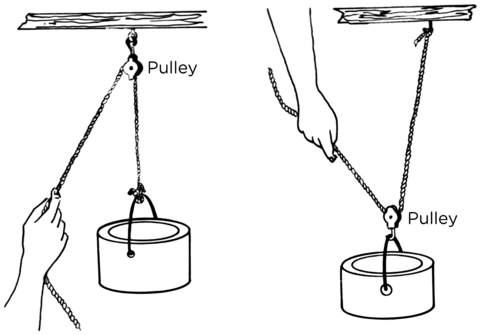

A pulley system is an example of a mechanical system.

What is the input energy in this system?

The input energy is the movement (kinetic energy) of the worker's arms as he pulls on the rope

What are the different parts making up this mechanical system?

The different parts are the worker's arms pulling on the rope. the rope, the pulley, the heavy object and the surface of the Earth.

What is the input energy transferred to within this system?

The kinetic energy is transferred to potential energy as the object is raised higher.

A swing or a seesaw are examples of mechanical systems.

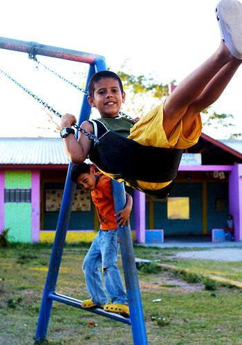

A swing is a simple mechanical system.

Did you realise that when you were swinging on the park swings that you were a part of a mechanical system? When you are at the top of the swing's arc, you and the swing have potential energy because the Earth is pulling you and you are going to start moving down. The **potential energy** becomes **kinetic energy** as you swing through the arc.

What about when you throw a ball up into the air? Do you think this is a mechanical system?

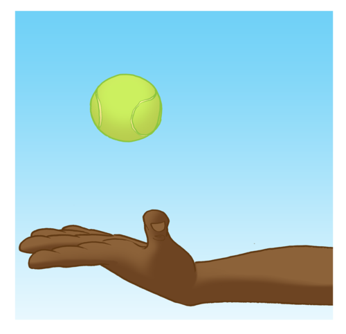

When you throw a ball upward it slows down as it moves upwards, stops for an instant and then speeds up as it falls back down to your hand. Your hand moves to throw the ball and transfers energy to the ball which allows it to move upwards. Does this also follow the Law of Conservation of Energy? Yes, it does. No energy was created or destroyed. The kinetic energy was transferred from your hand to the ball which then starts to move. As the ball moves upwards, kinetic energy is transferred to potential energy as it moves further away from the ground. As the ball moves back down again, the potential energy is transferred to kinetic energy.

What are the parts involved in this mechanical system?

The hand throwing and the ball are the parts involved.

What is the input energy in this mechanical system?

The kinetic energy of your moving arm and hand as you throw the ball.

When does the ball have the most potential energy?

It is important to note that potential energy is relative to a reference point. So, in this example, if we consider the ground to be the reference point, then if you throw a ball upwards and catch it again in your hand, it always has potential energy as it is above the ground. Therefore, the ball has most potential energy when it is at the top of the throw when it stops briefly, before coming back down to the ground.

When does the ball have kinetic energy?

The ball has kinetic energy as it is moving upwards and then falling back downwards.

Let's have a look at some more examples.

# Identifying energy transfers in mechanical systems

Learner might battle to do this at first, so you can go through one or two of the examples with them, and if possible, also perform the demonstration of bending the wire back and forth. The key is to first identify the parts that are involved and then how the energy is transferred from one part to another within the system.

**MATERIALS:**

- a piece of wire

We are first going to perform a simple demonstration to identify the energy transfers within mechanical systems. Take a length of wire and touch it to your lips. How does it feel?

Learners should note that the wire feels cold.

Then, bend the wire into a U-shape and bend it back and forth 10 times quickly. Now, feel the temperature again at the bend. How does it feel?

Learners should note that it feels warm.

This is an example of a mechanical system. We can describe the transfer of energy as the potential energy within your arms is transferred to kinetic energy as you move them back and forth. This is transferred to kinetic energy in the wire which is then transferred to the lips as heat.

**INSTRUCTIONS:**

2. Look at the following pictures of different mechanical systems.
4. Identify the different parts in the system and then how energy is transferred from one part to another. You can discuss this with your partner.
6. Then write a few sentences to describe the energy transfers within each system.

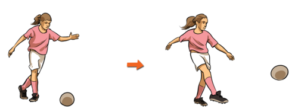

**Problem:**
The girl uses the energy in her muscles and pulls her leg back. When her leg is at its highest point, what energy does it have?

**Solution:**
It has potential energy.

**Problem:**
As she swings her leg back down towards the ball, describe the transfer of energy.

**Solution:**
The potential energy becomes kinetic energy.

**Problem:**
When her foot hits the ball, and the ball moves off, describe the transfer of energy in the system.

**Solution:**
The kinetic energy from her leg is transferred to the ball and makes the ball move. The ball now has kinetic energy.

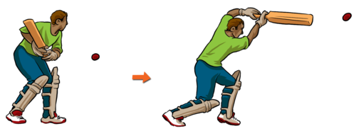

**Problem:**
The muscles in the cricketer's arm pull the cricket bat upward. Describe the transfer of energy.

**Solution:**
This movement transfers potential energy to the bat.

**Problem:**
Describe the transfer of energy as the bat swings down and then hits the moving ball.

**Solution:**
As the bat swings down the potential energy becomes kinetic energy as the bat moves. When the bat hits the ball, it transfers the kinetic energy to the ball. The kinetic energy allows the ball to move through the air.

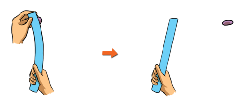

**Problem:**
Now that you have had practice with the other examples, use the following space to describe the transfer of energy within the above system as a ruler is pulled back and then flicks a pellet across the room.

**Solution:**
When the ruler is pulled back, the movement of the hand has kinetic energy which is transferred to the ruler. The ruler has gained potential energy and when it is released, the potential energy becomes kinetic energy as the ruler flicks backwards. The kinetic energy is transferred to the pellet and so the pellet moves across the room.

### Thermal systems

<Callout type="note" title="Note">
We will learn more about how particles behave next year when we look at the particle model of matter.
</Callout>

Did you know that the particles that make up a substance or object, such as atoms or molecules, also have kinetic energy? Particles which have more kinetic energy will move faster than particles which have less kinetic energy. When the particles are moving very fast, we feel the substance and say "That's hot!". This is because the temperature of a substance depends on the kinetic energy of the particles.

The thermal energy can be transferred from one object to another in a thermal system. When thermal energy is transferred, this is called heat. We will look more at this in the next chapter, but for now let's look at some simple examples of energy transfers within thermal systems (heating).

We will look more at heat as a form of energy transfer in the next chapter.

# The energy transfers when boiling water

This investigation works best with water placed in a beaker and heated over a Bunsen burner using a tripod. However, if you don't have a Bunsen burner you can use a candle and a tin can. The candle will not provide a large amount of heat energy and so you should use a small amount of water in order for it to reach boiling point within the lesson time. Remember to use an alcohol thermometer rather than a mercury thermometer.

Although this may seem like a very simple investigation, and learners have heated water before, the focus here is different in that we are investigating the energy transfers. This is also an opportunity for learners to practice recording, observing and translation skills, such as drawing a graph.

**INVESTIGATIVE QUESTION:**

What happens to the temperature of water when it is heated over a flame?

**VARIABLES:**

We will be measuring the change in the water temperature over time.

**Problem:**
Which quantity/variable are you in control of? This is the independent variable.

**Solution:**
Time is the independent variable

**Problem:**
Which variable are you measuring in response to the independent variable? This is the dependent variable.

**Solution:**
The temperature of the water is being measured.

**Problem:**
Which variable are you keeping constant?

**Solution:**
The amount/volume of the water must be kept constant

**HYPOTHESIS:**

Write a hypothesis for this investigation. (Hint: What do you think will happen to the temperature of the water. Will it go up or down?)

The hypothesis should mention how the dependent variable would change with a change in the independent variable and should mention which variables must remain constant. In this investigation a suitable hypothesis could read: 'The temperature of the water will increase as time increases if the amount of water is kept constant' or 'The temperature of the water will decrease as time increases if the amount of water is kept constant.'

Remember that a hypothesis doesn't have to be correct. It is a prediction made before any investigation is done and so the outcome is not necessarily known beforehand. Do not discourage learners from developing their own hypotheses. Emphasise that a hypothesis is just as valuable if it is rejected after the investigation.

**MATERIALS AND APPARATUS**

- 150 ml or 250 ml beaker
- tripod
- gauze
- Bunsen burner
- matches
- thermometer
- stopwatch
- retort stand
- clamp

If you don't have Bunsen burners you can use spirit burners or a candle.

**METHOD :**

2. Pour 200 ml of water into a beaker.
4. Place the beaker onto the wire gauze on the tripod.
6. Carefully place the thermometer into the water. When you take the readings, the thermometer should not be touching the sides of the beaker. Alternatively, if you have a retort stand and clamp, the thermometer can be clamped in the stand with the bulb in the water.
8. Light the Bunsen burner.
10. Measure the temperature of the water every 30 seconds until the water starts to boil.
12. Once the water starts to boil, take 3 to 5 more readings.
14. Write down your observations in the table.
16. Once finished, turn off the Bunsen burner and leave the beaker of water to stand.
18. Plot a graph showing the relationship between the time and the temperature.

Make sure that learners observe that the temperature remains constant once the water starts to boil. Once the learners have completed their measurements, turn off the Bunsen burner and leave the water to cool while they carry on with the rest of the task and questions. They will then have to observe what happened to the water once it was left to stand.

**RESULTS AND OBSERVATIONS:**

A table to record your observations:

| Time (seconds) | Temperature ( o C) |
| --- | --- |
| 30 |  |
| 60 |  |
| 90 |  |
| 120 |  |
| 150 |  |
| 180 |  |

If the water takes longer than to boil, ask the learners to add rows to the bottom of their tables. If it takes less, ignore the rest of the table. Each row must represent half a minute (30 seconds).

Use the following space to draw a line graph for your results.

**Problem:**
First, think about what will go on your horizontal, x-axis? This is what you changed.

**Solution:**
Time goes on the x-axis as this is the independent variable.

**Problem:**
What will go on the vertical, y-axis? This is what you measured.

**Solution:**
Temperature is the dependent variable.

**NOTE:**

Learners must provide a heading for their graph. for example "The change in water temperature over time". The graph must show data points with a line of best fit drawn through them. The graph must also flatten out at the end as the water boils.

**Problem:**
The temperature of the water kept increasing, until it started to boil. What temperature did the water boil at?

**Solution:**
This might vary slightly depending on your area and altitude, but it is around 100 oC.

**Problem:**
What did you observe in the temperature when the water started to boil?

**Solution:**
When the water reaches boiling point, the temperature remains constant while the water is changing state from a liquid to a gas.

The reason we do a boiling point curve like this is so that the learners can see that the curve flattens out and temperature remains constant. This is how we find the boiling point of a liquid. It is useful to do a boiling point curve of another liquid as well, such as Coca Cola or orange/apple juice to get a similar shaped curve so that learners understand that at boiling point of that liquid the temperature remains constant for while. If you leave it longer still the temperature will begin to fall as more water particles move into the atmosphere.

This links back to what was covered in the previous term in Matter and Materials in Chapter 1 on the Properties of Materials.

<Callout type="note" title="Note">
Do you remember that we learned about boiling and melting points last term in Matter and Materials in Properties of Materials? If you do not have your previous workbook with you, you can always visit the website at[www.curious.org.za](http://www.curious.org.za)
</Callout>

**CONCLUSION:**

**Problem:**
What can you conclude from your results?

**Solution:**
Learner-dependent answer. The learners should conclude that the longer you keep the water over the flame, the higher the temperature of the water, until it reaches boiling point. At boiling point, the temperature remains constant as the water is changing state from a liquid to a solid.

**Problem:**
Can you accept or reject your hypothesis?

**Solution:**
Learner-dependent answer.

**QUESTIONS:**

**Problem:**
In order for the water to boil, the thermal energy of the water must increase. Where do you think the energy came from to make the water boil?

**Solution:**
The energy for the temperature increase came from the burning gas in the Bunsen burner.

**Problem:**
Describe the transfer of energy within this thermal system as the water is heated.

**Solution:**
The thermal energy (kinetic and potential energy) of the flame in the Bunsen burner/candle is transferred to the water. The thermal energy of the water therefore increases and the temperature rises.

**NOTE:** Remember that temperature is a measure of the average kinetic energy of the particles.

**Problem:**
After the water has boiled, and you then turn off the Bunsen burner, what happened to the water in the beaker?

**Solution:**
It cooled down.

**NOTE:** This is because once the Bunsen burner is switched off, no more energy is supplied to the system and so the loss of energy is greater than the gain and the temperature decreases.

**Problem:**
What do you think happened to the thermal energy of the water? Describe the transfer of energy.

**Solution:**
The thermal energy was then transferred from the water to the surrounding air.

2. A Gr. 7 learner is conducting the investigation and read the temperature off the thermometer as it is set up in the diagram below. What is wrong with this set-up? What is your advice to the learner?
   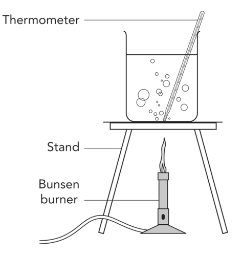

**Problem:**

**Solution:**
The thermometer is resting on the bottom of the beaker and touching the side. This could give an inaccurate reading. The thermometer should either be held by the learner so that it does not touch the sides while they take the reading, or else clamped in a retort stand with the bulb in the water.

So, what have we discovered? The temperature of the water increased. This means that the water particles must have been given more **kinetic energy**. The energy must have come from the Bunsen burner flame. The flame is there because we are burning gas so the energy must have been stored in the gas. If it is stored energy then it is **potential energy**.

<Callout type="note" title="Note">
Build your own skate park with this simulation and see what happens to the potential, kinetic, and thermal energy of the skateboarder.[http://phet.colorado.edu/en/simulation/energy-skate-park-basics](http://phet.colorado.edu/en/simulation/energy-skate-park-basics)
</Callout>

This is a fun simulation that learners can use to investigate potential and kinetic energy. There is the example in the introduction that can be used to show them how to use it, and then there is the track playground that allows you to create your own track. Click on the bar graph, or pie chart menu options for a real-time display of the fluctuations in potential, kinetic and thermal energy.

Once they have mastered the basics, and if there is more time you can show learners the more advanced skate park simulation. The graphs in this version do become slightly more involved but represent the features of the energy system beautifully. [http://phet.colorado.edu/en/simulation/energy-skate-park](http://phet.colorado.edu/en/simulation/energy-skate-park)

PhET tips for teachers are available here: [http://phet.colorado.edu/files/teachers-guide/energy-skate-park-guide.pdf](http://phet.colorado.edu/files/teachers-guide/energy-skate-park-guide.pdf)

So, we have discovered that the potential energy stored in the gas has been transferred to the water particles as kinetic energy. No energy has been **created**, it has been **transferred** from the gas to the water. The energy of the system has been **conserved**.

### Electrical systems

Do you think an electric circuit is a system? Look at the following image and discuss this with your partner. Write down whether you think it is a system or not and why.

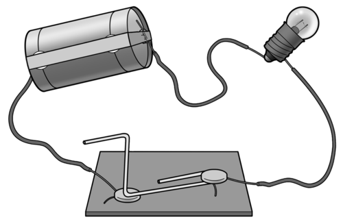

An electric circuit is a system as it consists of different parts that do something, ie. make the light bulb glow. Ask learners to identify the different parts in this system. They are: the battery, the light bulb, the switch (paperclip) and the conducting wires.

What is the source of energy is this electric circuit? In other words, what is the input energy in this system?

The battery is the source of energy, potential energy is the input energy in this system.

What is the result of the energy transfer in the system? In other words, what is the energy output?

The output is that the light bulb lights up/glows.

Let's look at another example of an electrical circuit which makes a motor turn to see the different energy transfers within the system.

# An electric fan system

If possible, make this circuit in class with your learners so that they can observe the changes in the circuit and the movement of the fan. You can use any small device that rotates, such as a fan or a small motor. If you do have a small motor, you can attach a sucker stick to the rotating shaft with a piece of Prestik to make a fan.

**MATERIALS:**

- small electric fan or motor
- conducting wires
- battery
- switch

You can also make your own switch, as described below.

**INSTRUCTIONS:**

2. If possible, make the following circuit in class. However, if you do not make the actual circuit, study the image and answer the questions.
4. To make the circuit, attach a small fan or motor to a battery using the conducting wires.
6. Attach a switch in the circuit as shown in the image. You can make your own switch using a piece of board and pressing two metal pins into it. Then, bend a metal paper clip and attach it to the one drawing pin as shown below.
8. Close the switch and observe what happens to the fan.

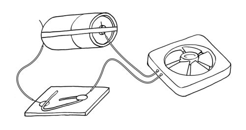

**QUESTIONS:**

**Problem:**
What are the parts making up this electrical system?

**Solution:**
The battery, the fan/motor, the switch, the wires.

**Problem:**
Which part of the system provides the input energy to the system?

**Solution:**
The battery provides the input energy (potential energy).

**Problem:**
What happens to the fan or motor when you close the switch?

**Solution:**
The fan starts to turn/rotate/move.

**Problem:**
What type of energy does the fan now have?

**Solution:**
Kinetic energy.

2. Using your answers to the previous questions, complete the following flow diagram which describes the energy transfers within this electrical system. You need to fill in the type of energy at each step.

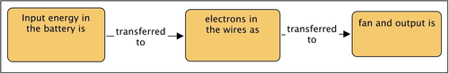

The following shows the completed diagram with the answers learners should supply:

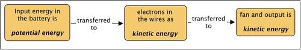

The battery has potential energy which is transferred to the electrons in the circuit. The electrons have kinetic energy which they transfer to the motor. The motor uses the kinetic energy to turn. The turning motor turns the blades of the fan.

### Biological systems

Do you know that we also get biological systems? You have come across these types of systems before in Life and Living, but now we are going to talk about them in terms of how the energy is transferred within these systems, and conserved.

Do you remember learning about photosynthesis and food chains in Life and Living? This is an example of a biological system. Let's find out why.

A plant uses the radiant energy from the Sun to make its own food through the process of photosynthesis. The energy from the Sun is stored as potential energy in plants, mainly as starch. Have a look at the following image to remind you.

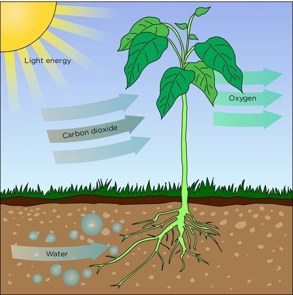

What process is being shown in the diagram? Write a sentence to describe the requirements for this process.

The diagram is showing photosynthesis. The plant uses water, carbon dioxide and sunlight energy to produce glucose and oxygen.

When an animal eats the plant it uses the potential energy in the food which is released during respiration. This is then used by the animal to move and for all its life processes. So the potential energy in the food which the animal eats is transferred to kinetic energy. Energy has been transferred from the Sun to the plant to the animal.

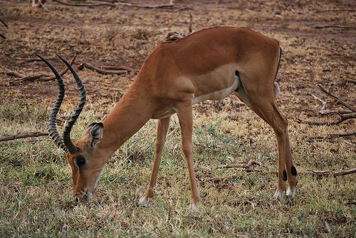

An impala eats the grass and stores the energy in its muscles. When the impala runs, the stored energy becomes kinetic energy.

When we eat plants or animals we are able to use the stored potential energy to make our bodies function.

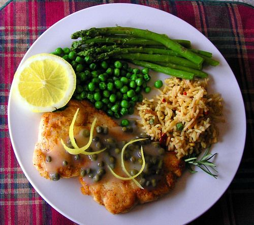

Our food provides the input energy for our bodies to work and move. The food contains potential energy.

Is the energy conserved in a biological system? Yes, it is! The plants change the Sun's energy into **potential** energy which it stores inside itself. Animals then eat the plants and the stored potential energy is transferred to them. The animals use the stored energy to enable them to move. This means the potential energy within the animal has been transferred kinetic energy. As the animal moves and performs its functions, this kinetic energy is transferred to the surroundings. No energy has been created or destroyed, just transferred from the Sun to the plant to the animal.

Let's revise the energy transfers within some systems by studying and drawing flow diagrams.

# Flow diagrams for energy transfers

**INSTRUCTIONS:**

2. Study each of the following diagrams which show different systems.
4. Draw a flow diagram, similar to the one you did for the electric fan in the space provided.
6. Then write a few sentences underneath on the lines to describe how energy is transferred between the different parts in each of these systems.
8. The first one has been done for you.

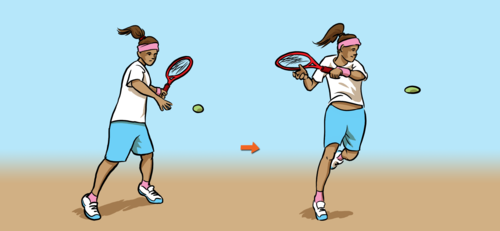

This flow diagram describes the transfers of energy.

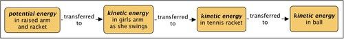

The tennis player's arm and racket have potential energy as they are raised. As the girl swings her arm, this potential energy is transferred to the tennis racket as kinetic energy. The tennis racket transfers energy to the ball as kinetic energy which enables the ball to move through the air.

**QUESTIONS:**

**Problem:**
This is a food chain. Draw a diagram showing the energy transfers in this biological system.

**Solution:**
An example of the flow diagram learners could produce:

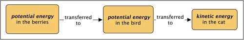

**Problem:**
Write a description of the energy transfers below.

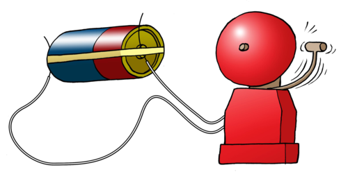

**Solution:**
The berries have potential energy in them. The bird eats the berries and this energy is transferred to the bird as potential energy. Most of the energy is used by the bird and transferred as kinetic energy as it moves around. The bird is then eaten by a cat and the potential energy in the bird's flesh is transferred to the cat as potential energy which is then transferred to kinetic energy as the cat moves around and performs its life processes.

**NOTE:** Although learners will only look at food chains and energy pyramids in more detail next year in Life and Living, this is an introduction to how not all the energy is transferred onto the cat as most of it is used by the bird as it moves around and performs its functions and processes.

**Problem:**
Draw a diagram showing the energy transfers in this electrical system.

**Solution:**
An example of the flow diagram learners could produce:

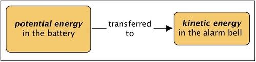

**Problem:**
Write a description of the energy transfers below.

**Solution:**
The battery/cell has potential energy which is transferred to kinetic energy in the alarm bell as the hammer moves back and forth to produce sound.

**Problem:**
In the previous example showing the berries, the bird and the cat, we saw an example of a food chain. Do you remember learning about food chains in Gr. 6? A food chain only shows the transfer of energy between organisms, and does not include the Sun. So, it always starts with a producer. Is the image below an example of a food chain? Why or why not?

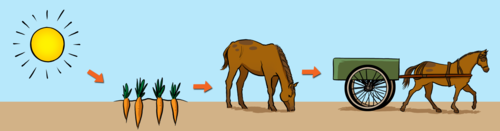

**Solution:**
No, this is not a food chain, as a food chain only shows the transfers of energy between organisms, highlighting the feeding relationships. This diagram also includes the Sun, as well as showing the horse moving a cart.

**Problem:**
We can rather call this an energy transfer sequence. Draw a flow diagram to explain the energy transfers in this biological and mechanical system.

**Solution:**
An example of the flow diagram learners could produce:

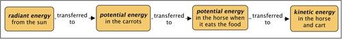

**Problem:**
Write a description of the energy transfers below.

**Solution:**
The energy from the Sun is transferred to potential energy within the carrots as they photosynthesize and produce food. The horse then eats the carrots and this potential energy is transferred to potential energy within the horse. The horse then moves and pulls a cart, so the potential energy in the horse is transferred to kinetic energy in the horse and in the cart as it moves along.

**Problem:**
Let's now look at a more complex system which involves many different parts working together. Do you remember learning about hydropower as an source? Is it renewable or non-renewable?

**Solution:**
Renewable.

<Callout type="note" title="Note">
We will learn more about food chains and the interactions between organisms next year in Gr. 8 Life and Living.
</Callout>

2. Study the following diagram which shows a hydropower plant at the edge of a dam. Then answer the questions that follow.
   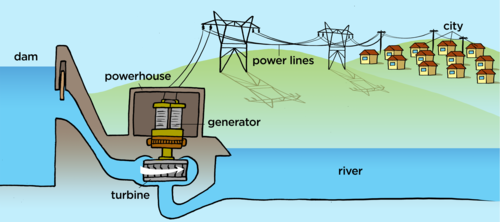
   **Problem:**
   The water in the dam on the left is high up. It has the ability to fall down. What kind of energy does the water have?
   **Solution:**
   The water has potential energy.
   **Problem:**
   As the water flows down the outlet from the dam, describe the transfer of energy.
   **Solution:**
   The potential energy is transferred to kinetic energy as the water moves/flows down.
   **Problem:**
   The flowing water then turns the turbine. This is a mechanical system. What energy does the turbine have?
   **Solution:**
   It has kinetic energy.
   **Problem:**
   The generator then transfers the energy between two systems. The kinetic energy in the mechanical system is transferred to kinetic energy in the electrical system as it generates electricity. What parts make up the electrical system in the diagram?
   **Solution:**
   The electrical system is made up of the generator, the power lines and then the houses/buildings in the city.
   **Problem:**
   What is the output from this whole system? In other words, what does the city get?
   **Solution:**
   The city gets electricity to run appliances, machines, equipment, lights and heating systems.

<Callout type="note" title="Note">
- Potential energy is energy which is stored in a system.
- Kinetic energy is energy which an object has because it is moving.
- Energy is measured in joules (J).
- Energy cannot be created or destroyed. It can only be transferred from one part of a system to another. This is the Law of Conservation of Energy.
- Energy is transferred within systems. The input energy is transferred through the system and energy is conserved.
- There are various energy systems, such as:
  - mechanical systems
  - thermal systems
  - electrical systems
  - biological systems
- Energy is also transferred between different systems.

Concept map

Complete the concept map below by filling in some examples of objects with either potential energy or kinetic energy that you learned about in this chapter.
</Callout>

<Callout type="note" title="Note">
We will study the national electricity grid in more detail at the end of the term.
</Callout>

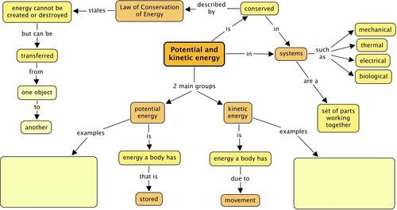

Teacher's version showing some examples of what learners could put in for potential and kinetic energy. There are many other examples too.

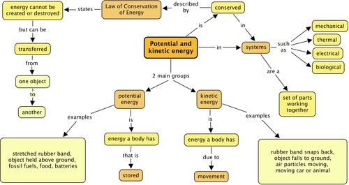

# Revision questions

**Problem:**
What is potential energy? Give two examples of systems which have potential energy [3 marks]

**Solution:**
It is the energy stored inside a system. There are many different examples of potential energy. Some examples are: objects which are held above a surface, elastic bands which have been stretched, batteries contain potential energy.

**Problem:**
What is kinetic energy? Give two examples of systems which have kinetic energy? [3 marks]

**Solution:**
It is the energy a system has because it is moving. There are many different examples of kinetic energy. Learners can use any moving object as an example.

**Problem:**
What does the Law of Conservation of Energy state? [1 mark]

**Solution:**
Energy cannot be created or destroyed. It is transferred from one part of a system to another.

**Problem:**
Look at the picture below.

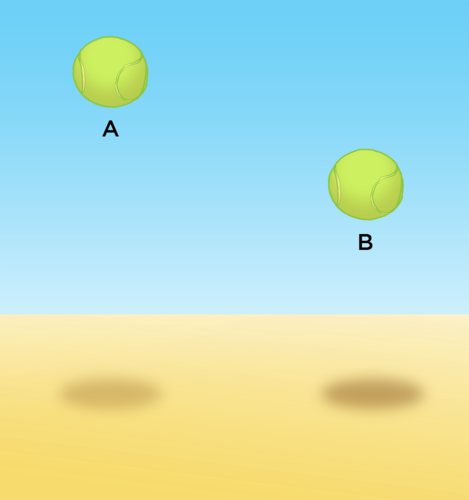

2. Which ball has the most potential energy? [1 mark]
4. Explain your choice. [1 mark]

**Solution:**
2. Ball A has more potential energy.
4. Ball A is higher than ball B relative to the ground and so it has more stored energy.

**Problem:**
Complete the sentences by filling in the missing words. Write the sentence out in full and underline your answers.

2. A plant receives energy from
                                 _____ and uses the energy to make _____. The plant then changes some of the sugar into _____ and stores it in leaves, fruit and other parts. The plant has _____
                                 energy which you can get when you eat the plant. [4 marks]
4. When a plane carries skydivers high into the sky, it is giving them _____ energy. When they jump out and free-fall, they have _____ energy. [2 marks]
   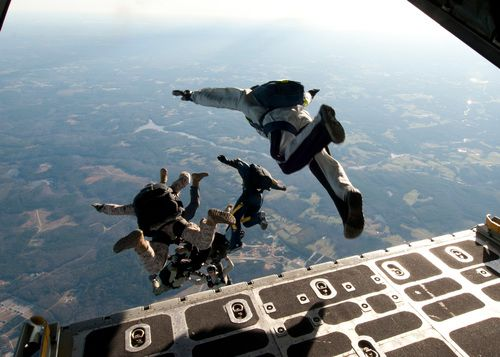
   These army skydivers have just jumped out the back of a plane.

**Solution:**
2. A plant receives energy from the Sun and uses the energy to make food/sugar/glucose. The plant then changes some of the sugar into starch and stores it in leaves, fruit and other parts. The plant has potential energy which you can get when you eat the plant.
4. After skydivers jump out of a helicopter or plane, potential energy is transferred to kinetic energy as they fall.

**Problem:**
Draw an energy transfer flow diagram to show how energy gets from the Sun into your food and then to you. [3 marks]

**Solution:**
Learners must draw a Sun then a plant then either a person, or another animal which eats the plant and then a person which eats the animal.

**Problem:**
A high jumper starts running. As she approaches the bar, she pushes off the ground and lifts her body off the ground and flies over the bar. She then falls down into a large padding on the ground.

A high jumper going over the bar.

Think about her jumping, from the moment her feet leave the ground. She goes up in the air, she almost stops as she goes over the bar, and then she comes down again.

2. Where does she have the most potential energy? [1 mark]
4. Where does she have the most kinetic energy? [1 mark]
6. Does she have some potential energy and some kinetic energy at any point in her jump? If you say yes, name one point where it is true. [2 marks]

**Solution:**
2. At the top of her jump (as this is when she is the highest above the ground).
4. She has the most kinetic energy just before she touches the ground/pad again (as this is where she will be moving the fastest).
6. Yes, she does have both kinetic energy and potential energy at points during her jump. They are on the way up / on the way down (either).

**Problem:**
Which type of energy do each of the following systems contain (kinetic or potential or both types)? [6 marks]

2. A mountain biker at the top of the mountain.
4. Petrol in a storage tank.
6. A race-car travelling at its maximum speed.
8. Water flowing down a waterfall before it hits the pond below.
10. A spring in a pinball machine before it is released.
12. A running refrigerator motor.

**Solution:**
2. Potential energy
4. Potential energy
6. Kinetic energy
8. Both
10. Potential energy
12. Kinetic energy

**Problem:**
Study the following image and answer the questions.

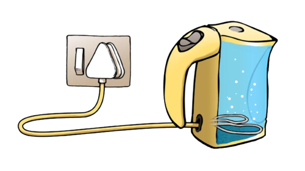

2. There are two systems involved in this image of heating water in a kettle that is plugged in. What are they? [2 marks]
4. Describe the energy transfers within and between these two systems. [2 marks]

**Solution:**
2. They are an electrical system and a thermal system.
4. The electric current transfers energy to the hot-wire in the kettle, which transfers energy to the water and so the water molecules get more and more kinetic energy until the water starts to boil.

Total [32 marks]
