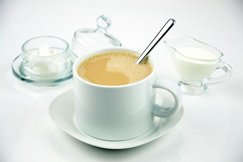
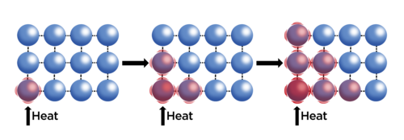
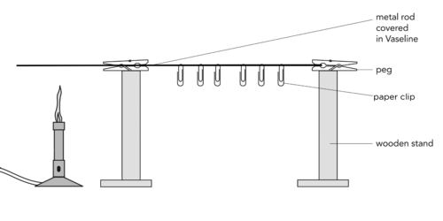
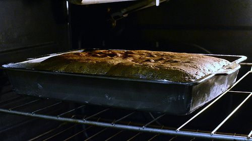
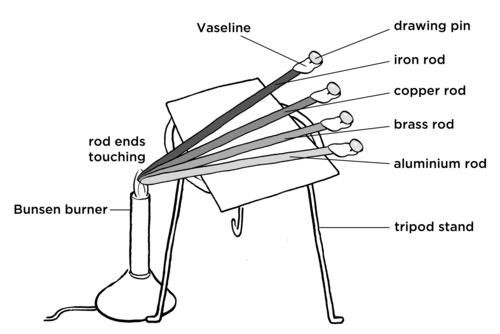
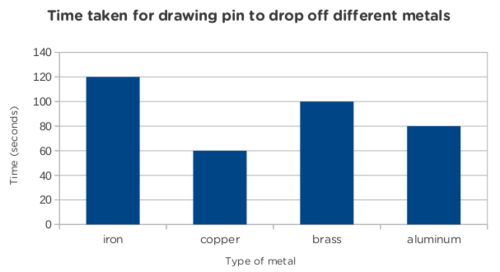

## Conduction

<Callout type="note" title="Note">
- conduction
- conductor
- insulator
</Callout>

A suggestion to introduce this topic is to ask learners what happens to a metal teaspoon when they put it in their hot beverage. If possible, demonstrate this briefly in class, even with a hot glass of water and a metal rod. In addition, use a plastic teaspoon to demonstrate the difference as plastic is an insulator.

Have you noticed that when you put a cold, metal teaspoon into your hot cup of tea, the teaspoon handle also warms up after a while? Have you ever wondered how this warmth "moved" from the hot tea to the cold teaspoon and warmed it up? This is one way in which energy is transferred and this is called **conduction**. Let's find out how it works.

How does the handle of the metal teaspoon become hot when in a cup of tea?

When energy is transferred to an object, the energy of the particles increases. This means the particles have more kinetic energy and they start to move and vibrate faster. As the particles are moving faster they "bump" into other particles and transfer some of their energy to those neighbouring particles. In this way, the energy is transferred through the substance to the other end. This process is called **conduction**. The particles conduct the energy through the substance, as shown in the diagram.

Let's demonstrate this practically.

# Conduction through a metal rod

Set this demonstration up in front of the class as you start to talk about conduction.

**MATERIALS:**

- Bunsen burner
- metal rod
- Vaseline
- paper clips, drawing pins or safety pins
- two wooden stands, or a stack of books or blocks of wood to create the two stands on either side
- 2 pegs

**INSTRUCTIONS:**

2. Set the apparatus up as shown in the diagram.
4. Cover the rod in Vaseline and place it between the two stands with pegs to prevent it from rolling and hold it in place. The rod must be extending past the left hand upright and the Bunsen burner placed here so that the Vaseline does not melt due to radiation from the Bunsen burner, but rather conduction along the metal rod.
6. Attach the paper clips or drawing pins to the rod by sticking them into the Vaseline.
8. Light the Bunsen burner and heat the one end of the rod.
10. Watch as the paper pins or pins drop off one by one as the energy is conducted through the rod.

**INSTRUCTIONS:**

2. Your teacher will set up the demonstration as in the diagram below.
4. Observe what happens to the pins or paper clips as the Bunsen burner is lit and heat is applied to one end of the metal rod.

As an extension exercise you could include another investigation in which you measure the rate of energy conduction along a metal rod. Repeat the experiment placing drawing pins at 5cm intervals on a long metal rod. Clamp the metal rod and heat one end over a Bunsen burner. Use a stopwatch to time how long it takes for each drawing pin to drop and record the results on a graph. This could be further extended by using different metals and putting all the results on a single set of axes. The gradient of the graphs would give the rate of heat conduction.

**QUESTIONS:**

**Problem:**
When the Bunsen burner is lit, what happens to the rod just above it?

**Solution:**
Energy is transferred to the metal of the rod just above it. The thermal energy of this part of the rod increases and the rod becomes hot.

**Problem:**
Which pin or paperclip dropped off the metal rod first? The one closest to or furthest from the Bunsen burner?

**Solution:**
The one closest to the Bunsen burner dropped off first.

**Problem:**
What does this tell us about the way in which heat is conducted along the rod?

**Solution:**
The heat is transferred from where it is hottest to the colder end of the rod.

Let's think about the teaspoon in the tea again. The tea is hot and the metal spoon is cold. When you put the metal teaspoon into the hot tea some of the thermal energy from the tea is transferred to the metal particles. The metal particles start to vibrate faster and collide with their neighbouring particles. These collisions spread the thermal energy up through the teaspoon. This makes the handle of the teaspoon feel hot.

Conduction is the transfer of thermal energy between objects that are touching. In the teaspoon example, the particles of the tea are touching the particles of the metal spoon, which in turn are touching each other, and this is how heat is conducted from one object to the other.

Do all materials conduct heat in the same way? Let's find out.

<Callout type="note" title="Note">
Misconceptions about temperature. Why do you think your carpet feels warmer than tiles in winter? Watch this video to find out.
</Callout>

In response to the video in the margin box about why your carpet feels warmer than the tiles in winter, you can come back to this question after you have performed the following investigation, and also looked at the example of the cake tin and the cake straight out of the oven. You can lead the discussion in the following way:

- Start off by asking learners why they would prefer to stand on a carpet in winter rather than the tiles. They would probably answer that the carpet feels warmer.
- Follow this up by asking them what they think the temperatures of each surface is. Learners might say that they think the tiles are at a lower temperature than the carpet because it feels colder. This is incorrect as the tiles and the carpet will be at the same temperature as they have both been in the same environment for a while and so will be at the same temperature.
- However, if you pose this question to learners again after doing the following investigation and also after looking at the cake and cake tin example, they might then realise that this is another example of a difference in conductivity.
- Namely, the tiles and the carpet are both at the same temperature, but the tiles are a better conductor of energy and so they conduct heat at a faster rate away from your feet than the carpet would, making the tiles feel colder, when in actual fact they are at the same temperature.

# Do all materials conduct heat in the same way?

This investigation will show the learners that metals conduct heat better than non-metals. If possible, watch the Veritasium video provided in the visit link before class about the misconceptions surrounding temperature and which demonstrates this activity. Start off by asking learners to feel the blocks and ask which one feels colder. The aluminium block will feel colder. Then ask them which block they think will melt the ice cube the fastest. as in the video, most people think that the ice cube will melt faster on the plastic block as it feels warmer than the aluminium block. However, this is a misconception, and will be demonstrated in the activity that it is in fact the aluminium block which causes the ice cube to melt faster as metals are a better conductors of heat.

**AIM:** To investigate which materials are the best conductors of heat.

In this investigation, we will be placing an ice cube on a plastic block and on an aluminium block and observing which ice cube melts the fastest.

**HYPOTHESIS:** Write a hypothesis for this investigation. Which block do you think will melt the ice cube the fastest?

Learners might hypothesize that the ice cube will melt faster on the plastic than the aluminium block. If they do, make sure that they come back to reject their hypothesis and revise it.

**MATERIALS AND APPARATUS:**

- a plastic block
- an aluminium block
- ice cubes
- a plastic ring to keep the ice cube in place on the block

You can use any piece of plastic and aluminium (or other metal) that you can find. if possible, use a circular ring to stop the melted water from spilling.

**METHOD:**

**Problem:**
First feel the plastic block and the aluminium block. Describe how they feel.

**Solution:**
Learners will note that the plastic block feels warmer than the metal block.

2. Place an ice cube onto each block and observe what happens.

**OBSERVATIONS:**

**Problem:**
Which ice cube starts to melt first and the fastest?

**Solution:**
The ice cube on the aluminium/metal block melts first.

**Problem:**
Is this what you thought would happen? Refer back to your hypothesis.

**Solution:**
Learner-dependent answer. Most people generally have the misconception that the ice cube will melt faster on the plastic block, rather than the metal block.

**CONCLUSIONS:**

**Problem:**
What can you conclude about which material (the plastic or the metal) is the best conductor of heat?

**Solution:**
Metal is a better conductor of heat than plastic as the ice cube on the metal melted first.

We will discuss this in the next paragraph about why this happens.

So how does this work? This is to do with **thermal conductivity**, the rate at which heat is conducted from one object to another.

When you originally felt the blocks, you felt that the plastic block was warmer. But, what we observed is that the aluminium or metal block melted the ice cube faster. This is because the metal block is conducting the heat faster to the ice cube. The plastic block is a worse thermal conductor so less heat is being transferred to the ice cube and so it does not melt as fast.

Why then does the aluminium block feel colder than the plastic block?

This is because the aluminium conducts heat faster away from your hand than the plastic does. Therefore the aluminium block feels colder and the plastic block feels warmer. When you touch something, you do not actually feel the temperature. Rather you feel the rate at which heat is either conducted away from or towards you.

Let's think of another example of baking a cake. Imagine you have just finished baking a cake in the oven at 180 °C.

A cake baking in the oven in a metal tin.

When you remove the cake from the oven, which is more likely to burn you more, the metal cake tin, or the cake?

The most likely answer is that the cake tin will give you a more serious burn.

For the next question, get learners to speculate about what they think about the **temperature** of the cake tin and the actual tin. Many people have the misconception that the tin is hotter than the cake as it **feels** hotter. They are actually at the same temperature as they have both been baking at 180 °C.

Do you think the cake and the tin are at the same temperature when you remove them from the oven? Why?

Yes, the cake and the tin are both at the same temperature as they have been baking at 180 oC. Learners might be inclined to say that the tin is at a higher temperature than the cake as it feels hotter and the metal tin will give you a more serious burn than the actual cake. This is a misconception and you must discuss this. As with the example of the aluminium and plastic block, the cake tin and the cake are at the same temperature. But, the metal tin conducts heat faster towards your hand than the cake does. Therefore, the metal tin will feel hotter and is more likely to give you a serious burn than the cake does. When you touch something, you do not actually feel the temperature. Rather you feel the rate at which heat is either conducted away from or towards you.

<Callout type="note" title="Note">
Misconceptions about heat: Why is a cake tin more likely to burn you than the actual cake?[https://www.youtube.com/watch?v=hNGJ0WHXMyE](https://www.youtube.com/watch?v=hNGJ0WHXMyE)
</Callout>

<Callout type="note" title="Note">
If you have the opportunity, watch the video in the**Visit** margin box by typing the link into your internet browser, even on your mobile phone. This video demonstrates the cake and cake tin example.
</Callout>

What we have seen here is another example of thermal conductivity. The tin will conduct heat much faster to your hand than the cake, so the tin will burn you, but the cake will not. The tin and the cake are at the same temperature.

So what have we learnt? Metals conduct heat better than non-metals.

- There are substances that allow thermal energy to be conducted through them and so they are called **conductors**.
- There are substances that do not allow thermal energy to be conducted through them and so they are called **insulators**.

This links back to what we learned in Matter and Materials about the properties of materials and how their properties determine their uses. Remind learners of the activities they did in Matter and Materials, especially linked to conductivity.

<Callout type="note" title="Note">
Remember, just because a material**feels** colder, does not mean it has a lower temperature. It may just be that it is conducting heat faster away from your hand.
</Callout>

Now that we know that metals are good conductors of heat, do you think all metals conduct heat equally well? Let's investigate which metals are better conductors.

# Which metals are the best conductors of heat?

We are going to see which metal is the better conductor of thermal energy. To do this we will see which metal becomes hot first.

<Callout type="note" title="Note">
Make sure you know how to use a Bunsen burner safely.
</Callout>

Now that we have established that metals conduct heat energy better than non-metals, the learners will investigate which metals are the best conductors of heat. This investigation requires more heat than the previous one and so the learners should not test the conduction with their fingers.

Spend a few minutes before the learners begin by demonstrating the correct procedure for lighting a Bunsen burner. There are many different instructional videos on the internet, such as the one identified in the visit box in the margin. Here are a list of instructions for your reference:

2. Ensure that you are working on an appropriate surface, such as a fireproof mat, and that it is clean and uncluttered.
4. Make sure that the gas tube is in good condition and not perishing.
6. Connect the to the gas outlet securely and make sure it won't easily come off if moving the Bunsen burner around.
8. Make sure that the collar at the base of the Bunsen burner and the air hole are closed.
10. First light your match, holding it away from the Bunsen burner.
12. Turn on the gas with your other hand and bring the match to the Bunsen burner to light it.
14. Adjust the air hole by opening it so that the flame becomes hotter.
16. Adjust the intensity of the flame using the collar at the bottom.

You can ask the learners to draw posters explaining how to light a Bunsen burner as an additional exercise if you feel they need the extra practice and reminders.

Remember that the tripods and metal rods that the learners use will get quite hot during this experiment. Make sure to allow the apparatus to cool before packing it away.

**AIM:** To identify whether some metals are better conductors of heat than other metals.

**IDENTIFY VARIABLES :**

Read through the method and look carefully at the diagram for the investigation to identify the different variables required.

**Problem:**
Which variable are you going to change?

**Solution:**
Material being tested i.e. iron, copper, brass or aluminium

**Problem:**
What do we call the variable that you are going to change?

**Solution:**
This would be the independent variable

**Problem:**
Which variable are you going to measure?

**Solution:**
Time taken for the drawing pin to drop.

**Problem:**
What do we call the variable that you are going to measure?

**Solution:**
The dependent variable

**Problem:**
Which variables must be kept the same?

**Solution:**
Length and thickness of the material should be the same for each material used. Distance of the drawing pin from the heat source.

**Problem:**
What do we call the variables which must be kept the same?

**Solution:**
Constants

**HYPOTHESIS:**

Write a hypothesis for this investigation.

Learner-dependent answer. Learners can hypothesise about which metal they think will be the best conductor, for example, the copper rod will be the best conductor.

**MATERIALS AND APPARATUS:**

- Bunsen burner
- Vaseline
- copper, iron, brass and aluminium rod
- stopwatch
- drawing pins
- tripod
- cardboard or paper
- matches

The materials listed here are a suggestion. You can use alternative apparatus to still do this investigation. For example, a spirit burner could also be used to heat the rods. If you do not have a tripod stand, you can place the metal rods on another stand, such as a block of wood, with the ends sticking out one side to still reach over the Bunsen burner. Paper clips can also be used instead of drawing pins. The type of metals are not important as long as you have different metals of the same length.

**METHOD:**

2. Stick the flat end of a drawing pin to the end of each of the metal rods using the Vaseline. Try to use the same amount of Vaseline for each drawing pin.
4. Place the cardboard on the tripod.
6. Balance the metal rods on the cardboard so that one end of each is over the Bunsen burner.
8. Light the Bunsen burner.
10. Using a stopwatch, measure how long it takes for each of the pins to drop off.
12. Record your results in the table.
14. Draw a bar graph to illustrate your results.

The cardboard is an insulator and will stop the heat from the rods transferring to the tripod itself. The loss of heat from the rods could affect the results.

**RESULTS AND OBSERVATIONS:**

Record your results in the following table.

| Type of metal | Time taken for pin to drop off (seconds) |
| --- | --- |
| iron |  |
| copper |  |
| brass |  |
| aluminium |  |

Now draw a bar graph to show your results. Do not forget to give your graph a heading to describe what it represents.

**Problem:**
Which variable should be on the horizontal x-axis?

**Solution:**
The type of material should be on the horizontal axis. This is the independent variable.

**Problem:**
Which variable should be on the vertical axis?

**Solution:**
The time taken for the drawing pin to to fall off should be on the vertical axis. This is the dependent variable.

**Problem:**
Why do you think that a bar graph is suitable for this investigation?

**Solution:**
The independent variable/type of material is not a number value and so it does not need a number line. A bar graph is used to represent non-number or non-continuous data.

The independent variable is always drawn on the x-axis with the dependent variable on the y-axis. Both axes must be labelled and show the units of measurement. The graph should have a heading.

An example set of data is given here with the accompanying bar graph as a reference. Your results may vary from these presented here.

| Type of metal | Time taken for pin to drop off (seconds) |
| --- | --- |
| iron | 60 |
| copper | 30 |
| brass | 50 |
| aluminium | 40 |

**ANALYSIS :**

**Problem:**
Which bar on your graph is the longest?

**Solution:**
The longest bar should be the iron.

**Problem:**
Which bar is the shortest?

**Solution:**
The shortest bar should be the copper.

**Problem:**
Write down the materials in order of how fast they conducted heat from the quickest to the slowest.

**Solution:**
Activity-dependent answer.

**Problem:**
Why does the Vaseline melt?

**Solution:**
The heat is transferred by conduction through the metal rod and to the Vaseline causing an increase in its temperature and then a change of state (solid to liquid).

**Problem:**
Why do you think it was necessary to place the piece of cardboard or paper on the tripod stand underneath the metal rods. Hint: The tripod stand is also made of metal.

**Solution:**
The cardboard acts as an insulator to prevent heat from transferring to the stand from the rods. For the purpose of this experiment, the heat should transfer down to the different metal rods only.

**Problem:**
Why do you think it is necessary to use the same amount of Vaseline on the ends of each rod?

**Solution:**
This is so that the test is fair, otherwise some drawing pins might be stuck on better than others, leading to inaccurate results.

**Problem:**
Do you think we could have performed this investigation if our rods were of different lengths? Why?

**Solution:**
No, otherwise it would not be a fair test as the heat will have to be conducted further in some rods than in others, leading to inaccurate results.

**EVALUATION:**

It is always important to evaluate our investigations to see if there is anything we would change or improve on.

**Problem:**
Is there anything that went wrong in your investigation that you could have prevented?

**Solution:**
Learner-dependent answer.

**Problem:**
If you were to repeat this investigation, what would you change?

**Solution:**
Learner-dependent answer. Examples include: repeating the same experiment three times and averaging the results, increasing the number of metals tested.

**CONCLUSIONS:**

**Problem:**
Write a conclusion for this investigation about which metal is the best conductor of heat.

**Solution:**
This answer will depend on their experimental results, and the exact metals which you used in the investigation.

In this section we looked at how heat is conducted through metal rods and other objects. These were all *solid* objects. How is energy transferred through liquids or gases? Let's find out in the next section.
