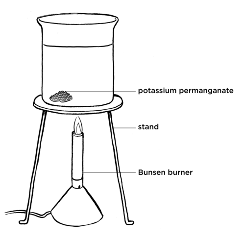
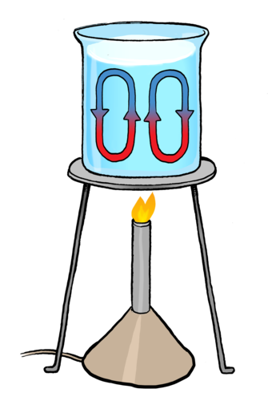
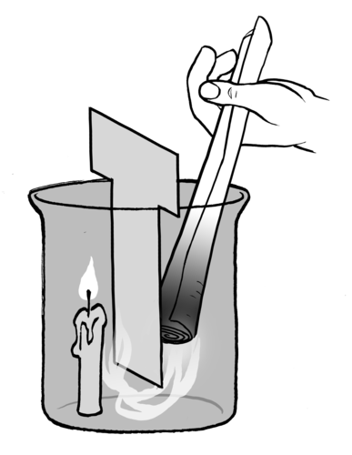
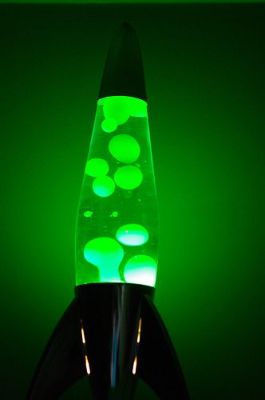
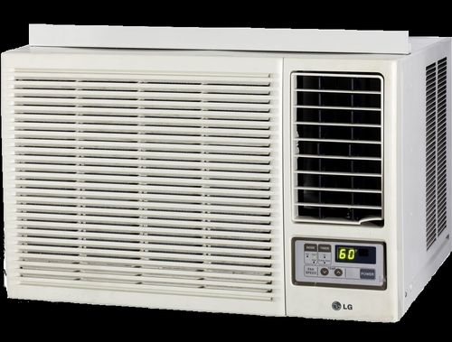

## Convection

<Callout type="note" title="Note">
- convection
- convection current
</Callout>

As an introduction to this section, you can simulate the "sitting in a bath" concept by filling a rectangular plastic tub or small water tank with cold water and then pouring hot water into one side. Invite the learners to feel the cold side of the tub and then feel it a few minutes later.

If you can get hold of a lava lamp, this can make a very exciting introduction to the lesson. You can turn the lights off and place the lava lamp on your desk for when learners come into the class. You can then explain that you are going to find out why the blobs rise and then fall back down in the lava lamp. If you do not have a lava lamp, you can also play this video:

Think of a pot of water on a stove. Only the bottom of the pot touches the stove plate, but all of the water inside the pot, even the water not touching the sides, becomes warmer. How does the energy transfer throughout the water in the pot? The transfer of energy is because of **convection**.

Let's do an activity that will help us to visualise how convection occurs.

# Convection in water

<Callout type="note" title="Note">
Colourful convection currents (video)
</Callout>

**MATERIALS:**

- 200 ml glass beaker
- potassium permanganate
- Bunsen or spirit burner, tripod stand, wire gauze

Take note that you only need a few grains of potassium permanganate, otherwise you will not see anything.

An alternative to the above materials is the following:

2. Cut the neck of a transparent 4 or 5l container.
4. Fill the container three quarters with cold tap water.
6. Put coloured hot water (can be coloured with food colouring) into a small bottle with a lid that is easy to remove. Close the lid.
8. Lower the small bottle into the container.
10. Gently open it once lowered, then gently take out your hand from the container, with the lid.
12. Observe that the coloured hot water rises from the small bottle, through the cold water, then drops down again as it cools on its way up - observe the convection currents.

**INSTRUCTIONS:**

Learners must not just throw the potassium permanganate into the water. It is important that they place it carefully in one side of the bottom of the beaker so that they can see how the currents in the water move.

2. Half fill the beaker with cold tap water.
4. Carefully put a small amount of potassium permanganate on one side of the beaker. DO NOT STIR.
6. Heat the water directly under the side of the beaker with potassium permanganate with a Bunsen/spirit burner and observe what happens.
8. Set up a control experiment and place a few grains of potassium permanganate into the bottom of a beaker filled with water. Do not heat this beaker and observe what happens.

**QUESTIONS:**

**Problem:**
What did you see as the water started to warm up in the beaker that was heated? Draw a picture to show what you see.

**Solution:**
Learners should see the purple from the dissolved potassium permanganate moving in a circle upwards through the water.

**Problem:**
What is happening to the potassium permanganate in this beaker?

**Solution:**
As the potassium permanganate dissolves in the water it is being dragged through the water.

**Problem:**
Can you explain the pattern you saw?

**Solution:**
The warm water is rising and being replaced by cooler water.

**NOTE:**

At this point the learners are not aware of the theory behind convection currents and so their answers will be quite simple.

**Problem:**
Compare this to the beaker which was not heated. What did you observe in this beaker?

**Solution:**
The potassium permanganate will dissolve, but it will not form rising currents. It will diffuse evenly and densely at the bottom of the beaker. Over a long time it will spread out evenly throughout the water.

Let's now explain what we observed in the last activity. Convection is the transfer of thermal energy from one place to another by the movement of gas or liquid particles. How does this happen?

As a gas or liquid is heated, the substance expands. This is because the particles in liquids and gases gain kinetic energy when they are heated and start to move faster. They therefore take up more space as the particles move further apart. This causes the heated liquid or gas to move upwards and the colder liquid or gas moves downwards. When the warm liquid or gas reaches the top it cools down again and therefore moves back down again.

<Callout type="note" title="Note">
We then say that the heated liquid or gas is less dense as the same particles are now taking up a larger space. We will learn more about density next year in Gr 8.
</Callout>

In the last activity, the water particles gained kinetic energy and moved apart from each other, therefore taking up more space. This water then moves upwards as it is less dense than the cold water, meaning it it lighter than the cold water. We were able to observe this as the potassium permanganate dissolved in the water and moved with the water particles, and then moved downwards again as the water cooled.

This movement of liquid or gas, is called a **convection current**, and energy is transferred from one area in the liquid or gas to another. Have a look at the diagram which shows a convection current.

# Does smoke move up or down?

The learners need to be careful with this experiment. It is easy to set the T-shaped cardboard alight with the candle and they should be careful not to burn their fingers when lighting the candles as well.

**MATERIALS:**

- T-shaped cardboard
- candle
- twist of paper or splint
- beaker
- box of matches

**INSTRUCTIONS:**

You can drip some wax onto the base and then stick the candle onto this to make it stand.

2. Light the candle and place it inside the beaker, to the side of the beaker.
4. Put the T-shaped cardboard into the beaker so that there is a small gap between the bottom of the beaker and the cardboard.
6. Light the twisted roll of paper and hold it in the beaker on the opposite side to the candle as shown in the diagram.
8. Observe what happens to the smoke.

**QUESTIONS:**

**Problem:**
What happens to the smoke from the paper?

**Solution:**
The smoke is drawn down under the cardboard and up next to the candle.

**NOTE:**

Some of the smoke particles may move upwards.

**Problem:**
Why do you think the smoke moves in this way?

**Solution:**
The candle heats the air above it which creates a convection current which draws the cooler air on the other side of the cardboard towards the candle. This movement of the air particles pulls the smoke particles with it. The smoke particles allow us to visualise the convection current.

In the last two activities, we have observed convection currents in a liquid and in a gas. Convection currents can only form in gases and liquids as these particles are free to move around. They are not held in fixed positions like in a solid. Solid particles are held together too tightly for them to move when heated. Solid particles will only vibrate faster when heated but will not move from their positions.

<Callout type="note" title="Note">
The solid particles will only move from their positions when they have gained enough kinetic energy for a change of state to occur and the solid melts to become a liquid.
</Callout>

<Callout type="note" title="Note">
The blobs in a lava lamp move up and down in the lamp as they first heat and expand and then reach the surface and cool so they move back down again.
</Callout>

The blobs in a lava lamp move up and down showing us the convection currents as the lamp provides the source of heat at the bottom.

<Callout type="note" title="Note">
How does a lava lamp work? (video)
</Callout>

Now that we have learned about convection, how can we apply this in the world around us? It is interesting to learn about concepts and theories in science, but it is even more interesting when we discover how this has an influence in our daily lives.

# Installation of air heating and cooling systems

Imagine that your teacher has been given a heater and an air-conditioning unit for your classroom. The heater will warm your classroom in winter and the air-conditioner will keep you cool in summer. You need to help you teacher decide where each item should go in the classroom. Should they go on the wall near the ceiling or near the floor? Should they go next to a window?

This is an photo of an air conditioner.

**INSTRUCTIONS:**

**Problem:**
Get into groups of 2 or 3.

**Solution:**

**Problem:**
Discuss where in your classroom you would place a heater so that it can effectively heat up the room. Draw a diagram to explain your choice.

**Solution:**
A heater should be placed near the floor. As it heats the air around it, the warm air will rise and be replaced by cool air. The cool air is then warmed and rises. This creates a convection current which will warm the entire room. The diagram should show the upward circulation of the warm air.

**Problem:**
Discuss where in your classroom you would install the air-conditioner so that it can effectively cool the room. Draw a diagram to explain your choice.

**Solution:**
An air-conditioner should be placed near the ceiling. As it cools the warm air near the ceiling the cool air moves downward towards the floor and is replaced by warm air from below. The warm air is then cooled by the air-conditioner. This creates a convection current which will cool the entire room. The diagram should show the downward circulation of the cool air.

Try to find an air-conditioner or heating specialist who you can interview. Ask them to explain the best way to install the air-conditioner and a heater.

We have now looked at how energy is transferred through different materials, whether they are solids (conduction) or liquids and gases (convection). But, what about if there are no particles to transfer the thermal energy? Is there still a way for energy to be transferred?
