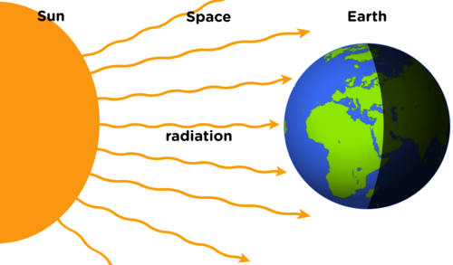
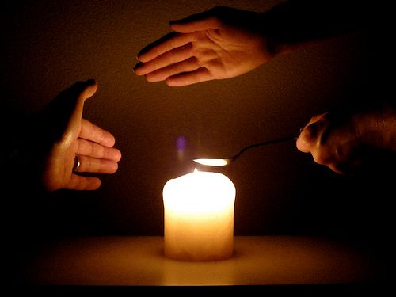

## Radiation

<Callout type="note" title="Note">
- radiation
- matt
- reflect
- absorb
</Callout>

Have you ever wondered how the Sun is able to warm us even though it is so far away? The energy is transferred from the Sun to everything on the Earth. The Sun does not need to be touching the Earth for the energy to be transferred. Also, there is space in between the Earth and the Sun. The energy from the Sun is able to warm us without the Sun ever touching us.

This transfer of energy is called **radiation**. It is different to conduction or convection as it does not require objects to be touching each other or the movement of particles.

<Callout type="note" title="Note">
Radiation comes from the Greek word*radius*, meaning a beam of light.
</Callout>

The Sun radiates heat in all directions. Energy is transferred through space to Earth

<Callout type="note" title="Note">
It takes light about 8 minutes to travel from the Sun to Earth.
</Callout>

We can also see how heat is transferred by radiation here on Earth, and not just between the Sun and the Earth. Let's demonstrate the difference between radiation and convection using a candle.

# Radiation from a candle

A suggestion is to do this as a demonstration and get learners to come up in small groups. You can then control how close they put their hands to the flame. Take note that heat radiates **in all directions** around the source of thermal energy (including the top of the candle). What makes us feel the heat more at the top is the effect of convection currents of the hot air moving up. They should first hold their hands above the flame to feel the heat from convection. Then they should hold their hands next to it to feel the heat transfer from radiation. Finally, you can also demonstrate conduction using a metal spoon and holding it in the flame.

**MATERIALS:**

- candle in a holder
- metal spoon or metal rod
- matches

**INSTRUCTIONS:**

2. Light a candle and place it in a holder. Your teacher might do this and get groups of you to come up at a time to the demonstration.
4. First hold you hand above the candle.
6. Then hold your hand on the side of the candle.
8. Answer the following questions.

**QUESTIONS:**

**Problem:**
We know now that heat from a candle will be transferred to the air around it. These will warm up. Where will this air move to?

**Solution:**
The air particles will move upwards.

**Problem:**
What is this called?

**Solution:**
Convection.

**Problem:**
So, when you hold your hand above the candle, what do you feel and why?

**Solution:**
When you hold your hand above the candle, the warm air particles transfer the energy to your hand causing your hand to warm up and you feel the increase in temperature.

**Problem:**
But, what about when you hold your hand on the side of the candle? Could you also feel warmth from the candle?

**Solution:**
Yes

**Problem:**
This is not convection as the air particles do not travel sideways when they warm up from the flame. So, how is energy transferred to your hand when you feel the warmth on the side of the candle?

**Solution:**
The energy is transferred by radiation.

**Problem:**
Lastly, if your teacher placed a metal spoon in the candle flame and you felt the end, how would it feel after a little while?

**Solution:**
It would also feel warm.

**Problem:**
How was the energy transferred from the flame to the end of the spoon?

**Solution:**
The energy was transferred by conduction.

**Problem:**
This photo shows all three forms of how heat is transferred. Explain which type of heat transfer is represented by each hand.

Energy is transferred in three ways.

**Solution:**
The hand on the right holding the spoon represents conduction as the heat is transferred from the flame through the metal of the spoon. The hand above the candle represents convection as heat is transferred from the flame by moving air particles which warm up and rise. The hand above the candle will also experience heat from radiation as heat is radiated in all directions. The hand on the left next to the candle represents radiation as energy is transferred from the source through space to the hand.

As we saw in the last activity, energy is transferred from the candle to your hand by convection and by radiation. Have you ever stood next to a huge fire? You will feel the radiating heat even though the air might be very cold. This is because the energy is transferred to you by radiation through the spaces between the particles in air.

What about if you touch a black wall or a white wall? Do you think there is a difference in how different surfaces **absorb** and **reflect** radiation? Let's find out by doing an investigation.

# Which surfaces absorb the most radiation?

This investigation looks at the way different materials absorb radiation or reflect it. It is important that the surface area of each material is kept the same so that the results are reliable. This investigation will work best on a hot, sunny day. Try to find the sunniest place you can on the school grounds in order to conduct this investigation.

We are going to investigate which surfaces absorb the most heat, using dark coloured paper, light coloured paper and shiny paper, such as aluminium foil. We will use the temperature inside an envelope made from each kind of paper as a measure of the amount of heat the paper absorbed. Why do you think we can do this?

Discuss this with your class as it is important that the understand why they are doing the investigation. When the paper envelope absorbs heat, the energy will then be transferred to the air inside the envelopes. This will then cause a rise in temperature which the thermometer will show. The more energy that is absorbed, the more that is transferred to the interior, and the higher the temperature. The paper that reflects the most energy will show the smallest increase in temperature.

**INVESTIGATIVE QUESTION:**

Which surfaces will absorb the most radiation from the Sun and therefore increase in temperature the fastest?

**VARIABLES**

**Problem:**
Which variable are you going to measure?

**Solution:**
The temperature of the substance.

**Problem:**
What do we call the variable you have measured?

**Solution:**
The dependent variable.

**Problem:**
Which variable are you going to change?

**Solution:**
The type of material.

**Problem:**
What do we call this variable?

**Solution:**
Independent variable.

**Problem:**
What must be kept the same for all the different materials?

**Solution:**
The surface area of each substance which is exposed to the Sun must be the same (ie. the size of the envelope). The length of time that the materials are exposed to the Sun.

**HYPOTHESIS:**

Write a hypothesis for this investigation.

Learner-dependent answer. The hypothesis could be: 'The shiny surface will absorb the least heat, and the black/dark coloured paper will absorb the most.'

**MATERIALS AND APPARATUS:**

- matt black paper
- white paper
- aluminium foil
- 3 alcohol thermometers
- stopwatch or timer
- glue or adhesive tape

You can also extend the investigation by testing more colours, such as red and yellow to see how they compare.

**METHOD:**

2. Fold each piece of paper and aluminium foil into the shape of an envelope.
4. Put a thermometer into each of the envelopes and record the starting temperature.
6. Put all the envelopes outside in the Sun.
8. Check the temperature on the thermometers every 2 minutes for 16 minutes.
10. Record your results in the table.
12. Draw a line graph for each envelope on the same set of axes.

**RESULTS AND OBSERVATIONS:**

The results for this experiment are dependant on the size of the paper envelope that the learners make as well as the amount of sunlight falling on the envelopes. The readings may also fluctuate from time to time as a result of cloud covering.

Record your results in the following table.

| Time (minutes) | Temperature in black paper envelope (°C) | Temperature in white paper envelope (°C) | Temperature in aluminium foil envelope (°C) |
| --- | --- | --- | --- |
| 0 |  |  |  |
| 2 |  |  |  |
| 4 |  |  |  |
| 6 |  |  |  |
| 8 |  |  |  |
| 10 |  |  |  |
| 12 |  |  |  |
| 14 |  |  |  |
| 16 |  |  |  |

Draw a line graph for each of the envelopes in the space below. Do not forget to give your graph a heading.

Time should be plotted on the horizontal axis with temperature on the vertical axis. Draw three different graphs for the three different materials. Comparing the slopes of the three graphs will allow the learners to determine which material warmed up fastest. The line with the steepest slope heated the fastest.

The black paper should increase in temperature the fastest and so it would have the steepest curve. The aluminium envelope should increase in temperature the slowest and have the shallowest curve, with the white paper in between.

The graph should have a title. An example of a suitable title would be 'A comparison of the rate of temperature increase of different surfaces.'

**ANALYSIS:**

**Problem:**
What do you notice about the shapes of the graphs you drew? Are the graphs straight lines or curves?

**Solution:**
Activity-dependent answer. The values obtained will depend on the size of the envelopes the learners make as well as the amount of sunlight to which the envelopes were exposed. It is important that they should see an increasing trend in the lines of the graph.

**Problem:**
Which line on your graph is the steepest? What does this tell us?

**Solution:**
The graph representing the black paper should be the steepest graph. This means this envelope increased in temperature the fastest. This is because the black, matt colour absorbs the most radiation.

**Problem:**
Compare your results for the white paper and the shiny surface. What does this tell you.

**Solution:**
The envelope made out of aluminium foil should show the smallest increase in temperature as shiny surfaces reflect heat.

**EVALUATION:**

**Problem:**
Did the investigation run smoothly? Or is there anything you would change?

**Solution:**
Learner-dependent answer. Learners should discuss the quality of their method and whether they got the results that they expected to get. They could suggest repeating the experiment three times and getting an average increase over time.

**Problem:**
Did you get any results which did not seem to fit the overall pattern?

**Solution:**
Learner-dependent answer. Some learners may get outliers but others may have clear results with a clear patterns.

**CONCLUSION:**

Write a conclusion for your investigation. Remember to refer back to the investigative question that we wanted to answer.

Learners should conclude that black surfaces absorb the most radiation and therefore show the biggest and fastest increase in temperature, whereas shiny surfaces absorb the least, as they reflect the most.

<Callout type="note" title="Note">
Radiation from the Sun is essential to life on Earth, but ultraviolet radiation from the Sun can also be very damaging our skin. Remember to wear suncream and a hat when outside and avoid being in direct sunlight between 11am and 2pm.
</Callout>

The investigation showed that the dark envelope showed the biggest increase in temperature. The lighter coloured envelope showed a smaller increase in temperature. The envelope made out of a shiny material showed the smallest increase in temperature.

So what have we learnt? Dark colours seem to absorb more of the Sun's radiation than light or reflective colours. So, if you want to stay warm on a cold day, dark clothing will absorb more of the available warmth from the Sun's radiation than light colours.

The average summer temperature in Hotazel, a town in the Northern Cape is about 34 °C. If you lived in Hotazel and needed to buy a new car, would you buy a light or dark-coloured car? Explain why.

The best colour to buy would be a white car because, as seen in the investigation, light colours absorb less heat than dark colours. So a light-coloured car will ideally remain the coolest on the inside.

You have the option of getting the car sprayed to make the surface more shiny. Do you think this will help keep the car cool in hot, summer months? Explain why.

Yes, it will help, as shiny surfaces are more reflective and so more radiant heat is reflected rather than absorbed, keeping the inside of the car cooler.
