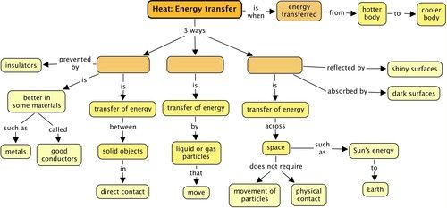
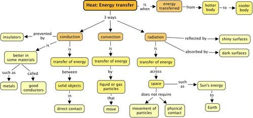
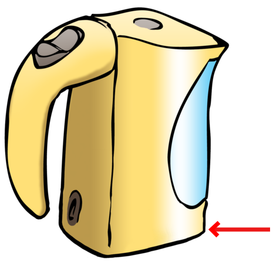

## Summary

<Callout type="note" title="Note">
- Heat is energy that is transferred from a hotter to a cooler object.
- Temperature is a measure of how hot or cold a substance feels.
- Heat (energy transfer) occurs in three ways: conduction, convection or radiation.
- During conduction, the objects must be touching each other for energy transfer to take place.
- Some materials, such as metals, conduct heat well. They are called conductors of heat.
- Some materials, such as plastics and wood, slow down or prevent conduction. They are called insulators.
- Convection is the transfer of energy within liquids or gases.
- A convection current refers to the movement of a liquid or gas during energy transfer. The liquid or gas moves upwards from the heat source (as it expands) and then downwards when the liquid or gas cools (as it contracts).
- Radiation is the transfer of energy where objects do not have to be physically touching. Radiation does not require a medium and can take place through empty space.
- The Sun's energy is transferred to Earth by radiation.
- Dark, matt surfaces are good absorbers of radiant heat
- Light and shiny surfaces are poor absorbers of radiant heat. Light, shiny surfaces reflect more radiant heat than they absorb.
</Callout>

**Concept map**

Below is a concept map showing how the different topics about heat together. You need to fill in the three different ways that energy can be transferred, as discussed in this chapter, but you cannot just put anyone into any box. You need to study the concepts which come after and explain each way of transferring energy during heating.

# Revision questions

**Problem:**
How is energy being transferred in the following photos showing different heating processes? Write down conduction, convection or radiation. Some illustrations may show more than one form. [4 marks]

| The heat from the Sun travels to Earth. | Cooking food on a braai or fire. |
| --- | --- |
| Boiling water in a metal pot. | A heater in a room. |

**Solution:**
| The heat from the Sun travels to Earth. | Cooking food on a braai or fire. |
| --- | --- |
| Radiation | Convection (and also some radiation) |
| Boiling water in a metal pot. | A heater in a room. |
| Conduction (through the metal) and convection (in the water) | Radiation and convection |

**Problem:**
In each of the following situations, identify the method of energy transfer taking place (conduction, convection, radiation).

2. A fireplace has a glass screen in front of it. The person sitting in a chair next to the fireplace chair feels hot due to ________. [1 mark]
4. When you stir your tea with a metal spoon the handle gets hot because of ________. [1 mark]
6. When you are lying on the beach your skin feels hot because of _______. [1 mark]

**Solution:**
2. radiation
4. conduction
6. radiation

**Problem:**
Draw energy transfer flow charts for the following: You buy a cup of hot chocolate and hold it in your hands on a cold winter day. [2 marks]

**Solution:**
The energy is transferred from the cup to the hands by conduction.

**NOTE:**

One of the marks is for choosing the correct direction of the energy transfer. The second mark is for drawing it in the form of a flow chart.

**Problem:**
Your parents have a metal hot water geyser and they are complaining about the amount of energy needed to keep the water hot. What can you recommend your parents could do to prevent energy loss from the geyser? Explain your answer. [4 marks]

**Solution:**
Metals are good conductors of heat and so the heat from the water is transferred out of the geyser. A (shiny foil) insulating blanket could be used to wrap around the geyser. The air between the blanket and the geyser is a poor conductor of heat so the heat loss will be slower.

**Problem:**
Explain why the heating element for a kettle is at the bottom and not at the top. [3 marks]

**Solution:**
The heating element is at the bottom because as the element transfers energy to the water, the water expands and moves upwards and the colder water (slower moving particles) will sink to the bottom, forming a convection current This cycle will ensure that all the water is heated as quickly as possible. If the element was at the top, the water at the bottom would take much longer to boil.

**NOTE:**

Learners must mention the term convection current.

**Problem:**
Explain why you think the water boils throughout the kettle pot and not just at the bottom? [2 marks]

**Solution:**
The water at the bottom of the pot gets hot and then moves to the top of the pot because of convection. This allows the cold water to sink to the bottom and heat up. This constant circulation allows all of the water to heat up and boil.

**Problem:**
Explain why you think take-away coffee is sold in styrofoam cups rather than ceramic cups. [2 marks]

**Solution:**
Normal ceramic cups are good conductors of heat and so the energy from the coffee is transferred quickly through the cup to the surroundings. The styrofoam is a poor conductor of heat and so it does not allow the energy from the coffee to move quickly to the surrounding air, so the coffee stays warmer for longer.

**Problem:**
Explain why you think two thin blankets can sometimes be warmer than one thick blanket. [2 marks]

**Solution:**
Air is trapped between the two blankets. The air is a very poor conductor of heat and so it becomes an extra insulating layer which slows down the loss of energy from your body. One blanket cannot trap as much air and so isn't as warm as two blankets.

**Problem:**
Explain why birds fluff up their feathers to stay warm, especially in winter. [2 marks]

**Solution:**
Birds fluff up their feathers so that more air gets trapped between the feathers. The air is a poor conductor of heat and so the energy from the birds body is not transferred to the surroundings.

**Problem:**
Why should you place an air conditioner at the top of a room, near the ceiling, rather than at the bottom near the floor? [2 marks]

**Solution:**
This is because cold air will move downwards, therefore cooling the room, and the hot air will rise and can therefore be removed by the air conditioner at the top of the room, near the ceiling.

**Problem:**
Imagine you want to build a small enclosure for some chickens on your property. You have an outside area for them that is made from barbed wire, and you have made a small inside, covered enclosure for them out of bricks and cement which you would like to paint. You know that it can get quite cold in winter in your area so you want the house to be as warm as possible for the chickens. What colour paint are you going to choose to paint the outside of chicken house? Will it be a dark-coloured paint, such as brown or black, or a light-coloured paint, such as white or yellow? Explain your choice. [4 marks]

**Solution:**
The best choice to keep the house as warm as possible on the inside is a dark-coloured paint. This is because the dark colours absorb more radiant heat from the Sun during the day, than the light colours, which reflect heat. The dark paint will absorb the heat and it will be transferred to the air inside of the house, making it warmer, especially during winter.

Total [30 marks]
