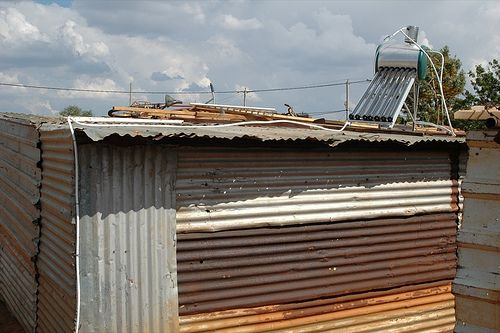
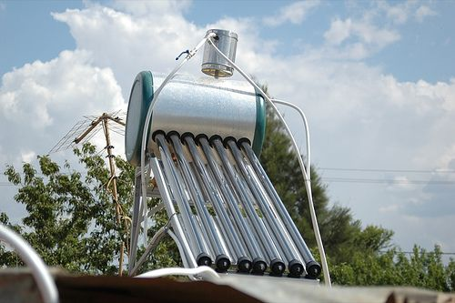
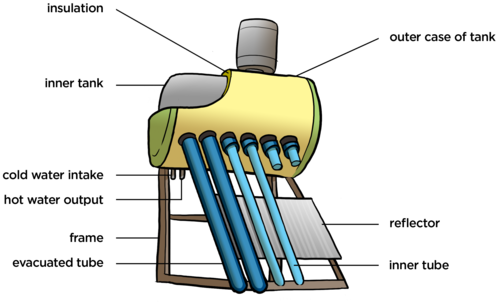
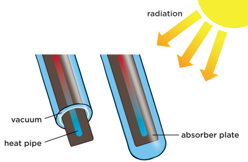

## Why do we need insulating materials?

<Callout type="note" title="Note">
- insulator
- conductor
</Callout>

Heat is the transfer of energy by conduction, convection or radiation, as we learned in the previous chapter. Often, we want this energy to be transferred for heating. For example, when you place a heater in a room, you want the energy to be transferred through convection and radiation to the room so that the room becomes warmer.

In other situations, you want to prevent energy transfer. For example, on a cold winter's day, we need to minimize heat loss from the house, so that it stays warm. Other objects, such as electric geysers, need to prevent energy transfer to the surroundings so that the water inside stays warm. Materials which are insulators can slow down or prevent energy transfer.

An example of where we want the transfer of energy to take place in some parts of the system but prevent it in other parts, is in a solar water heater. The use of a solar water heater helps to save energy. This is not only because the system is efficient at warming water, but we also use solar power which is free, whereas we pay for electricity from the national grid and it puts demands on the national demand for electricity.

We use different materials in different situations depending on whether or not we want energy transfer to take place. Let's find out why, and discover how a solar water heater works.

<Callout type="note" title="Note">
A simple demonstration showing how a solar water heater works.
</Callout>

# How do solar water heaters work?

Learners can discuss this in groups and then write down their own answers or do it individually.

**INSTRUCTIONS:**

2. Study the following diagrams which show how a solar water system works.
4. Answer the questions which follow.

There are several different types of solar water heaters. We will be looking at the most efficient heater, which uses evacuated tubes.

A solar water heater on top of a corrugated iron house.

A close up photo of a solar water heater.

The following diagram shows the different parts of the solar water heater to which we will be referring. Cold water flows in the cold water intake pipe and then down the long tubes, called **evacuated tubes**. The water warms up due to energy transfer from the Sun and it then flows into the storage tank at the top. When someone wants hot water in the house, the hot water flows out of the hot water output and down into the house.

**QUESTIONS:**

**Problem:**
Is solar power an example of a renewable or non-renewable energy source?

**Solution:**
A renewable energy source.

**NOTE:**

This links back to what learners covered in Chapter 1.

**Problem:**
When the cold water flows down the tubes, energy is transferred to the water from the Sun. What type of heating is this?

**Solution:**
Radiation.

**Problem:**
In the tubes part of the system, we want energy transfer to take place, so specific materials are used to make energy transfer as efficient as possible. There is a shiny surface underneath the tubes called a **reflector**. How does this help to increase the amount of energy that the water in the tubes receive?

**Solution:**
The reflector is a shiny surface so it does not absorb the heat, but reflects the Sun's radiant energy back up and onto the tubes, increasing the amount of energy that the water in the tubes receive.

**Problem:**
Do you see that there is a tank at the top to store the hot water? In this part of the system we want to prevent energy transfer to the outside. This tank consists of an inner tank and an outer case. If there were just these two layers, made of metal, how could heat loss from the hot water to the external environment occur?

**Solution:**
By conduction.

**Problem:**
However, something has been done to help prevent this transfer of energy. What have they done to help keep the water warm while it is stored?

**Solution:**
In between the inner and outer tank there is a thick layer of insulation. This does not conduct heat. The insulation helps to prevent the transfer of energy to the surroundings by conduction as the insulation material is a poor conductor of heat.

**Problem:**
Let's now take a closer look at the evacuated tubes in a solar water heater. Study the following diagram. The water runs down the central **heat pipe**. There is an absorber plate below each pipe and this is enclosed within two layers of tube.

Can you see that there is an inner and an outer tube? Between these tubes there is a **vacuum**. This means that the Sun's energy can still pass through to warm the water. However, when the energy is transferred to the water, and it warms up, the vacuum prevents energy from transferring back out by conduction or convection. Why is this so?

**Solution:**
For energy to be transferred by conduction or convection, it requires a medium, such as air particles. However, there is a vacuum, so it helps to insulate the inner pipe.

**Problem:**
Underneath the heat pipe there is a plate which helps to absorb radiant energy from the Sun and transfer it to the heat pipe. Why is it made of a dark material and not a light material?

**Solution:**
This is because the dark material is much better at absorbing radiant heat and transferring it to the pipe, than a light material would be.

**Problem:**
Do you see that the water at the bottom is cooler, indicated by the blue colour, and the water at the top of the tube is warmer, indicated by the red colour? When the cooler water moves to the bottom and the warmer water moves to the top, what is this called?

**Solution:**
A convection current.

**Problem:**
This movement of water helps to move the hot water out of the tubes and into the tank so that cold water can replace it.

**Solution:**

**Problem:**
Do you think the solar water heater is an energy efficient system? Why?

**Solution:**
It is a very efficient system as all the materials are carefully chosen to either enhance energy transfer or prevent it, depending on what is needed in that part of the system. This helps to save electricity as solar power is used to heat water instead of relying on an electrical geyser. It is also cheaper as solar power is free, except for the installation of the actual solar heater.

Now that we have looked at how different materials are used in different situations depending on whether we want to prevent energy transfer or allow it to take place, we are going to take a closer look at how we use those materials that prevent energy transfer.
