## Using insulating materials

Before we start, write down your own definition for an insulator of heat.

Learners should write something about it being a poor conductor of heat, or preventing energy transfer.

Which materials work well as insulators of heat? Let's first do a fun activity.

# Keep your coffee hot and your cold-drink cold

Learners must use their knowledge of the ways energy is transferred in order to come up with their own method for insulating their drinks. Let the learners be creative here, don't give them too many hints or suggestions. The activity will show you which learners have understood the energy transfer concepts from the previous chapter and which of them need more help.

There are different ways to manage this activity. You can provide the learners with a selection of materials that you want them to use or you can ask them to bring in their own materials. Making the learners bring in their own materials makes it more challenging for the learners. If you provide a selection of insulating materials then the learners will have a base from which to work and they are more likely to insulate the drink correctly the first time.

This activity is meant as an introduction to using insulating materials. The learners need to consider what they have learnt about conduction, convection and radiation in order to choose different materials for their activity.

Get the learners to develop a plan for their design before they insulate their cup. Ask them to come up with a hypothesis that they can test. Here are several hypotheses which the learners may come up with:

- "Wrapping aluminium foil around the cup will prevent energy transfer".
- "Covering the cup with cardboard will slow down heat loss."
- "Using corrugated cardboard as an insulator will slow down heat loss"
- "Wrapping a cup in layers of newspaper will prevent energy transfer."

The learners can then test their hypothesis and decide at the end whether or not it is true or false.

An additional exercise to do is to use the same size tins and wrap them in 3, 6 and 9 layers of newspaper. This clearly shows that newspaper is a very effective insulator, especially if layered.

**MATERIALS**

- kettle
- 2 identical mugs, metal or ceramic
- tea or coffee
- alcohol thermometer
- various insulating materials
- timer or stopwatch

**INSTRUCTIONS**

2. Get into groups of 3 or 4.
4. Design a method to keep a cup of tea warm for as long as possible. You may use any materials that you have at home or provided by your teacher.
6. Make your design.
8. Write a hypothesis for your planned design.
10. Fill your insulated cup with boiling hot tea.
12. Measure the temperature with a thermometer.
14. Keep the thermometer in the cup and time how long it takes to reach room temperature (approximately 25 °C)
16. Fill the uninsulated cup with boiling hot tea and time how long it takes to reach room temperature.
18. Repeat this activity using a cold drink in the cups.

**QUESTIONS:**

These answers are learner-dependent because they are based on the learner's own choice of materials and the ambient temperatures at the time of the experiment.

**Problem:**
What materials did you use to keep your tea warm?

**Solution:**
Learner-dependent answer.

**Problem:**
Why did you choose those particular materials?

**Solution:**
Learner-dependent answer.

**Problem:**
How did you attach the materials to the mug?

**Solution:**
Learner-dependent answer.

**Problem:**
Draw a labelled diagram of your design.

**Solution:**
Learner-dependent answer.

**Problem:**
How long did it take your tea to reach room temperature (25 °C)?

**Solution:**
Learner-dependent answer.

**Problem:**
What materials did you use to keep your cold drink cold?

**Solution:**
Learner-dependent answer.

**Problem:**
Why did you choose those particular materials?

**Solution:**
Learner-dependent answer.

**Problem:**
How did you attach the materials to the mug?

**Solution:**
Learner-dependent answer.

**Problem:**
Draw a labelled diagram of your design.

**Solution:**
Learner-dependent answer.

**Problem:**
How long did it take your cold drink to warm up to room temperature (25 °C)?

**Solution:**
Learner-dependent answer.

**Problem:**
Why did you also time the uninsulated cups?

**Solution:**
The uninsulated cups acts as controls for the activity. Without testing the uninsulated cups we cannot be sure of whether or not the tea would have cooled down (or the cold drink warmed up) at the same rate without the extra insulating materials.

**Problem:**
Was your hypothesis shown to be true or false?

**Solution:**
This answer will depend on the learners' hypotheses. If they hypothesise that their material will decrease heat loss and they can show that it does then their hypothesis is true. If they hypothesise that their material will decrease heat loss but the tea cools at the same rate as the control then their hypothesis is false.

What have you learned from your attempts at keeping your hot drink warm and your cold drink cool? Some materials trap heat really well and others do not. Let's now do a more formal investigation of some of the different materials to find out which is the best insulating material.

<Callout type="note" title="Note">
Do you surf? Find out how a wetsuit works.[http://videos.howstuffworks.com/discovery/35827-howstuffworks-show-episode-10-how-wetsuits-work-video.htm](http://videos.howstuffworks.com/discovery/35827-howstuffworks-show-episode-10-how-wetsuits-work-video.htm)
</Callout>

# Which is the best insulating material?

**AIM:** Write down an aim for this investigation.

To investigate which materials is the insulator of heat.

**MATERIALS AND APPARATUS:**

- 4 beakers or tins
- 4 alcohol thermometers
- aluminium foil
- fabric
- newspaper
- plastic
- kettle
- timer or stopwatch

**METHOD:**

Make sure that the layers of newspaper, plastic and fabric are the same thickness so that the thickness of the material does NOT vary in the investigation.

2. Wrap one beaker with newspaper, one beaker with plastic, one beaker with aluminium foil and the fourth beaker with fabric.
4. Boil water in a kettle.
6. Pour 250 ml of boiling water into each beaker.
8. Put a thermometer in each beaker.
10. Measure the starting temperature of the water and then measure the temperature of the water every 5 minutes for half an hour.
12. Write the measurements in the table in the results section.
14. Draw a graph representing the data you have collected.

**RESULTS AND OBSERVATIONS:**

Record your results in the following table.

| Time (minutes) | Temperature of aluminium foil beaker ( °C) | Temperature of newspaper (°C) | Temperature of plastic (°C) | Temperature of fabric (°C) |
| --- | --- | --- | --- | --- |
| 5 |  |  |  |  |
| 10 |  |  |  |  |
| 15 |  |  |  |  |
| 20 |  |  |  |  |
| 25 |  |  |  |  |
| 30 |  |  |  |  |

Use the following space to draw a line graph for each type of material. You must plot each graph on the same set of axes.

First, we need to think about which data is put on each axis.

**Problem:**
What will you plot on the horizontal x-axis? This is the independent variable.

**Solution:**
Time

**Problem:**
What will you plot on the vertical y-axis? This is the dependent variable.

**Solution:**
Temperature

**Problem:**
How are you going to show a difference between the lines for each type of material on one graph?

**Solution:**
Learners can use different colours for each type of material used.

The independent variable (time) must be plotted on the horizontal x-axis and the dependent variable (temperature) must be plotted on the vertical y-axis. The learners should plot each of the four graphs one-by-one in a different colour in order to distinguish between the lines. If they cannot use colour then make sure that they label each line carefully. The actual temperature of the water before it starts to cool will affect the results. Also, the ambient temperature of the room will also affect the temperature drop. What is important to notice is that the initial temperature drop is fast but then the rate of temperature drop decreases. This means that the shape of the graph will be a decreasing curve. Learners must provide a heading for the graph, such as "Graph showing the decrease in temperature over time when using different materials as heat insulators."

You can use Assessment Rubric 3 at the back of your Teacher's Guide if you wish to assess this graph.

**ANALYSIS:**

**Problem:**
Which of your graphs has the steepest curve?

**Solution:**
The aluminium foil has the steepest curve. This might vary though depending on the actual foil and other materials which you used.

**NOTE:**

The answers here must correlate to the learner's results.

**Problem:**
What does the steepness of the curve tell you about how quickly the material allows heat to leave the water?

**Solution:**
The steeper the curve the faster the temperature has dropped. The steep curve shows that heat has left the water quickly.

**Problem:**
Arrange the materials in order from very good insulator to poor insulators of heat.

**Solution:**
Activity-dependent answer.

**Problem:**
Which material was the best conductor of heat? Explain your choice.

**Solution:**
This depends on the learner's results. Whichever material allowed the fastest decrease in temperature is the best conductor of heat as it means that heat was easily conducted out of the warm water.

**Problem:**
Which material was the best insulator of heat? Explain your choice.

**Solution:**
The graph with the shallowest curve is the best insulator. This depends on what the learner's observed during their investigation.

**Problem:**
If you had to keep a bottle of water cold for as long as possible, which of the 4 materials would you choose? Explain your choice.

**Solution:**
Learners must suggest the insulator which had the shallowest curve on their graph.

**CONCLUSION:**

Write a conclusion for this investigation.

Learners must answer the question which was which is the best insulator. So, they can conclude, from their results, which is the best.

<Callout type="note" title="Note">
Read more about how insulating materials are used in NASA's Webb Space Telescope.[http://www.nasa.gov/content/goddard/webb-telescope-test-insulating-from-heat-and-cold/#.UjGxGSLtky2](http://www.nasa.gov/content/goddard/webb-telescope-test-insulating-from-heat-and-cold/#.UjGxGSLtky2)
</Callout>

Why is fabric a good insulator? The woven fibres of the fabric trap air between them. Air is a poor conductor of heat and so it slows heat loss through the fabric.

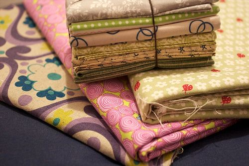

Here are some different fabrics.

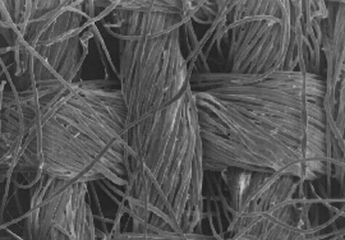

And here is a close up of the fibres making up the fabric.

Fabric is not generally used to keep our hot drinks warm. In fact, most take-away cups are made from styrofoam. Styrofoam is a good insulator of heat. It is made from polystyrene which has had air pumped through it. This makes styrofoam extremely light and the air pockets make it a very good insulator.

<Callout type="note" title="Note">
Learn more about aerogel, a space-age insulating material
</Callout>

A very useful application of the use of insulating materials is the cooler box and hot box. Look at the following photo of a cooler box.

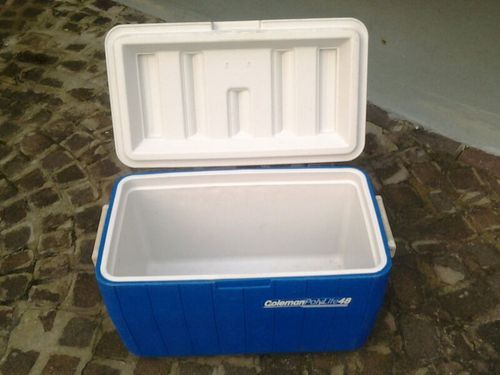

A cooler box.

Cooler boxes are used to keep food cold. You need to put ice blocks in with the food to do so. The cooler box is made from a thick layer of plastic. How does this help to keep the contents cool inside?

The thick layer of plastic acts as an insulator so heat from the surroundings is prevented/minimized from entering into the cooler box and the contents stay cold inside.

A hot box works in a similar way, but can be used to keep food warm for long periods of time. There are many ways to construct a hot box.

# Building a hot box

It would be best to do this activity as a demonstration. The quantity of blankets and towels required may be difficult for each learner to bring in to school. If you want the learners to try it then let them do it in groups. Ask learners to each bring in a towel or a blanket to school to make sure that each group has enough materials. A couple of old pillows in a box also works very well. You can also make smaller hotboxes with smaller boxes and strips of fabric rather than blankets and towels. The smaller hotboxes may not be sufficient insulation to keep a meal cooking so you could use an ice cube and try to keep that cold. A hot box can keep cold items cold as it also prevents the transfer of heat from the surroundings into the box.

This activity provides one way to make a hotbox. You can also do this as a project where learners must design and build their own hot boxes and they can also do this in groups.

The materials and instructions for building this hotbox are provided only here in the Teachers Guide in case you want learners to design, make and test their own hot box, rather than one that you have made as a demonstration.

**MATERIALS:**

- large cardboard box
- medium cardboard box (must fit inside the larger box)
- blankets
- towels
- rice and water brought to the boiling point for about five minutes. This will continue cooking if well insulated and the rice will be completely cooked after about 40 min.

**INSTRUCTIONS:**

2. Line the inside of the larger cardboard box with towels and blankets. Make sure that there is still room for the medium cardboard box to fit inside.
4. Put the medium cardboard box in the middle of the larger cardboard box.
6. Put a few small towels and blankets around the outside of the medium box. Pack the towels and blankets snugly so that the medium cardboard box cannot move around.
8. Put a pot of partially cooked rice inside the medium cardboard box, Wrap newspaper, towels and a blanket around the pot.
10. Close the lid of the medium cardboard box.
12. Put a layer of towels and blankets on top of the closed medium cardboard box and then close the large cardboard box as well. Put some more towels or blankets on top.
14. The rice will continue to cook in the hot box.

**INSTRUCTIONS:**

2. Depending on your teacher, he or she will either make a hot box as a demonstration in class, or else you are required to design and make your own hot box.
4. The hot box needs to keep a pot of rice and water brought to boiling point hot enough so it finishes cooking.
6. If you are designing and making the hot box yourself or in a group, you need to think about which materials will be the best insulators for the hot box.

**QUESTIONS:**

**Problem:**
Draw a labelled diagram of the hot box design that either you, your group or your teacher made.

**Solution:**
Learner-dependent answer. This links in with what learners do in Technology in terms of drawing their designs. Make sure that it is labelled and specifies the materials used.

**Problem:**
Why did you or your teacher use the specific materials to make the hot box?

**Solution:**
This answer depends on the materials used. For example, towels and blankets are good insulators because air is trapped between the woven fibres as well as between the layers of the fabric. The cardboard box is also a better insulator than for example a metal box or container.

**Problem:**
Why did you put rice with the water boiling, instead of cold water, in the hotbox?

**Solution:**
The food needs to be hot when it is put in so that the hotbox can trap the heat. If the food and water was cold then the hotbox would keep the heat out and the rice would not cook.

**Problem:**
If you had something cold and you wanted to keep it cold, could you use your hotbox? Explain your answer.

**Solution:**
The hotbox can keep cold items cold for a longer period of time. This is because the insulating layers will prevent energy from the outside from entering the hotbox and so the interior can stay cool.

<Callout type="note" title="Note">
A video on solar cooking
</Callout>

Keeping our homes warm in winter is also very important and there are different ways to do this. Let's look at how our homes are insulated.

# Keeping our homes warm

The following image shows how heat is lost from a house, using a colour scale to represent how much heat is lost. Red represents areas of high energy transfer, yellow is medium and green and blue are areas of low energy transfer.

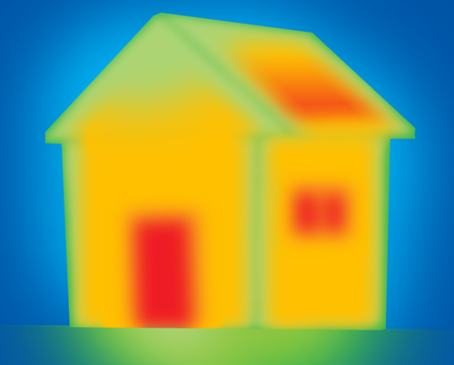

**Problem:**
Which parts of the house lose the most heat?

**Solution:**
The windows, door and roof.

**Problem:**
How is heat lost through these places?

**Solution:**
By conduction.

Convection also cools down a house, cold air is drawn in through gaps in doors and windows and is circulated through the house. Some of the heat is lost by radiation through the walls, roof and windows. Let's now make our own model houses to see how we can prevent heat loss.

The learners will now make model houses. The template is included below. If you can, photocopy the template for the learners as this would save some class time, preferably A3 size paper. If you cannot photocopy the template have the learners trace it onto a piece of paper. The learners can choose the number of windows in the house. The learners may choose to use thicker or thinner cardboard for the walls and roof. They may use fabric or cotton wool on the roof and the floor. They should try different things to regulate the internal temperature of their model house. The holes for the windows could be covered over with sellotape to simulate glass.

As an extension exercise, if you have enough class time, it would be a good idea to have each learner or group of learners make several different models. Each model can have a different number of windows and have used different insulating methods. If you do not have enough class time for each group to do more than one model then encourage different learners or groups of learners to do different models and then have the groups compare their results with other groups.

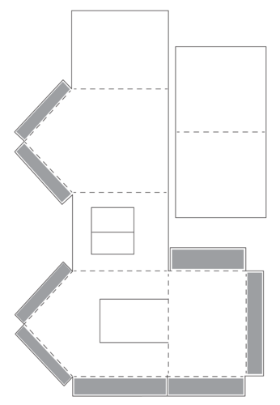

**MATERIALS:**

- model house template
- paper and cardboard
- glue
- sellotape
- pieces of fabric or cotton wool
- hole punch
- pair of scissors
- thermometer
- lamp (to simulate sunlight)
- timer or stopwatch

**INSTRUCTIONS:**

2. Your teacher might provide you with a large model house template for you to cut out. If not, copy the following template onto a large piece of cardboard or design your own template for making a house.

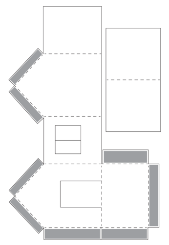

2. Cut a small hole in the roof using the hole punch. This is for the thermometer.
4. Choose the number of windows you would like your house to have.
6. Cut out the windows. Use sellotape across the hole to act as glass.
8. Cut out a piece of fabric for the floor.
10. Glue the fabric to the floor of your model house.
12. Fold along the dotted lines and then glue the shaded flaps together to make the house. Place the roof on top.
14. Insert the thermometer through the roof.
16. Set up the lamp so that it is shining directly onto your model house. An alternative is to put the houses in a sunny place. This will depend on the weather.
18. Take temperature readings every 5 minutes for half an hour.
20. Switch off the lamp, or bring your model out of the Sun, and measure the temperature as the house cools down, measure every 5 minutes for half an hour.

As an extension, ask learners what they can do to their model houses to prevent heat loss? Try it out and test it. An example of what learners could do is to line the inside of the house with cotton wool and then repeat the experiment to see if it makes a difference.

| Time (minutes) | Temperature (°C) |
| --- | --- |
| 0 |  |
| 5 |  |
| 10 |  |
| 15 |  |
| 20 |  |
| 25 |  |
| 30 |  |
| 35 |  |
| 40 |  |
| 45 |  |
| 50 |  |
| 55 |  |
| 60 |  |

Draw a line graph of temperature versus time. Do not forget to include a heading for your graph.

This graph is a line graph. The time should be on the horizontal axis and the temperature on the vertical axis. The temperature should rise and then reach a steady temperature. When the lamp is switched off the temperature should decrease and then reach a steady temperature again.

**QUESTIONS:**

**Problem:**
Why did your model house warm up when the lamp was shining on it, or when it is placed in the Sun? Use your knowledge of radiation, conduction and convection in your explanation.

**Solution:**
The energy from the lamp (Sun) transferred by radiation to the model house. The walls of the house conducted the energy through to the interior of the house. Convection of the warmer air inside the house made sure that the entire interior of the house warmed up.

**Problem:**
Why did your model house cool down when the lamp was switched off, or you brought your model back inside out of of the Sun? Use your knowledge of radiation, conduction and convection in your explanation.

**Solution:**
The warm air inside the model house rises towards the roof because of convection. The energy from the warm air is transferred to the outside because it is conducted through the roof, walls and windows.

**Problem:**
What could you have changed in your model house in order to slow down the energy transfer so that the house is not too hot or too cold?

**Solution:**
Learner-dependent answer. Each model house would need different interventions in order to improve their insulation. Some may suggest fewer windows, some may suggest using fabric on the walls or thickening the walls by using cardboard.

**Problem:**
Think about your own home. What do you think you could do to improve the insulation of your home in winter?

**Solution:**
Learner-dependent answer. The answers will depend on the socio-economic circumstances of the learners. Suggestions may vary from fitting carpets and double glazing to using cloth or cardboard to seal gaps under doors.

**Problem:**
Will the suggestions you made in the previous question also work for summer? Explain your answer.

**Solution:**
Insulators prevent heat from leaving the house but, at the same time, they also prevent heat from entering a house. This means that the house should not take in as much heat during summer but in winter the heat is trapped inside.

At this point you can also explain some of the new building regulations, such as requiring windows to be double glazed if they take up large areas in the house. This is to prevent energy loss.

In the previous chapter you learned that dark, matt surfaces are good absorbers of radiation. Light, shiny surfaces are poor absorbers and they can reflect some radiation. These properties are very important when choosing an insulating material. In extremely hot climates, such as Greece, the local people paint their houses white because the walls do not absorb as much heat during the day and therefore stay cooler inside. The position of the house in relation to the rising and setting of the Sun is also considered. For example, people will build their houses facing away from direct sunlight if they live in very hot areas.

Houses painted white in Greece to keep them cool in the hot summers.

Let's look at how some of the indigenous houses in Southern Africa make use of insulating materials in the house structure.

### Indigenous homes

The indigenous people of South Africa have many different ways of insulating their homes. Here are some pictures of different homes from different indigenous groups.

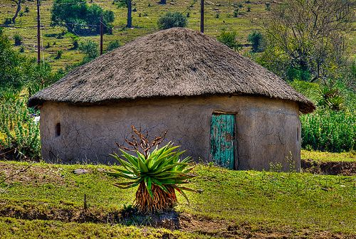

A thatched Zulu house.

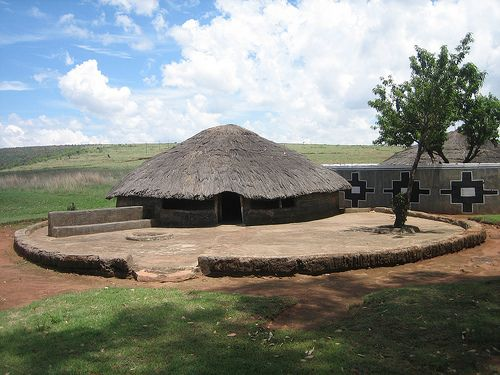

An Ndebele house.

Did you notice that the houses do not have windows, or the windows are very small? Windows allow a lot of heat to escape a building and so these designs rather leave those out. The roofs are made from thatch which is a poor conductor of heat. We know that most of the heat of a home is lost through the roof and so by using an insulating material in the roof it helps to minimise the heat loss in cold weather and heat gain in hot weather.

The roofs also extend further over the walls creating an overhang. The overhang helps to shade the walls in summer but the winter sun can still reach under the overhang. The walls are also very thick. How do you think this helps?

The thickness helps to reduce heat lost through conduction. This keeps the houses cooler in summer, but warmer in winter.

<Callout type="note" title="Note">
Are you interested in energy efficient buildings? Read more about this from the Green Building Council for South Africa.[http://www.gbcsa.org.za/](http://www.gbcsa.org.za/)
</Callout>

We have now seen how our knowledge of insulating materials can be applied in the world around us to come up with solutions for preventing heat loss. Remember, be curious to discover the possibilities.

<Callout type="note" title="Note">
- Heat is transferred by conduction, convection and radiation
- In some cases, heat transfer is advantageous, for example from a heater to the air in a room.
- In other systems, heat transfer needs to be minimised or prevented.
- Insulating materials are used to minimise heat loss or gain from systems.
- Metals are good conductors of heat. Non-metal materials are good insulators of heat. Non-metals are used as insulating materials.
- We use insulators to keep our homes warm in winter and cool in summer. This helps to conserve energy and electricity.
- Indigenous homes in Southern Africa make use of insulating materials to be energy efficient in our climate.
</Callout>

**Concept map**

Complete the following concept map by identifying the three ways in which energy is transferred.

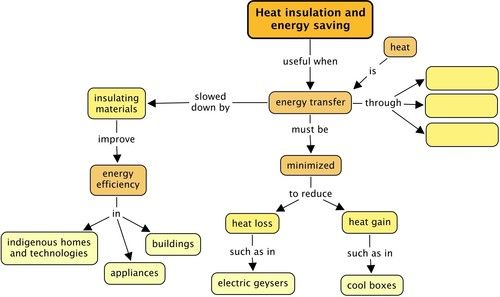

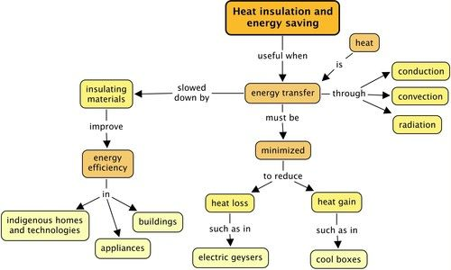

# Revision questions

**Problem:**
What is an insulator? [1 mark]

**Solution:**
An insulator is a substance which resists the transfer of energy (heat or electricity) through it.

**Problem:**
Are the following statements true or false? If they are false, explain why:

2. A tea cosy keeps the cold out. [2 marks]

**Solution:**
False. A tea cosy stops the heat from the tea from being transferred out of the tea to the surroundings.

**Note:** 'Cold' cannot be transferred. Cold is a measure of temperature.

**Problem:**
Space is empty and so it is impossible for energy to transfer between the Earth and the Sun. [2 marks]

**Solution:**
False. The sun warms the earth through radiation which can travel through a vacuum.

**Problem:**
On a cold day, insulating clothing reduces the energy transfer from your body to the surroundings. [2 marks]

**Solution:**
True

**Problem:**
A man is building a wooden house. He lives in a very cold area, especially in winter. He has space for one window. He has two choices. He can put in a large window with a single pane of glass or he can put in a smaller window which has 2 panes of glass separated by a small air space trapped in between them. Which window do you think he should use? Why did you choose that window? [3 marks]

**Solution:**
He should use the smaller double-paned window as he needs to prevent heat loss in a cold environment. The air space slows the heat loss from conduction because the air is a poor conductor of heat. Also, the smaller window means that there is a smaller surface area for heat to escape.

**Problem:**
Take away coffee is often served in paper cups with a corrugated cardboard layer on the outside. Why are these materials used? [4 marks]

**Solution:**
The coffee is very hot and the energy transfer to the surroundings needs to be reduced so that it stays hotter for longer. Paper is a poor conductor of heat. The corrugated cardboard allows a layer of air between the cardboard and the cup. Air is a poor conductor of heat. This means that less energy is transferred from the coffee to the person's hand and surroundings. Corrugated also means that there is less area of contact between the person's fingers and the cup. there is therefore less conduction so the person is less likely to burn their fingers.

**Problem:**
You have designed a new material for insulating coffee cups. You're hoping to make money from this new material but you have to test that it works better than other materials. You arrange a blind test to convince a group of people who might invest in your new company so you can develop it.

The scientist who is performing the test is given 4 different materials, labelled A, B, C and D. One of the 4 materials is your new material you have developed, but she does not know which one it is. This is called a blind test. She takes 4 beakers and wraps each one in a different material. She pours hot water into each beaker. She measures the temperature of the water at the start of the experiment and again 30 minutes later.

The following table shows the results of her experiment.

| Time (minutes) | Material A (°C) | Material B (°C) | Material C (°C) | Material D (°C) |
| --- | --- | --- | --- | --- |
| 0 | 70 | 70 | 70 | 70 |
| 30 | 34 | 30 | 50 | 48 |

2. What is the independent variable for this experiment? [1 mark]
4. What is the dependent variable for this experiment? [1 mark]
6. Draw a bar graph of the material collected. Show the starting temperature and end temperature for each material as separate bars. [8 marks]
8. After the experiment the results show that your material is the best insulator. Based on the results, which material (A,B,C or D) is yours? [2 marks]
10. How do you know? [2 marks]

**Solution:**
2. The type of material is the independent variable.
4. The temperature of the water is the dependent variable.
6. Here is an example graph. Marks are allocated as follows:
   0.5 marks for each of the bars [0.5 x 8 = 4 marks]
   Appropriate heading [1 mark]
   1 mark each of the headings for the axes [1 x 2 = 2 marks]
   Putting the right variables on each axis. [1 mark]
   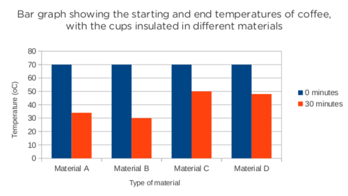
8. Material C is your material.
10. Material C shows the smallest drop in temperature which means that the material prevented the most energy from transferring to the surroundings.

**Problem:**
How does a thick woollen jersey help to prevent heat loss? [2 marks]

**Solution:**
The wool of the jersey acts as an insulating material as it is a poor conductor of heat. The thick jersey also traps a layer of air around the body. Energy from the body is transferred to this air via conduction. This warm air is unable to move away from the body because of the thick wool. The fibres of the wool trap air and the air is a poor conductor of heat.

**Problem:**
Look at the following photo showing the inside of a ceiling in a house being constructed. Do you see the pink material?

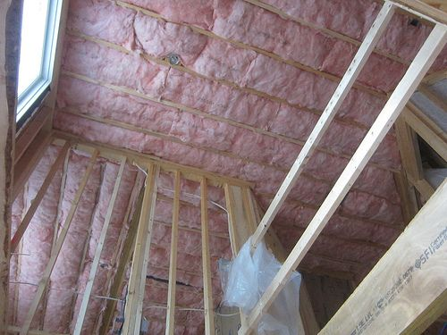

The ceiling in a new house being built.

2. What do you think this is for? [1 marks]
4. How will it work? [2 marks]
6. What type of climate do you think this house is being built in? Why? [2 marks]

**Solution:**
2. The pink material is an insulator to prevent heat loss.
4. The material is a poor conductor of heat and so it minimizes heat from being transferred from the air in the house, through the roof and to the outside. The material also traps air in it, and the air is also a poor conductor of heat, increasing the insulation.
6. It is probably being built in a cold climate as extra measures are being taken to reduce heat loss from the house.

**Problem:**
Marathon runners are often given thermal blankets at the end of a long race which are made from plastic and have a shiny surface. This very thin, light blanket does not look very warm at all.

2. How do you think it works? [2 marks]
4. You might think that a wool blanket would be better for this purpose. why do you think the race organizers rather use these plastic blankets? [2 marks]

**Solution:**
2. The plastic is an insulator. The runners bodies get very hot during their race and so their bodies try to cool down by sweating. If all that heat escapes their bodies, the runners will cool down too quickly, resulting in cramps and they could get sick. The plastic traps the heat below the blanket. The reflective surface stops the blanket from emitting any heat to the surroundings.
4. This is open to interpretation by the learners. The main reason is that the plastic blankets are much cheaper and disposable, and since they might be handing them out to many runners, it is more economical.

**Problem:**
Study the following diagram showing the parts that make up a solar water heating system. This is a different type to the one we looked at in the beginning of the chapter. In this solar water heater, instead of evacuated tubes, there is a flat solar panel, called a collector.

                        >

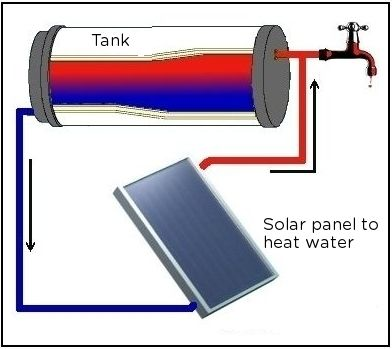

2. What are the parts that make up this system? [3 marks]
4. Why does it make sense to have the outlet pipe for the tank to go to the solar panel at the bottom of the tank? [2 mark]
6. Why do you think the tap is at the top of the tank? [2 marks]
8. What sort of covering do you think this tank should have to make it the most efficient system? [2 marks]

**Solution:**
2. The tank, the connecting pipes and the solar panel heater.
4. This is because as the water in the tank cools, it moves to the bottom (convection current) so the pipe at the bottom funnels this water to the heater to be warmed again.
6. Similarly to the previous question, the warm water is pumped from the solar panel heater and into the top of the tank. The warm water collects at the top of the tank as warm water rises (convection current). So, it makes sense to have the tap at the top of the tank to collect the water while it is warm. If the tap was at the bottom, the water would be colder.
8. It should be covered in an insulating material to conserve heat inside the water and reduce heat loss to the surroundings by conduction.

Total [48 marks]
