# Energy transfer to surroundings

**Chapter overview**

1 week

This chapter follows on from the last chapter where we mentioned that heat can be 'lost' as energy is transferred to the surroundings. This chapter now explains that within a system, there is useful energy which is transferred to the desired object or place, but no process is 100% efficient. Energy can be transferred to the surroundings rather than to the object or part of the system that you want it to transfer to. This is considered a waste of energy and systems are designed to try minimize this waste so that they are more efficient. There is always some loss of energy (wasted energy) and so there are always by-products to energy production. Some of the by-products are harmful to the environment.

Important to note is that CAPS makes the following statement:

- *'The output energy in a system is always less than the input energy, because some of the energy escapes to the environment.'*

This is **not correct** as the output energy is always equal to the input energy as energy is conserved within systems. The statement should rather state:

- *'The output energy in a system is always less than the input energy, because some of the energy escapes to the environment.'*

The wasted energy is still part of the output energy from the system, it is just not useful.

1.1 Useful and "wasted" energy (3 hours)

| Tasks | Skills | Recommendation |
| --- | --- | --- |
| Activity: Useful outputs from energy systems | Accessing and recalling information, identifying and classifying | Suggested |
| Activity: Energy transfers in systems | Accessing and recalling information, identifying and classifying | CAPS suggested |
| Activity: Drawing Sankey diagrams | Interpreting, sorting and classifying, communicating information graphically | Suggested |
| Activity: Researching energy transfers | Researching, accessing and recalling information, interpreting, sorting and classifying, communicating information; written, graphically | CAPS suggested |

<Callout type="note" title="Note">
- What sort of useful energy output do some systems produce?
- What is meant by "wasted" energy?
- What is a Sankey diagram?
- How do we draw Sankey diagrams?
</Callout>

## Useful and wasted energy

<Callout type="note" title="Note">
- Sankey diagram
- input
- output
</Callout>

The learners will not have seen **Sankey diagrams** before. You should explain the usefulness of representing processes using pictures. Illustrations make a quick, visual impact on the viewer which makes it easier to understand a process. A Sankey diagram is a visual representation of an energy process showing the input energy and the output energy. Sankey diagrams should be drawn neatly and as close to scale as possible. Take the time to draw several examples on the board so that the learners see that all energy processes have more than one output energy type.

This term we have been looking at energy transfers within systems. Systems have an input energy and an output energy. Systems such as appliances, tools, vehicles and machines provide us with a useful output. Let's look at some examples to identify what these outputs are in some systems.

# Useful outputs from energy systems

**INSTRUCTIONS:**

Look at each of the photos and identify what is useful to use from this system.

| System | What useful output does it provide us with? |
| --- | --- |
| A light bulb. http://www.flickr.com/photos/nikonfilm35/4209619566/ |  |
| An electric fan. http://www.flickr.com/photos/_wick/5861380711/ |  |
| An electric iron. |  |

| System | What useful output does it provide us with? |
| --- | --- |
| A light bulb. http://www.flickr.com/photos/nikonfilm35/4209619566/ | Light |
| An electric fan. http://www.flickr.com/photos/_wick/5861380711/ | Movement |
| An electric iron. | Thermal energy |

What was the input for each of these systems?

Electricity/electrical energy.

Whenever we use an appliance or a machine we are transferring energy from one object to another. Not all the energy is transferred where we want it, a lot of it is transferred to the surroundings where it does not help us achieve our aims. The energy which is transferred to the surroundings is "**wasted**".

<Callout type="note" title="Note">
Watch how this chocolate rabbit melts beneath an energy-inefficient light bulb.
</Callout>

We can use a **Sankey diagram** to show how the energy is transferred in a system. This gives us a picture of what is happening and shows the input energy and how the output energy is made up of useful energy (arrow at the top) and wasted energy (arrow going to the bottom). Have a look at the following general example.

<Callout type="note" title="Note">
Sankey diagrams are named after the Irish Captain Matthew Sankey, who first used this type of diagram in 1898 in a publication on the energy efficiency of a steam engine.
</Callout>

The width of the arrows tell us something in these diagrams. The input energy is the width of the original arrow. The width of both the output energy arrows (useful and wasted) add up to the width of the input arrow. Why do you think this is so? Think back to what you learned about energy within systems in Chapter 2.

This is because energy is neither created nor destroyed, but conserved within a system. So the input must equal the output energy in a system.

Sankey diagrams are drawn to scale so that the width of the arrows gives us a visual idea of how much energy is useful and how much is wasted. In the diagram above, you can see that only a small part of the input energy was useful and a large amount of the input was wasted by being transferred to the surroundings. An efficient system is one where the useful output energy is only slightly smaller than the input energy. An inefficient system has a lot of wasted energy. Do you think this is an efficient energy system? Why?

No, it is not efficient as a lot of the energy is wasted.

This brings us to our next point of how efficient an energy system is. If the wasted energy is much larger than the useful energy output, then the system is not energy efficient. The above Sankey diagram actually shows the energy transfers for a light bulb. You identified the useful energy output as light in the last activity. What do you think the wasted energy output is? Where does it go?

It is lost as heat, as energy is transferred to the surrounding air.

Do you see that an incandescent light bulb is actually not a very efficient system? This is because a lot of the energy is lost as heat as energy is transferred to the surroundings. Is there something more efficient? Look at the photo of a fluorescent light bulb.

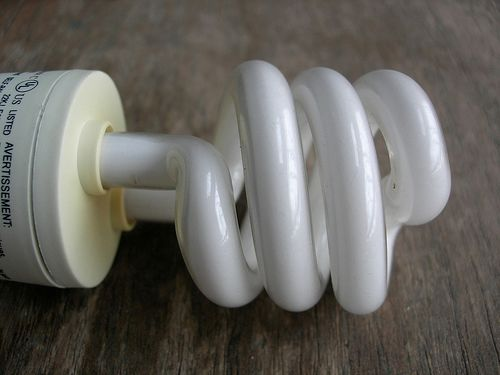

A fluorescent light bulb.

A fluorescent light bulb is much more efficient than incandescent light bulbs which use a heated wire to produce light. Most of the energy is lost as it is transferred to the surrounding air from the metal filament. In a fluorescent light bulb, less energy is lost to the surroundings and more energy is transferred to useful light energy. Use this information to draw a Sankey diagram for a fluorescent light bulb in the space below.

Learner's diagram should look as follows:

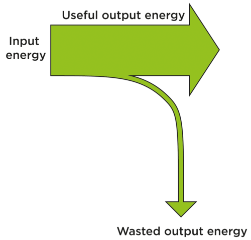

Let's look at another example. Look at the lady in the photo using an electric drill. The electrical energy from the drill is transferred to the drill bit as kinetic energy. The drill bit turns and drills into the metal. But the drill also makes a lot of noise. Energy is used to make sound and the drill bits get hot, so some of the energy is converted into thermal energy. This means that some of the electrical energy has been transferred to the surroundings as sound and thermal energy. This is energy that has been "wasted" because the sound and thermal energy are not useful to us.

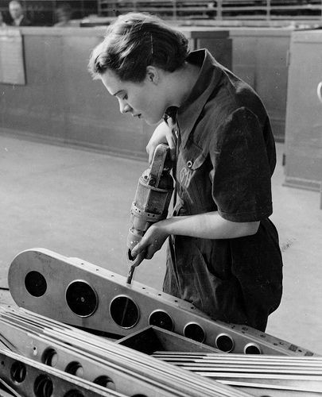

A lady using an electric drill to make a hole in an aeroplane part.

Complete the following Sankey diagram by writing in what the energy input is, and then the energy outputs.

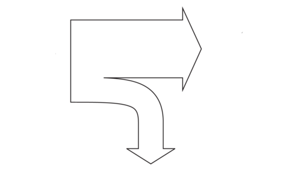

Learner's Sankey diagram should look as follows with the labels:

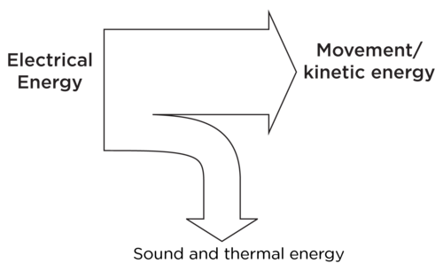

In order to draw a Sankey diagram you need to think carefully about the input energy and how the input energy is transferred to the surroundings. Let's practice this a bit more in the following activity.

# Energy transfers in systems

**INSTRUCTIONS :**

2. Look at the following diagrams/photos of appliances.
4. Complete the tables showing the energy transfers for each diagram/photo. The first one has been completed for you.

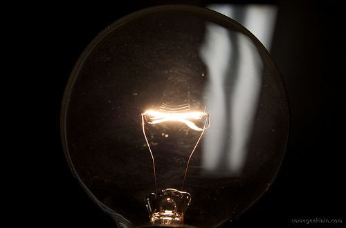

Filament in a light bulb.

| Energy INPUT | Useful Energy OUTPUT | Wasted energy OUTPUT |
| --- | --- | --- |

| Energy INPUT | Useful Energy OUTPUT | Wasted energy OUTPUT |
| --- | --- | --- |
| electricity | light | thermal energy |

Burning candles.

| Energy INPUT | Useful Energy OUTPUT | Wasted energy OUTPUT |
| --- | --- | --- |

| Energy INPUT | Useful Energy OUTPUT | Wasted energy OUTPUT |
| --- | --- | --- |
| potential energy in wax | light | thermal energy |

An electric beater.

| Energy INPUT | Useful Energy OUTPUT | Wasted energy OUTPUT |
| --- | --- | --- |

| Energy INPUT | Useful Energy OUTPUT | Wasted energy OUTPUT |
| --- | --- | --- |
| electricity | movement/kinetic energy | sound, thermal energy |

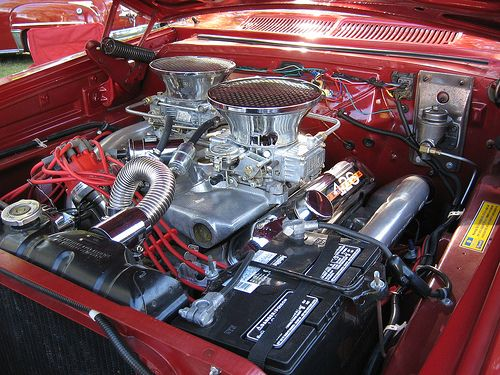

A car engine.

| Energy INPUT | Useful Energy OUTPUT | Wasted energy OUTPUT |
| --- | --- | --- |

| Energy INPUT | Useful Energy OUTPUT | Wasted energy OUTPUT |
| --- | --- | --- |
| petrol/potential energy from burning fuel | kinetic energy | thermal energy, sound |

Welding metal together.

| Energy INPUT | Useful Energy OUTPUT | Wasted energy OUTPUT |
| --- | --- | --- |

| Energy INPUT | Useful Energy OUTPUT | Wasted energy OUTPUT |
| --- | --- | --- |
| electrical energy | thermal energy | light, sound |

Athletes running.

| Energy INPUT | Useful Energy OUTPUT | Wasted energy OUTPUT |
| --- | --- | --- |

| Energy INPUT | Useful Energy OUTPUT | Wasted energy OUTPUT |
| --- | --- | --- |
| potential energy in food | kinetic energy | thermal energy, sound |

A television.

| Energy INPUT | Useful Energy OUTPUT | Wasted energy OUTPUT |
| --- | --- | --- |

| Energy INPUT | Useful Energy OUTPUT | Wasted energy OUTPUT |
| --- | --- | --- |
| electrical energy | light, sound | thermal energy |

Now that we have identified the energy transfers in each system and the input and output energy, let's practice drawing some more Sankey diagrams.

<Callout type="note" title="Note">
Video on drawing a basic Sankey diagram.
</Callout>

# Drawing Sankey diagrams

Let's look at the example of a filament light bulb to draw a Sankey diagram. A filament light bulb only uses about 10101010101010101010% of the input energy to generate light, the rest is "wasted" because it warms up the surrounding air without producing any light. This means that our Sankey diagram must split into two parts: one for the light and one for the thermal energy which is transferred to the surroundings (heat). The thermal energy arrow must be 90% of the width of the input arrow and the light arrow must be 10% of the width of the input arrow.

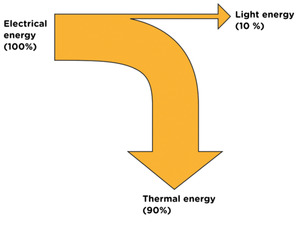

**INSTRUCTIONS:**

2. Now draw a Sankey diagram for some of the appliances from the last activity, which are listed below.
4. A description of the energy transfers has been provided for each appliance.
6. Concentrate on showing how the input energy is split between useful energy and wasted energy. Remember that the width of the arrow must show how much energy is transferred. A thick arrow means a large amount of energy, a thin arrow means a small amount of energy.
8. Show the various input and output energies and the percentages.

**Electric beater:**

The electric beater transfers 70% of the input energy to kinetic energy to beat the food and 30% is wasted output energy in the form of thermal energy and sound.

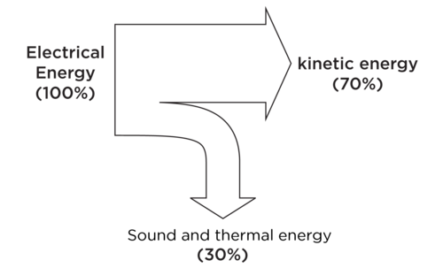

**Car engine:**

The car engine transfers only 30% of the input energy to move the car and 70% is wasted as sound and thermal energy.

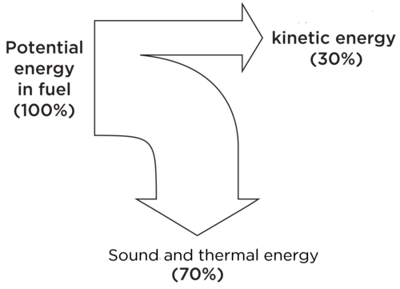

**Television:**

The television uses 80% of the input energy to create the images on the screen and sound and 20% is wasted as thermal energy.

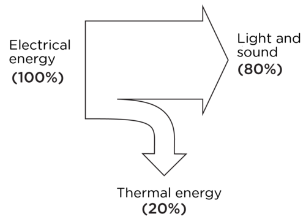

**QUESTIONS:**

**Problem:**
Which is the most efficient system in the above three examples? Why?

**Solution:**
The television as most of the energy input (80%) is transferred to useful output (light and sound) and only 20% is lost as thermal energy.

**Problem:**
Which is the least efficient system in the above three examples? Why?

**Solution:**
The car engine as more of the energy input (70%) is wasted than the amount transferred to useful energy to move the car (30%).

Most of our everyday activities require some form of electrical energy. Electricity is produced by burning fuels and transforming the chemical potential energy into kinetic energy to generate electricity. Fossil fuels, such as coal, store huge amounts of energy but we can only harness a small percentage of that energy. A lot of the energy is transferred to the surroundings in the form of heat, sound and light.

# Researching energy transfers

This is a research activity. If your learners have access to the internet and/or a library then allow them to spend some time researching the energy transfers in a power plant and a car engine. If your learners do not have access to the internet then it would be a good idea to print out some information from various websites that can be handed out to the class. You could let the printed information circulate through the class so that you do not need as many copies. This will save on paper and printing costs.

In this activity, they will first see how the wasted energy can be in more than one form and how to represent this in a Sankey diagram for a car engine. Learners will then research a power plant. You can get the learners to work in groups to find the information but make sure that each learner is able to write their own paragraph. This will give you a sense of whether or not the learner has understood what they have researched.

Here is a resource for reference: [http://www.bbc.co.uk/schools/gcsebitesize/science/21c_pre_2011/energy/generatingelectricityrev4.shtml](http://www.bbc.co.uk/schools/gcsebitesize/science/21c_pre_2011/energy/generatingelectricityrev4.shtml)

<Callout type="note" title="Note">
In our previous Sankey diagrams, we just had one arrow for wasted energy output, but it can split into more than one arrow to represent the different ways in which energy is wasted. There could also be more than one arrow for the useful energy, for example in the TV diagram above, light and sound are both useful and could be represented by two arrows.
</Callout>

In the last activity we looked at the energy transfers in a car engine. However, we only used one arrow to represent the wasted energy. We can show a difference between the ways in which energy is wasted in a Sankey diagram. Use the following information to label the Sankey diagram:

- The input energy in a car engine is supplied by the combustion of petrol.
- Only 30% of the energy is transferred to useful output energy as movement.
- About 70% of the energy is transferred to the surroundings in the form of thermal energy and sound. Some of the energy is lost in cooling down the engine.
  - 40% is lost as thermal to the surroundings.
  - 20% is lost in cooling the engine.
  - 10% is lost as sound.

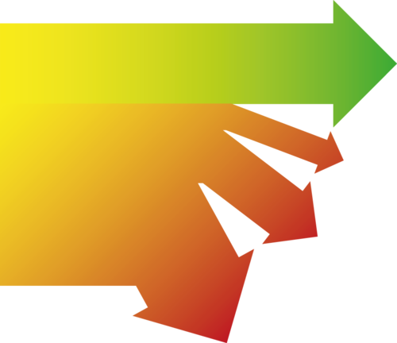

This is the labeled Sankey diagram:

In a power station, energy is transferred through the system in order to produce electricity. During the transfer of energy through the system, some of the energy is wasted.

Use the internet or other resources to find the different ways in which energy is transferred to the surroundings as wasted energy during the production of electricity in a power plant.

Write a short paragraph to explain the energy transfers. How is the input energy transferred through the system and where is the wasted energy lost?

The paragraph should include the following information:

- Coal is burnt and the energy is transferred to the water and used to boil the water. Some of the energy is lost during this process.
- The steam from the boiling water is used to turn the turbine. The kinetic energy of the steam is transferred to the turbine. Some of the energy is lost to the surroundings as sound and thermal energy.
- The kinetic energy of the turbine is transferred to the generator. Some of the energy is lost to the surroundings as sound and thermal energy.
- The kinetic energy of the generator is used to generate electricity.

Draw a Sankey diagram for the energy transfers.

An example for a Sankey diagram for a power plant is given below. You can also see what learners have found out and then draw one on the board to illustrate the transfers.

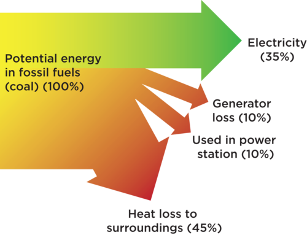

<Callout type="note" title="Note">
Remember, energy is measured in joules (J).
</Callout>

<Callout type="note" title="Note">
- Energy entering a system is called the input energy.
- The energy is transferred in a system to provide a useful output energy.
- Tools, appliances, vehicles and machines all provide useful energy outputs.
- Not all of the input energy is transferred to a useful output. Some of the energy is wasted or lost. The useful output is therefore less than the input energy as some of the output energy is wasted.
- An example is a light bulb where the input is electricity and the useful output is light. However, a large amount of the energy is lost to the surroundings as thermal energy.
- The efficiency of a system is determined by how much of the input energy is transferred to useful output energy. The greater the wasted output energy, the less efficient the system.
- A Sankey diagram is used to show the energy transfers in a system.
- In a Sankey diagram, the arrows represent the portion of the input energy which is transferred to useful energy output and the portion which is transferred to the surroundings and wasted.
</Callout>

**Concept map**

Complete the concept map by giving two examples of systems where energy is transferred to the surroundings and "wasted" as sound and thermal energy, and one example of where the wasted energy output is light.

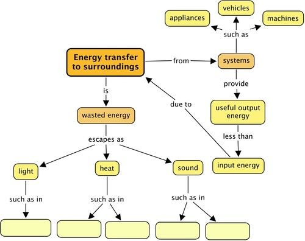

Teacher's version. The examples given here are not the only examples. Learners can use any of the examples discussed in the chapter which are appropriate.

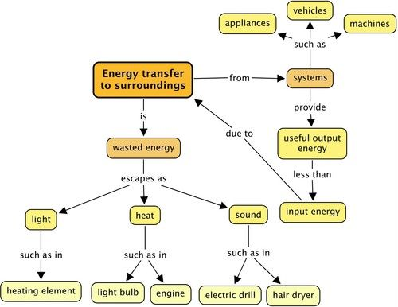

# Revision questions

**Problem:**
What is meant by "wasted" energy? [2 marks]

**Solution:**
In an energy system, some of the energy is transferred to the surroundings in ways which we did not intend or are not useful. This amount of energy serves no useful purpose and so it is "wasted".

**Problem:**
Draw a simple Sankey diagram to show the energy transfers in a system where the wasted energy output is more than the useful energy output. [4 marks]

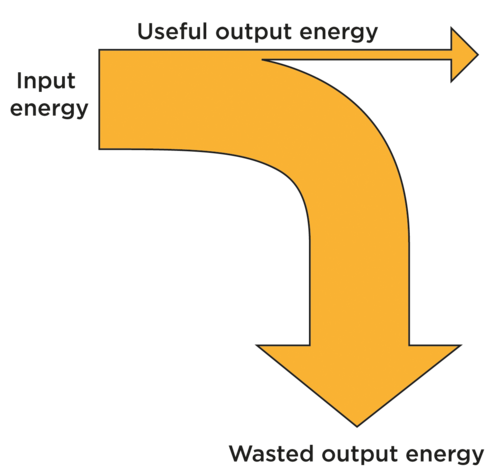

**Solution:**
In the chapter, learners used percentages to draw their Sankey diagrams. The following is an extension and starts off with a simple example which they have already seen in the chapter, namely a light bulb, but the energy transfers were represented as percentages. In the first example here, we now start off with 100 J instead of 100%. The Sankey diagram will be straightforward to draw. However, in the subsequent examples, the input energy is more than 100 J. Learners do not need to calculate the percentages, but the thickness of the arrows should be representative of the amount transferred.

**Problem:**
For each of the following situations, draw a labelled Sankey diagram to show the amount of input energy, useful energy and wasted energy.

2. An electrical torch converts 100 joules (J) of electrical energy to 10 J of light energy and 90 J of thermal energy. [3 marks]
   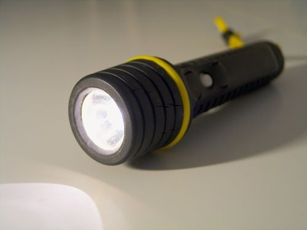
   An electric torch.
4. A television has an energy output of 500 J. 400 J is in the form of light. 50 J is in the form of sound and 50 J is thermal energy. [3 marks]
   
   A television set.
6. A hair dryer converts 300 J of energy into 150 J of kinetic energy, 100 J of thermal energy and 50 J of sound energy. [3 marks]
   
   A hair dryer.[http://www.flickr.com/photos/sunshinecity/2336638849/](http://www.flickr.com/photos/sunshinecity/2336638849/)

**Solution:**
- 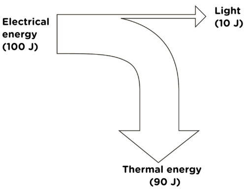
- 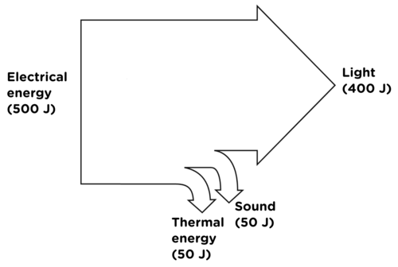
- 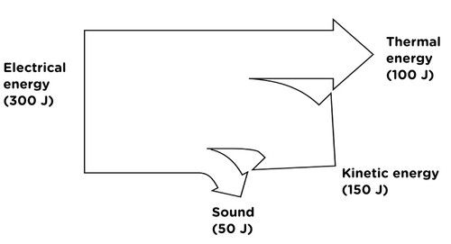

**Problem:**
Write a description of the energy transfers in each of the situations in question 2. [6 marks]

**Solution:**
a. The potential energy from the batteries in the torch is transferred to the filament of the bulb. The energy is transferred to the surroundings as thermal energy and light. Most of the energy is transferred as thermal energy which is not useful and only some of the energy is transferred as light.

b. The energy from the TV is transferred to the surroundings as thermal energy, sound and light. The light and sound are useful because they are the images and sounds we want to hear. The heat is wasted energy.

c. The energy from the hair dryer is used to heat the air and dry our hair. Two thirds of the energy is useful thermal energy but one third is transferred as sound, which is not useful to us.

**Problem:**
What is the difference between a filament light bulb and an energy saving light bulb? [2 marks]

**Solution:**
A filament light bulb uses a metal filament and an energy saving light bulb uses a fluorescent gas to provide light.

**Problem:**
Why is an energy saving light bulb better at saving energy than a filament light bulb? [3 marks]

**Solution:**
A lot of the energy used to make a filament bulb glow is used to heat the metal to make the metal glow. This means that a lot of the energy is wasted as thermal energy when we actually want light. Energy saving bulbs don't have to heat the gas before it will glow and so it wastes less energy.

**Problem:**
In the last chapter we looked at insulating materials and how they help reduce energy transfer. Use this knowledge, and what you have learned in this chapter about input energy, useful output energy and wasted energy, to explain why an electric geyser should have an insulating layer on the outside. [4 marks]

**Solution:**
An electric geyser transfers electricity to thermal energy in the water particles as the water is warmed up. The useful output is the thermal energy to warm the water. However, some of this thermal energy can escape from geyser to the surroundings. This is therefore wasted. In order to make the geyser system more efficient so that the useful energy output is greater and the thermal energy loss is minimized, the geyser should have an insulating covering, to reduce energy transfer to the surroundings by conduction.

**Problem:**
In the electric geyser, the heating element is placed near the bottom of the geyser. Why is this? [2 marks]

**Solution:**
The heating element is placed at the bottom as this is more efficient because as the water warms up due to the transfer of energy, the heated water expands and moves upwards, and the cold water moves down in a convection current, thereby warming all the water.

This links back to the previous chapters so that knowledge is revised and reinforced.

Total [32 marks]
