## Energy transfers in the national grid

<Callout type="note" title="Note">
- national electricity grid
- transformer
- pylon
- consumption
- Eskom
</Callout>

Do you remember learning about the mains electricity supply in Gr. 6 Energy and Change? We learned that the electricity that is used to power our homes, schools, shops and other buildings is generated in power stations and delivered to us in the **national electricity grid**. In this chapter we are going to be looking in more detail at how electricity is generated and delivered to the consumers.

<Callout type="note" title="Note">
Great video that provides a comprehensive overview of where energy comes from and how it is distributed via the national grid.
</Callout>

The visit box refers to an excellent video on the national grid and summarises where energy comes from, how it is harnessed, and how it is distributed. It links back to work covered in Gr. 5 and Gr. 6. It does, however, only refer to the national grid of the UK and USA. You could use this as an opportunity to discuss the South African national grid in contrast to international electricity grids and supply systems.

### The national grid is a system

Let's look at the different parts of the national electricity grid.

# Overview of the national electricity grid

The following is a diagram of the national electricity grid. This gives you an overview of the process and different steps that we will be discussing.

**QUESTIONS:**

Some of the questions here link back to what was covered in the earlier chapters this term, which serves to revise concepts and also create connections between concepts. This reinforces learning.

<Callout type="note" title="Note">
In the simple circuit, the circuit is completed as the wire goes from the bulb back to the battery. We cannot see this in the national electricity grid, but there are also power lines which connect back to the station to complete the circuit.
</Callout>

**Problem:**
Write your own definition of a system.

**Solution:**
A system is a set of parts that function together as a whole.

**Problem:**
What does the Law of Conservation of energy tell us about the energy in a system?

**Solution:**
The energy is conserved in a system, it is neither created nor destroyed.

**Problem:**
Look at the diagram of the national electricity grid. Do you think it is a system? Why?

**Solution:**
Yes, it is a system as it is made up of different parts, such as the power station, transmission lines, buildings, which function together to generate and deliver electricity.

**Problem:**
The national electricity grid is actually a big electrical circuit. Look at the following diagram of a simple electric circuit that you might have made in class and the diagram of the national grid. We can draw similarities between this circuit and the national electricity grid to understand it.

**Solution:**

**Problem:**
The battery is the source of potential energy in the simple circuit. What generates electricity in the national electricity grid?

**Solution:**
The power station.

**Problem:**
In the simple circuit, the conducting wires transmit the electricity in the circuit. What does this job in the national electricity grid?

**Solution:**
The transmission power lines.

**Problem:**
In the simple circuit, the useful output energy is to make the light bulb light up. What are some of the useful outputs in the buildings where the electricity is delivered to in the national electricity grid.

**Solution:**
There are many useful outputs, such as lights in houses, schools, heaters, warming water in geysers, running any appliances or tools, etc.

**Problem:**
In Chapter 1 of this term, we discussed sources of energy. What is the source of energy for the power station in the diagram?

**Solution:**
Coal.

**Problem:**
Is this a renewable or non-renewable energy source? Why?

**Solution:**
It is non-renewable as there is only a limited amount of coal on Earth. It is not being regenerated at a fast enough rate for it to be renewable.

**Problem:**
We can divide the national electricity grid up into 4 main stages. These are:

**A: Generation** (this is where electricity is generated)

**B: Transmission** (the electricity enters the power lines of the national grids and is transmitted)

**C: Distribution** (the electricity is distributed at substations to various towns and areas)

**D: Consumers** (this is where the electricity is transferred to useful energy outputs)

Use this information to write the letters A, B, C and D on the diagram of the national electricity grid to label these stages.

**Solution:**
The learners should write the letters in the approximate places as shown below:

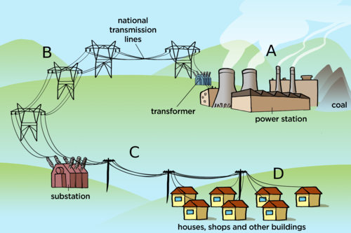

Let's now take a closer look at the first stage in the national electricity grid, namely how electricity is generated.

### How electricity is generated and supplied

<Callout type="note" title="Note">
- turbine
- generator
- dynamo
- solenoid
- geyser
</Callout>

Do you remember that in Chapter 2 we looked at another renewable way that electricity is generated using a hydropower plant. The water in the dam was used to turn the **turbine** to generate electricity. What energy did the water have when it was at the top in the dam?

Potential energy.

What was this energy transferred to as the water fell and turned the turbine?

It is transferred to kinetic energy.

In South Africa most of the power stations use coal for fuel. We are therefore going to learn more about how coal-powered power stations work. The coal is mined out of the earth. The coal is transported to the power station in large trucks or trains.

<Callout type="note" title="Note">
We will learn about how coal is formed next term in Planet Earth and Beyond.
</Callout>

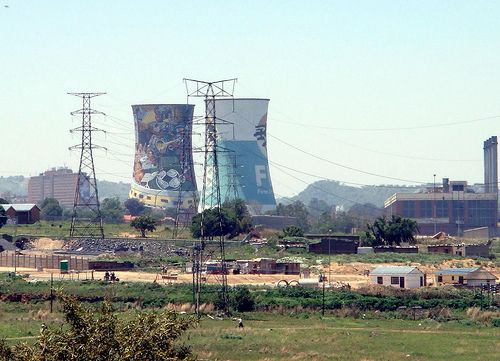

This is the Orlando Power Station in Soweto which served Johannesburg for 50 years from 1951. It is not used anymore. The painted cooling towers are seen the most prominently, but the building to the right is also part of the power station.

<Callout type="note" title="Note">
The cooling tower on the left in the photo is covered in the largest mural painting in South Africa.
</Callout>

Let's take a closer look at what happens inside a power station. Have a look at the following diagram.

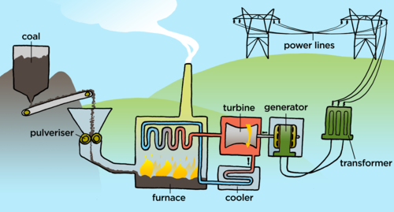

2. The large chunks of coal are first crushed into a fine powder. This is called **pulverisation**.
4. The coal is then transported to a **furnace** where it is burnt.
6. The thermal energy from the burning coal is used to boil water and generate **steam**.
8. The steam pushes the blades of the **turbine** and so the turbine spins.
10. The turbine is connected to the shaft of the **generator** which then turns large magnets within wire coils, which generates electricity.
12. The **electric current** is sent through the **power lines** to businesses and homes.

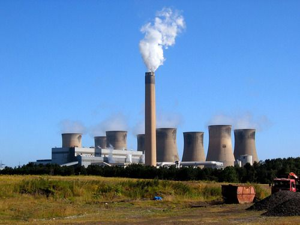

A coal-powered power station.

Now that we know the basic process for producing electricity, let's look more closely at how energy is transferred from one part to another in the system.

### Energy transfers in the national grid

In a coal-powered power station, the potential energy stored in the coal is used to boil water to produce steam.

The thermal energy in the steam is transferred to a turbine. This allows the turbine to turn which means that the turbine now has kinetic energy. Can you see how energy is transferred from a thermal system to a mechanical system?

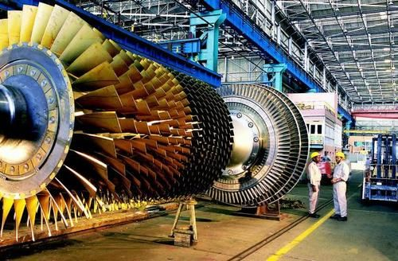

A steam turbine with the outer case removed.

How does the steam make the turbine turn? Let's make a simple turbine (pinwheel) and see how it works.

# Turning a pinwheel

If you do not have enough time in class to have each learner make their own pinwheel then either make a few before class that the learners can use or just make one to use as a demonstration. You may also be able to purchase small pinwheels to save class time.

Some kettles may produce a weaker stream of steam and so it would be a good idea to test the kettle with a paper pinwheel before doing it with the class. You can also watch the video provided in the Visit box.

If the pin wheel which is made using the A5 paper is too large to turn in the steam from a kettle, then redo the activity using a smaller piece of paper. Starting with a smaller piece of paper will result in a smaller pinwheel. Take note that the commercial pinwheels made from plastic often curl and melt in the steam.

<Callout type="note" title="Note">
How to make a pinwheel (video)
</Callout>

**MATERIALS:**

- A5 stiff cardboard
- pair of scissors
- straw
- pin
- kettle

**INSTRUCTIONS:**

2. Start with a piece of paper. Fold the rectangular A5 page into a square.

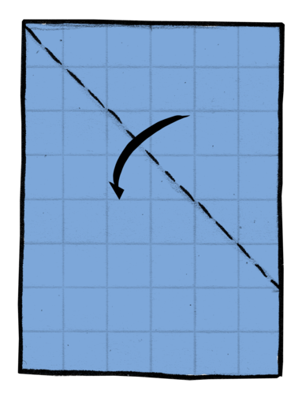

2. Use the scissors to cut off any excess paper.

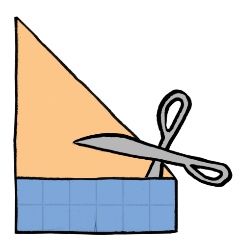

2. Fold the square corner to corner and then unfold so that you have diagonal crease marks.

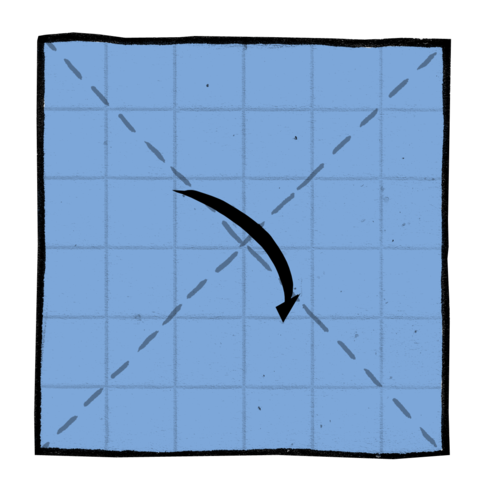

2. Make a pencil mark about a third of the way from the centre along each diagonal line.

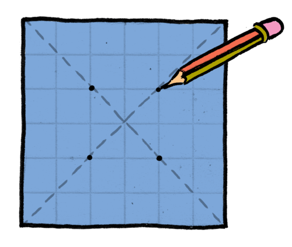

2. Use the scissors to cut along the fold lines and stop at the pencil mark.

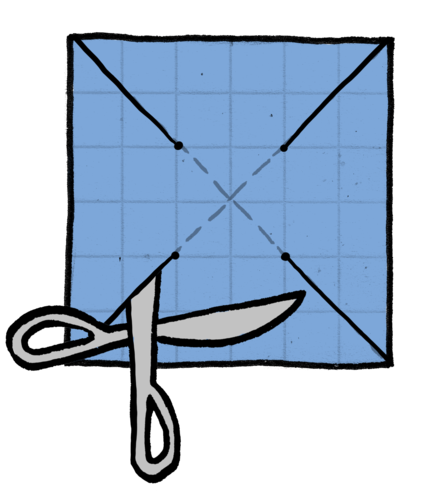

2. Bring each point to the centre of the square and stick a pin through all four points.

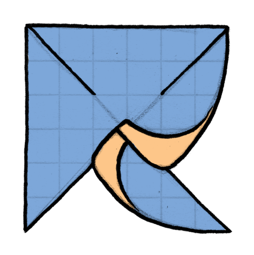

2. The head of the pin forms the centre of the pinwheel.

2. Turn the pin wheel over and make sure your pin goes through the exact centre.

2. Stick the pin into a thin stick or straw. Make sure that the pinwheel is free to turn. You can also place a small bead in between the pinwheel and the stick to make sure it spins easily.

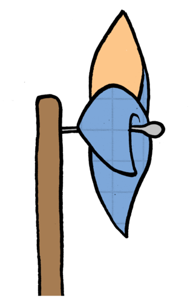

2. Boil a kettle. The kettle must be full and boiling rapidly.
4. Hold the pinwheel over the spout of the boiling kettle and watch it.

Make sure to point out the thermal system (the kettle and boiling water) and the mechanical system (the turning pinwheel) and how energy is transferred between these systems.

<Callout type="note" title="Note">
We have mostly looked at coal-powered power stations, but other energy sources, such as hydropower or nuclear power, can also be used to transfer energy to the turbine.
</Callout>

**QUESTIONS:**

**Problem:**
What happened to the pinwheel when it was held in the steam from the boiling kettle?

**Solution:**
The pinwheel turned when it was placed in the steam.

**Problem:**
Why did the pinwheel turn? Explain the energy transfers which are taking place.

**Solution:**
The element in the kettle transfers energy to the water in the kettle. The water then gets to boiling point and changes phase to water vapour. The steam rises because of convection. The moving particles push against the blades of the pinwheel and cause the pinwheel to turn. The steam has a lot of kinetic energy which is transferred to the blades of the pinwheel causing it to turn. There is a transfer of energy between a thermal system and a mechanical system.

The turning turbine is attached to the axle of a generator. The turning turbine turns the generator. So the turbine transfers its kinetic energy to the generator.

A generator consists of a very large **solenoid** with a large rotating magnet. The solenoid is made up of thousands of coils of conducting wire. When the magnet is turned inside the coil, the generator produces electricity. The electricity is then sent to our homes through the national grid power lines. We use the energy in our homes to make our appliances work.

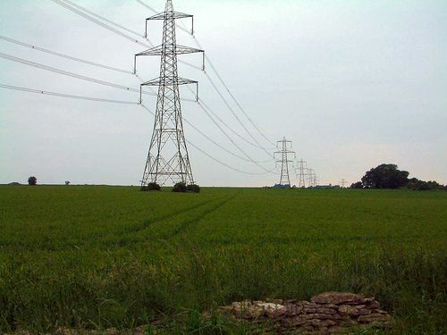

The national power lines transmit electricity across the country from the power stations.

<Callout type="note" title="Note">
We will learn more about electromagnets next year in Gr. 8.
</Callout>

<Callout type="note" title="Note">
How a coal power station works (video)
</Callout>

If possible, organise an excursion with your learners to a power station in your area. Here is a link to the Wikipedia article which lists all the power stations in South Africa. [http://en.wikipedia.org/wiki/List_of_power_stations_in_South_Africa](http://en.wikipedia.org/wiki/List_of_power_stations_in_South_Africa)

Here is a table summarizing some of the various power stations in South Africa and and which province they are located in, for your reference.

**
Coal-powered stations
**

| Power station | Province |
| --- | --- |
| Arnot Power Station | Mpumalanga |
| Bloemfontein Power Station | Free State |
| Camden Power Station | Mpumalanga |
| Duvha Power Station | Mpumalanga |
| Kelvin Power Station | Gauteng |
| Lethabo Power Station | Free State |
| Matimba Power Station | Limpopo |
| Pretoria West Power Station | Gauteng |

**
Hydroelectric Power Stations
**

| Power station | Province |
| --- | --- |
| Drakensberg Pumped Storage Scheme | Free State |
| Gariep Dam | Free State-Eastern Cape border |
| Ingula Pumped Storage Scheme | KwaZulu-Natal |
| Kouga Dam | Eastern Cape |
| Palmiet Pumped Storage Scheme | Western Cape |
| Steenbras Pumped Storage Scheme | Western Cape |
| Vanderkloof Dam | Northern Cape |

# Energy transfers

The description of the production of electricity given in the text before this activity and the videos should give the learners enough information with which to draw a simple flow diagram showing how energy is transferred through the system, from the coal to the power lines.

**INSTRUCTIONS:**

2. Use the information given in this chapter about how electricity is produced to draw a flow diagram of the energy transfers which take place in the production of electricity in a coal power station.
4. Start with the burning of coal and end with the transmission of electricity in the power lines.

This is an example of the type of flow diagram required. If learners are battling, start the diagram off with them by showing the first step and then they can complete it.

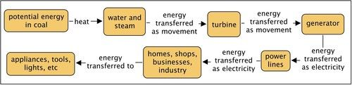

### Dynamos

Take note that an electric generator is a device that converts mechanical energy into electrical energy, normally using electromagnetic induction. A dynamo was actually the precursor to the modern day electric generators. now, it can be considered as a type of generator that produces **direct** current, with the use of commutators. At this level though in Gr. 7, we are not explaining the difference between direct and alternating current. Generators are used all over the world now, and dynamos are considered to be an instrument of the past, however, they are still used in some instances where a low powered DC current is required, such as a bicycle light, as discussed here. Make sure that learners do not use the words generator and dynamo interchangeably as a dynamo is a type of generator, but it is incorrect to call a generator a dynamo.

Eskom produces electricity by using large generators but we can produce electricity on a smaller scale using a **dynamo**. A dynamo is a type of generator and they are considered to be the device that came before and led to the development of the modern day electrical generators that are used now all over the world. However, dynamos are still used in some places where a low current is needed.

<Callout type="note" title="Note">
A dynamo is a type of generator, but a generator is not necessarily a dynamo.
</Callout>

A bicycle light is powered by a small dynamo. A bicycle dynamo has a small magnet which is turned inside a metal coil. The magnet is turned by the motion of the bicycle wheel.

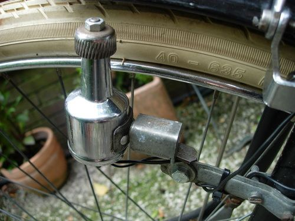

A dynamo on the wheel of a bicycle.

Do you see the cog which turns at the top as the wheel goes around? This turns the magnet enclosed in the dynamo. Explain the transfer of energy in this system.

The movement (kinetic energy) of the wheel is transferred to electrical energy.

What is the advantage of having a dynamo on the bicycle, rather than a battery for example?

The dynamo is used to generate electricity to power a light for the bicycle. This is useful as a battery will only last for a certain amount of time and run out. But, a dynamo will work whenever you are cycling as it just needs the movement of the wheel.

Dynamos are also used in mining helmets and wind-up torches and radios. If a miner's light on his helmet goes out, he can just wind up the dynamo again to generate electricity for the light. This is very useful when miners are deep underground and they cannot afford to have no light. A battery-powered light has the risk of running out and there is no way to recharge it when underground.

Electricity is very expensive to produce and, in South Africa, we rely heavily on non-renewable sources of energy such as coal. The burning of fossil fuels releases greenhouse gases into the atmosphere, causing damage to our environment. We therefore need to conserve electricity.
