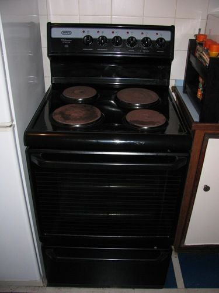

## Conserving electricity in the home

<Callout type="note" title="Note">
- conserve
</Callout>

In South Africa, electricity is produced by Eskom and sent to our homes through the wires of the national grid. Eskom charges us for the electricity we use. In order to save money and to preserve our environment we need to make sure that we use as little electricity as possible.

There are many ways to cut down on the amount of electricity we use in our homes. Simple things such as switching off lights when you leave a room or using extra blankets to keep warm rather than a heater. Air conditioners also use a lot of electricity so using them only when really necessary will also help to save electricity.

There are several common household appliances which use a lot of electricity. The element of an electric stove and ovens use a lot of electricity in order to stay hot enough to cook food. Electricity can be saved by making sure that the oven is switched off as soon as the food has been cooked.

An electric oven.

An electric stove usually has several different sizes of heating elements. In the photo there are two large plates and two smaller ones. It is important to use small pots on small elements and large pots on larger elements. Why do you think this is?

The part of the heating element which is not covered by the pot is transferring thermal energy to the air surrounding the element rather than to the pot and so a lot more energy is "wasted".

# Geyser blankets and solar geysers

Any appliance that produces heat requires a lot of electricity. A **geyser** is an appliance which uses a lot of electricity. A geyser is a cylindrical tank which is used to warm and store hot water for people to use in their homes. It takes a lot of energy to warm the water and so a lot of electricity is needed. A lot of the energy transferred to the water is wasted because the air around the geyser gets warmed up as energy leaves the water and is transferred to the air. The geyser has to keep warming the water to keep the temperature constant.

One way to help reduce the energy loss to the surrounding air is to use a geyser blanket. Geyser blankets are usually between 50 mm and 150 mm thick and are often made from fibreglass and other insulating materials. They are covered with a reflective aluminium layer.

Solar geysers do not use electricity from the national grid for their energy needs. We have already learned about how they work.

**QUESTIONS:**

**Problem:**
Use your knowledge of insulating materials to explain how a geyser blanket could help reduce energy loss from the water to the surroundings, and therefore conserve electricity.

**Solution:**
The thick fibre layer helps to reduce the energy loss by slowing down the conduction of heat from the water to the air. The shiny aluminium layer is not a good emitter of radiation and so less energy is lost through radiation.

**Problem:**
How does installing a solar geyser contribute to relieving demand placed on the national grid?

**Solution:**
The solar panels generate the required electricity and so it isn't generated by Eskom. It is the electricity supplied by Eskom that needs to be conserved. This also reduces the demand on non-renewable energy sources which have a negative impact on the environment.

Let's look at some more ways to conserve electricity.

<Callout type="note" title="Note">
The Eskom website has several tips on how to conserve electricity.[http://www.eskom.co.za/c/article/78/conserving-electricity/](http://www.eskom.co.za/c/article/78/conserving-electricity/)
</Callout>

# Conserving electricity

**INSTRUCTIONS:**

Look at the grid below. If the instruction helps to SAVE electricity, colour it in BLUE. If the statement WASTES electricity, colour it in RED.

| Turning off appliances when on holiday | Leaving lights on in an empty room | Using an electric blanket | Using fluorescent lights | Using filament lights |
| --- | --- | --- | --- | --- |
| Wearing jerseys and warm clothes in winter | Leaving outside lights on during the day | Using an electric toothbrush | Running full loads in the washing machine | Switching off the geyser during the day |
| Boiling a full kettle | Using a gas heater | Hanging clothes outside to dry | Turning the TV off when no one is watching | Using a geyser blanket |
| Running half loads in a dishwasher | Leaving the oven on when nothing is cooking | Using an electric can opener | Running an air conditioner with the windows open | Using a tumble dryer |

**Problem:**
Look at all of your red blocks. Rewrite each statement so that it changes from a waste of electricity to a method of saving electricity.

**Solution:**
The blocks which learners should identify as energy wasting are listed below, with a suggestion for how it can be rewritten to be energy saving:

- **Leaving lights on in an empty room** - Switch off lights in an empty room
- **Using an electric blanket** - Use extra fabric blankets
- **Using filament lights** - Use fluorescent lights
- **Leaving outside lights on during the day** - Switch off outside lights during the day
- **Using an electric toothbrush** - Use a non-electric toothbrush
- **Boiling a full kettle for one cup of tea** - Only boil the amount of water that you intend using
- **Running half loads in a dishwasher** - Only run the dishwasher when it is full
- **Leaving the oven on when nothing is cooking** - Switch off the oven as soon as the food is cooked
- **Using an electric can opener** - Use a non-electric can opener
- **Running an air conditioner with the windows open** - Keep windows and doors closed when running an air conditioner
- **Using a tumble dryer** - Rather hang washing than use a tumble dryer

**QUESTIONS:**

**Problem:**
Make a list of the electrical appliances in your home. Walk through your home and make sure to count every item. What could you do, in your home, to help your family conserve electricity?

**Solution:**
Learner-dependent answer.

**Problem:**
Our country relies heavily on fossil fuels for our energy supply. Eskom power stations use coal, which is a non-renewable energy source. How can saving electricity in our homes help to reduce our negative impact on the environment?

**Solution:**
This question links back to what learners covered in Chapter 1 on sources of energy. Burning fossil fuels releases greenhouse gases which contribute to the greenhouse effect in the atmosphere. This contributes to global warming. If we use electricity in our homes wisely and save electricity, we reduce the load on the coal-powered stations, and therefore help to reduce the emission of greenhouse gases.

**Problem:**
What renewable energy alternatives could your family use in your house to reduce your use of electricity supplied by coal-powered stations through the national electricity grid?

**Solution:**
Learners can suggest installing solar panels on the roofs of their house to rather make use of solar power as it is a renewable energy source. Electric geysers also use a huge amount of electricity to warm water, therefore installing a solar water heater (as discussed in Chapter 4), the family will reduce their load on the national supply system by rather using alternative energy sources.

# Writing a letter to your local newspaper

This is an optional activity aimed at creating awareness amongst learners about our country's reliance on fossil fuels and the negative environmental impact. This can also be done as a homework task.

Learners will need to write a letter to their local newspaper. Encourage learners to do some extra research about the area in which you live. For example, looking at the direct impacts of a coal station on your area, such as the possible effects of acid rain. Learners should research the renewable energy power stations that might already be in the area which could rather be expanded.

This is a creative writing piece but also a research task. Learners must reference any sources that they use. Learners must include in their letter, their motivation for why renewable energy sources should rather be explored. The scientific accuracy of their letters must also be assessed.

The purpose of this activity is to engage learners in constructive, problem-solving thinking.

You have just found out that there are plans to build a new coal-powered power station just outside your home town. Your local community is upset about this due to the effects of the pollution on the environment. Your community also feels that greater measures are needed to change the way we rely so heavily on non-renewable sources. We should rather be looking at alternative ways of generating electricity. You decide to do some research about the best possible solution for a power station, other than one which uses fossil fuels.

**INSTRUCTIONS:**

2. You decide to write a letter to your local newspaper explaining your findings, your community's concerns and your alternative suggestion.
4. Use your knowledge from this term's work and think about the best possible solution for your area. For example, perhaps there is a dam nearby which could be used for a hydroelectric power plant? Perhaps there is a wind power farm close by which could be expanded?
6. You need to think critically and present a constructive solution to the problem.
8. Use the following space to write your letter.
10. Reference any sources which you use.

Learner-dependent answer.

*
**Careers in electricity**
*

There are many different careers in the field of electricity generation. Engineers, both mechanical and electrical, are needed to help design and run the processes of electricity generation. Technicians and artisans are needed to build and maintain the power generators. Research scientists are also needed to help test and develop new technologies.

# Career research

**INSTRUCTIONS:**

Choose an electricity related career which you find interesting and research the career. You can do this by searching on the internet or in books. Some careers to find out about are those in the field of electricity generation, including engineers, scientists, artisans and technicians.

Learners can also make a poster about the career and put them up for display in the classroom.

You can also contact some the engineering associations listed below:

Engineering Council of South Africa (ECSA)

Tel: (011) 607-9500 Fax: (011) 622-9295

E-mail: engineer@ecsa.co.za

South African Institute of Electrical Engineers

Tel: (011) 487-3003/6 / (011) 487-3002

Electrical Contractors Association of SA

Tel: (011) 392 0000

What does a day in the life of this career involve?

Learner-dependent answer.

The Zooniverse website provides a great overview of the various citizen science projects that learners can get involved in. There is a huge variety of projects, from helping to identify possible planets around stars, analysing real life cancer data, looking at tropical cyclone data, or listening to the calls from whales or bats. And there are also many others. Citizen science is scientific research which is conducted in whole or in part by nonprofessional scientists, specifically the general public. Encouraging learners to get involved in some of these projects will open their eyes to the possibilities out there, and also add meaning and value to what they learn within the Natural Sciences classroom. [https://www.zooniverse.org/](https://www.zooniverse.org/)

<Callout type="note" title="Note">
'Citizen science' is when the general public takes part in and conducts scientific research.
</Callout>

<Callout type="note" title="Note">
Want to take part in some real science research? Check out these citizen science projects to easily get involved.[https://www.zooniverse.org/](https://www.zooniverse.org/)
</Callout>

Remember to discover more online by visiting[www.curious.org.za](http://www.curious.org.za) and by typing the links in the Visit margin boxes into your internet browser to watch any videos, play with simulations or read an interesting article.

Type the bit.ly link for the video or site that you want to visit into the address bar of your browser on your computer, tablet or mobile phone.

<Callout type="note" title="Note">
- The national electricity grid is a system in which the energy is conserved. It makes a complete circuit.
- In a coal power station, the coal is burned and steam is produced. The steam turns a turbine. The turbine turns a generator which produces electricity. This is transferred to the powerlines in the national grid.
- Eskom uses coal powered stations and generates electricity using generators.
- Dynamos are a type of generator that can be used to produce small amounts of electricity, such as a for a bicycle lamp.
- Electricity is expensive and we need to conserve electricity to reduce our household costs.
- Fossil fuels are burnt to generate electricity. When fossil fuels are burnt they release greenhouse gases into the atmosphere. We need to reduce our electricity consumption in order to reduce pollution.
- There are many practical ways to conserve electricity within our homes.
</Callout>

Complete the concept map below by filling in some of the ways to save energy.
