## Solar energy and the Earth's seasons

<Callout type="note" title="Note">
- sphere
- axis
- rotation
- revolution
- day
- orbit
</Callout>

### Earth's rotation

Let's start off with seeing what you can remember learning about **day** and night in Grade 6.

# Day and night revision exercise

**INSTRUCTIONS:**

2. Answer the questions in the table below.

**Problem:**
**QUESTIONS:**

| In which direction would you have to look to see the Sun rising? |  |
| --- | --- |
| In which direction would you look to see the Sun setting? |  |
| At what time is the Sun at its highest point in the sky? |  |
| At midnight, where is the Sun in relation to your position on the Earth? |  |
| How long does it take the Earth to complete one rotation on its axis? |  |

**Solution:**
| In which direction would you have to look to see the Sun rising? | To the East |
| --- | --- |
| In which direction would you look to see the Sun setting? | To the West |
| At what time is the Sun at its highest point in the sky? | At midday |
| At midnight, where is the Sun in relation to your position on the Earth? | Directly opposite your position on the other side of the globe |
| How long does it take the Earth to complete one rotation on its axis? | 24 hours (1 day) |

<Callout type="note" title="Note">
Different planets take different amounts of time to make one complete rotation on their axis and so they have different lengths of days. Venus is the most sluggish rotator of all the planets in our solar system and takes 243 Earth days to complete one rotation. A Venus day lasts longer than 200 days on Earth!
</Callout>

If you follow the path of the Sun during the day you will see that it rises in the east and sets in the west. The Sun reaches its highest point at noon (midday). Why do you think it looks as though the Sun moves across the sky during the day?

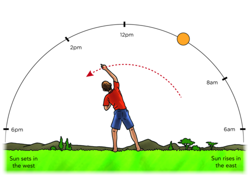

The Sun is at different positions in the sky during the day. But is it the Sun that is moving?

Let's do an activity to find out!

# Movement of a classroom Sun

This is an active group activity for the whole class. Ensure that the balloon or ball you use can be seen clearly by all learners. The learners will be standing up and turning around on the spot so ensure that they have enough room to turn without hitting each other or falling over their chairs. If space is cramped it might be a good idea to stack all the chairs away for the activity, or else ten or so children can stand up at a time and move and after that they sit down and the next ten take a turn.

Ensure that the learners know the difference between turning in a clockwise and anti-clockwise direction before they complete the activity.

**MATERIALS:**

- yellow round balloon or ball which can be hung from the ceiling
- string for hanging the ball or balloon

**INSTRUCTIONS:**

2. Hang up the balloon or ball from the ceiling using the string close to one of the corners in your classroom. Make sure that the balloon/ball is high up and visible from the back of the classroom. The balloon/ball represents the Sun.
4. Stand up in your classroom and face the balloon/ball.
6. Now slowly turn on the spot in a clockwise direction keeping your head still, completing two or three turns.
8. Repeat the activity but this time turn in an anti-clockwise direction.

**QUESTIONS:**

**Problem:**
As you turned clockwise what direction did the hanging balloon/ball appear to move?

**Solution:**
From right to left.

**Problem:**
As you turned anti-clockwise what direction did the hanging balloon/ball appear to move?

**Solution:**
From left to right.

**Problem:**
Did the hanging Sun actually move?

**Solution:**
No it was hanging in place.

**Problem:**
Why do you think we see the Sun move across the sky?

**Solution:**
The Sun appears to move from our perspective, but really we are moving. The Earth is spinning on its axis and the Sun appears to move in the opposite direction from our spin.

<Callout type="note" title="Note">
The story of our planet (video)
</Callout>

As you can see the hanging Sun is not really moving, it just appears to move because you are turning. This is also true for the real Sun in the sky. The Sun does not really move, it just appears to move because the Earth is turning on its** axis**. So, it is the Earth's** rotation** that causes the apparent movement of the Sun across the sky during the day.

<Callout type="note" title="Note">
Video of the Earth spinning on its axis causing day and night.
</Callout>

# Daytime and nighttime

This is an active group activity for the whole class. Ensure that the balloon or ball you use can be seen clearly by all learners. They will have to walk around the globe so ensure that there is space to do this. Ensure that the lamp or torch you use fully illuminates one half of the globe. If only a small portion of the globe is lit up, move the lamp further away and if necessary use a stronger light source.

**MATERIALS:**

- a globe (or a ball/balloon with the shapes of the continents drawn on it) which can be hung from the ceiling
- string for hanging the globe
- non-permanent marker or sticker
- desk lamp or torch
- black bin bags or curtains to darken the room

**INSTRUCTIONS:**

**Problem:**
If you do not have a globe, you can make a model of the Earth yourself in class. Use any ball. Draw the Equator and mark the North and South Poles.

**Solution:**

**Problem:**
Mark with a dot/sticker your position on the globe.

**Solution:**

**Problem:**
Hang the globe from the ceiling near the middle of the class. It should be at about eye level height. The globe represents the Earth.

**Solution:**

**Problem:**
Darken the room.

**Solution:**

**Problem:**
Shine a desk lamp or torch on the globe facing Africa and keep the lamp/torch steady in this position. The torch represents the Sun.

**Solution:**

**Problem:**
Walk around the globe so that you can see all of it. Is it all lit up by the torch? How much of it is lit and how much is dark?

**Solution:**
Half of the globe is lit and half is dark.

**Problem:**
The lit area represents daytime and the dark area represents nighttime. Is your dot/sticker in daytime or nighttime?

**Solution:**
The dot is in daytime as it is facing the lamp.

**Problem:**
Now turn the globe anti-clockwise, half a turn. Is your dot/sticker in daytime or nighttime?

**Solution:**
The dot is now in nighttime as it is facing away from the lamp.

**Problem:**
Where is it now daytime?

**Solution:**
Learner dependent answer. Accept any answer where there is light shining onto the globe. (i.e on the half of the globe now facing the lamp).

**Problem:**
Keep turning the globe anti-clockwise until your dot/sticker is back in its original position and lit again. How long would it take on the real Earth for the dot to complete one rotation like this?

**Solution:**
24 hours, or one day.

So, now you can see how the Earth's rotation about its axis causes day and night. When one half of the Earth is lit up by the Sun, the other half is in darkness. It is daytime in the lit half and nighttime in the dark half. As the Earth spins you move from light to shadow and back to light again over the course of one day (24 hours).

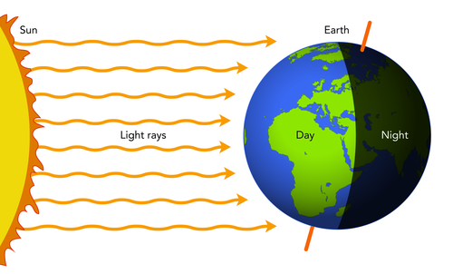

During the night you cannot see the Sun move across the sky, but if you look carefully you will notice that the stars move across the sky, just like the Sun does. It takes the Earth 24 hours to make one complete turn (called a rotation) on its axis, so an Earth day is 24 hours long.

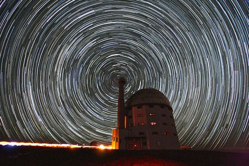

This picture of the SALT telescope near Sutherland was taken at night with the camera shutter left open. You can see the star trails due to the Earth's rotation.

You now know that the Earth rotates on its axis completing one turn every 24 hours. But which way does it turn? Let's see if you can figure it out.

<Callout type="note" title="Note">
Why does the Earth spin? (video)
</Callout>

# Which way does the Earth rotate?

This is a slightly more difficult activity. Ensure that the balloon or ball you use can be seen clearly by all learners. The learners will be standing up and turning around on the spot, ensure that they have enough room to turn without hitting each other or falling over their chairs. If space is cramped it might be a good idea to stack all the chairs away for the activity. Ensure that the learners know the difference between turning in a clockwise and anti-clockwise direction before they complete the activity.

**MATERIALS:**

- a ball or balloon
- string for hanging the ball

**INSTRUCTIONS:**

**Problem:**
Hang up the balloon or ball from the ceiling using the string close to one of the corners in your classroom. Make sure that the balloon/ball is high up and visible from the back of the classroom. The ball represents the Sun.

**Solution:**

**Problem:**
Stand up in your classroom and face the balloon/ball.

**Solution:**

**Problem:**
Now slowly turn on the spot in a clockwise direction keeping your head still, completing two or three turns. Are you turning to your left or right? Note what happens to the hanging balloon or ball.

**Solution:**
You are turning to your right. The ball appears to be moving from right to left.

**Problem:**
Now repeat the activity but this time turn in an anti-clockwise direction. Are you turning to your left or right? Note what happens to the hanging balloon or ball.

**Solution:**
You are turning to your left. The ball appears to be moving from left to right.

**Problem:**
What do you notice about the direction that you turn (left or right) and the direction that the hanging Sun appears to move?

**Solution:**
The directions are opposite to each other.

**Problem:**
Which direction does the Sun appear to move across the sky, east to west or west to east? Given your answer to question 5 which way do you think the Earth is really turning?

**Solution:**
The Sun appears to move from east to west. So the Earth is really moving west to east.

**Problem:**
Look at the picture below showing the Earth from space. Using your answer to question 6, is the Earth spinning in a clockwise or anti-clockwise direction? Draw the direction on the picture below.

**Solution:**
Anti-clockwise direction (as viewed from the North Pole).

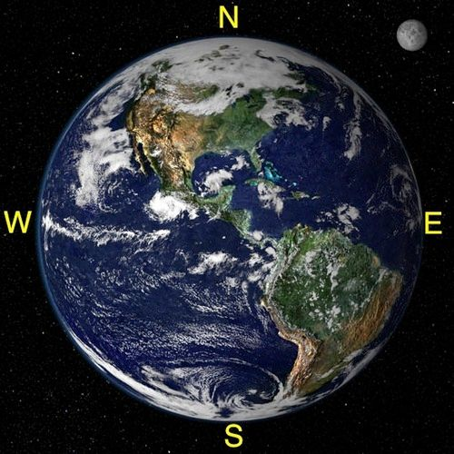

This colour image shows North and South America (green and brown continents) as they would appear from space.

<Callout type="note" title="Note">
The only planet that rotates on its side like a barrel is Uranus. The only planet that spins backwards relative to the others is Venus.
</Callout>

### Earth's revolution

The Earth revolves around the Sun in an almost perfect circle, completing one **revolution** (**orbit**) around the Sun per year (or 365 ¼ days to be precise). As the Earth revolves around the Sun it also rotates (spins) on its axis at the same time. Having two words both beginning with "r" relating to movement can be confusing! Let's check now that you know what they mean before we continue.

In your own words explain what is meant by the Earth's **rotation**.

It is the spinning of the Earth on its own axis. This axis is called the rotation axis.

In your own words explain what is meant by the Earth **revolving**.

This refers to the Earth travelling around the Sun in its orbit. One com

plete orbit is called a revolution.

Different planets take different amounts of time to make one complete revolution around the Sun and so their years have different lengths. The planets further from the Sun will have bigger orbits, as shown in the diagram, and therefore take longer to revolve around the Sun.

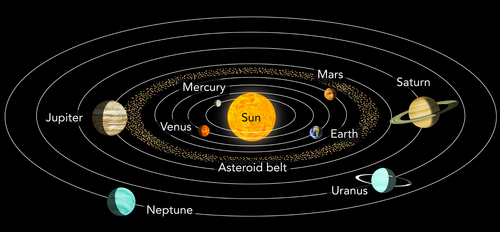

Our solar system.

<Callout type="note" title="Note">
Mercury has a year of just 88 Earth days, and Neptune has a year of 164 Earth years.
</Callout>

### Why do we have seasons?

<Callout type="note" title="Note">
- solar energy
- intensity
- oblique
- direct
- indirect
- equator
- equinox
- hemisphere
- tilt
- season
- solstice
</Callout>

A good way to introduce the concept of seasons is to have learners identify the traditional four seasons (spring, summer, autumn and winter). Ask them to describe the differences in weather and environment during the four seasons and ask them about the different activities they like to do in the different seasons (for example going to the beach in summer). You could then ask them roughly how long each of the seasons lasts and at what time of the year the different seasons occur. In a country as large as South Africa the climate varies considerably from place to place and while it may for example be spring-like in Pretoria, it could still be frosty in the Eastern Cape. Therefore, keep in mind that the four seasons (each lasting 3 months) have been defined mainly for temperate regions and the weather expected for "spring" (mild!) might not correspond exactly to the weather experienced in a given place in South Africa at a given time. Discussions in the chapter are therefore
                  kept as general as possible focusing on average temperatures in summer and winter for the northern and southern hemispheres.

Before investigating what causes the seasons on Earth you could ask learners what they think causes the seasons and list all the answers on a blackboard, perhaps taking a class vote for each reason. After doing the activities listed in section 1.1 you should ask the learners to recast their votes. It is important that any misconceptions that learners may have regarding the cause of the seasons be addressed and some common misconceptions are explained in the teachers notes in section 1.1.

As the Earth travels around the Sun it receives **solar energy** in the form of light and heat, emitted from the Sun. Do you remember that in Energy and Change last term, we spoke about how heat is transferred from the Sun through space, to Earth? What is this called?

Radiation.

<Callout type="note" title="Note">
The amount of solar energy the Earth receives is called**insolation** which comes from the words: **in**coming **solar radiation**
</Callout>

Insolation is not to be confused with insulation.

We are very lucky to have our Sun! if the Earth did not receive any energy from the Sun the Earth would be cold and lifeless. Have you noticed that the average temperature is not the same all year round? We experience the **seasons**: winter, spring, summer and autumn. It is generally much warmer in summer and cooler in winter, why do you think that is?

Learners will most probably have lots of different answers, accept all the answers and then carry out the activities in the chapter to investigate the true cause of the seasons.

Let's first make sure that we know some of the terminology about Earth before continuing.

# Label the Earth

If possible, bring some oranges to class and get learners to draw the different lines of latitude onto the oranges using a permanent marker and marking the North and South Pole and the Northern and Southern Hemisphere.

**INSTRUCTIONS:**

Using the word bank, label the diagram of the Earth below.

| Word bank: Northern Hemisphere Southern Hemisphere Equator North Pole South Pole |
| --- |

Here is the labeled diagram:

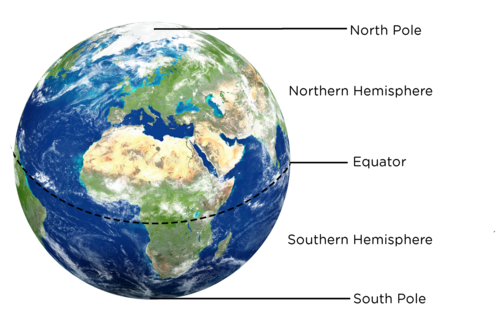

You might already have some thoughts about why we get different seasons throughout the year.

# What causes the seasons? Guesses!

**INSTRUCTIONS:**

**Problem:**
Which of the
                        statements in the table do you think are true and which do you think are false? Put your answers in the right hand column.

| Statement | True or False |
| --- | --- |
| We experience winter because the Sun emits less energy in winter. |  |
| We experience summer because we are closer to the Sun during summer. |  |
| If it is winter in the Northern Hemisphere it is winter in the Southern Hemisphere too. |  |
| Daytime is longer in the summer because the Earth spins more slowly in the summer months. |  |

**Solution:**
| Statement | True or False |
| --- | --- |
| We experience winter because the Sun emits less energy in winter. | False |
| We experience summer because we are closer to the Sun during summer. | False |
| If it is winter in the Northern Hemisphere it is winter in the Southern Hemisphere too. | False |
| Daytime is longer in the summer because the Earth spins more slowly in the summer months. | False |

ALL the statements in the "What causes the seasons?" activity are false! The amount of energy emitted by the Sun is the same all year round. Also the Earth spins on its axis at the same rate all year. When it is summer in Cape Town it is winter in Paris and when it is spring in London it is autumn in
                South Africa. The seasons are reversed in the Northern and Southern **Hemispheres**. If it can both be winter and summer on different parts of the Earth at the same time, the seasons cannot be caused by our distance to the Sun. If that were the case, then the whole of the Earth would experience summer and winter at the same time.

Two common misconceptions about the seasons to be aware of whilst going through this content with learners:

**1. Seasons are caused by the Earth being closer to the Sun in the summer and farther in the winter due to the Earth's oval orbit**.

NO: IN FACT, the Earth's orbit around the Sun is elliptical but it is nearly a
                  perfect circle; it is off by only \(\text{4}\)%. Astronomers have calculated the resulting difference in incoming solar energy: it is only \(\text{7}\)% which is very small and not sufficient to cause the variations in the temperatures associated with the seasons. If this change in distance were responsible for the seasons, then

the Southern and Northern Hemispheres would experience summer and winter at the same time, which is not the case.

**2. The Earth's tilt brings the Earth significantly nearer to the Sun during the hotter times of the year.**

NO: IN FACT, the tilt of the Earth is the cause of our seasons, but this tilt does not bring us significantly closer to the Sun. The distance from the Sun to the Earth is on average 149 000 000 km and any difference caused by the Earth's tilt is tiny (the change in distance is
                  only about 0.003% of the distance between the Sun and the Earth). This is not sufficient to cause any differences in temperature.

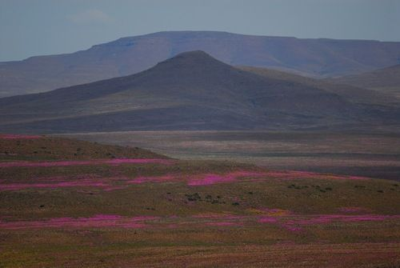

Springtime in the Northern Cape, the flowers are out in bloom.

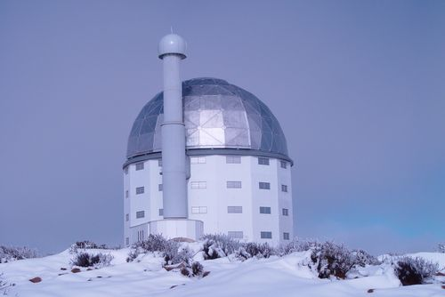

Winter time in the Northern Cape. In Sutherland, temperatures can go below 0oC
                  and it often snows.

Let us now find out what causes the seasons. The seasons don't just divide up the year into quarters, they tell us where the Earth is in its path around the Sun. Have a look at the following diagram which shows how the Earth revolves (orbits) around the Sun and the different seasons experienced by the Southern Hemisphere.

<Callout type="note" title="Note">
The relative position of the Earth around the Sun is not drawn to scale. If it was drawn to scale, the Earth would not fit on this page!
</Callout>

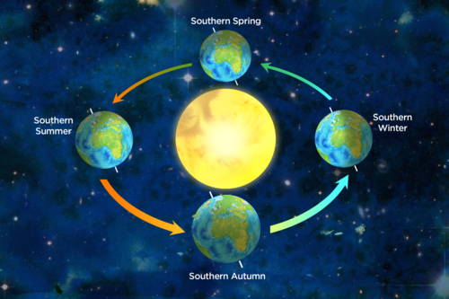

The relative
                  positions of the Earth and Sun during the course of a year. It takes one complete year for the Earth to revolve (orbit) around the Sun. It takes six months for the Earth to travel halfway around the Sun.

Look at the picture showing the position of the Earth as it orbits the Sun during a year. The Earth travels around the Sun in an almost perfect circle. If you look closely, you can see that the Earth's axis is not pointing straight up, but is slanted, or tilted in the picture. This is because the Earth is actually tipped over slightly relative to the plane of its orbit. The Earth's axis always tilts in the same direction in space: the North Pole points towards the star Polaris.

<Callout type="note" title="Note">
The Earth's orbit is actually very slightly elongated but very close to a circle, called an ellipse.
</Callout>

What do we mean when we say that the Earth's axis is tilted relative to the **plane** of its orbit? A plane is a flat surface, for example a flat piece of card or the surface of still water. The plane of the Earth's orbit is an imaginary flat surface that contains the Earth as it revolves around the Sun.

Imagine that the Earth is a beach ball floating on the surface of water in a swimming pool with half the ball submerged so that you can only see the top half of the ball poking out of the water. Now imagine that the ball is moving around in a circle on the surface of the water but it is not moving up or down. This is what we mean when we say that the Earth travels in a circle in a plane. In this example the Earth's orbital plane is the surface of the water. In space there is no surface of water, the plane is just an imaginary flat surface!

Now imagine that the valve where you blow up the beach ball is pointing straight up towards the sky. This valve represents the Earth's North Pole. In this case the valve and the plane are **perpendicular** to each other and the angle between them is 90 degrees.

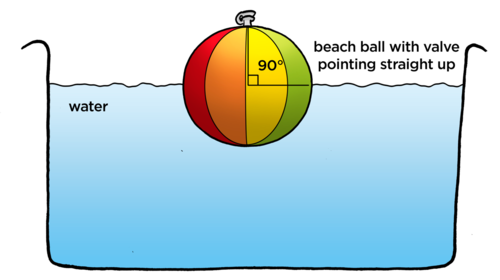

However, if you push the ball over slightly so that the valve no longer points straight up, then the valve (representing the Earth's North Pole) and the water surface will not be perpendicular to each other.

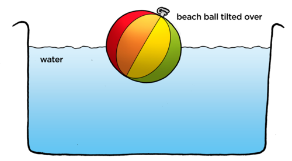

The Earth's rotation axis is tilted over by an angle of 23.5 degrees (23.5°) from the vertical. As the Earth travels around the Sun its North and South Poles constantly point in the same direction in space.

<Callout type="note" title="Note">
By pure luck, in the Northern Hemisphere the North Pole points to the star Polaris, which allows astronomers to find north easily! Unfortunately, there is no "south star" in the Southern Hemisphere.
</Callout>

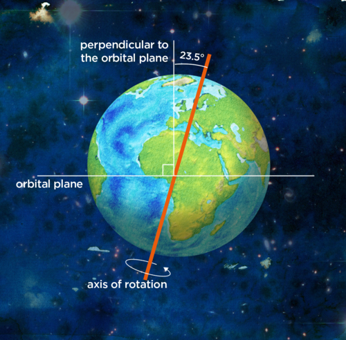

The Earth's rotation axis is tilted by 23.5° from the vertical as it orbits the Sun.

Let's model the Earth's tilt.

# The Earth's tilt

This activity is designed to reinforce the idea that the Earth's axis always points in the same direction in space. The North Pole points towards the star Polaris (North Pole Star) and you can mention this to learners. Unfortunately, there is no southern equivalent of the North Pole Star.

**MATERIALS:**

- globe or ball/balloon
- non-permanent marker or stickers
- card and tin foil to
                      make a star
- string
- scissors
- glue

**INSTRUCTIONS:**

2. Mark on the globe the position of the North and South Pole with a marker or stickers. If using a ball or balloon mark the positions of two points directly opposite each other on the surface of the ball/balloon which will be used to represent the North and South Poles of the ball/balloon.
4. Using the scissors, cut the card into the shape of a star.
6. Cover the star in foil, using the glue if necessary to stick it to the card.
8. Hang the star up from the ceiling using the string. Make sure it is high up and clearly visible from the whole of the class.
10. Sit in a circle with the rest of your class, your class teacher should sit or stand in the middle of the circle representing the Sun.
12. Select one member of your class in the circle to start the activity and pass the globe to them.
14. Tilt the globe away from the vertical, pointing the North Pole towards the hanging star.
16. Pass the globe around the circle keeping the North Pole pointed in the same direction towards the hanging star. *Remember to keep the globe spinning on its axis as it is passed around!*
18. Note how as the globe moves around the circle, sometimes the Northern Hemisphere is tilted more towards the Sun, sometimes the Southern Hemisphere is pointed more towards the Sun and sometimes neither hemispheres are tilted towards the Sun.

**QUESTIONS:**

**Problem:**
For roughly what fraction of the orbit did
                          the Southern Hemisphere point towards the Sun?

**Solution:**
1/4 of the orbit.

**Problem:**
For roughly what fraction of the orbit did the Northern Hemisphere point towards the Sun?

**Solution:**
1/4 of the orbit.

**Problem:**
What length
                          of time do these fractions correspond to for the real Earth's orbit around the Sun?

**Solution:**
Both represent 3 months.

Let's see now what effect this tilt has on the Earth.

# Direct and indirect light

Before starting this activity, explain what is meant by direct and indirect. The aim of this activity is to see how the
                    energy from a torch is spread out when the light is shone directly and indirectly onto card. In this activity students will need to shine a torch onto black card. Learners will need to work in pairs so that one person can hold the torch and the other one can draw an outline of the beam of light.

This activity works best when the room is darkened, as it is easier to see the torch light. Some torches produce concentric rings rather than a smooth light distribution. If this is the case the learners should pick a given ring (say the outside one, or the one immediately inside this, whichever is easier to see) and stick to observing this ring in both cases. Learners should find that the direct light is more concentrated (spread over a smaller area) than indirect light.

**MATERIALS:**

- A4 sized or larger piece of black card, one per pair
- torch, one per pair
- bin bags to darken the room if necessary
- pencil or pen, one per pair

**INSTRUCTIONS:**

2. You will need to work in a pair for this activity.
4. Place the card flat on a desktop or table.
6. Darken the room using curtains or bin bags.
8. One person should hold the torch about 25 cm above the card pointing straight down onto the card. Shine the light onto the card.
10. Look at the beam shining on the black card and note its size. The person in the pair not holding the torch should draw around the edge of the beam with a pen or pencil.
12. Swap places and point the torch towards the card at an angle
                         of 45°, keeping it at the same distance from the card as before. Shine the light onto the card.
14. Look at the beam shining on to the card, draw around the edge of the beam with a pen or pencil.

**QUESTIONS:**

**Problem:**
In which case is the light more concentrated? (direct or indirect)

**Solution:**
Direct.

**Problem:**
In which case is the light more spread out? (direct or indirect)

**Solution:**
Indirect.

**Problem:**
If the light is more concentrated, does this mean that the energy from the torch is more concentrated or spread out?

**Solution:**
If the light is more concentrated, energy from the torch is more concentrated, and spread over a smaller area.

**Problem:**
In which case did the light look brighter? Why is this?

**Solution:**
Direct. Because the energy from the light is spread over a smaller area, so each unit area receives more energy compared with the indirect case. As the brightness is proportional to the amount of energy received, so areas which receive more energy per unit area are brighter.

The energy is spread out over a larger surface area when the light is shone at a slanting (**oblique**) angle relative to the card than when it is shone **directly** onto the card. Similarly, when light from the Sun hits the Earth directly, the solar energy is spread over a smaller surface area and is more **intense** (concentrated) than when light hits the Earth **indirectly**. Do you think this has an effect on the temperature? Let's investigate.

# Direct and indirect light and its effects on temperature

Scientists often use models to recreate the real world in a laboratory. In this investigation, you will use a model to simulate how sunlight strikes the surface of the Earth. You will use a torch to represent the Sun. You will change the angle at which light strikes a flat surface and see what effect this has on the heating of the surface. This will model how sunlight strikes the surface of the
                  Earth at different angles.

The aim of this investigation is to demonstrate that direct light heats up an area more quickly than indirect light. It is assumed that this experiment will be a teacher led demonstration but with measurements taken by the learners, however, if you have enough equipment there is no reason why the learners cannot set up the experiment themselves. Strip thermometers are often used for taking children's temperatures and are available in most chemists. You can extend this activity if you wish by changing the angle at which the "indirect light" lamp points at the card in steps. Learners should find that shallower angles with respect to the surface produce lower temperature readings.

Ensure that the two lamps have bulbs of the same
                    power installed in them. During the experiment the strip thermometers may become too hot. If this happens turn both the lamps off for about 5 minutes and let them cool down, then start the observation again.

**INVESTIGATIVE QUESTION:**

Does direct light heat an area more quickly or slowly than indirect light?

**HYPOTHESIS:**

What do you think will happen?

Learner-dependent answer. Learners could state 'The direct light will heat the area
                    more quickly.'

**IDENTIFY VARIABLES:**

**Problem:**
What are you keeping constant in this experiment?

**Solution:**
The distance of the lamp from the thermometer is kept constant. Also the power of the light bulbs used in the lamps are kept constant. The amount of time that light is shone on each thermometer is also kept constant. These are called control variables.

**Problem:**
What are you changing in this experiment?

**Solution:**
The angle at which the light hits the card is changing, in the first case, A, the light is direct. In the second case, B, the light is indirect. This is the changing independent variable.

**Problem:**
What are you going to be measuring in this investigation?

**Solution:**
The temperature. This is the
                          dependent variable.

**MATERIALS AND APPARATUS:**

- two desk lamps
- two pieces of black card/paper
- two strip thermometers
- watch or clock
- marker pen and/or sticker to label the cards

**METHOD:**

2. Place the two desk lamps on a table or desk about 1 metre apart from each other.
4. Point one of the desk lamps directly downwards towards the table, at a height of about 30 cm.
6. Place the black card under the light and label it "A".
8. Place the thermometer strip in the centre of the black card. The light bulb should be
                       directly above the thermometer strip.
10. Adjust the second desk lamp so that it is at the same height as the first one, but instead of pointing it directly down at the table, tilt it slightly to one side (left-right direction).
12. Place the second piece of black card under this lamp and label it "B".
14. Place the second thermometer strip in the centre of the black paper. This light should shine indirectly over the thermometer.
16. Record the temperature of both thermometers in the table below.
18. Turn on both lights at the same time. Wait for about 30 seconds and then record the temperatures of the thermometers in the table below.

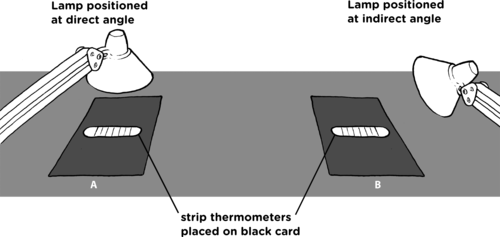

**RESULTS AND OBSERVATIONS:**

| Card | Initial temperature (°C) | Final temperature (°C) | Temperature difference (°C) |
| --- | --- | --- | --- |
| Card A (direct light) |  |  |  |
| Card B (indirect light) |  |  |  |

The temperatures recorded are learner dependent. However, all
                    learners should agree on the initial temperature of the thermometers. The thermometers should indicate the same initial temperature if they are calibrated correctly. The final temperature should be higher than the initial temperature, and the temperature of A should be higher than B. They should then work out the temperature difference by subtracting the initial temperature from the final temperature.

**Problem:**
Is light hitting the card from lamp A direct or indirect light?

**Solution:**
Direct light.

**Problem:**
Is light hitting the card from lamp B direct or indirect light?

**Solution:**
Indirect light.

**Problem:**
Which card has the hottest final temperature? Why is this?

**Solution:**
Card A, this is because the light is shining directly onto it and so the energy is more
                          concentrated.

**EVALUATION:**

How could you have improved this experiment?

Learner-dependent answer. Learners should clearly explain the reasoning behind their answers. Examples could include using more sensitive thermometers, repeating the observations and taking an average value for the temperatures.

**CONCLUSION:**

What do you
                  conclude about the heating effects of direct and indirect light? Why do you think this is the case?

Direct light heats the card more quickly as light is more concentrated and so more energy per unit area falls onto the card. This energy is what causes the heating and so if there is more energy per unit area falling on a surface then there will be more heating of that surface.

**QUESTIONS:**

Imagine that the lamps represent sunlight and the cards represent the surface of the Earth.

**Problem:**
What
                          season on Earth do you think corresponds to case A, and why do you think this?

**Solution:**
Summer because it is warmer.

**Problem:**
What season on Earth do you think corresponds to case B, and why do you think this?

**Solution:**
Winter because it is cooler.

Areas of the Earth that are hit by direct sunlight are therefore warmer than areas that are hit by indirect sunlight. In the summer, the Sun is high in the sky and we receive more direct sunlight than in winter when the Sun is lower in the sky and we receive more indirect sunlight. This explains why summer is warmer than winter.

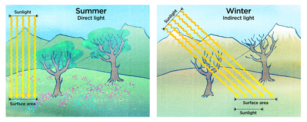

But why do we receive more direct light in summer? And why is it always warmer at the equator than at the North and South Poles? Let's do an activity to find out.

# Looking at sunlight hitting the Earth

The aim of this exercise is to introduce learners to the concept that sunlight hits the Earth at varying angles across the Earth's surface because it is curved. At the equator you can see that sunlight hits the Earth almost straight on, this is called direct light. Areas close to the equator are warm as the Sun's energy is concentrated in these regions. As the Earth is curved, not all of the Sun's rays hit it directly. Areas that are hit by indirect sunlight are cooler because the Sun's energy is spread out over a large area. The poles are always hit by indirect light which explains why it is cold at the North and South Poles.

In this example, the Southern Hemisphere is tilted towards the Sun. In the Northern Hemisphere most of the sunlight hits the surface of the Earth at a shallow slanted (oblique) angle relative to the Earth's surface, and so it receives more indirect light. The Southern Hemisphere receives lots of sunlight straight on (directly) and a little also hits at an oblique angle (indirectly) close to the South Pole. As the Southern Hemisphere receives more direct light it is summer there.

This exercise may prove a little harder for the learners as they have to visualise the angle at which the Sun's rays strike the Earth along a curved surface. Encourage them to rotate the book around if needed so that the surface of the Earth is always horizontal.

**INSTRUCTIONS:**

2. Look at the example picture below. It shows sunlight hitting the Earth.
4. Look at the Sun's rays and see how the angle at which they hit the Earth's surface changes at different points along the surface of the Earth because of its curved shape.
6. Answer the questions below.

**QUESTIONS:**

**Problem:**
Does the equator receive more or less direct light than the poles?

**Solution:**
More direct light.

**Problem:**
Which hemisphere receives more direct light in the picture? Why is this?

**Solution:**
The Southern Hemisphere receives more direct light as it is tilted towards the Sun.

**Problem:**
Which hemisphere in this diagram receives more indirect light? Why is this?

**Solution:**
The Northern Hemisphere receives more indirect light as it is tilted away from the Sun.

**Problem:**
Why do you think it is warmer at the equator than at the poles?

**Solution:**
Because the equator receives more direct light where the solar energy is more concentrated and the poles receive only indirect light where solar energy is more spread out.

**Problem:**
Is it summer or winter in the Southern Hemisphere in this example?

**Solution:**
Summer.

**Problem:**
Is it summer or winter in the Northern Hemisphere in this example?

**Solution:**
Winter.

**Problem:**
What would happen to the seasons if the Earth was tilted in the opposite direction, with the Northern Hemisphere tilted towards the Sun instead?

**Solution:**
The seasons would be reversed, it would be summer in the Northern Hemisphere and winter in the Southern Hemisphere.

The light falling on the Equator always hits at angles very close to 90° (almost direct), so it stays almost the same temperature all year round.

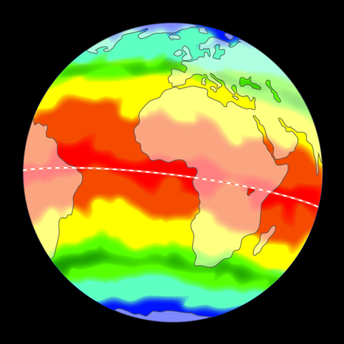

The areas around the Equator are warmer than at the poles throughout the year, as light falls almost directly on the Earth's surface between the Tropic of Cancer and Tropic of Capricorn.

Areas that are hit by indirect sunlight are cooler because the Sun's energy is spread out over a larger area than at the equator. The poles are always hit by indirect sunlight which explains why it is cold at the North and South Poles.

<Callout type="note" title="Note">
Another way to say that the light falls indirectly is to say **obliquely.** Oblique means it is not at a right angle (90°), but slanted.
</Callout>

Having discovered that the Earth is warmer close to the equator and cooler towards the poles you could start discussions related to this. For example, why is the world's population distributed the way it is? How long is the growing season for each region of the world? Tundra, Desert, Deciduous versus Coniferous versus Rain Forest. Why?

We experience the different seasons because of the varying amount of direct and indirect sunlight we receive. When the Southern Hemisphere is tilted towards the Sun it receives more direct sunlight (more radiant energy) and temperatures increase: it is summer in the Southern Hemisphere.

The opposite hemisphere is tilted away from the Sun and receives
                less direct sunlight, it receives less energy and temperatures decrease, so it is winter in the Northern Hemisphere. When the Northern Hemisphere is tilted towards the Sun we have the opposite case and it is summer in the Northern Hemisphere and winter in the Southern Hemisphere.

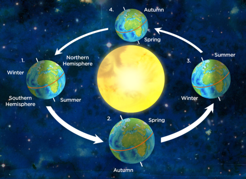

The seasons as the Earth revolves around the Sun.

A nice arts and craft activity to reinforce the idea that the tilt of the Earth's rotation axis is responsible for the seasons is to have learners make a poster of the above figure, labelling the Earth and Sun, the equator, hemispheres, poles, tilt (towards, away, neither) and resulting seasons for each hemisphere at each position.

In the picture above you can see the Earth travelling around the Sun in its orbit. The Earth's axis always points in the same direction in space. Because of this, sometimes the Southern Hemisphere is tilted towards the Sun and sometimes it is tilted away from the Sun. Let's follow the path of the Earth around the Sun as it completes one revolution from points 1 to 4.

At position 1 the light falls directly on the Tropic of Capricorn (23.5° S). This occurs when we, in the Southern Hemisphere, are having summer, and is called a **solstice**. The day of the summer solstice is the longest day in the year. In the Southern Hemisphere, this is usually around 21 December.
                At position 3, the light falls directly on the Tropic of Cancer (23.5° N). This occurs during our winter, whilst the Northern Hemisphere is having summer. This is called the winter solstice in the Southern Hemisphere and occurs around the 21 June. The winter solstice is the shortest day of the year.

<Callout type="note" title="Note">
Different cultures around the world have various celebrations and holidays around the winter and summer solstices, the equinoxes, and the midpoints between them.
</Callout>

At position 2 and 4, the equator receives direct sunlight. This is called an **equinox**. An equinox occurs twice a year, around 20 March (when our autumn equinox occurs at position 2) and 22 September (when our spring equinox occurs at position 4).

<Callout type="note" title="Note">
The term 'equinox'
                  comes from the Latin words *aequus* (equal) and *nox* (night), because around the equinox, night and day are about the same length.
</Callout>

# Earth's seasons summary

**INSTRUCTIONS:**

2. Refer to the previous diagram showing the Earth's seasons.
4. Fill in the blanks in the sentences below.
6. Write out the paragraph in full and underline your answers.

**QUESTIONS:**

**Problem:**
At position 1, the Southern Hemisphere is tilted towards the Sun and experiences summer. This is called the summer _____ in the Southern Hemisphere and occurs around the date, _____. The Northern Hemisphere is tilted _____ from the Sun and experiences winter. This is called the winter _____ in the Northern Hemisphere.

**Solution:**
At position 1, the Southern Hemisphere is tilted towards the Sun and experiences summer. This is called the summer solstice in the Southern Hemisphere and occurs around the date, 21 December. The Northern Hemisphere is tilted away from the Sun and experiences winter. This is called the winter solstice in the Northern Hemisphere.

**Problem:**
At position 2, _____ months later, neither hemisphere is tilted more toward the Sun. Direct sunlight only hits the Earth near the _____ and indirect sunlight hits nearly everywhere else. This is called an _____. This causes mild temperatures in the north and south away from the equator.

**Solution:**
At position 2, three months later, neither hemisphere is tilted more toward the Sun. Direct light only hits the Earth near the equator and indirect light hits nearly everywhere else. This is called an equinox. This causes mild temperatures in the north and south away from the equator.

**Problem:**
Six months later, the Southern Hemisphere is tilted _____ from the Sun and experiences _____. This is called the winter _____ in the Southern Hemisphere and occurs around the date, _____. The Northern Hemisphere is tilted _____ the Sun and experiences _____. This is called the summer _____ in the Northern Hemisphere.

**Solution:**
Six months later, the Southern Hemisphere is tilted away from the Sun and experiences winter. This is called the winter solstice in the Southern Hemisphere and occurs around the date, 21 June. The Northern Hemisphere is tilted towards the Sun and experiences summer. This is called the summer solstice in the Northern Hemisphere.

**Problem:**
Nine months later, neither hemisphere is tilted more toward the Sun. Direct light only hits the Earth near the _____ and indirect light hits nearly everywhere else. This causes mild temperatures in the north and south away from the equator.

**Solution:**
Nine months later, either hemisphere is tilted more toward the Sun. Direct light only hits the Earth near the equator and indirect light hits nearly everywhere else. This causes mild temperatures in the north and south away from the equator.

**Problem:**
The Earth is now back to its starting point again, having completed one revolution of the Sun in _____ months.

**Solution:**
The Earth is now back to its starting point again, having completed one revolution of the Sun in twelve months

**Problem:**
Why do you think it is important to know about the seasons? Think about how people used the knowledge of the seasons to organise their lives and mark the passage of time. Discuss this with your class and take some notes below.

**Solution:**
Learner-dependent answer

It is important that we relate the learning in class to learners' everyday lives so that it is applicable to them. You can have a class discussion on this topic, but learners must also write down their own thoughts. Start off by asking learners what do they think we can learn from learning about the seasons?

Some of the benefits of learning about the seasons relate to indigenous knowledge, such as knowing when to plant crops, when to harvest and when to store food for the winter months. Before people had calendars, they used the seasons to mark the passage of time and know when a year had gone by and the cycle repeated again.

So you now know that temperatures (and therefore the seasons) on Earth are determined by the angle at which sunlight hits the Earth. In summer, the Sun is high in the sky and sunlight hits the Earth directly. In winter, the Sun is low in the sky and the Sun's rays strike the Earth indirectly at an oblique (shallow) angle. The seasons occur because *the Earth's axis is tilted relative to the path of its orbit around the Sun* and not because the distance between the Earth and the Sun vary as the Earth revolves around the Sun.

<Callout type="note" title="Note">
The reason for the seasons (video)
</Callout>

Viewed from the Earth's surface, the Sun appears higher in the sky in summer. As the

Sun travels higher in the sky it takes more time to travel across the sky from sunrise to sunset. Therefore, daytime is longer in summer than in winter. The change in the length of daytime during the year also occurs because of the tilt of the Earth's rotation axis in space.

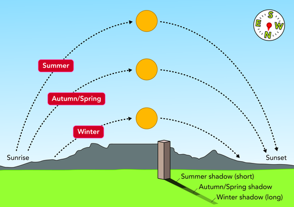

The apparent path of the Sun across the sky in winter and summer. The Sun travels higher and further across the sky in summer, and so days are longer.

<Callout type="note" title="Note">
Remember that it is NOT actually the Sun that moves, but Earth's rotation which makes it look as though the Sun moves across the sky.
</Callout>

The following questions are challenging and can be used to test the most able learners and extend their thinking.

What do you think would happen to the seasons if the Earth were not tilted by 23.5°, but instead were pointed straight up relative to the path of its orbit?

You can discuss this with your class. The Sun's path across the sky would be the same all year round and there would no longer be seasons as we know them. It would still be warm at the equator and cold at the poles however. The biggest impact on temperatures would be at the poles. Presently they have dark winters with extremely low temperatures followed by warmer temperatures and constant light in the summer. If there were no tilt, the polar regions would have much more uniform temperatures all year round and the Sun would always be low on the horizon. Across the Earth it would be like it is in the middle of autumn or spring all year.

There would still be some slight changes during the year. This is because the Earth-Sun distance varies during the year as the Earth's orbit around the Sun is not a perfect circle (it is *slightly* elliptical). Currently, the Earth is closest to the Sun in January and furthest away in July. With no tilt, this change in Earth-Sun distance during the year would produce a slight impact on the weather pattern. It must be emphasised that the effect would be tiny as the Earth-Sun distance does not vary significantly different during the year (147 million km in January 2013 compared to 152 million km in July 2013).

The Southern Hemisphere receives the greatest amount of solar energy around the 21st of December each year. However, the hottest days of the year are generally a month or so afterwards. Why do you think this is?

This is because it takes time for the land and sea to heat up or cool down. This is also explains why the seasons change gradually.

<Callout type="note" title="Note">
A year of the sky on Earth (video)[http://vimeo.com/32095756](http://vimeo.com/32095756)
</Callout>

The video showing a year of the sky is very interesting. Each panel shows one day so there are 360 movie panels playing at once to show the sky over almost a whole year, as recorded in San Francisco. 28 July is shown in the upper left and January 1 is about half way down. The camera recorded an image every 10 seconds from sunrise to sunset. You can see the time going by in the bottom right. This video is useful to show learners how although each day lasts 24 hours, the amount of sunlight changes depending on the season. Although this video is for the Northern Hemisphere and we are in the Southern Hemisphere, it is still very
                  interesting and can be used to demonstrate the difference in daylight hours very eloquently. You can ask the learners why they think the bottom videos (and soon the top videos) are the first to light. This is because it is dawn and the Sun rises earlier in the summer months of June, July and August in the Northern Hemisphere, so these panels light up earlier than the others for the winter months. The initial darkness in the middle depicts the delayed dawn and fewer daylight hours of winter.

### Seasons on other planets

This section is an extension which is not required by CAPS, but offers an opportunity to extend your learner's thinking, if you feel you have time in class and you need to assess the capabilities of your learners. Alternatively, learners can read it themselves in their own time.

Do you think that other planets experience seasons too?

Yes they do! Every planet in the solar system has seasons, but they are nothing like the seasons we experience on Earth. Seasons pass very quickly on some planets like Venus, yet last decades on others like Uranus. Unlike the Earth's seasons, which are caused *only* by the tilt of the Earth's axis in space, seasons on other planets can be caused by:

2. The tilt of the planet's rotation axis.
4. The variable distance of the planet from the Sun during its orbit. This is because some planets have extremely oval shaped orbits around the Sun unlike Earth.

The planets Venus and Jupiter have very small tilts compared with Earth. Their rotation axes are only tilted by 3° compared with the Earth's 23.5° tilt and so Venus' and Jupiter's seasons are hardly noticeable. Venus does have interesting weather however! Venus's surface is a whopping 460 °C all year round because Venus has an atmosphere made of dense acidic clouds which trap sunlight leading to a runaway greenhouse effect.

Mars's tilt is 25°, very close to the Earth's 23.5°. Because of this tilt, Mars has seasons, just like the Earth. As Mars takes two Earth years to orbit the Sun, the seasons on Mars are twice as long. The rotation axis of Mars does not point toward Polaris, our North Star, but points towards the star Alpha Cygni. Because of this, Martian seasons are out of step with the seasons on Earth. Mars also has a distinctly oval-shaped orbit. When Mars is further away from the Sun in its orbit it is cooler, which leads to long, extreme southern winters. The northern winters are not so long and extreme because they occur when the planet is closer to the Sun.

The planet with the most extreme seasons in the solar system is Uranus. Like Earth, the orbit of Uranus is nearly circular, however, Uranus's rotation axis is tilted by a massive 98°. Uranus is on its side!

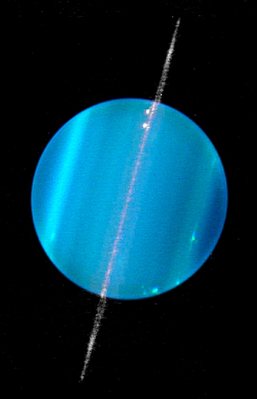

Uranus.

Uranus completes one revolution around the Sun every 84 Earth years, giving rise to seasons which last 21 years each! For two of the seasons, one pole is pointed directly at the Sun and the opposite hemisphere does not see the Sun because Uranus spins on its side. The hemisphere facing away from the Sun experiences a long (around 21 years!) dark, bitterly cold winter and doesn't see the Sun until the planet has travelled on in its orbit, to a point in its orbit where Uranus's rotation axis no longer points directly at the Sun.

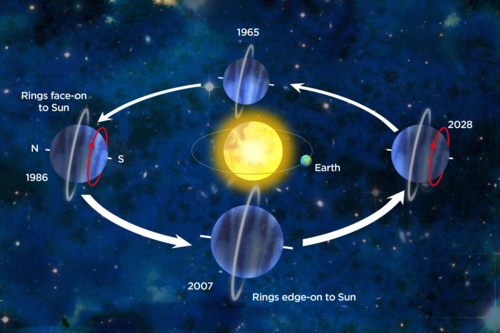

The seasons on Uranus: In 1986 the south pole was facing the Sun and so its Northern Hemisphere was in total darkness. In 2028 the North Pole of Uranus will face the Sun and the Southern Hemisphere will be in total darkness. Presently, neither pole is facing the Sun directly.
