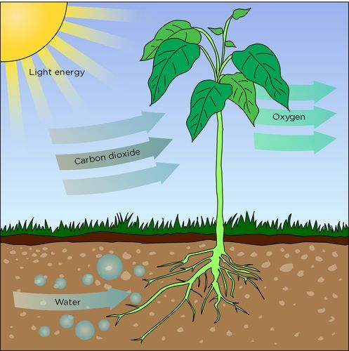
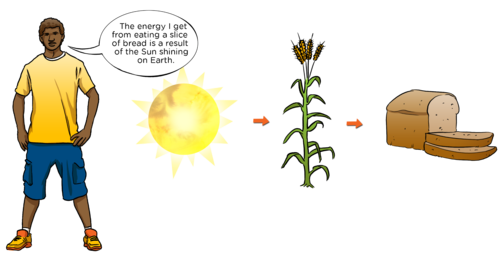
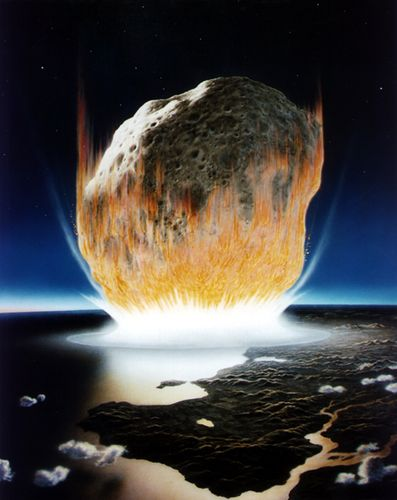
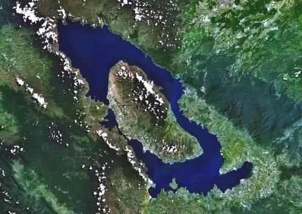

## Solar energy and life on Earth

<Callout type="note" title="Note">
- solar energy
- photosynthesis
- cellulose
- glucose
- starch
</Callout>

This section builds on what was done in Grades 4-6 on energy and photosynthesis to expand learners' understanding of these concepts and include the concept that the Sun's energy can be captured through photosynthesis and stored as carbohydrates to sustain life on Earth.

Earlier in Grade 7, in the Energy and Change section, the concept of fossil fuels was discussed with a focus on renewable versus non-renewable energy sources. This is extended here by looking into how fossil fuels were formed and how they captured the Sun's energy for use millions of years later. Learners need to realise how crucially important the Sun is for life on Earth.

In earlier grades energy transfer from producers to consumers, in food chains and food webs, were discussed. Here we look at capturing the energy from its source, the Sun, and storing it for later use. The overarching concept that energy cannot be created or destroyed, it can only be transferred from one form to another, should come through strongly in this section and the next one.

**Misconception: The carbon in plants comes from the soil.**

This could be used as an introduction to the section. Ask learners what wood is made of (mainly carbon) and where the carbon comes from that a tree is made of. Learners might say the soil (which is incorrect). This could then lead into a discussion of photosynthesis (revision) and how energy is captured by plants. Learners could be lead to discover that plants take up atmospheric carbon from the carbon dioxide air and not from the soil - wood is composed mainly of carbon atoms which come from atmospheric carbon dioxide. This is how plants capture carbon and store it so that human and animals are able to use it. The take-up of carbon by plants is also important as it controls the amount of greenhouse gases in the atmosphere (CO2 is a problematic greenhouse gas when in excess). When plants die and decompose to eventually form coal, the carbon remains in the fossil fuel which we harness later on. The same applies for oil and natural gas.

So far this term you learnt about how the Sun and Earth interact to form day and night, and the seasons. In this section we are going to look further at how important the Sun is for us on Earth, and more specifically at how the energy from the Sun is essential for life on Earth.

In Grade 6 you learnt how plants produce food through the process of **photosynthesis**. Plants absorb light energy from the Sun and use the energy to make food. In this way the Sun's energy is captured and stored so that it can be used later on.

: The process of photosynthesis to produce carbohydrates which are stored in the plant.

<Callout type="note" title="Note">
Plants also take up minerals from the soil, which are necessary for their functioning.
</Callout>

In photosynthesis the energy from the Sun is to used to change carbon dioxide and water into **carbohydrates** (for example **cellulose**, **starch** or **glucose**). The carbohydrates are stored in fruits, leaves, wood or bark. When we eat the plant, for example an apple, our bodies are able to release the energy stored in carbohydrates. In the same way animals, for example cows, use the Sun's energy when they eat the grass.

# Capturing the Sun's energy

Study the following flow diagram and answer the question below.

**QUESTION:**

A boy says: 'The energy I get from eating a slice of bread is a result of the Sun shining on Earth.' Do you agree with this statement? Use the flow diagram provided, and write a paragraph to explain why you agree or disagree with the statement. Use the words in the word bank in your explanation.

| Word bank: capture release store energy photosynthesis Sun wheat bread |
| --- |

Learner-dependent answer. It is not important whether the learner agrees with the statement or not, but rather what they write in their explanation. A possible explanation could be:

The Sun's energy is captured through a process called photosynthesis. Wheat plants use the energy to make carbohydrates which they store in their wheat kernels. The wheat kernels are ground to make flour for bread. The Sun's energy is therefore captured in the carbohydrates found in bread, so when the boy eats the bread, the energy from the carbohydrates is released.

All plants and animals depend on photosynthesis for their energy. In previous grades, you learnt about energy transfer between producers, for example grass, and consumers, for example a buck or lion. You used food chains and food webs to show how energy is transferred. Plants play a vital role in life on Earth as they form the basis of food chains. Without plants, life on Earth would not survive. Plants are completely dependant upon the Sun for survival and would die out without its energy which allows them to photosynthesize. Let's investigate this in the following activity:

# What would happen if the Sun's rays are blocked from reaching Earth?

Imagine a world without the Sun. How can this happen? It has happened before in Earth's history.

Dinosaurs lived on Earth millions of years ago. They were the dominant terrestrial vertebrates until about 65 million years ago, when there was a massive extinction. There are several theories about what caused this mass extinction. The most supported theory is that a massive asteroid hit Earth. It entered Earth's atmosphere with a brilliant flash of light and crashed into a shallow sea. Huge pieces of red-hot rock and steam exploded into the sky, causing raging fires which destroyed everything in their path. The asteroid's impact also caused giant waves, called tsunamis which swept across the coastal lands. Scientists think that the impact could have started a series of volcanic eruptions. This sent huge clouds of ash and dust into the atmosphere, blocking the sunlight. These huge clouds of ash, dust and steam quickly spread all over Earth and blocked the warm rays of the Sun. Scientists hypothesize that this cold, dark environment could have lasted for months, or even
                years.

An artist's depiction of the asteroid impact 65 millions years ago, which scientists think is the most direct cause of the dinosaur's sudden, mass extinction.

<Callout type="note" title="Note">
The 10 biggest volcanic eruptions in recorded human history.[http://www.livescience.com/30507-volcanoes-biggest-history.html](http://www.livescience.com/30507-volcanoes-biggest-history.html)
</Callout>

Much more recently in Earth's history, there was a supervolcanic eruption at the present site of Lake Toba in Indonesia. This occurred about 70 000 years ago when Mount Toba erupted and sent a huge volcanic ash cloud into the atmosphere. The eruption was followed by a six year long volcanic winter as the ash blocked out the sun's rays, and a 1000-year-long Ice Age. Following the eruption, mount Toba collapsed inwards and today the site can be seen at Lake Toba.

A satellite image of Earth's largest caldera (30 x 100 km), partially filled by Lake Toba, formed during the super volcano eruption about 70 000 years ago.

<Callout type="note" title="Note">
A caldera, meaning*cooking pot* in Latin, is a large volcanic feature usually formed by the collapse of land after a volcanic eruption.
</Callout>

Let's now pretend that another event occurs in present day, blocking the Sun's rays from reaching Earth. What would happen to the people, animals and plants on Earth? Discuss this with a friend and then complete the table by writing down the things that you think would happen if the Sun's rays are blocked from reaching Earth for an extended period.

For this activity let the learners first discuss what they think would happen in pairs. Then give them time to write their answers down. Afterwards a class discussion could follow. Another suggestion is to have the learner discussion at the end of a lesson and then give them the exercise for homework. The class discussion could follow in the next lesson when the homework is checked. The answers to this activity will be learner-dependent, however, some suggestions are provided. The purpose of the activity is to generate discussion and not to have right and wrong answers. The suggestions provided here are based on what scientists believe happened after the major volcanic eruptions (for example, Mount Toba), in the past.

Something else to discuss, which links back to what learners covered briefly in Matter and Materials, is that the atmospheric dust and ash forms poisonous acid rain, which contaminates rivers, lakes and oceans, causing many plants and animals to die.

|  | What do you think would happen? |
| --- | --- |
| On the first day |  |
| One week later |  |
| One month later |  |
| One year later |  |

|  | What do you think would happen? |
| --- | --- |
| On the first day | It would be overcast as the ash and dust would block out the Sun's rays. It would be much cooler. |
| One week later | It would still be dark, where people have electricity they would have light. Fossil fuels will provide heat and light. Animals might die because of the cold. Plants would be affected as they would not be able to photosynthesize which would start to affect the quality of food higher up the food chain. |
| One month later | Most food crops will fail and plants that manage to fruit and seed will have lower abundance. All stored foods will be used until they run out. Animals will die when there are no more plants available. Weather patterns will have changed. Rainfall will change drastically and will be hugely reduced. |
| One year later | Many animal and plant species in the land and sea would have decreased in number, severely so in the case of animals or plants reliant on heat and rainfall for reproducing. People and animals will be struggling to find food and will have to expand their diet to include foods not usually eaten. There will be great competition for food at levels in the food chain where similar food types are eaten. |

<Callout type="note" title="Note">
The search for life on other planets.
</Callout>
