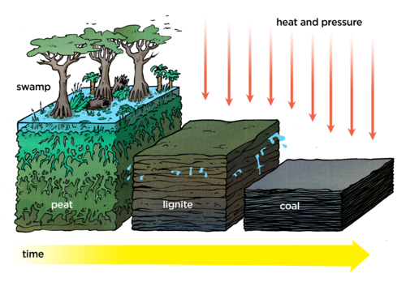
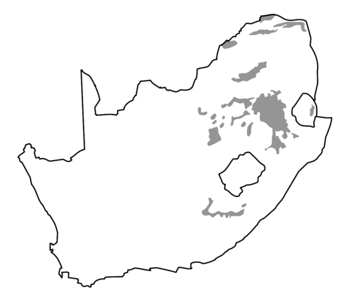
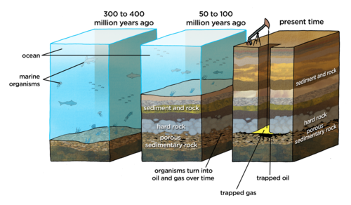
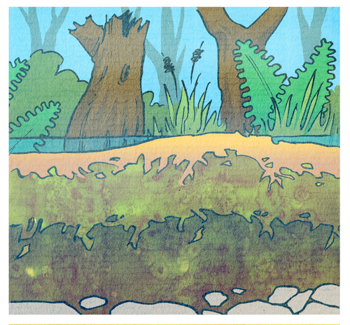
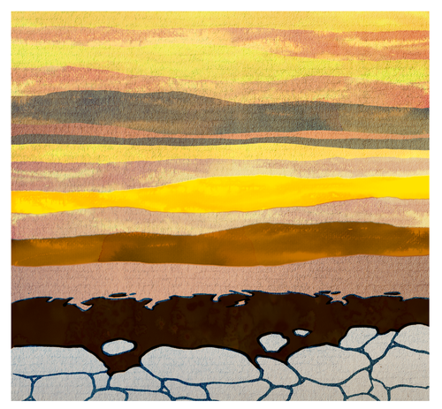
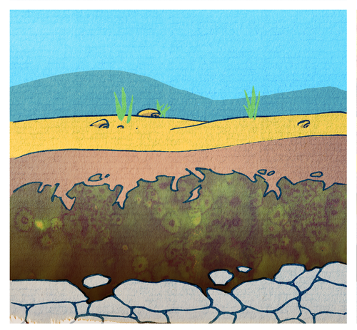
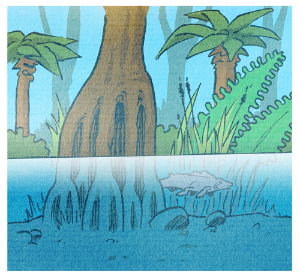
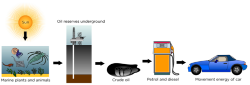

## Stored solar energy

<Callout type="note" title="Note">
- fossil fuels
- coal
- crude oil
- natural gas
- renewable
- non-renewable
- vegetation
</Callout>

Earlier this year you learnt about **renewable** and **non-renewable** energy sources. **Fossil fuels** are examples of non-renewable energy sources. In this section we are looking at the relationship between the Earth and the Sun and how solar energy is stored on Earth. We have learnt that plants store the Sun's energy and we are able to use that energy later on. But what happens to the stored energy when plants die? To answer this question we need to go back in time. Millions of years back in time...

# Going back in time

This is an optional activity. This video is only 9 minutes long and gives a useful link between the Sun's energy and how it was captured long ago. It gives the conditions for the formation of fossil fuels and explains how coal was formed. Play this video to your learners and let them answer the questions afterwards.

If video facilities are not available in your classroom, try to watch this video yourself and then use it to talk to the learners about the formation of fossil fuels. Alternatively, the text provides the information as well and can be used to facilitate a discussion before the activity is done.

The following video tells the story of how fossil fuels were formed millions of years ago and how we are able today to use the energy captured at the time:

Watch the video and answer the questions below.

**QUESTIONS:**

**Problem:**
What are fossil fuels?

**Solution:**
A source of fuel/energy made from the fossilised remains of ancient plants and sea animals.

**Problem:**
Are fossil fuels renewable or non-renewable? Give a reason for your answer.

**Solution:**
Non-renewable, it cannot be replaced once used up.

**Problem:**
What conditions are needed for fossil fuels to form?

**Solution:**
Saturated environment (lots of water), anaerobic conditions (lack of oxygen), increased/high pressure, increased/high temperature.

**Problem:**
How were each of these conditions met at the time when fossil fuels were formed?

**Solution:**
Swamps created areas of saturation and lack of oxygen (anaerobic conditions). As the plants died and layers upon layers were formed, the pressure on the lower layers increased. As the layers moved deeper in the Earth, they were subjected to increasingly high temperatures (it gets hotter the further down in the Earth's crust that you go).

**Problem:**
Why are fossil fuels important?

**Solution:**
Fossil fuels are important as they form a vital part of the economies and lifestyles of all people on Earth. They have stored energy which we now use to drive many machines, vehicles and processes in our lives.

**Problem:**
Why can't we make fossil fuels today?

**Solution:**
Fossil fuels need millions of years to form.

Fossil fuels were formed millions of years ago. **Coal,crude oil**and**natural gas** are examples of fossil fuels. The different fossil fuels were all formed in slightly different ways. Let's look at how they were formed.

### Formation of coal

Millions of years ago the Earth was covered with fern-like plants. The plants captured the Sun's energy and manufactured carbohydrates through the process of photosynthesis, just like plants do today. Through changes in the conditions on Earth, the land was increasingly covered by water, forming swamps. Over time the plants died, forming a thick layer of dead **vegetation** on swamp bottoms.

As more water covered the land, sand and silt were washed in and covered the dead vegetation, enabling more and more plants to grow. These plants eventually died as well and more layers of plant material formed. Again they were was covered with water, sand and soil. This process repeated itself for millions of years building up massive layers of dead plant material, called **peat**. The peat layers eventually became buried and compressed by further layers of sediment forming above them.

Deep in the Earth the peat was subjected to pressure and heat, and turned into **lignite**, a porous type of coal. Upon further pressurisation and heating, more moisture was squeezed out of the lignite until it became soft, bituminous coal and eventually anthracite, the hardest type of coal available.

<Callout type="note" title="Note">
**Bituminous** coal is a soft coal, containing bitumen, a sticky, black tar-like substance. Bituminous coal is of a lower quality than **anthracite** coal, which is a hard, compact coal with the highest carbon content out of all the coal types.
</Callout>

Coal was formed from the remains of ancient plants over millions of years.

# Coal formation flow diagram

**INSTRUCTIONS:**

2. Read the above section on the formation of coal and summarise it in a flow diagram.
4. The following tips will help you draw your flow diagram:
   2. Underline the most important key words.
   4. Write a short sentence on each event.
   6. Identify the order in which events took place.
   8. Link the sentences using arrows.

The purpose of this activity is to practice the skill of identifying the most important facts from text and translating the information into a flow diagram. Learners also need to be able to extract the order of events from a paragraph.

Fernlike plants lived on Earth millions of years ago →

Plants captured the Sun's energy through photosynthesis →

Earth became wetter and swamps formed →

Plants died forming thick layers of peat →

Water washed in silt and sand →

More plants grew and died →

More layers formed →

Layers were compressed and heated, squeezing out more and more moisture →

Peat turned into lignite →

Lignite turned into bituminous coal →

Bituminous coal turned into anthracite coal →

Coal is found in a number of different areas in South Africa. Study the map to see where the coal deposits are located in South Africa. Millions of years ago the interior of South Africa was a large swamp where many plants grew and died, eventually forming coal.

<Callout type="note" title="Note">
92% of the coal consumed in Africa, is mined in South Africa.
</Callout>

: Coal deposits in South Africa.

<Callout type="note" title="Note">
South Africa is one of the seven largest coal producing countries in the world. A quarter of the coal mined in South Africa is exported, mostly from Richards Bay.
</Callout>

### Formation of crude oil and natural gas

Oil, also known as crude oil, and natural gas were also formed millions of years ago by processes similar to those leading to the formation of coal. Sea animals and plants died in the oceans and were deposited on the ocean floor. Over millions of years, layer upon layer of marine deposits formed and were covered by sand and silt.

Through the actions of temperature and pressure, the deposits were changed into crude oil and natural gas. Today, oil and gas are trapped under layers of rocks and sediment and have to be drilled and pumped out of the Earth. South Africa has some gas fields off the coast of Mossel Bay, but we do not have any oil reserves.

: Crude oil and gas were formed millions of years ago.

Crude oil is a thick, dark, sticky substance when it comes out of the ground. Crude oil has many uses, but has to be refined first to obtain different a number of different products. These different products have different boiling points, which is how they can be separated from each other. Do you remember that we learnt about this in Matter and Materials when looking at how to separate mixtures? What is the name of this technique where different components, which have different boiling points, are separated by evaporating and collecting them?

We call the separated components fractions, and the process, fractional distillation.

Crude oil is refined to make a number of different products such as motor oil, petrol, lighter fuel, aeroplane fuel, diesel and tar, Vaseline and other waxes. The components of crude oil are evaporated at different temperatures, starting with lighter fuel (which has the lowest boiling point), then jet fuel, then petroleum, then motor car oil, until only tar is left. When crude oil is refined, some of the raw materials extracted from this process are then used to make plastics and various chemicals.

# Forming coal

The purpose of this activity is to support learners in making sense of information. Here they need to put information in order by applying what they know about the process of coal formation. If there are learners struggling to find the correct order, guide them by telling them to look at number of layers of coal formed. The learners should use the pictures to guide their discussion in the paragraph.

**INSTRUCTIONS:**

2. The following pictures explain the formation of coal. The pictures are not in the correct order.
4. Study the pictures and order them in the correct order to show how coal is formed.
6. Write a paragraph explaining the formation of coal.

Picture 1.

Picture 2.

Picture 3.

Picture 4.

The correct order is: 4, 1, 3, 2

Millions of years ago ferns and trees grew in swamps. As they died, they formed thick layers of vegetation in the swamps. Rain and rivers washed in sand and soil, which covered the dead plant material. More plants grew, died and formed layers of dead plant material called peat. Over millions of years the peat layers got buried deeper within the Earth's crust, subjecting the layers to high temperatures and pressure. Over time, the peat turned into lignite. High temperatures and pressure squeezed and squeezed more water from the lignite and layers of bituminous coal and later anthracite was formed.

The video resource on the formation of fossil fuels from the activity done earlier in this section () can also be used here to help learners by providing them with a visual picture of how coal was formed. As an extension of this activity, learners could be asked to make up their own drawings for the formation of oil or gas.

<Callout type="note" title="Note">
The formation of coal (video).
</Callout>

### Fossil fuels store and transfer solar energy

What type of energy is stored in fossil fuels?

The energy is stored in the form of potential energy in fossil fuels.

When we use fossil fuels, the stored energy is transferred to another part in the system, for example as kinetic energy. We already saw this in Energy and Change last term when looking at how a coal-powered power station works to generate electricity. In a coal-powered station, coal is burned and used to boil water. The steam produced then turns the turbine, which in turn causes the generator to turn to produce electricity. In the next activity we will investigate how the Sun's energy is transferred through fossil fuels.

# Explaining the flow of energy

This activity can be used to link what was done in the previous term on energy transfers within a system, with the content from this term. This will also give the learners the opportunity to revise what was done earlier in the year.

**INSTRUCTIONS:**

Petrol is made from crude oil, a fossil fuel. Use the diagram below to answer the questions about how the Sun's energy is captured in petrol and how this helps life on Earth.

**QUESTIONS:**

**Problem:**
Using the diagram, explain how the Sun's energy is captured in petrol and used in cars.

**Solution:**
The energy from the Sun (or solar energy) was captured through the process of photosynthesis by sea plants. The marine animals obtained energy by eating the plants. Millions of years ago the sea animals and plants died in the oceans and were deposited on the ocean floor. They were covered with sand and silt and formed layers and layers of dead matter. Over time, and through the working of temperature and pressure, the remains were changed into crude oil and natural gas. Crude oil was extracted from the ground by mining and refined to make petrol, which is then used to fuel cars.

**Problem:**
What transfer of energy takes place within the system?

**Solution:**
The Sun's radiant energy is transferred to chemical potential energy in the marine organisms and then stored within the oil. The potential energy in the oil/petrol is transferred to kinetic energy when the car moves.

**Problem:**
Why is petrol important in our lives?

**Solution:**
We use petrol for transport, for example, to transport food from farms to cities (or any other link between transport and food can be supplied). Any appropriate answer of how we use petrol to sustain life can also be accepted.

**Problem:**
Draw a labelled flow diagram to show the transfer of energy from the Sun to a fire made from burning anthracite, a type of coal.

**Solution:**
The learners should draw the Sun with an arrow going to trees and other plants with an arrow going to coal with an arrow going to a fire with the burning coal. Each picture should have a label.

**Problem:**
For each label write a sentence explaining how the energy is transferred. Also give an example of how this energy can be used in human activity.

**Solution:**
A possible answer could be: The Sun is the source of solar energy. Plants capture the energy through photosynthesis. Ancient plants formed coal which stored the energy from the Sun. When the coal is burned, the energy which was stored millions of years ago, is released. This energy can be used for human activities, for example cooking. In this way the Sun's energy was transferred through plants and coal to be released from the coal by burning.

<Callout type="note" title="Note">
An interesting video on what would happen if the world's oil ran out.[www.youtube.com/watch?v=VnCc6V6YI0Y](https://www.youtube.com/watch?v=VnCc6V6YI0Y)
</Callout>

A very thought-provoking video on what happens when oil runs out can be found in the Visit margin box. It is quite a long movie, but will lead to a very interesting class discussion. The following questions could be used to generate class discussion, and are not meant to have right and wrong answers. Not all the questions need to be used.

2. How did people react immediately, one year later, and 40 years after all the oil disappeared?
4. How would this affect you?
6. How would this affect South Africa? How is South Africa different to the United States of America?
8. How would you and your family survive?
10. What jobs would be important in a world without oil?
12. Do you think countries should grow crops for fuel or food?
14. What is the effect on the animal populations?
16. What effect would this have on disease and combating diseases in hospitals?
18. How important is fuel for life on Earth?
20. What would the effect be on recycling? Do you think we should recycle? What should we recycle and why?

This stored energy is not in limitless supply. It will run out at some point so we need to be very careful how we use it, and we need to find alternatives to using fossil fuels for our energy supply. Do you think that people on Earth are using our fossil fuels wisely? Let's investigate how fossil fuels are used in our homes.

<Callout type="note" title="Note">
We also rely on crude oil for many products besides as a source of energy, such as producing plastics, lubricating waxes and oils and other materials and chemicals.
</Callout>

# The use of fossil fuels in your home

Learners should not only focus on the use of fossil fuels as an energy source, but they should also look at the many other ways that we use fossil fuels in our daily lives, such as our use and reliance on plastics, various chemicals, lubricating substances, etc. This has an impact when talking about our reliance on fossil fuels.

Provide some guidelines on the format of the reporting required. You can decide whether it must be a written report, a project to complete over the course of this chapter or term, a poster, an oral presentation, or a combination. You can use the various Assessment Rubrics at the back of your Teacher's Guide to assess learners reports, projects or posters.

If time permits, a general class feedback discussion could follow when the learners hand in their reports. This would close the chapter reinforcing our responsibility to use fossil fuels wisely.

For this task, you need to find out how much your household makes use of fossil fuels in one month.

**INSTRUCTIONS:**

**Problem:**
Make up a question that you would like to answer. You teacher will help you formulate this. Write your question below.

**Solution:**
Learner-dependent answer.

**Problem:**
Think about what information you need and design a table where you will gather this information.

**Solution:**

**Problem:**
Research information about fossil fuels and their uses.

**Solution:**

**Problem:**
Report the information in the format that your teacher specified (either a written report, a poster or a project):

2. Do a write-up which clearly shows how your findings are linked to fossil fuels, and how you collected your data.
4. What have you found? Write a paragraph on your findings.
6. Write a conclusion. Answer the question you posed in step 1.
8. Make some recommendations on what you have found. Does your family use a lot of fossil fuels? Is this good or bad? Why do you think so? Give your own opinion here.

**Solution:**

Discuss the formulation of an investigative question in class. Examples are: How much electricity does my household use in a month? How much petrol does my household use in a month? (In this case, public transport should also be included.) What other products do we use at home that are derived from fossil fuels? If learners choose to use electricity as a measure of the fossil fuel use, then they need to clearly state how this is related to fossil fuels, for example the burning of coal to generate electricity.

Below are some exemplar tables. These are not complete and should only be used to help learners think about what information they need. It might be necessary to discuss this in class before learners start working on it on their own.

| Appliance | Power (Watts) | Time used | Consumption (kWh) | Price per unit |
| --- | --- | --- | --- | --- |
| Geyser |  |  |  |  |
| Stove |  |  |  |  |
| Kettle |  |  |  |  |
| Light bulbs |  |  |  |  |
| etc. |  |  |  |  |

| Mode of transport | Distance | Fuel consumption * | Litres of petrol used | Price per litre of petrol |
| --- | --- | --- | --- | --- |
| Car |  |  |  |  |
| Bus |  |  |  |  |
| Taxi |  |  |  |  |

* Take note that the average fuel consumption can be calculated as litres per 100 km. You can also then discuss with learners that more fuel is used, the more you accelerate.

| Household product | Fossil fuel source | Method of manufacture |
| --- | --- | --- |

Learners will need about a week to plan this investigation and gather the information. The activity can be handed out in the beginning of the section to allow enough time for learners to complete this investigation.
