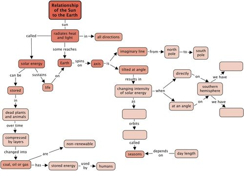
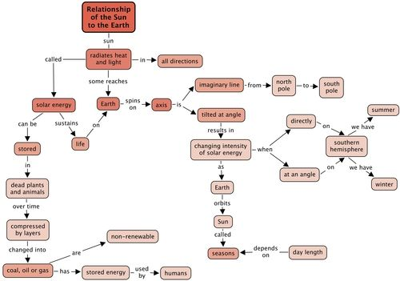

## Summary

<Callout type="note" title="Note">
- The Earth revolves around the Sun completing one orbit every 365 ¼ days. As the Earth revolves around the Sun it also spins on its axis completing one rotation in 24 hours.
- The Earth's rotation axis is tilted in space. The North Pole points towards the star Polaris and the axis is offset from the vertical by 23.5 °.
- The tilt of the Earth's rotation axis is responsible for the seasons on Earth.
- Areas near the equator are warmer than areas near the poles because they receive more direct sunlight.
- The Sun's energy is captured and used by plants to produce carbohydrates, which the plant uses and stores. Plants form the basis of food chains.
- The energy stored by plants millions of years ago is available to us today in fossil fuels. The energy however is non-renewable.
- Coal, crude oil and natural gas was formed millions of years ago from the remains of dead animals and plants.
- Life on Earth depends on the Sun's stored energy in fossil fuels.
</Callout>

**Concept map**

Look at the concept map below which shows what we have learnt in this chapter about the relationship between the Sun and the Earth.

Fill in the blank spaces to complete the concept map. You need to fill in two of the seasons. To do this, read the concept map and complete the sentence. For example "when **solar energy** falls **directly** on the **Southern Hemisphere**, we have …...."

There are also two blank spaces to fill in about what orbits what in terms of the Sun and the Earth.

It is important to take note of which direction the arrows are pointing in a concept map so that you know which way to read it. For example, below where we have:

The arrow is pointing to the left so this reads, "Day length depends on seasons" and NOT the other way around "seasons depends on day length".

Teacher's version:

# Revision questions

**Problem:**
What causes day and night? [2 marks]

**Solution:**
We have day and night because the Earth rotates on its axis. The side of the Earth facing the Sun is lit up it is daytime for this side. The side not facing the Sun is dark. It is night time for this side. Because the Earth is continually rotating each point on the Earth experiences successive daytime and nighttime.

**Problem:**
The Sun appears to move across the sky during the day moving from east to west. What is really happening? [2 marks]

**Solution:**
The Earth is spinning on its axis west to east (anti-clockwise). The Sun does not move, but it is rather due to the Earth's rotation.

**Problem:**
What is the difference between rotation and revolution? [2 marks]

**Solution:**
Rotation is when an object spins around on its own axis. Revolution is when an object moves around (orbits/revolves) another object, such as the planets around the Sun.

**Problem:**
How long does it take the Earth to complete one rotation? [1 mark]

**Solution:**
24 hours (actually 23 hours and 56 minutes!)

**Problem:**
How many days does it take for the Earth to complete one revolution around the Sun? [1 mark]

**Solution:**
365 ¼.

**Problem:**
Why do you think we have leap years every 4 years, when there is an 'extra day', 29 February? [1 mark]

**Solution:**
Because of the extra 1/4 days, which every 4 years adds up to a whole day.

**Problem:**
What does sunlight do for the Earth? [2 marks]

**Solution:**
It provides radiant energy to the Earth in the form of heat and light.

**Problem:**
Why is it hotter at the equator than at the poles? [4 marks]

**Solution:**
As the equator is always hit by direct rays from the Sun it is always warm as the solar energy is spread over a small surface area (intense). Areas that are hit by indirect light are cooler because the Sun's energy is spread out over a large area. The poles are always hit by indirect rays which explains why it is cold at the North and South Poles.

**Problem:**
What causes the seasons on Earth? [5 marks]

**Solution:**
The seasons are caused by the tilt of the Earth's rotation axis relative to the Earth's orbital plane as it travels around the Sun. If the Northern Hemisphere is tilted towards the Sun at a particular point during the Earth's orbit, it receives more direct sunlight. In this case the solar energy is spread over a smaller area, is more intense and thus temperatures are warmer and it is summer. Meanwhile the Southern Hemisphere is tilted away from the Sun and receives indirect sunlight. In this case the solar energy is spread out over a larger area, it is less intense and thus temperatures are lower and it is winter in this hemisphere. Because the Earth's axis always tilts in the same direction in space, six months later the opposite hemisphere is tilted towards the Sun and the seasons are reversed in the two hemispheres.

**Problem:**
Explain why the seasons cannot be caused by the change in the Earth's distance from the Sun as it travels along its slightly oval (elliptical) orbit. [2 marks]

**Solution:**
If the change in distance were responsible for the seasons, then the Southern and Northern Hemispheres would experience summer and winter at the same time, which is not the case. The Earth's orbit around the Sun is elliptical but it is nearly a perfect circle; it is off by only \(\text{4}\)% and the resulting difference in incoming solar radiation is only \(\text{7}\)% which is very small and not sufficient to cause the variations in the temperatures associated with the seasons.

**Problem:**
Where does crude oil come from? [2 marks]

**Solution:**
Crude oil was formed millions of years ago from the remains of sea animals and plants through the action of high temperature and pressure.

**Problem:**
Why are the coal deposits found mostly in the same area in South Africa? [1 mark]

**Solution:**
Millions of years ago interior areas of South Africa used to be a large inland lake which became a swamp.

**Problem:**
Compare the formation of natural gas, crude oil and coal by completing the following table. [5 marks]

|  | When was it formed? | What was it formed from? | What conditions were need for its formation? | Does South Africa have this natural resource? | Renewable or non- renewa ble resource? |
| --- | --- | --- | --- | --- | --- |
| Coal |  |  |  |  |  |
| Oil |  |  |  |  |  |
| Natural Gas |  |  |  |  |  |

**Solution:**
|  | When was it formed? | What was it formed from? | What conditions were need for its formation? | Does South Africa have this natural resource? | Renewable or non- renewa ble resource? |
| --- | --- | --- | --- | --- | --- |
| Coal | Millions of years ago | Remains of dead plants | High temperature and pressure | Yes | Non-renewable |
| Oil | Millions of years ago | Remains of dead sea animals | High temperature and pressures | No | Non-renewable |
| Natural Gas | Millions of years ago | Remains of dead sea animals | High temperature and pressures | Yes | Non-renewable |

**Problem:**
Explain how fossil fuels are able to store the Sun's energy. [4 marks]

**Solution:**
Millions of years ago ancient plants used the Sun's energy, carbon dioxide and water to produce energy-rich glucose through photosynthesis. The glucose was stored in the plants. As the plants died their energy was transferred to the coal, natural gas or crude oil that was formed.

**Problem:**
The Sun's energy is essential for life on Earth. Draw a flow diagram to show how the Sun's energy is transferred through natural gas and used in gas cooker in a household. Use appropriate labels to explain the diagram. [4 marks]

**Solution:**
Learners should draw a flow diagram from the Sun to sea plants and sea creatures to natural gas (drawing can be an underground gas chamber) to a gas cooker showing the flame. Labels that should be included are: Sun (solar energy); Sea plants (capture the Sun's energy through photosynthesis); natural gas (formed over millions of years, stores the Sun's energy); gas cooker (releases the energy when the gas is burned)

Total [38 marks]
