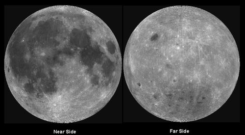
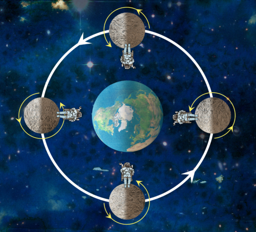
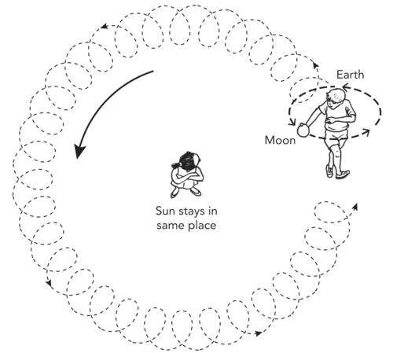
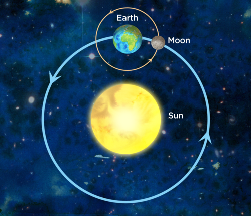
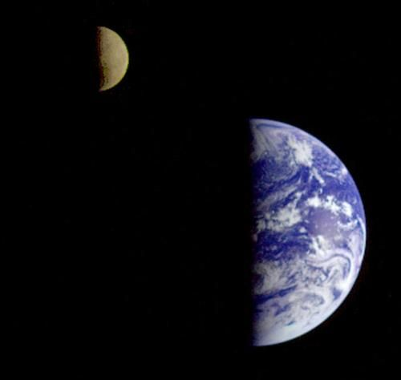
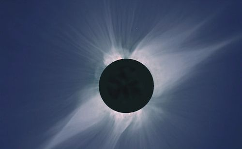
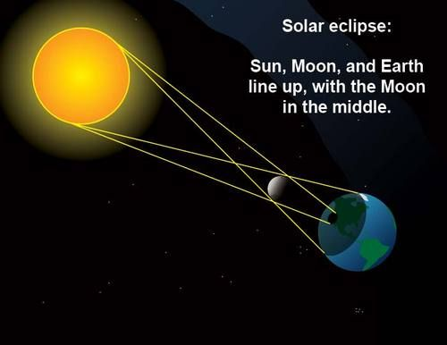
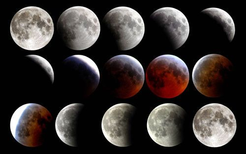
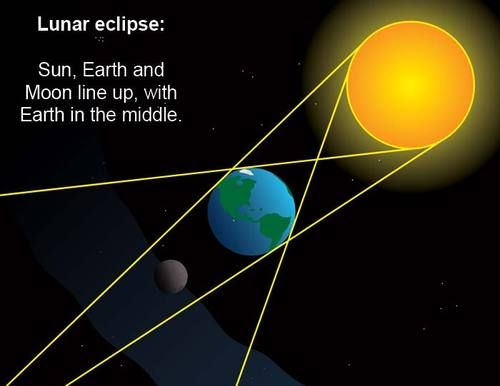

## Relative positions

<Callout type="note" title="Note">
- moon
- lunar
- eclipse
</Callout>

You learnt about the Moon in Grades 4 and 6. Lets see what you can remember!

# Moon revision quiz

This is an activity to review material covered in Grades 4 and 6. It is a short, optional activity.

**INSTRUCTIONS:**

**Problem:**
Fill in the gaps in the Earth-Moon comparison table below using the word bank.

| Word bank: rock, soil and water rock and lunar soil reflects absorbs Sun Earth an no larger smaller 24 27.3 |
| --- |

| The Earth | The Moon |
| --- | --- |
| Surface consists of _____. | Surface consists of _____. |
| Is ____ _than the Moon | Is _____ than the Earth |
| Is visible because it _____ light from the Sun hitting it. | Is visible because it _____ light from the Sun hitting it. |
| Is in orbit around the _____. | Is in orbit around the_____. |
| Spins on its axis once ever y _____ hours. | Spins on its axis once every _____ days |
| Has _____ atmosphere. | Has _____ atmosphere. |

**Solution:**
| The Earth | The Moon |
| --- | --- |
| Surface consists of rock, soil and water . | Surface is consists of rock and lunar soil. |
| Is larger than the Moon | Is smaller than the Earth |
| Is visible because it reflects light from the Sun hitting it. | Is visible because it reflects light from the Sun hitting it. |
| Is in orbit around the Sun. | Is in orbit around the Earth. |
| Spins on its axis once every 24 hours. | Spins on its axis once every 27.3 days. |
| Has an atmosphere. | Has no atmosphere. |

<Callout type="note" title="Note">
The Moon is actually covered in a layer of lunar 'soil' called regolith. This is why you can see astronauts' footprints on the Moon. Lunar 'soil' has different properties to soil on Earth, most significant is that terrestrial soil has organic matter in it.
</Callout>

Let's now take a closer look at the surface of the Moon.

# Observe the Moon!

In this activity learners look in detail at the surface features of the Moon. The photographs show images of both the near side and far side of the Moon which look quite different and learners should be encouraged to compare the two.

Images of the near side and far side of the Moon taken with NASA's Clementine spacecraft. Look at the difference between the two images, what do you notice?

**INSTRUCTIONS:**

2. Study the images of the Moon.
4. Answer the questions below.

**QUESTIONS:**

**Problem:**
Does the Moon's surface have any oceans or lakes?

**Solution:**
No, the surface is all solid rock and lunar soil (regolith).

**Problem:**
What do you notice covering much of the Moon's surface?

**Solution:**
Craters.

**Problem:**
Some areas look dark and others look lighter, the dark areas are called maria (singular mare) meaning seas, as astronomers initially thought that these areas were seas on the surface. The bright areas are called highlands as they are higher than the maria. On what side of the Moon (near or far) are there more dark areas (maria)?

**Solution:**
The near side has more maria.

<Callout type="note" title="Note">
Humanity got its first view of the far side of the Moon in 1959 when the Soviet Union launched the small spacecraft*Luna 3*. This was the first probe to get to the far side of the Moon and photograph it.
</Callout>

<Callout type="note" title="Note">
Read more about exploring the far side of the Moon.[http://www.planetary.org/blogs/guest-blogs/bill-dunford/20130429-dark-no-more-exploring-the.html](http://www.planetary.org/blogs/guest-blogs/bill-dunford/20130429-dark-no-more-exploring-the.html)
</Callout>

**Activity: Google the Moon**

This is an optional activity to do with your learners if you have internet access. You can use it as an alternative to the previous activity where the images are provided.

This activity is a nice way to incorporate ICT into a science lesson. The Google Earth software can be downloaded for free directly onto your computer from the following web address: [http://www.google.com/earth/explore/products/](http://www.google.com/earth/explore/products/) The software contains an interactive map of the Earth, Moon and Mars. Switching to 'Moon mode', learners can look at the surface of the Moon in amazing detail, rotating, and zooming in or out of the map. Additional information about the 6 Apollo landing sites is also available with photos and short videos. Both low and high resolution images of the Moon can be studied along with contour maps to explore the heights and depths of the craters. If you do not have access to a computer then an alternative activity is to show students a variety of photographs of the Moon.

**MATERIALS:**

- Computer
- Google Earth software (freely downloaded from the internet)

**INSTRUCTIONS:**

2. Open the Google Earth software installed on your computer.
4. Switch to Moon mode.
6. Study the images of the Moon, rotating, zooming in and out to look at the surface features.
8. Read the information about the Apollo missions and other missions to the Moon.

**QUESTIONS:**

Use the Google Earth Moon images to answer the following questions.

2. Does the Moon's surface have any oceans or lakes?

*No, the surface is all solid rock.*

2. What do you notice covering much of the Moon's surface?

*Craters.*

2. Some areas look dark and others look lighter, the dark areas are called maria (singular mare) meaning seas, as astronomers initially thought that these areas were seas on the surface. The bright areas are called highlands as they are higher than the maria. Rotate the image of the Moon around. On what side of the Moon (near or far) are there more dark areas (maria)?

*The near side has more maria.*

2. In what mare or sea did the Apollo 11 mission land?

*Sea of Tranquility. (Latin: Mare Tranquillitatis).*

The Earth, just like all the other planets in the solar system, travels around the Sun, completing one revolution every year. As the Earth travels around the Sun it has a companion in space: our Moon!

<Callout type="note" title="Note">
The time that it takes an object to make one complete orbit around another object, relative to the stars, is called the orbital period or synodic period.
</Callout>

The Moon orbits around the Earth completing one revolution every 27.3 days. Our Moon rotates on its own axis and experiences daytime and dark nighttime just like the Earth does. However, the Moon spins much more slowly than the Earth does and completes one rotation on its axis once every 27.3 days. Did you notice that the Moon takes the same amount of time to spin on its axis as it does to orbit completely around Earth? This means that from the Earth, we always see the same side of the Moon (called the 'nearside'). The side we do not see from Earth, called the 'farside', has been mapped during space missions to the Moon.

The **sidereal period** of the Moon is mentioned in the previous paragraph, namely the Moon completes an orbit around the Earth about once every 27.3 days. This is not to be confused with the Moon's **synodic period**, which is 29.5 days. The synodic period of the Moon is due to the Earth moving in its orbit about the Sun at the same time, and so it takes slightly longer for the Moon to show the same phase to Earth.

<Callout type="note" title="Note">
Why do we only see one side of the Moon? (video)
</Callout>

The Moon spins on its own axis at the same rate that it revolves around the Earth. As it completes one quarter turn on its axis it also completes one quarter of its orbit. This results in the same side of the Moon always facing Earth.

<Callout type="note" title="Note">
The Moon revolves around the Earth at an average orbital speed of about 1 km per second!
</Callout>

Viewed from above, the Moon moves in an anti-clockwise direction around the Earth. The Moon's orbit is not a perfect circle, it is elliptical, so its distance from Earth varies as it revolves around the Earth. The average distance is about 385 000 km, which is about 60 times the radius of the Earth itself. For comparison, the Earth's average distance from the Sun is 149 597 871 km, or about 23 481 times the radius of the Earth. You can see now why the Moon is called Earth's close companion!

In Gr. 6, learners would have done some activities to act out the revolution of the Moon around the Earth as the Earth orbits the Moon. You can view this content online at [www.thunderboltkids.co.za](http://www.thunderboltkids.co.za). Here is a link to the actual content: http://bit.ly/15wPXbE. Here is an image of the activity if you would like to repeat it with your learners to reinforce the relative positions of the Earth, Moon and Sun.

Diagram showing the Earth's motion around the Sun and the Moon's motion around the Earth.

<Callout type="note" title="Note">
In the diagram, the Sun and Sun-Earth distance are not drawn to scale, the Sun would be MUCH larger than in this image and the distance between the Sun and Earth would also be MUCH larger.
</Callout>

An image of the Earth and Moon taken from the Galileo satellite on its way to Jupiter over 6 million km away. The Moon's diameter is just under a third of the Earth's diameter. You can see the sunlit sides of the Earth and Moon. On what side do you think the Sun is?

The Sun is on the right.

The following table summarises some useful information about the Sun, Earth and Moon.

| Characteristic | Sun | Earth | Moon |
| --- | --- | --- | --- |
| Relative position | Is at the centre of our solar system | Orbits the Sun once every 365.25 days | Orbits the Earth once every 27.3 days |
| Rotation | Spins on its own axis roughly once every 28 days | Spins on its own axis once every 24 hours | Spins on its own axis once every 27.3 days |
| Distance from orbited body | - | 23 481 Earth radii from the Sun | 60 Earth radii from Earth |
| Size | Diameter is roughly 100 times the Earth's diameter | - | Diameter is roughly ⅓ times the Earth's diameter |

<Callout type="note" title="Note">
Did the Earth have two Moons?
</Callout>

We have now looked at the relative positions and movement of the Earth, Moon and Sun. Let's extend this knowledge to learn about a solar eclipse.

# Total Solar Eclipse

In this activity, the idea that the apparent size of an object depends upon its distance from an observer is reinforced. Learners will find that although the Sun is much much larger than the Moon, it appears about the same size in the sky because it is much more distant than the Moon.

**INSTRUCTIONS:**

Look at the image below. It shows a total solar eclipse which you learnt about in Gr. 6. This happens when the Moon passes directly in front of the Sun and blocks the Sun's light. The bright light from the Sun is blocked, allowing us to see the very faint outer edge of the Sun's atmosphere, called the corona. We normally cannot see the corona as it is swamped by the bright light from the Sun. When you look at the size of the Moon in the sky compared with the size of the Sun in the sky you see that they are very similar. We call this the **angular size**. This is because the Moon is much closer than the Sun. The Moon appears large enough from Earth to totally block out the Sun's light.

A total solar eclipse. The Moon is in front of the Sun allowing us a rare glimpse of the Sun's outer corona, with thin wisps of atmosphere extending into space.

<Callout type="note" title="Note">
What is a solar eclipse? (video)
</Callout>

**QUESTIONS:**

**Problem:**
Which in reality is larger, the Moon or the Sun?

**Solution:**
The Sun is larger.

**Problem:**
Which is further away, the Moon or the Sun?

**Solution:**
The Sun is further away.

**Problem:**
How do the angular sizes of the Moon and the Sun compare when viewed from the Earth's surface?

**Solution:**
They are almost the same.

**Problem:**
Why is this the case?

**Solution:**
Although the Sun is much larger than the Moon, it is much more distant. As objects appear to look smaller and smaller the further away they are, the Sun appears smaller than it is in reality. The Moon also appears smaller than it is in reality, however it is much closer to the Earth than the Sun is and so its apparent size isn't reduced as much as the Sun's is. Just by chance, the Sun and moon are currently at distances where they have the same angular size viewed from the Earth's surface.

A total solar eclipse occurs when the Earth, Moon and Sun are aligned in a straight line with the Moon placed in between the Earth and the Sun. Just by chance, the Sun and Moon are currently at distances where they have the same angular size viewed from the Earth's surface. If the angular size of the Moon were smaller, it would not be large enough to completely block the Sun and we wouldn't have total solar eclipses! The picture below shows the relative alignment of the Sun, Earth and Moon during a solar eclipse.

The Sun, Moon, and Earth all lined up during a solar eclipse. The black spot on Earth shows the location from where a total solar eclipse would be visible. This area is in the Moon's dark shadow. The grey area on Earth's surface indicates the location from where a partial eclipse would be visible.

<Callout type="note" title="Note">
Why does the Moon sometimes appear red?
</Callout>

We can also get a lunar eclipse. This is when the Sun, Earth and Moon line up with the Earth in the middle.

<Callout type="note" title="Note">
Read more about why the Moon can appear red during a lunar eclipse.[http://earthsky.org/space/why-does-the-moon-look-red-during-a-total-lunar-eclipse](http://earthsky.org/space/why-does-the-moon-look-red-during-a-total-lunar-eclipse)
</Callout>

A series of images showing the Moon during a full lunar eclipse.

See how a lunar eclipse compares to a solar eclipse in the diagram. In this case, the Earth blocks the sunlight from reaching the Moon's surface, making the Moon appear dark in the night sky.

Sun, Earth and Moon line up to form a lunar eclipse.

<Callout type="note" title="Note">
Find out when the next lunar eclipses will take place.[http://eclipse.gsfc.nasa.gov/lunar.html](http://eclipse.gsfc.nasa.gov/lunar.html)
</Callout>

<Callout type="note" title="Note">
The Moon is slowly moving away from the Earth at a rate of 3.8 cm per year (the Moon's orbit is getting larger). In about 563 million years time its angular size on the sky will have decreased so much that it will no longer be large enough to produce total solar eclipses!
</Callout>

**A note about lunar phases**

Learners will most likely be familiar with the change in the Moon's appearance over the course of a month, the lunar phases. Each lunar phase cycle from New Moon to New Moon takes 29.5 days, which is slightly longer than the Moon takes to complete one revolution around the Earth (27.3 days). This is because during the 27.3 days it takes for the Moon to revolve around the Earth, the Earth is moving along in its orbit. In order for the Moon to appear at the same phase *as viewed byan observer on Earth*it needs to travel slightly further than 360 degrees around the Earth and in order for it to be aligned such that there is a New Moon it takes about an extra 2 days.

[http://www.sumanasinc.com/webcontent/animations/content/sidereal.html](http://www.sumanasinc.com/webcontent/animations/content/sidereal.html) shows a nice animation demonstrating the difference between the orbital period of the Moon which defines the sidereal month (27.3 days) and the lunar phase cycle which defines the synodic month (29.5 days).

Observers on Earth see the same phase where ever they are positioned on Earth. However, the phases (apart from New Moon and Full Moon) look different to an observer in the Northern and Southern hemispheres. We in the Southern Hemisphere view the Moon "upside down". This is important to note because \(\text{99}\)% of all textbooks and online references include the Northern Hemisphere view of the phases and this is *not* what learners will see when they view the Moon for themselves. An awareness of this is crucial to reduce learner confusion when looking online and in generic textbooks.

The activity below is an optional extension activity which links the relative positions of the Earth, Sun and Moon to the phases of the Moon observed.

**Activity: H ands-on Moon Phases**

As the Moon revolves around the Earth, the side facing the Sun is always illuminated, just as Earth's daylight side is illuminated by the Sun. However, from the Earth's surface we do not see a half Moon lit up all the time. Instead, we see a change in the amount of the Moon which is lit up by the Sun.

In this activity learners will learn that the relative position of the Earth, Moon and Sun determine what phase of the Moon is observed. Learners will use a lamp to represent the Sun. The learners will represent the Earth and a styrofoam ball stuck on a pencil will represent the Moon. If you cannot get hold of a styrofoam ball then you can use an orange instead. They will vary the location of the Moon in its orbit around the Earth and observe the phase of the Moon. A dark room is needed for this activity. If necessary darken the classroom with bin bags or curtains. In the centre of the room place an unshaded lamp to represent the Sun.

Ideally learners should work in pairs for this activity, so that one learner can draw their observations while the other learner holds the ball in place. Ensure that learners hold the balls slightly above their heads so that they do not cast shadows over the ball. In this exercise we make the assumption that the Earth remains in the same spot while the Moon orbits around the Earth.

Before starting the activity, explain to learners the names of the Moon phases and draw them on the blackboard: New Moon (entirely dark), Full Moon (entirely lit), Crescent Moon (mostly dark), Gibbous Moon (mostly lit) and First Quarter Moon (left half lit) and Third Quarter Moon (right half lit). [Note that the first and third quarter appearances listed here are for the Southern Hemisphere only]

**MATERIALS:**

- pencil (2 per pair)
- one lamp that can shine in all directions (i.e., a lamp base with a bare 100 to 150 Watt bulb and no lampshade)
- styrofoam balls (1 per pair)
- black plastic bags (and tape) or curtains to darken the classroom
- sheet of paper (1 per pair)

**INSTRUCTIONS:**

2. You will work in pairs for this activity.
4. Place a lamp representing the Sun in the centre of the classroom. Even for a large classroom, you should only use one bright lamp placed in the middle of the classroom otherwise you will have shadowing effects that may ruin the results.
6. Darken the room if needed by taping dark plastic bags to the windows or closing the curtains.
8. Stick one of the pencils into your styrofoam ball so that you can hold the ball up by the pencil end. This ball represents the Moon.
10. All learners must stand in a circle around the central light, with your partner next to you in the circle.
12. Directly face the light in front of you. One of you should hold the ball at arms length, slightly above your head, and the other should hold the pencil and paper. The person holding the ball represents the Earth.
14. If you are holding the ball, move the ball from left to right (keeping still) and observe how much of it is lit by the light as you move it around. Now let your partner do the same.
16. Look at the different phases of the Moon drawn on the blackboard by your teacher (New Moon, Full Moon, First quarter, Third quarter).
18. One of you should now hold the ball and position it until from your point of view it looks completely in shadow. This represents New Moon.
20. The member of the pair not holding the ball should now draw the relative positions of the Sun, Moon and Earth, and write down the Moon phase corresponding to these positions.
22. Swap the person holding the ball and the pen/paper, and position the ball such that it is fully lit and looks like a Full Moon. The member of the pair not holding the ball should now write down the relative positions of the Sun, Moon and Earth.
24. Repeat this for all the phases listed in 8.
26. Look at the crescent Moon on the blackboard. Find out what positions you can place the ball in to see it lit up like a crescent (less than half lit).
28. Swap positions again and this time find out what positions you can place the ball in to see it lit up in a gibbous phase (more than half lit).

**QUESTIONS:**

2. In what position do you need to place the Moon in order to see a New Moon?

*The Moon needs to be placed directly in between the Sun and the Earth.*

2. In what position do you need to place the Moon in order to see a full Moon?

*The ball needs to be place d directly opposite from the Sun, with the Earth in between the two.*

2. In what positions can you place the Moon in order to see a crescent?

*Any position as far as 90 degrees either side of the N ew Moon position (to the left or right).*

Another optional activity that learners may complete in their own time is a month long Moon observation. They may have already completed this activity in Gr. 6 but it is included here in case you wish to conduct a Moon observation as an additional activity.

**Activity: Month long Moon observation**

This activity can be conducted by students at home.The activity takes a month (30 days) to complete, therefore it can be done while other material is covered in class. Students may need reminding to complete their observations every day. Start the observations at New Moon so that the learners can follow the phases of the Moon in order. The dates of New Moon can be obtained online at http://aa.usno.navy.mil/data/docs/MoonPhase.php Once learners have completed all their observations you can discuss in class what they saw and ask them questions as to why they think the Moon changes its appearance.

**MATERIALS:**

- Moon observation chart
- pencil

**INSTRUCTIONS:**

2. Draw up an observation chart with blank circles to represent the moon each day.
4. Go out and observe the Moon. (You may have to do this during the day or during the night depending on when the Moon is visible).
6. Always stand in approximately the same spot and face the same direction (either south or north). Look from east to west and find the Moon.
8. Draw how the Moon looks by shading in the circles to reflect the shape of the Moon in your observation chart.
10. Note the date and time of your observation.

Help: For example, if you can see the whole Moon, you do not need to shade in any part of the circle. If you can only see half of the Moon, shade the side of the Moon that you cannot see in the circle for that day. If you cannot see the Moon at all on a day, indicate this on your journal and also write down why you could not see the Moon.
