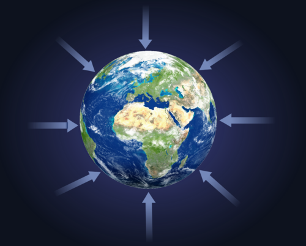
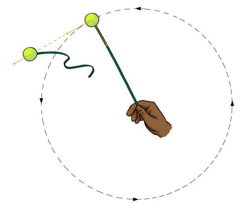
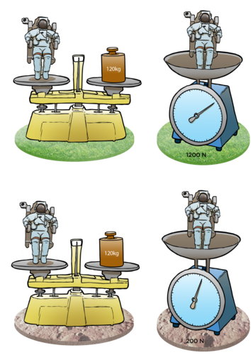
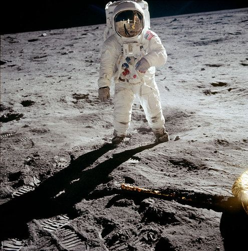

## Gravity

Before introducing the concept of gravity ensure that learners fully understand what is meant by a force (a push or a pull). Run through some everyday examples of forces that learners encounter such as pushing a trolley at the supermarket, or pushing or pulling their friends!

Strictly speaking when talking about "gravity" we are specifically referring to the gravitational force of attraction that occurs between the Earth (or another celestial body like a planet) and other objects, as opposed to the gravitational force in general which acts between any two objects with mass. For example, we would refer to the gravitational force acting to attract objects to the Moon as the Moon's gravity, but we would not generally refer to the gravitational force acting to attract things to ourselves as 'our gravity'.

<Callout type="note" title="Note">
- gravity
- mass
- weight
- acceleration due to gravity
- gravitational force
</Callout>

The word **gravity** is used to describe the **gravitational pull (force)** an object experiences on or near the surface of a planet or moon. The gravitational force is a force that attracts objects with mass towards each other. *Any object with mass exerts a gravitational force on any other object with mass*. So, the Earth exerts a gravitational pull on you, the desks in your classroom and the chairs in your classroom, holding you on the surface and stopping you from drifting off into space.

The Earth's gravity pulls everything down towards the centre of the Earth and so when you drop an object like a book or an apple it falls to the ground. However, do you know that you, your desk, your chair, and the falling apple and book exert an equal but opposite pull on the Earth? Why do you think that these pulls don't cause the Earth to move noticeably?

The Earth has a much larger mass than a person or a desk and so it is accelerated by a much smaller amount even though the force exerted on the Earth by a desk is the same size as the force exerted on the desk by the Earth (just in opposite directions). This is why the Earth does not movecnoticeably.

The arrows show the direction of the force of gravity by the Earth on all other objects with mass. The arrows all point towards the centre of the Earth because the gravitational force is always attractive.

<Callout type="note" title="Note">
Interact with this simulation to see the relationship between gravity and the masses of the object and distance between them.[http://phet.colorado.edu/sims/html/gravity-force-lab/latest/gravity-force-lab_en.html](http://phet.colorado.edu/sims/html/gravity-force-lab/latest/gravity-force-lab_en.html)
</Callout>

The PhET simulation in the visit box can be used to very easily demonstrate how the gravitational force between two objects increases with mass and decreases as the distance between the objects increases. You can turn off the values, and use the position of the little figures tugging on the ropes to qualitatively demonstrate the relationships.

The gravitational force between two objects decreases as the objects move further apart. If you double the distance between two objects the gravitational force between them decreases by a factor of four. Similarly if you triple the distance between them, the gravitational force between them decreases by a factor of nine. This explains why we are stuck to the Earth rather than the Sun. The Sun is 333 000 times more massive than the Earth and its gravity is much stronger than the Earth's. However, we are so far away from the Sun that the gravitational force the Sun exerts on us, is much smaller than the gravitational force the Earth exerts on us.

<Callout type="note" title="Note">
Watch Felix Baumgartner's supersonic freefall back to Earth.
</Callout>

The Moon is held in orbit around the Earth by the gravitational force between the Earth and the Moon. Similarly, the Sun's gravity holds the Earth in orbit around the Sun. Lets do an activity to demonstrate the Moon's orbit around the Earth.

# Demonstrating the Moon's orbit around the Earth

In this activity learners will demonstrate the orbit of the Moon around the Earth using a ball tied to a rope swung around their heads. They will demonstrate what would happen to the Moon if there were no gravity by letting go of the rope.

**Safety tip:** Do this activity outside or in the school hall if possible so that learners can spread out. This will help them avoid hitting each other when the balls are released. If this is not possible take it in turns to do this demonstration or have only a few learners do this demonstration so that no one is hit by a flying ball!

-->
                **MATERIALS**

- rope
- ball (tennis balls are ideal)

**INSTRUCTIONS**

2. Tie a ball to the end of a piece of rope. You may have to wrap the rope around the ball a few times to do this.
4. Hold the rope up high above your head and swing the rope around in a horizontal circle.
6. Let go of the rope and observe what happens.

Looking down at a ball swung in a circle after it is released.

**QUESTIONS:**

**Problem:**
How can you describe the movement of the ball as you swing it around?

**Solution:**
The ball moves around in a complete circle.

**Problem:**
The rope pulls the ball inwards towards the centre of the circle keeping the ball moving in a circle. What force holds the Moon in orbit around the Earth?

**Solution:**
The gravitational attraction between the Earth and the Moon.

**Problem:**
What happens to be ball when you let the rope go? \

**Solution:**
If the rope is released the ball flies off in the direction it was travelling in just as the rope was released.

**Problem:**
What does this represent in terms of the Earth and the Moon?

**Solution:**
This represents that the gravity keeps the Moon in it's path around the Earth. Without it, the Moon would move away from its path.

All the components in our Universe are held together by gravity. In summary we can say:

- The greater the mass of the objects, the stronger the gravitational pull between them.
- The closer objects are, the stronger the gravitational pull between them.

<Callout type="note" title="Note">
Move the Sun, Earth, Moon and space station to see how it affects their gravitational forces and orbital paths.[http://phet.colorado.edu/en/simulation/gravity-and-orbits](http://phet.colorado.edu/en/simulation/gravity-and-orbits)
</Callout>

### Weight

The content here on weight is not specified for Gr. 7 level in CAPS, and only appears in Gr. 9 in CAPS. However, as learners confuse mass and weight very easily, this has been included as enrichment material at this level. You can decide whether you want to cover this content with your learners or not. It is not to be assessed in Gr. 7.

The weight of an object is the force acting on it due to gravity. Weight is not the same as mass although the two words are often confused in everyday language.

The **mass** of an object is the amount of matter in the object, it tells you how many particles you have. Do you remember that we briefly spoke about atoms in Matter and Materials? So, for example, the mass of a wooden block tells us how many atoms there are. Mass is measured in kilograms (kg) and is independent of where you measure it. A wooden block with a mass of 10 kg on Earth also has a mass of 10 kg on the Moon.

However, an object's **weight** can change as it depends on the mass of the object and also the strength of gravity acting on it. Weight is measured in Newtons (N). For example the Earth exerts a gravitational force of about 10 Newtons for every kilogram of mass on its surface. So, a person with a mass of 50 kg has a weight of 500 N on the surface of the Earth.

The Moon also has its own gravity. The strength of gravity on the surface of the Moon is one-sixth that of the Earth, and so you would weigh one-sixth of what you do on Earth on the Moon. On Jupiter you would weigh 2.5 times more than you do on Earth as Jupiter's gravity is 2.5 times that of the Earth's. Even though you would weigh different amounts (and feel lighter on the Moon and heavier on Jupiter) your actual mass would stay the same in both cases.

An astronaut's mass remains the same wherever it is measured. The astronaut's weight however depends on where you measure it, as you can see the astronaut weighs 1200 N on Earth but only 200 N on the Moon.

Answer the following questions to check your understanding of mass and weight:

**Problem:**
Lindiwe has a mass of 50 kg on Earth. What is her mass on the Moon?

**Solution:**
50 kg as the mass of an object is independent of position.

**Problem:**
Andrew has a mass of 60 kg on Earth, what is his weight in Newtons on Earth?

**Solution:**
600 N (60 x 10)

**Problem:**
How much would Andrew weigh on the Moon?

**Solution:**
100 N (60 x 10/6)

**Problem:**
Would Lindiwe feel heavier or lighter on the Moon?

**Solution:**
She would feel lighter on the Moon, even though her mass is the same on the Moon.

# How much would you weigh on other planets?

In this activity, learners calculate what their weight would be on the seven other planets in our solar system. Although their mass remains the same, they will "feel" lighter or heavier because of the differences in the gravitational field strength on the surfaces of the other planets. You should emphasise that their mass always remains the same, but only their weight varies. If you do not have access to weighing scales you can either ask learners to estimate their mass or provide them with an example number.

**MATERIALS:**

- weighing scales
- calculator

**INSTRUCTIONS:**

2. Measure your mass in kilograms using weighing scales. Record the value in the table below.
4. Look at the table below, it shows how strong the gravity is on each of the planets in our solar system.
6. Calculate your weight on each of the planets and enter it into the table below.

*Hint:* On Earth each kilogram weighs 10 Newtons. So if your mass is 50 kg then you weigh 50 x 10 = 500 N on Earth. If the strength of gravity on a planet is half the strength of the Earth's gravity then you would weigh half of what you weigh on Earth on that planet.

| Planet | Your mass (kilograms) | Strength of gravity relative to Earth | Your w eight (Newtons) |
| --- | --- | --- | --- |
| Earth |  | 1 |  |
| Mercury |  | 0.378 |  |
| Venus |  | 0.907 |  |
| Mars |  | 0.377 |  |
| Jupiter |  | 2.36 |  |
| Saturn |  | 0.916 |  |
| Uranus |  | 0.889 |  |
| Neptune |  | 1.12 |  |

Example answers for a 50kg learner

| Planet | Your mass (kilograms) | Strength of Gravity relative to Earth | Your weight (Newtons) |
| --- | --- | --- | --- |
| Earth | 50 | 1 | 500 |
| Mercury | 50 | 0.378 | 189 |
| Venus | 50 | 0.907 | 453.5 |
| Mars | 50 | 0.377 | 188.5 |
| Jupiter | 50 | 2.36 | 1180 |
| Saturn | 50 | 0.916 | 458 |
| Uranus | 50 | 0.889 | 444.5 |
| Neptune | 50 | 1.12 | 560 |

**QUESTIONS:**

**Problem:**
On which planets would you feel heavier than you do on Earth?

**Solution:**
You would feel heavier on Jupiter and Neptune.

**Problem:**
On which planets would you feel lighter than you do on Earth?

**Solution:**
You would feel lighter on Mercury, Venus, Mars, Saturn and Uranus.

**A note on falling objects**

A useful way to demonstrate the Earth's gravity is to look at falling objects. An optional extension activity is included below in which learners drop a variety of objects. You can take a vote from the class to see whether learners think that an apple or bag of sugar would hit the ground first. (Answer: they would hit the ground at the same time as long as air resistance is negligible.) It is very likely that learners will have the preconception that heavier items fall faster. It is not important at the moment that the learners answers are correct and do not try to lead them to the correct answer. They will hopefully discover it for themselves in the following experiment.

**Investigation: Dropping objects**

In this investigation learners need to work in pairs. They will initially drop a whole apple and half an apple from the same height at the same time. They will then further experiment with balls of different masses (but the same size) and balls of the same mass (but different volumes). It is very hard to drop objects at exactly the same time so that they hit the floor simultaneously so let the learners repeat the experiment several times until they are confident that they are dropping the objects at the same time. If it is hard for them to see which object hits the ground first, suggest to that learners they listen for the number of sounds they hear - one or two - when the objects hit. Learners might need to repeat this investigation many times since it most likely contradicts their preconceptions! Safety tip: It is probably a good idea to have the apples cut in half ahead of time.

Once the learners have finished their experiment you can demonstrate the effects of air resistance by dropping a hammer and a feather. Have the learners take a vote on what will happen when you drop the hammer and feather. Be ready to explain to learners that air resistance slows the fall of the feather and that if there were no air resistance the two would fall at the same rate and hit the floor at the same time.

**INVESTIGATIVE QUESTION:** Do different objects fall at the same rate?

**HYPOTHESIS:**

What do you think will happen?

*Learne r-dependent answer.*

**IDENTIFY VARIABLES:**

What are you keeping constant in this experiment?

*The height at which objects are dropped.*

What are you changing in this experiment?

*The type objects that are being dropped, in particular the mass and volume of the objects.*

**MATERIALS AND APPARATUS:**

- hammer
- feather
- apples (one and a half per pair)
- knife (if needed to cut the apples in half)
- two balls of the same mass, different volumes (one set per pair)
- two balls of the same volume, different masses (one set per pair)

**METHOD:**

2. Work in pairs, take it in turns to be the person who drops an object (experimenter) and the person who observes the object dropping (observer).
4. Fill in the "prediction" column in the table below.
6. Experimenter: stand on top of a chair or desk and take an apple in one hand and apple half in the other hand.
8. Experimenter: hold the two up at the same height in front of you and drop them at exactly the same time.
10. Observer: note what happens, in particular which lands first.
12. Swap positions and repeat the experiment using two balls which have the same mass but different volumes.
14. Swap positions and repeat the experiment using two balls which have the same volume but different masses.
16. Your teacher will now do a demonstration for you and drop a hammer and a feather. Before your teacher drops the hammer and feather, fill in the prediction column for the hammer and feather drop.
18. Write down what happened with the hammer and feather and answer the questions below.

**RESULTS AND OBSERVATIONS**

In the table below, fill in what you think will happen in the "prediction" column before you conduct your experiment. Assuming that you drop each pair of objects from the same height at the same time, what do you think will happen? Which do you think will land first?

| Objects | Prediction | Observation |
| --- | --- | --- |
| Apple and half apple |  |  |
| Balls: same mass, different volume |  |  |
| Balls: different mass, same volume |  |  |
| Hammer and feather |  |  |

**EVALUATION:**

How reliable was your experiment? How could you improve your method?

*Learner dependent answer. Example answers could include: It is difficult to drop objects at exactly the same time. It would be better to drop the objects from a greater height. Air resistance could have affected the results and it would be better to drop the objects in a vacuum.*

**CONCLUSIONS:**

Learners should have found that the apple and half apple hit the floor at the same time. They should also have found that the balls of the same mass hit the floor at the same time and also the balls of the same volume hit the floor at the same time. From this they should conclude that all objects dropped, fall at the same rate no matter what their shape or size if air resistance can be ignored. (Advanced: they *accelerate* at the same rate). In the case of the hammer and feather drop, learners should have found that the hammer landed first. This is because of the effects of air resistance slowing the feather's fall.

**QUESTIONS:**

2. Which landed first, the apple or the half apple?

*They should have both landed at the same (or close to the same) time.*

2. Considering the balls of the same mass, which landed first, the larger one or the smaller one?

*They should have both landed at the same time.*

2. Considering the balls of the same volume, which landed first, the heavier one or the lighter one?

*They should have both landed at the same time.*

2. Why do you think the two balls dropped always landed at the same time?

*In an ideal situation, all objects dropped from the same height will land at the same time, this is because the Earth's gravity causes the same acceleration for everything no matter how heavy it is or its volume.*

**Advanced Teacher Note:** According to the universal law of gravitation, the Earth's gravitational force pulls down on an object with a force that is proportional to the (gravitational) mass of the object and the (gravitational) mass of the Earth. In all cases the mass of the Earth is the same and so any differences in the gravitational force depends only upon the difference in the gravitational mass of the objects being dropped.

According to Newton's second law, the force exerted on an object, F, is given by F=ma where m is the inertial mass of the object and a is the acceleration produced by the force F. All objects resist movement when acted on by a force. This resistance is called inertia and arises because an object has (inertial) mass.

When dropped, a heavier object experiences a greater gravitational force as it has a greater (gravitational) mass, but also resists harder as well as its inertial mass is larger. Lighter objects experience a smaller gravitational force and a smaller inertia.

We have, Force=mia = mgg where g is independent of the falling object, where mi= inertial mass and mg = gravitational mass.

So the resulting acceleration an object experiences is given by a = (mg/mi) x g

As the value of g is independent of the falling object, the acceleration is given by the ratio of the gravitational and inertial masses. It turns out that the measured acceleration of all objects in the Earth's gravitational field is the same, they all fall at the same rate. This implies that the ratio between the gravitational mass and inertial mass is the same for all objects. By setting the value of G, the gravitational constant appropriately we can set the two masses equal to each other, a rather remarkable result since the gravitational mass is what causes the object to accelerate and the inertial mass opposes the acceleration!

2. Why do you think that the hammer landed before the feather?

*In a real situation, the air around us affects how objects fall. As an object moves through the air, it must push the air out of the way, it experiences air resistance. The feather is much lighter than the hammer and so the effect of air resistance is much larger for the feather. The net force acting downwards on a falling object is the force due to gravity - force due to air resistance. As the feather is much lighter than the hammer, the net force acting on it will be less and so it will experience a smaller acceleration towards the ground and fall more slowly.*

**Advanced Teacher Note:** Air resistance is a drag force acting to slow the object down. The size of the force depends upon the velocity of the falling object squared, the surface area of the falling object and the density of the fluid it is falling in (in this case air). Very light objects are slowed by air resistance, like feathers or thin sheets of paper. This is because their weight is very small compared with the air resistance. Very large objects are also slowed by air resistance. This explains why a parachute slows your fall. Before you open a parachute only a small amount of air needs to be pushed out of the way as you fall. After opening, the wide parachute must push much more air out of the way and the air resistance increases, slowing you down.

**A note on Weightlessness**

The term weightless causes a lot of confusion for learners. The confusion of a person's actual weight with one's feeling of weight is the source of many misconceptions. Weightlessness refers only to someone's sensation of their weight, or lack thereof. Weightlessness is a feeling experienced by someone when there are no external objects touching the person exerting a push or pull upon them, (we call these contact forces because they arise due to things being in contact or touching each other).

The weight of a person is the force of gravitational attraction to the Earth, which that person experiences. Someone in free fall, feels weightless but they have not lost their weight, they are still experiencing the Earth's gravitational attraction.

Learners are also often confused as to why astronauts in orbit around the Earth float in their spacecraft. One common misconception is that there is no gravity in space and so the astronauts can float. In actual fact, in low Earth orbit the Earth's gravity is about \(\text{90}\)% of its strength at the surface of Earth. The only reason the astronauts float is because they are in free fall and their spacecraft is also in free fall with them, falling at the same rate. Therefore, the astronauts appear to float when compared with the spacecraft because they are both falling at the same rate. Another example is how orbiting spacecraft are essentially in free fall as there is 'nothing' retarding their motion towards to centre of the Earth, but because of their orbital velocity, they never actually move closer to the Earth.

A useful link to a video of someone experiencing free fall is given below:

Watch Felix Baumbartner's skydive. He experienced free-fall or weightlessness.

### The Moon's gravity

As you have already discovered, the Moon, like any other planet or moon, has its own gravity. The strength of gravity on the surface of the Moon is one-sixth that of the Earth, and so on the Moon you would weigh one-sixth of what you do on Earth. Due to the weak gravity on the Moon, you would be able to jump six times higher than usual! The astronauts had to learn to walk in strange ways (such as leaping or hopping) to move about on the surface of the Moon.

<Callout type="note" title="Note">
Neil Armstrong walking on the Moon (video)
</Callout>

As we will find out in the next section, the Moon's gravity not only affects humans walking on the Moon, but also influences the Earth.

<Callout type="note" title="Note">
The Moon's gravity affects humans on Earth. The tug of the Moon's gravity decreases a person's weight by the equivalent of a few grams on the surface of the Earth!
</Callout>

Neil Armstrong, the first man on the Moon.
