## Tides

Learners are often confused about the differences between waves and tides. Waves on the surface of the oceans, seas or lakes are caused by the wind and are independent of tides. Tides cause the overall water level to change with time. At high tide the sea is really high up on the beach, at low tide it is really far out. The water level gradually changes between the two and the cycle repeats daily with two high tides and two low tides at a given point in 24 hours. A tidal wave, or tsunami, is caused by a sudden disturbance, such as an earthquake and is unrelated to tides.

<Callout type="note" title="Note">
- tides
- tidal bulge
- spring tides
- neap tides
</Callout>

Tides are the predictable, repeated rise and fall of sea levels on Earth. If you look closely you will notice that the height of the surf at any beach varies slowly with time. When the sea is far out and there is lots of sand exposed, it is called low tide. You can see an example of low tide in the photo.

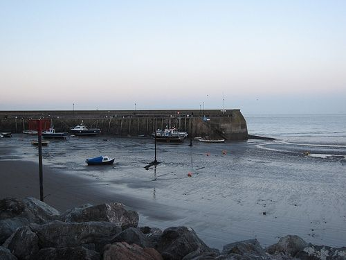

At low tide, the water is far out and the boats are resting on the sand.

Following low tide, the water gradually comes further up on the beach until it reaches its highest level, this is called high tide. After high tide the water level gradually drops again until it goes back to low tide. This pattern repeats over and over again. You can see an example of low and high tide at the same beach in the pictures below.

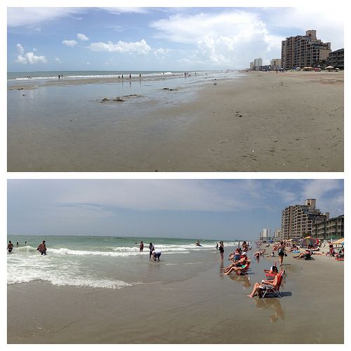

The same beach photographed at low tide (top) and high tide (bottom).

In general there are are two low and two high tides per day on the sea, which can be observed on the beaches or even in estuaries. The times of high and low tides are not exactly the same every day, they occur roughly one hour later each day.

Tides can be predicted and low and high tide times are published in tide tables. Fishermen use this information to plan when they will fish. Surfers also use this information so they can plan the best times to go surfing as each beach has a particular time when the sea level is just right for producing excellent surfing waves.

<Callout type="note" title="Note">
Some lakes and rivers also have tides!
</Callout>

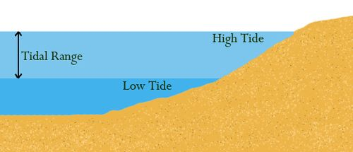

This diagram shows how the sea level differs at low and high tide at a beach. The vertical difference between low and high tide is called the tidal range.

# Reading a tide chart

This activity provides a chart showing tidal data for one week in Cape Town. This activity gives learners the opportunity to read and interpret data from the chart.

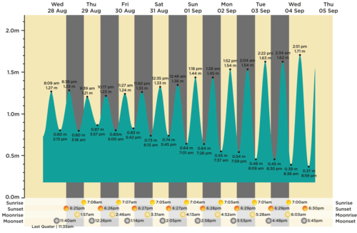

This graph shows the predicted tides for a period of one week in Cape Town. Although the graph only includes data for one week, the actual pattern of high and low tides repeats every day throughout the year.

**INSTRUCTIONS:**

2. Look at the chart above, it shows the predicted times of low and high tide for one week in Cape Town.
4. The peaks represent times of high tide and the heights are listed in metres along with the time of high tide. The troughs represent the times of low tide.
6. Answer the following questions.

**QUESTIONS:**

**Problem:**
How many peaks appear per day in the chart?

**Solution:**
Two

**Problem:**
What do these correspond to? High or low tide?

**Solution:**
High tide

**Problem:**
How many troughs appear per day in the chart?

**Solution:**
Two

**Problem:**
What do these correspond to? High or low tide?

**Solution:**
Low tide.

**Problem:**
What is the height in metres of the highest low tide during the week?

**Solution:**
0.7 m

**Problem:**
When does the lowest high tide occur? (date and time)

**Solution:**
Friday 3rd May, 10.17 am.

**Problem:**
What height is the lowest high tide?

**Solution:**
1.35 m

**Problem:**
The following photo is of a small harbour in Cape Town with a boat moored. These photos were taken on Monday 29 April.

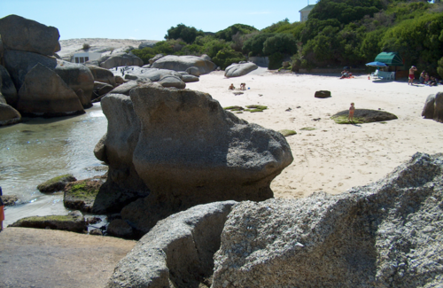

Boulders Beach in Cape Town at low tide.

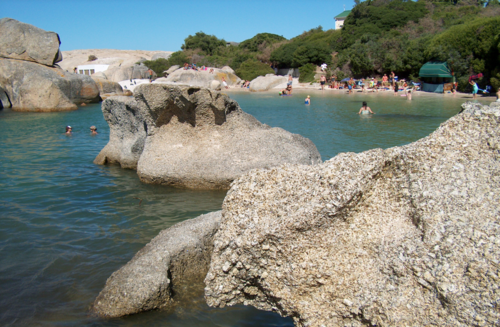

The same view of Boulders Beach at high tide.

2. What time of day, was the photo taken of low tide?
4. What time of day was the photo taken of high tide?

**Solution:**
2. At 11:47am.
4. At 6:05pm

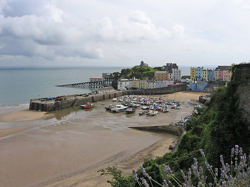

This picture shows a small harbour at low tide. The tide is out and the boats are stuck on the sand banks. Once the tide comes back in the boats will float on the water again.

<Callout type="note" title="Note">
Timelapse of a shore from low to high tide.
</Callout>

So you now know that all seas have tides, why do you think this is? Lets do an activity to find out.

Ask learners to give you their answer as to what causes the tides. You can write down all the answers. At this point it does not matter if the learners do not know what causes the tides, they will find out in the "Dance with the tides" activity. Once they have completed the activity, ask the learners again to see if they have changed their minds. At this point they should be aware that the gravitational pulls of the Moon and the Sun cause the tides.

# Dance of the tides

This activity requires learners to work in groups of six. One learner will represent the Earth, four learners will represent the Earth's oceans and one learner will represent the Moon. You could ask learners to wear coloured T-shirts (green for the Earth, blue for the oceans, grey for the Moon) or to pin drawings or photos of the object they are representing to their school shirts with safety pins to make it clear what they are representing.

In this activity learners will model how the Moon's gravitational pull causes tides on Earth. Be sure to explain to them that the scale of the model is not correct, for example the Moon and Earth sizes are not correct in relation to each other. You can ask learners how they think the Moon can influence the Earth. Explain that moons and planets can influence each other's spins and tilts from a distance via their gravitational pull. All objects that have mass have their own gravity, but only large objects, like planets, have enough gravity to influence each other from very large distances. Explain that you are going to model what effect the Moon's gravitational pull has on the Earth. Remember that the gravitational force exerted by an object diminishes as you go further from it. Therefore, objects that are closer to the Moon experience a greater gravitational pull towards the Moon than objects that are further away.

**MATERIALS:**

- Four (ideally blue) scarves or strips of fabric per group, each one needs to be about a metre in length.

**INSTRUCTIONS:**

**Problem:**
Work in groups of six, one learner represents the Earth, four learners represent the Earth's oceans and one learner represents the Moon.

**Solution:**

**Problem:**
The learner representing the Earth: stand in an open space.

**Solution:**

**Problem:**
The four learners representing the oceans: take one scarf each and stand in a circle around the learner representing Earth. (One behind, one in front and one on either side).

**Solution:**

**Problem:**
The four learners representing the oceans: link scarves with your neighbours.

**Solution:**

**Problem:**
Learner representing the Moon: stand outside the circle of "ocean" about 5 steps away from the "Earth" directly in front of one of the learners representing the ocean.

**Solution:**

**Problem:**
All learners apart from the Moon: turn to face the "Moon". You are now going to be "pulled" towards the Moon by the Moon's gravitational attraction! Remember that the gravitational pull exerted on an object by the Moon decreases with increasing distance to the Moon.

**Solution:**
**NOTE:**

Ask the learners the following questions and discuss them as you are going through the activity.

**Problem:**
Which part of the Earth and ocean is being pulled the most by the Moon?

**Solution:**
The learner closest to the Moon (one of the "oceans").

**Problem:**
Which part of the Earth and oceans is being pulled least by the Moon?

**Solution:**
The learner farthest from the Moon (another "ocean".)

**Problem:**
Ocean learner closest to the Moon: take three large steps towards the Moon.

**Solution:**

**Problem:**
Two ocean learners standing beside the Earth and the Earth learner: take two large steps toward the Moon.

**Solution:**

**Problem:**
Ocean learner farthest from the Moon: take one large step towards the Moon. Why have you moved towards the Moon by varying amounts?

**Solution:**
Because the pull of the Moon depends upon the distance to the Moon.

**Problem:**
Note what happens to the shape the "oceans" now make, are you still in a circle or forming an oval shape?

**Solution:**
An oval.

**NOTE:**

Explain that the water from the oceans has "piled up" under the Moon and directly opposite the Moon. The two children standing beside "Earth" represent parts of the ocean where there is less water. You could ask the learners the following questions:

- Where are the oceans at the highest levels?

*At the oceans nearest and farthest from the "Moon."*

- Are the coastal areas next to those "oceans" seeing a high or low tide?

*High.*

- How many sides of the Earth experience high tide at the same time?

*Two (in general).*

- Which parts of the Earth are experiencing high tide right now?

*The part that is under the piled up oceans.*

- Where is low tide?

*Near the oceans closest to Earth on either side.*

**Problem:**
Note which sides of "Earth's" body is experiencing high tide. (Front and back or left and right arms).

**Solution:**
Front and back.

**NOTE:**

The formation of the second ocean bulge is simplified in this model and ignores subtle motions of the Earth.

**Problem:**
Earth: spin around on the spot a few times stopping in a random position not directly facing the Moon. Remember that the Earth is continually spinning on its axis!

**Solution:**

**Problem:**
Note which sides of the "Earth's" body is experiencing high tide.

**Solution:**
Learner-dependent answer. Should be the parts of the body directly facing towards and away from the Moon.

**Problem:**
Now imagine that there is no Moon, but only the Sun to exert a gravitational pull on the Earth. Because the Sun is much farther than the Moon, its gravitational pull is only one third of the Moon's pull. The team member representing the Moon must now represent the Sun instead.

**Solution:**

**Problem:**
Sun learner: take an additional 10 steps away from the Earth so that you are 15 steps away in total.

**Solution:**

**Problem:**
Ocean learners return to your starting circle positions.

**Solution:**

**Problem:**
All learners apart from the Sun: turn to face the "Sun". You are now ready to be pulled towards the Sun.

**Solution:**

**Problem:**
Ocean learner closest to the Sun: take one large step towards the Sun.

**Solution:**

**Problem:**
Two oceans learners standing beside the Earth *and* the Earth learner: take one normal step toward the Sun.

**Solution:**

**Problem:**
Ocean learner farthest from the Sun: take one small step towards the Sun.

**Solution:**

**Problem:**
Note what happens to the shape the "oceans" now make, are you still in a circle or forming an oval shape? How does the shape compare with that made when you were pulled by the Moon?

**Solution:**
An oval but not as elongated as before, the "oceans" facing and directly opposite the Sun are closer to the Earth than they were when the Moon was pulling on them.

Ensure that learners can still find the sides of low and high tides even though they are less extreme.

**QUESTIONS**

**Problem:**
How many sides of the Earth experience high tide at the same time?

**Solution:**
Two

**Problem:**
Where are they positioned in relation to the Moon?

**Solution:**
Under the Moon and on the side of the Earth directly opposite the Moon.

**Problem:**
As the Earth spins what happens to the position of high tides in relation to the Moon?

**Solution:**
They remain under the Moon and directly opposite the Moon.

**Problem:**
As the Earth spins what happens to the position of high and low tides on the surface of Earth?

**Solution:**
The high and low tide are on different parts of the surface of Earth now.

**Problem:**
Besides the Moon, what pulls on the Earth?

**Solution:**
The Sun.

**Problem:**
If there were no Moon, would we still have tides?

**Solution:**
Yes but the difference between high and low tide would not be as extreme. Since the Sun is so far away, the Sun's gravitational pull would give the tides only a third of their height.

In this activity we have ignored the motion of the Moon revolving around the Earth. The time of high tide changes each day because the Moon is moving around the Earth. If we had no Moon, the tide due to the Sun alone would occur at essentially the same time every day. This activity also ignores the friction between the water and solid Earth as it spins, which causes the tidal bulges (piled up ocean bulges) to lie ahead of the Earth-Moon line in the direction of the Earth's rotation.

Look at the image below. It shows how the Moon's gravity distorts the shape of the Earth's oceans into an oval shape. Do you remember how the gravitational force depends on distance? The ocean on the side of the Earth closest to the Moon experiences a greater gravitational pull towards the Moon relative to the ocean on the far side of the Earth. This difference in gravitational pulls stretches the Earth's oceans into an oval shape. Along the Earth-Moon direction the oceans form two *tidal bulges*. At places in line with the Moon, where the oceans are experiencing a tidal bulge we have high tide. At locations which are at right angles to the Moon we have low tide.

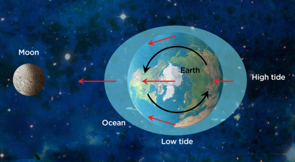

This picture shows the Earth and the Moon looking down from above. The gravitational pull experienced by different parts of the Earth towards the Moon are shown as arrows. The longer the arrow, the greater the pull. The ocean closest to the Moon experiences the greatest pull from the Moon and the ocean farthest from the Moon experiences the smallest pull towards the Moon. The differences result in the Earth's oceans being stretched to an oval shape.

<Callout type="note" title="Note">
As well as distorting the shape of the Earth's oceans, the Moon's gravitational pull also distorts the shape of the solid Earth. The solid Earth's bulge is about one hundred times smaller than the ocean bulge, but the Earth's crust closest to the Moon actually rises a few centimetres!
</Callout>

<Callout type="note" title="Note">
The highest tides in the world are at the Bay of Fundy in Canada. The bay is very narrow, so water rushing in from the ocean can rise and fall by up to 20 metres a day!
</Callout>

Why do you think there are two low tides and two high tides at a given beach per day? Look at the diagram above again. When the Moon is directly overhead your location you experience high tide. You also experience high tide when the Moon is directly opposite your location on Earth. Remember that the Earth spins on its axis once every 24 hours and so during one day you experience two high tides at a given location: one when the Moon is directly above your location and one when the Moon is directly opposite your location roughly twelve hours later. Similarly there are two low tides per day. This cycle continues as the Earth spins.

The actual times of low and high tides at a particular place on Earth are influenced not only by the Earth's spin but also by the Moon's motion around the Earth in its orbit. As the Earth spins, the Moon also travels around the Earth. The Moon rises about an hour later each day, and high (and low) tides also occur roughly an hour later each day.

The height of the tides varies slightly with the phase of the Moon. This is *not* because the gravitational pull of the Moon is changing: the Moon has the same amount of mass and therefore exerts the same gravitational pull at all phases. Rather, the change in the heights is due to the relative alignment of the Sun and the Moon. Let's look at this further in the following activity.

<Callout type="note" title="Note">
An animation demonstrating the tides.[http://www.onr.navy.mil/Focus/ocean/motion/tides1.htm](http://www.onr.navy.mil/Focus/ocean/motion/tides1.htm)
</Callout>

# Spring and neap tides

**INSTRUCTIONS**

2. Look carefully at the following diagrams, it shows the size of the tides at Full and New Moon (top) and at the first and third quarter phase (bottom).
4. Answer the following questions.

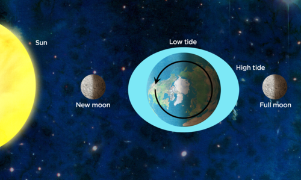

. Spring tide, showing the size of the tides at New moon and Full moon.

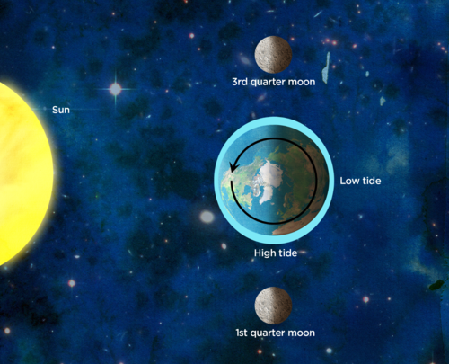

Neap tide, showing the size of the tides at first quarter and third quarter moon.

**QUESTIONS**

**Problem:**
When the Sun, Moon and Earth are in a straight line the Sun's gravitational pull adds to the Moon's gravitational pull. What Moon phases does this correspond to?

**Solution:**
New and Full Moon.

**Problem:**
During what phases of the Moon do the Moon's and Sun's gravitational pulls partly cancel each other out?

**Solution:**
First and third quarter.

**Problem:**
During what Moon phases would you expect the highest high tides and the lowest low tides?

**Solution:**
New and full Moon.

When the Sun, Moon, and Earth are lined up in a straight line (at the time of New or Full Moon), the pull of the Sun's gravity adds to the pull of the Moon's gravity creating extra-high high tides, and very low low tides. The difference in height between low and high tide is at its maximum at this time. These are called *spring tides*. When the Sun and Moon are at right angles to each other (during first and third quarter), the Sun's gravitational pull partially cancels out the Moon's gravitational pull and produces less extreme tides. The difference in height between the low and high tide is at its minimum at this time. These are called *neap tides*. Overall the Moon contribution to the Earth's tides is bigger than the Sun's contribution because it is much closer to Earth. If there were no Moon, the Earth's tides would be about a third of their current height.

Some additional activities are explained below.

**Activity: Tides Poster**

In this art and craft activity learners will make a poster to show the relative positions of the Sun and Moon producing spring and neap tides. You can use whatever art materials you have available, e.g. paint or pencils/crayons or felt pens. Ensure that you have blue, yellow and white and black colours so that the Earth's oceans, Sun and Moon can be accurately represented. Ensure that learners correctly identify which Earth-Moon-Sun alignments and Moon phases cause spring and neap tides . Ensure that learners draw the tidal bulge in the correct orientation and that the heights of their spring tides are higher at high tide and lower at low tide than their neap counterparts. Ensure that they correctly label places on Earth experiencing high and low tide.

**MATERIALS:**

- A3 sized poster paper
- paints, pencils or felt pens

**INSTRUCTIONS:**

2. Draw a poster showing the alignments of the Earth, Sun and Moon for both spring tides and neap tides.
4. Label the Sun, Earth and Moon, including the Moon phase.
6. Draw and label the tidal bulge created by the Moon.
8. Label where high and low tide occur.

**Activity: Make a tide wheel**

This is a very simple and fun activity for learners where they make a tide wheel using a template. Internet access and access to a printer is needed for this activity. The template used in the activity can be freely downloaded from the US weather service website at

[http://www.srh.weather.gov/srh/jetstream/ocean/images/tidewheel_w.pdf](http://www.srh.weather.gov/srh/jetstream/ocean/images/tidewheel_w.pdf)

The template file contains two pages. If available print out the template file onto thin card, this will make the tide wheel sturdier, however normal A4 paper is also fine (the learners will have to be careful not to rip the paper in this case). The printed pages will have to be secured together in the middle using a brass fastener (sometimes called a split pin). These are available from stationary stores.

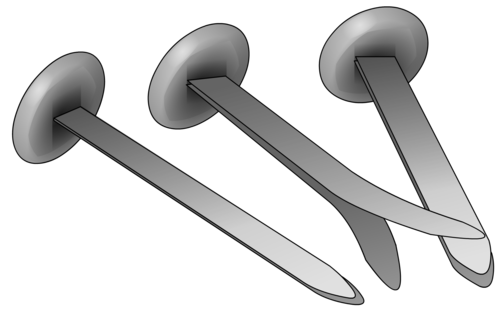

Split pins or brass fasteners.

Learners can use their tide wheels to see what phases of the Moon cause spring and neap tides, and to investigate the relative contribution of the Sun and the Moon to the tidal height.

**MATERIALS:**

- one tide wheel template per learner
- one brass fastener per learner
- scissors

**INSTRUCTIONS:**

2. Cut out the two pages of the template along the dotted lines at the edge.
4. Cut out the areas marked "cut out" along the dotted lines to leave "windows" in your first sheet of paper.
6. Place the sheet of paper with the windows cut out on top of the second sheet of paper. Both pieces of paper should have their pictures facing up.
8. Align the sheets so that the black dots in the middle lie directly on top of each other.
10. Use your brass fastener to secure the two pieces of paper together at the black dot in the middle. You should still be able to rotate the bottom or top sheet around.
12. Move the top circle of card on your tide wheel and notice how the tides change with the position of the Moon.
14. Use your tide wheel to answer the questions below.

**QUESTIONS:**

2. During New Moon, how are the Sun, Moon and Earth aligned?

*They are in a straight line: Sun-Moon-Earth.*

2. Is the tidal pull contribution from the Sun greater at Full Moon or First Quarter?

*The tidal pull contribution from the Sun is greater at F ull Mo on.*

2. What Moon phases correspond to neap tide?

*Neap tides occur at First quarter and Third Quarter (where the orange colour lines up with the neap tide marker on the front of the tide wheel)*.

[Did you know] The Moon's orbit is gradually increasing, and the Moon is slowly moving away from the Earth. Due to this the tides used to be much higher than they are today, and they will continue to become smaller.

You can now see how important our closest neighbour the Moon is. The Moon's gravitational pull is responsible for the ocean tides!

### The effects of tides on shoreline ecosystems

This section covers the effects that the tides have on marine life living in the region between low and high tide: the intertidal zone. This is a particularly harsh environment for marine animals and many have developed unique adaptations to help them thrive in their shoreline environments. A good way to introduce this topic is to ask learners about their experiences at the beach, in particular in rocky pool areas. You could ask them what sort of marine life they have seen for themselves in these areas. If learners have not visited the beach themselves you can also show colourful photographs of marine life found in the intertidal zone and explain how different animals have adapted to live in the shoreline environment.

This section links nicely with the biodiversity areas of the Life and Living strand in Gr. 7 and in particular with the Interactions and interdependence within the environment section of the Life and Living strand in Gr. 8. A class visit to an aquarium would be an ideal excursion for this section, allowing learners to see for themselves the organisms and conditions described in this section.

<Callout type="note" title="Note">
- ecosystem
- intertidal zone
</Callout>

The region of the beach between high tide and low tide levels is called the **intertidal zone***.* The intertidal zone is a harsh environment for marine animals to live. During storms the surf can be very rough and plants and animals must be able to withstand the battering from big waves and not get washed away! Animals and plants that live here are underwater at high tide but are exposed to the air during low tide. Some organisms may stay underwater if they are in small rock pools which do not empty out when the tide goes out. Those that are exposed to air at low tide, face hot temperatures in summer and cold temperatures in winter so they must be able to adapt to different temperatures.

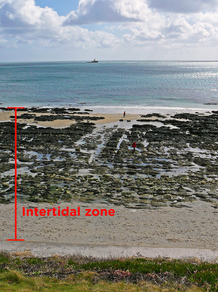

The intertidal zone can be seen here between the sea and the top of the sand.

Animals exposed to the air at low tide may be soaked in fresh water when it rains and yet be soaked in salty sea water at high tide. Therefore, they must also be able to adapt to different salt concentrations as the tides come in and out.

Different animals have adapted to this tough environment in different ways. For example:

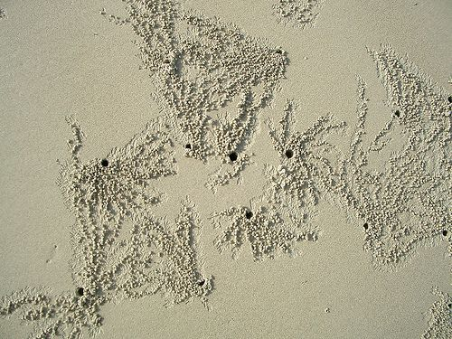

Crabs burrow into the sand to hide during low tide.

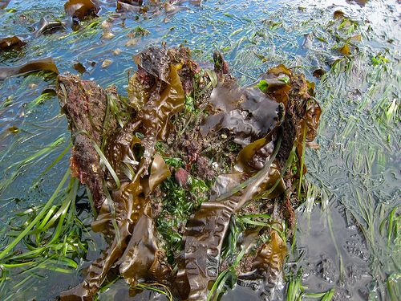

Kelp and other seaweeds are covered with thick slime to prevent them drying out.

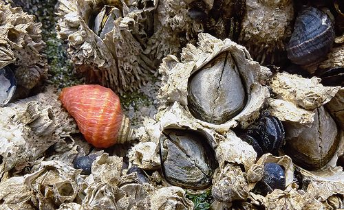

Mussels and barnacles close their shells tightly to avoid drying out.

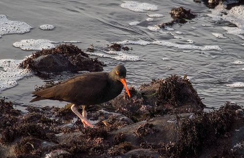

This oystercatcher takes advantage of low tide to feed.

# The effects of tides on shoreline ecosystems

**@**TN

This is an activity in which learners investigate what adaptions different shoreline animals have made in order to survive in the intertidal zone and write a summary of their findings. You can ask learners to look online for images and examples if they have access to the internet. Alternatively they can consult the school or local library or you can provide them with specific examples. Some images have been provided here as a starting point. This can also be used as a research task.

**MATERIALS:**

- Pictures and texts about shoreline animals. (Can be textbooks, library books or online materials as directed by your teacher).

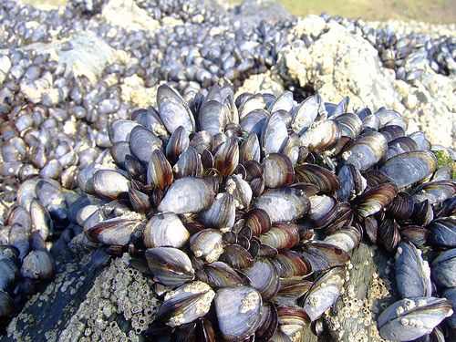

@@Caption Mussels growing on the rocks.

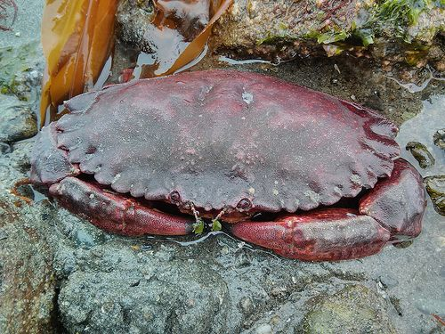

A crab in the sand.

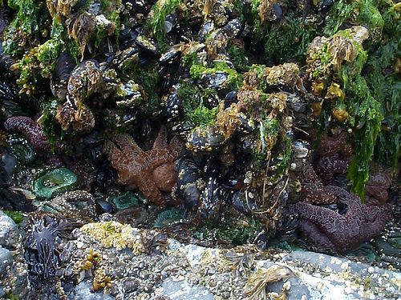

Seaweed, starfish and mussels in a rock pool.

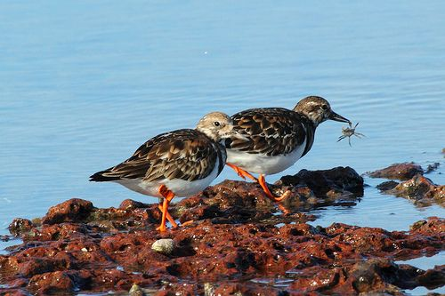

Birds feeding on the rocks.

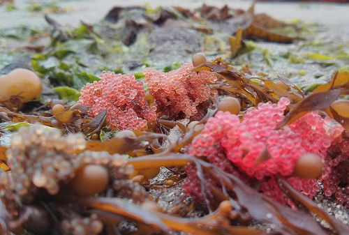

Eggs on some seaweed.

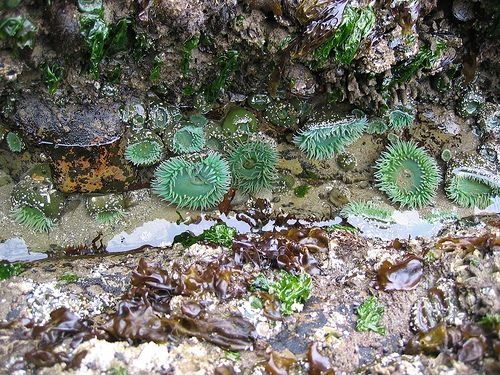

Green anemones in a rock pool.

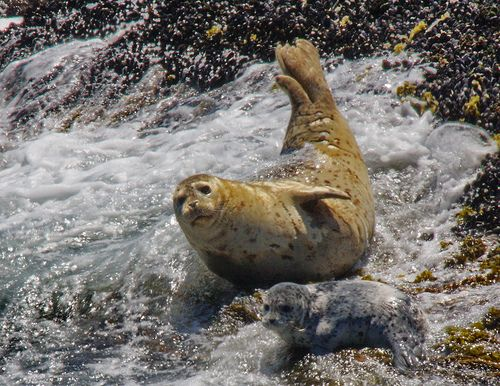

A mother seal and pup in the waves in the intertidal zone.

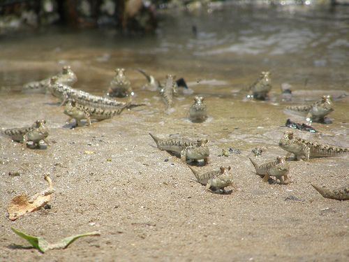

Mudskippers - fish that can walk on land!

<Callout type="note" title="Note">
Sea anemones look like plants with flowers but they are actually animals. Their tentacles contain a poison which paralyses their food (small fish and shrimps) when touched.
</Callout>

**INSTRUCTIONS:**

Study the pictures and texts and write a summary about how two different organisms are adapted to living in the intertidal zone. You can use the internet or other resources to do some more research.

Learners can use any of the examples given in this activity or those that they have read about. Answers could include animals that avoid drying out by burrowing, or closing their shells or plants that are covered in mucus. Answers could also include animals and plants that avoid being washed away by having strong "feet" that suck onto rocks.

High up in the intertidal zone water splashes only during high tide and the rest of the time it is dry. As you go lower down the intertidal zone, down the beach towards the sea, it gets progressively wetter for longer periods of time.

Some extra information about the different animals found in different areas in the intertidal zone:

High up in the intertidal zone (closer to the beach) the area is pounded by strong waves. Animals that live here need to be able to cling tightly to rocks to avoid being swept out to sea. Barnacles, limpets, periwinkles, and whelks cling tightly to rocks to avoid being swept out to sea. Seals and sea otters either rest or sleep above the intertidal zone so that they are not washed away or hit by the waves. If the tide comes in really high, they will move to another shoreline.

In the middle of the intertidal zone, tide pools often form and animals come to the tide pools to feed. Animals that live here can have softer bodies as this region is not so heavily pounded with waves. Sea anemones, snails, hermit crabs and starfish live in tidal pools.

In the lowest region of the intertidal zone where it is mainly wet, organisms are not well adapted to long periods of dryness. Some of the creatures found here are sea anemones, brown seaweed, crabs, green algae, limpets, mussels, sea slugs, starfish, sea urchins, shrimp, snails and sponges.

Marine life in the intertidal zone have to adapt to the rise and fall of sea levels at the beach. But marine life is not the only kind of life that has to take note of the tides. Many people also use the low tide to collect seaweed. Seaweed has many uses, including being a food source for people. In some cultures seaweed is used for medicinal purposes and to make various woven products, such as rope, baskets and mats.

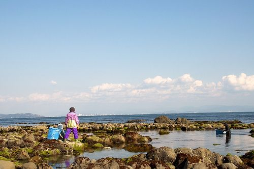

Harvesting seaweed during low tide.

Fishermen looking for big catches time their fishing activities according to the tides too. Lets investigate this further.

# How good a fisherman are you?

In this activity learners have to use a tide table to predict the best fishing times in Durban on a particular day. This emphasises how learning about the tides in the classroom has real world applications.

**BACKGROUND:**

Fish are easier to catch at times when they are feeding. The tides determine when most fish feed. When the tide is coming in or going out the moving water stimulates feeding. The fastest part of the tide is normally around two hours before and after low and high tides. These times are the best times to go fishing.

**INSTRUCTIONS:**

2. Look at the example tide table data for one day below and answer the following questions.

**Durban - Thursday 29th August 2013**

| Time | Tide Height (m) | Comment |
| --- | --- | --- |
| 00:56 |  | Moonrise |
| 02:29 | 0.85 | Low tide |
| 06:14 |  | Sunrise |
| 08:41 | 1.26 | High tide |
| 11:42 |  | Moonset |
| 14:52 | 0.93 | Low tide |
| 17:39 |  | Sunset |
| 21:34 | 1.27 | High tide |

**QUESTIONS:**

**Problem:**
Thembela wants to go fishing at the best time around the first low tide of the day. What times could she go fishing?

**Solution:**
00:29 or 04:29

**Problem:**
Josh wants to go fishing while the Sun has set. What would be the best possible times for him to choose from?

**Solution:**
00:29, 04:29, 19:34 or 23:34

**Problem:**
Faried wants to go fishing while the Sun is up. What would be the best possible times for him to choose from?

**Solution:**
06:41, 10:41, 12:52, 16:52
