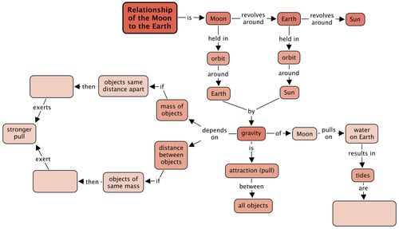
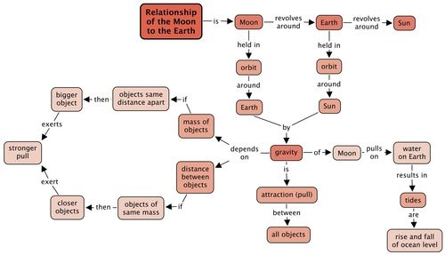
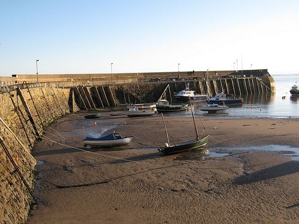
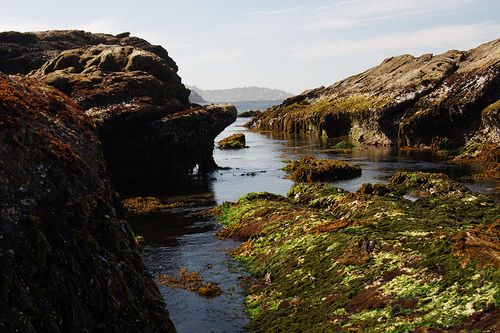

## Summary

<Callout type="note" title="Note">
- The Moon orbits the Earth once every 27.3 days. The Moon also spins on its own axis once every 27.3 days. Due to both these time periods being the same, we only ever see one side of the Moon from Earth.
- Gravity is a force that acts between all objects with mass. The size of the force acting on the objects is proportional to their masses and inversely proportional to their distance from each other.
- The Earth's gravity is responsible for holding the Moon in orbit around the Earth.
- The Moon's gravitational pull is mainly responsible for the tides on Earth.
- Neap tides occur when the Sun and Moon are at 90 degrees to each other.
- Spring tides occur when the Sun and Moon are in line with each other.
- The rise and fall of the tides affects marine life living along shorelines. They have adapted to this harsh environment in many ways to prevent themselves from drying out and from being washed away by strong waves.
</Callout>

**Concept map**

Complete the concept map by filling in the blank spaces. You can do this by reading the sentence that is made in the concept map. For example, "**Gravity** depends on **mass of objects**. If **objects same distance apar**t, then ….........., exerts a **stronger pul**l." What would the answer be? A "bigger object" or a "smaller object"? Fill the answer in. Also do this for the distance between objects. Would "closer objects", or "further away objects" exert a stronger pull? Then give a description of tides.

# Revision questions

**Problem:**
Why do we only see one side of the Moon from Earth? [2 marks]

**Solution:**
We only see one side of the Moon because the Moon rotates on its own axis at the same rate as it revolves around the Earth (27.3 days). Therefore the same half of the Moon always faces the Earth.

**Problem:**
What is gravity? [1 mark]

**Solution:**
Gravity is the force of attraction between two objects with mass.

**Problem:**
What holds the Moon in orbit around the Earth? [1 mark]

**Solution:**
The pull of gravity.

**Problem:**
How does the gravitational force of attraction between two objects depend on their masses? [2 marks]

**Solution:**
The larger the masses of the objects, the larger the gravitational force of attraction between them (at a fixed distance).

**Problem:**
How does the gravitational force of attraction between two objects depend upon their distance? [2 marks]

**Solution:**
The greater the distance between two objects with mass, the smaller the gravitational force of attraction between them (for fixed masses).

**Problem:**
If you were to stand on the surface of the Moon you would experience only 1/6th the strength of gravity that you experience standing on the surface of the Earth. Why is this? [2 marks]

**Solution:**
This is because the Moon is less massive that the Earth and so it has less gravity.

**Problem:**
What causes tides? [2 marks]

**Solution:**
Pull of the Moon's gravity on the Earth's oceans. And to a lesser extent the Sun's gravity.

**Problem:**
Look at the following photo of boats on the sand. Do you think it is a problem that they are stuck on the sand? How will people get them into the sea?

Boats on the sand.

**Solution:**
It is not a problem as it is low tide at the moment so the water has receded and the boats rest on the sand. But, when it is high tide again the water will come up and lift the boats off the sand and people will be able to get them out to sea.

**Problem:**
What kind of tides occur when the Moon is inline with the Sun? [1 mark]

**Solution:**
Spring tides.

**Problem:**
What kind of tides occur when the Sun, Earth and Moon are at right angles to each other? [1 mark]

**Solution:**
Neap tides.

**Problem:**
At what phases of the Moon do spring tides occur? [2 marks]

**Solution:**
New Moon and Full Moon.

**Problem:**
At what phases of the Moon do neap tides occur? [2 marks]

**Solution:**
First Quarter and Third Quarter.

**Problem:**
What would happen to the height of the tides if there were no Moon? [1 mark]

**Solution:**
They would be only a third of the height that they presently are.

**Problem:**
Draw a diagram to show the alignment of the Sun, Earth and Moon during neap and spring tides. [4 marks]

**Solution:**
You can use the image from the activity on spring and neap tides as a reference for what learners should draw.

**Problem:**
Explain why spring tides are more extreme than neap tides. [2 marks]

**Solution:**
When the Sun, Moon, and Earth are lined up in a straight line the pull of the Sun's gravity adds to the pull of the Moon's gravity creating spring tides. When the Sun and Moon are at right angles to each other the Sun's gravitational pull partially cancels out the Moon's gravitational pull and produces less extreme tides. These are called neap tides.

**Problem:**
Look at the following photo and answer the questions.

A rocky shore.

2. Do you think it is low or high tide? Give a reason for your answer. [2 marks]
4. What is the name given to this zone on the shoreline where the tides move back and forth? [1 mark]
6. What are the main risks to marine life living in this region? [2 mark]
8. How is the seaweed adapted to not dry out? [1 mark]
10. What other types of animals do you think you would find in this region? Give 4 examples. [2 marks]

**Solution:**
2. It is low tide as there are rocks exposed which are normally underwater as they have seaweed growing on them.
4. The intertidal zone.
6. Drying out, damage by strong wave action and predation.
8. The seaweed is covered in a slimy layer which prevents it from drying out. It also clumps together.
10. Learners can list any of the animals included in this chapter, or else others which they may know about.

Total [33 marks]
