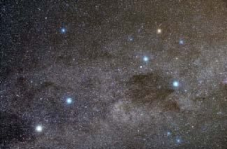
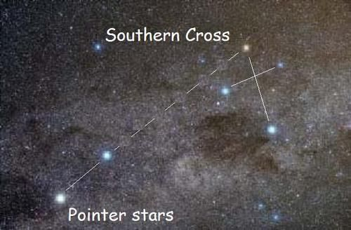
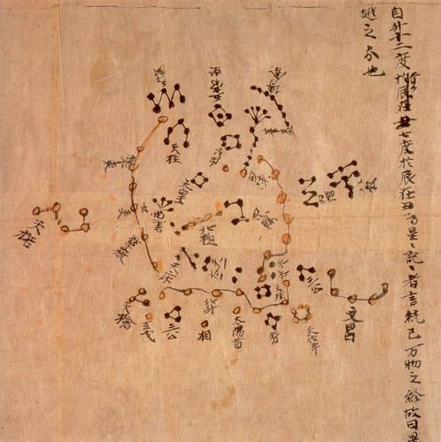
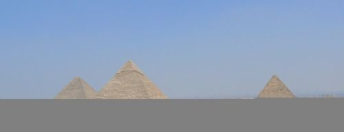
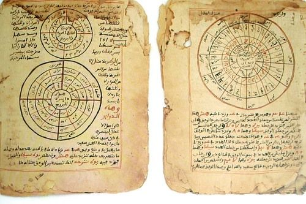
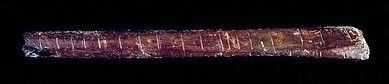
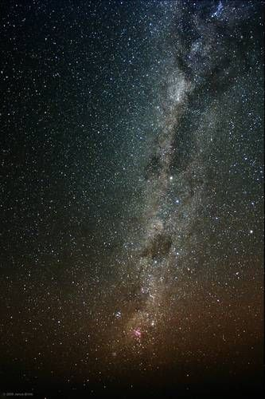
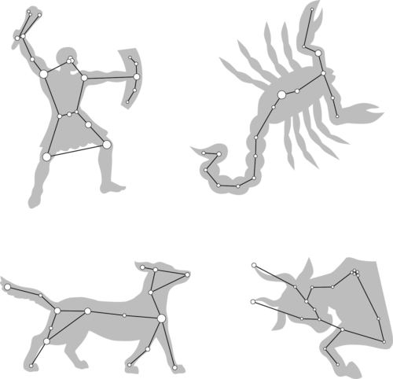

## Early indigenous knowledge

In this section learners will discover how ancient civilisations viewed the stars and told stories about the stars which were passed on from generation to generation. They will also learn about the practical uses of stars for navigation and timekeeping. A special emphasis is placed on indigenous knowledge related to South Africa, however, some global comparisons are also made.

<Callout type="note" title="Note">
- lunar calendar
- solar calendar
- constellation
- star lore
</Callout>

Astronomy is one of the oldest sciences. Ancient civilisations around the world watched the night skies, noting the patterns they saw in the sky. These patterns are called the constellations. A constellation is any group of stars, as seen from Earth, that seems to form a pattern or picture in the sky. Different nations, cultures and people have given different names for the different star patterns and how they interpreted the patterns.

A well known example is the Southern Cross. Have a look at the photos which show the stars in the night's sky and how to view the pattern making up the cross.

This pattern of stars is the Southern Cross.

The white lines show you how to view the Southern Cross.

<Callout type="note" title="Note">
You can find south using the Southern Cross constellation. Just extend the long axis of the cross four times and then go straight down to the horizon to find south.
</Callout>

The Southern Cross, *Crux*, and the two bright Pointer stars were used by farmers to mark the beginning of the planting season. According to Sotho, Tswana and Venda traditions, these stars were called *Dithutlwa*, meaning "The Giraffes". The bright stars of *Crux* are male giraffes, and the two Pointers are female giraffes.

Another example is the constellation Orion. It is named after Orion, a supernaturally, strong hunter in Greek mythology. This is one of the most recognised constellations around the world and many cultures have identified with it, each forming their own myths, many around a strong man or hunter.

The Orion constellation, seen here as the three bright stars in the middle making up Orion's belt and the four stars in each corner.

This image shows how the pattern of stars in Orion make the image of the hunter.

<Callout type="note" title="Note">
The name planet comes from the Greek word*planetes* which means wanderer. Planets were called wanderers by the ancient Greeks as they move across the sky relative to the background stars.
</Callout>

People also watched the movement of the stars and planets across the sky marking the passage of time. Early cultures tended to identify the stars and planets they saw in the night sky with gods, spirits or animals. Ancient astronomers could tell the difference between stars and planets as the relative positions of the stars remain fixed in the sky whereas planets appear to move across the sky relative to the background stars. Not all the planets were known to the ancient people, rather only Mercury, Venus, Mars, Jupiter and Saturn. Uranus and Neptune were only discovered after telescopes were invented.

<Callout type="note" title="Note">
We have seven days of the week due to the seven moving celestial bodies known to the ancient people, namely, the Sun, the Moon, Mercury, Venus, Mars, Jupiter and Saturn.
</Callout>

Ancient civilisations like the Sumerians, Babylonians and Egyptians were responsible for introducing many of the constellations that astronomers use in the West today.

The Dunhuang Star Map from the Tang Dynasty in China (circa 700 AD) showing some of the constellations they observed.

<Callout type="note" title="Note">
Read more about Chinese astronomy.[http://explorable.com/chinese-astronomy](http://explorable.com/chinese-astronomy)
</Callout>

Knowledge of these constellations were later passed on and added to by later civilisations like the ancient Greeks, Romans and Arabs. Native Americans, Aboriginal Australians, Mayans, Aztecs, Polynesians and ancient Chinese and Japanese peoples took a keen interest in the stars and had their own constellations and stories about the stars.

<Callout type="note" title="Note">
Ancient Egyptian Astronomy (video)
</Callout>

Astronomy played an important role in religion at the time, and the dates of festivals and holy days were fixed by the alignment of the stars or the phase of the Moon. In fact, the ancient Egyptian and Mayan pyramids and temples were designed in such a way that the Sun, Moon, stars and planets would be visible from the top or through certain windows at important times of the year, such as solstices or equinoxes.

The three Great Pyramids of Giza.

<Callout type="note" title="Note">
Some people believe that the builders of the ancient pyramids of Giza in Egypt placed them specifically to look the same from above as the three "belt stars" of the constellation Orion look from Earth.
</Callout>

Here in South Africa, early cultures also had their own constellations and stories which were passed down from generation to generation.

Early cultures used the stars for navigation. When travelling to new areas or over water they would have been unable to use familiar landmarks. When viewed from a particular location, a star always rises and sets in the same direction and follows the same path across the sky. We are familiar with this idea as the Sun is a star and we see it rise and set in the same direction every day. Early navigators learnt to use the directions of rising and setting stars to find their way.

Ancient manuscripts from Timbuktu in Mali in central Africa, documenting astronomical observations.

Early cultures also used the observed changes in the sky for timekeeping. A day was marked by the time between one sunrise and the next, just as it is today. The Moon's regular phases made it a very convenient "clock", and the time period between one New Moon and the next formed the basis of many of the oldest calendars.

<Callout type="note" title="Note">
In a*lunar calendar* the time between one New Moon and the next is called a *synodic month*and it is 29.5 days.
</Callout>

The lunar cycle was useful because it was predictable in the same way as day and night, however, each Moon cycle was also connected to a slightly different season with its own name and activities.Tally sticks made of bones with notches etched into them have been found dating as far back as 20-30 000 years ago and are believed to mark the phases of the Moon. Today we use a **solar calendar**, a calendar in which a year is defined by the complete revolution of the Earth around the Sun, but some religious calendars still use a lunar calendar. Accurate timekeeping was particularly important for farming communities because people needed to know when to plant their seeds and when to harvest their crops.

The Lebombo Bone was discovered in the Lebombo mountains between South Africa and Swaziland in the 1970s. It is a bone from a baboon used as a Tally Stick. It is roughly 35 000 years old. It is thought to have been used for tracking lunar cycles, due to the 29 marks on it.

The *Pleiades*, also called the *Seven Sisters,* is a bright cluster of stars. Traditional farming communities in South Africa used the Pleiades to help them plan their planting. Once the constellation was visible in the early morning in June they knew it was time to start planting their crops. The Khoikhoi call the Pleiades *Khuseti* or *Khunuseh* meaning "rain stars". They are called *Selemela* in Sotho and Tswana, *Shirimela* in Tsonga, *Tshilimela* in Venda, and *isiLimela* in Xhosa and Zulu. In Xhosa the stars are called the "digging stars". In East Africa and Zanzibar the Pleiades are called *Kilimia*, which also means "ploughing stars" or "
              digging stars". Not only were the Pleiades used in Africa to mark planting season, they were also used by the ancient Mayans in Mexico and Central America to mark the start of their rainy season too.

The Pleiades or Seven Sisters star cluster. Although the constellation is known as the seven sisters, the star cluster actually contains hundreds of stars although only about seven are easily visible to the human eye.

<Callout type="note" title="Note">
Read more about traditional African star lore.[http://www.psychohistorian.org/display_article.php?id=200901111733_african_star_lore.content](http://www.psychohistorian.org/display_article.php?id=200901111733_african_star_lore.content)
</Callout>

# The traditional and modern Xhosa calendar

In the Xhosa language, there are two ways of naming months, the modern and the traditional way. The modern names of the months are used in urban areas. However, in rural areas, in poetry, and particularly in the Eastern Cape the old names are still used. Look at the following table which shows these names.

<Callout type="note" title="Note">
You do not need to know the names of the months in Xhosa. This activity is for interest.
</Callout>

| English | Modern Xhosa | Traditional Xhosa | Meaning of traditional name |
| --- | --- | --- | --- |
| January | uJanuwari | EyoMqungu | month of the Tambuki Grass |
| February | uFebhuwari | EyoMdumba | month of the swelling grain |
| March | uMatshi | EyoKwindla | month of the first fruits |
| April | uApreli | UTshazimpuzi | month of the withering pumpkins |
| May | uMeyi | UCanzibe | month of Canopus (Canopus is a star) |
| June | uJuni | Isilimela | month of the Pleiades |
| July | uJulayi | EyeKhala / EyeNtlaba | month of the aloes |
| August | uAgasti | EyeThupha | month of the buds |
| September | uSeptemba | EyoMsintsi | month of the coast coral tree |
| October | uOktobha | EyeDwarha | month of the lilypad |
| November | uNovemba | EyeNkanga | month of the small yellow daisies |
| December | uDisemba | EyoMnga | month of the mimosa thorn tree and Simba (the lion) |

**QUESTIONS:**

**Problem:**
Do you see that the modern Xhosa names are derived from the English names. The traditional names for the months mostly come from the names of plants and flowers. Why do you think certain months are given specific plants or flower names?

**Solution:**
This corresponds to when these plants appear or grow as the seasons change throughout the year.

**Problem:**
Why do you think August is called *EyeThupha*, the month of the buds?

**Solution:**
This is because it is the start of Spring and the buds on plants start to appear at this time.

**Problem:**
Why is June called *Isilimela*? Hint: Read the preceding text in your workbook.

**Solution:**
Isilimela means 'month of Pleiades'. Pleiades is the group of seven stars which appears in the sky during June.

**Problem:**
What time of year does *Isilimela* correspond to? What does this signal to traditional farmers?

**Solution:**
It corresponds to winter, when farmers must start planting their crops so that they are ready to harvest when summer comes.

**Problem:**
What month are you born in? Write down the traditional Xhosa name below.

**Solution:**
Learner-dependent answer.

# Class discussion about different calendars

Remind learners of the rules for debating which is that each one must be given a chance to speak and respond and learners' viewpoints must all be respected. This activity will help learners to appreciate different cultures and religions.

You can also get learners from different religions or cultures in your class to explain the different festivities, holidays or special events which they observe throughout the year.

The calendar the we use is the Gregorian calendar and is the most widely used around the world. It is also known as the "Western calendar" or "Christian calendar". It was named after the man who first introduced it in February 1582: Pope Gregory XIII. The term New Year's Day for the 1 January was adopted in Western Europe in the Middle Ages. Before this, the Roman Julian calendar (named after Julius Caesar) was used.

<Callout type="note" title="Note">
The Roman influence in the Gregorian calendar explains why the months of July (Julius) and August (Augustus) are named after Roman emperors.
</Callout>

The Islamic year begins on the first day of the month of Muharram. It is counted from the year of the Hegira (Anno Hegirae), when Muhammad emigrated from Mecca to Medina (16 July 622 AD).

The Jewish calendar represents the number of years since they believed the world was created. This is calculated by adding up the ages of people in the Bible. So when someone of Jewish beliefs says that the year is 5763, it means 5763 years from the creation of Adam.

**INSTRUCTIONS:**

2. Around the world, and within South Africa, there are different calendars which are in use. Do you think it would just be easier to have one calendar?
4. Discuss this as a class.
6. You could do this as a class debate with teams debating the pros and cons of the concept.

<Callout type="note" title="Note">
In a debate, remember to be respectful to others' opinions and allow everyone a chance to speak.
</Callout>

As well as their practical uses in timekeeping, stories surrounding the Sun, Moon and constellations have been passed down from generation to generation. These mythical stories are called **star lore**. For example some believed that after sunset the Sun travelled back to the east over the top of the sky and that the stars are small holes which let the light through. Others said that the Sun is eaten each night by a crocodile and that it emerges from the crocodile each morning.

<Callout type="note" title="Note">
Read more about some South African star myths.[http://www.rmg.co.uk/explore/astronomy-and-time/astronomy-facts/stars/south-african-star-myths](http://www.rmg.co.uk/explore/astronomy-and-time/astronomy-facts/stars/south-african-star-myths)
</Callout>

Being the most prominent object in the night sky, the Moon also has many stories and legends associated with it. If you look closely at the Moon you can see that it has lighter and darker patches. The pattern formed by the light and dark patches had been interpreted differently by different cultures: some see a rabbit, others a buffalo, others a "Man in the Moon". One urban legend that some people still incorrectly believe is that the the Full Moon is linked to insanity. There is no evidence to support the claims of increased birth rates, admissions to psychiatric hospitals, traffic accidents, homicides or suicides during a Full Moon.

<Callout type="note" title="Note">
*Lunacy* and *lunatic* are derived from the Latin name for the Moon, *Luna*.
</Callout>

The Khoikhoi called the Moon *kham*, or *khab* meaning "the Returner". The Khoikhoi also considered the Moon to be "the Lord of Light and Life" and would sing and dance at times of New and Full Moon. In /Xam San star lore, there is the following story:

| The Moon is a man who has made the Sun angry. The Sun's sharp light cuts off pieces of the Moon until almost the whole of the Moon is gone, leaving only one small piece. The Moon then pleads for mercy and the Sun lets him go. From this small piece, the Moon gradually grows again until it becomes a Full Moon. |
| --- |

What do you think the San were observing which they explained with this story?

The San were observing the phases of the Moon. Throughout the month we only see certain parts of the Moon due to the relative position of the Sun, Earth and Moon and how much light is reflected from which part of the Moon.

The Xhosa considered the time of New Moon to be a time of inaction. When it reappeared as a crescent in the evening sky, it was cause for celebration. Important events were scheduled to take place around the time of Full Moon.

The Milky Way is also a prominent feature of the South African nighttime sky visible away from cities. Ancient peoples in South Africa described the Milky Way as as a footpath across the sky, along which the ancestor spirits walked. In San starlore, the Milky Way was created by a girl who scooped up a handful of ashes from a fire and flung them into the sky. This made a glowing path along which people could see the route to return home at night.

<Callout type="note" title="Note">
We will learn more about our galaxy, the Milky Way, and other galaxies, next year in Gr 8.
</Callout>

The Milky Way seen from Sutherland, Northern Cape, by Janus Brink (SAAO/SALT).

Meteors (also called shooting stars) and comets also feature heavily in starlore around the world. In most cultures meteors and comets were regarded as signs of important events. In Tswana starlore, a very bright meteor is an indication of a good season ahead. However, the .Xu San saw a meteor as an evil spirit racing across the sky to cause mischief among people. The /Xam San, thought that a meteor announced the death of one of them. In Xhosa starlore, a comet, *Uzatshoba,* is associated with bad luck, wars and death. There was also a strong belief that comets predicted the death of a chief. The Sothos called comets *naledi tsha mesela*, and the Zulus called them *inkanyezi enomsile*, which means "stars with tails".

# Create your own legend

In this activity learners will draw their own imaginary constellation (some examples are included for inspiration). They will then make up a story to go along with their constellation.

**MATERIALS:**

- pictures of famous constellations for inspiration

Some examples of constellations in the sky.

**INSTRUCTIONS:**

2. Make up your own pattern of stars and draw them in the box below.
4. Make up a legend (story) to go along with your new constellation.

Draw your new constellation pattern the box below.

Write your legend here.

<Callout type="note" title="Note">
Curious about the universe, but don't know where to start? Have a look at this step-by-step guide to becoming an awesome amateur astronomer.[http://www.unawe.org/awesome/](http://www.unawe.org/awesome/)
</Callout>
