## Modern developments

This section highlights significant discoveries about the nature of our Universe and the technology used to make those discoveries. The details about modern telescopes are kept brief, as this subject will be covered in more detail in the Grade 8 Earth and Beyond Strand: *Early viewing of space and telescopes*. Additional activities which are appropriate for this section depending upon access include visits to science centres, science museums, planetariums, observatories and amateur astronomy clubs.

<Callout type="note" title="Note">
- telescope
- prograde
- retrograde
</Callout>

<Callout type="note" title="Note">
Astronomy timeline[http://www.windows2universe.org/the_universe/uts/timeline.html](http://www.windows2universe.org/the_universe/uts/timeline.html)
</Callout>

The earliest astronomers had no sophisticated observatories. They studied the stars and planets using just their eyes. This is called naked eye observing. The South American Mayans, ancient Egyptians and ancient Chinese built some of the first **observatories**. These are special buildings used for studying the stars. These ancient observatories had no telescopes inside.

Nowadays modern observatories contain large telescopes with extremely sensitive cameras and instruments mounted on the telescopes. Astronomers use computers to move the telescopes and operate the instruments. As technology has progressed, we have been able to see a lot more and have learnt a lot more about the Universe.

<Callout type="note" title="Note">
X-ray telescopes like NASA's *Chandra* and the European Space Agency's *XMM-Newton* collect X-ray light emitted from objects at millions of degrees Celsius. These telescopes are placed in space because our atmosphere absorbs all the X-rays from space.
</Callout>

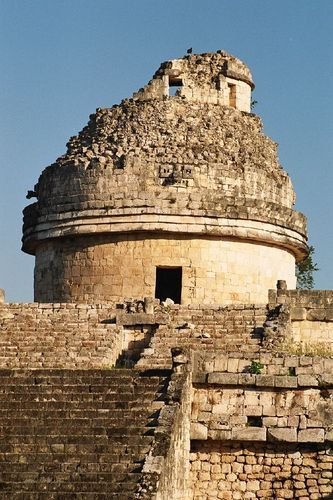

Chichen-Itza observatory in Mexico. This ancient observatory was used by the Mayans, although it had no telescope inside.

South Africa currently has the largest optical telescope in the Southern Hemisphere, the Southern African Large Telescope (SALT). SALT is located just outside Sutherland in the Karoo where the skies are clear and very dark. SALT's main mirror is a hexagon shape measuring 11 x 9 metres across and is made up of 91 individual smaller mirrors which are slotted together. Its mirror is so large so it can collect a lot of light from very faint and distant objects. SALT is used to study a variety of objects including asteroids, stars and galaxies.

<Callout type="note" title="Note">
The SALT website.[http://www.salt.ac.za/](http://www.salt.ac.za/)
</Callout>

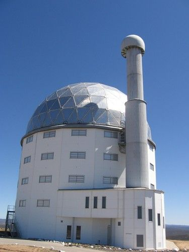

The Southern African Large Telescope (SALT).

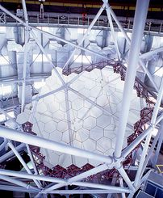

SALT's huge mirror collects light from faint distant objects.

<Callout type="note" title="Note">
SKA video
</Callout>

South Africa will also be hosting part of the Square Kilometre Array (SKA), the world's largest radio telescope, scheduled to be completed in 2024. The SKA will be located in the Karoo near the town of Carnarvon, far away from big towns and cities where there is little radio interference. When complete the telescope array will be 50 times more sensitive than any other radio telescope to date. The array will contain 3000 radio dishes as well as other types of radio detectors.

<Callout type="note" title="Note">
Two thirds of the SKA will be built in Africa (mostly in South Africa), while the remaining third will be built in Australia.
</Callout>

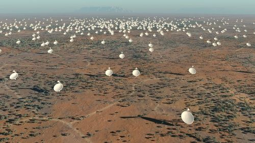

What the SKA will look like in the Karoo.

<Callout type="note" title="Note">
An array means a large number of the same items. For example, when the desks in your classroom are all lined up neatly, we can call that an array of desks.
</Callout>

Astronomers plan to use the giant telescope to test the laws of gravity using black holes. They will also peer at some of the most distant clouds of gas in the Universe which formed before the first stars. Astronomers will also study how galaxies form, and change over time, and perhaps also detect life elsewhere in the Universe.

<Callout type="note" title="Note">
Find out more about SKA.[http://www.ska.ac.za/meerkat/](http://www.ska.ac.za/meerkat/)
</Callout>

<Callout type="note" title="Note">
Black holes are super-dense regions in space which have very strong gravity, so strong that not even light can escape from them.
</Callout>

<Callout type="note" title="Note">
Read more about black holes.[http://www.nasa.gov/audience/forstudents/k-4/stories/what-is-a-black-hole-k4.html](http://www.nasa.gov/audience/forstudents/k-4/stories/what-is-a-black-hole-k4.html)
</Callout>

We still have so much to learn about our Universe, we only understand about 5% of the content of our Universe presently. SALT and SKA will help us understand far more about our Universe, so much is still to be discovered.

Let's look at some of the highlights in our journey of scientific discovery so far.

### The discovery that the Sun is at the centre of the solar system and not the Earth

<Callout type="note" title="Note">
History of astronomy and
</Callout>

Early astronomers such as the ancient Greeks believed the Earth was at the centre of the Universe, with the stars and planets orbiting around the Earth.

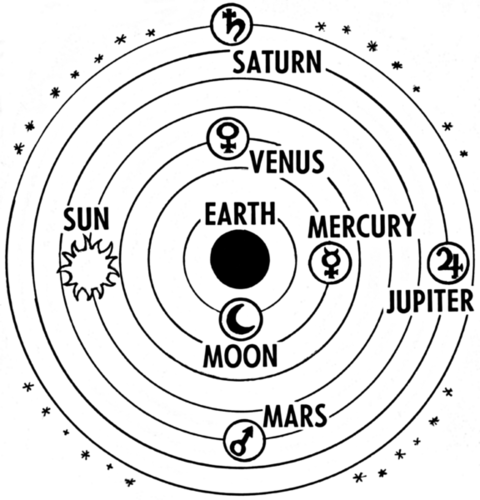

The ancient Greeks thought that the Earth was at the centre of the universe and believed that the planets, Sun and background stars all orbited around the Earth.

By carefully watching the motions of the planets in the sky, the Greeks saw that most of the time the planets travelled west to east across the sky relative to the background stars. However, they occasionally reversed their direction and moved backwards, from east to west relative to the background stars. The ancient Greeks' ideas about the Earth-centred Universe worked when the planets were travelling in the same direction as the background stars, but could not account for the their retrograde (backwards) motion.

<Callout type="note" title="Note">
Motion towards the east is called direct or*prograde* motion. Backwards motion is called *retrograde* motion.
</Callout>

In 1543, Nicolaus Copernicus, a Polish mathematician and astronomer, published his book called *De revolutionibus orbium coelestium*, or in English, *On the Revolutions of the Celestial Spheres*. In it he correctly deduced that the Sun, rather than the Earth, was at the centre of the Solar system. He based his deductions on many of his own and other people's observations. Copernicus correctly ordered all the planets known at the time in increasing distance from the Sun. In his model, all the orbits of the planets were circular, so in this way, it was similar to the model of the ancient Greeks. But how did Copernicus's new deduction solve the problem of Mars' backwards motion? Let's do an activity to find out.

<Callout type="note" title="Note">
seven famous astronomers you should know.[http://science.discovery.com/famous-scientists-discoveries/7-famous-astronomers-you-should-know.htm](http://science.discovery.com/famous-scientists-discoveries/7-famous-astronomers-you-should-know.htm)
</Callout>

# Explaining the motions of Mars

In this activity learners will discover how the retrograde (backwards) motion of Mars can be explained in a Sun-centred model of the solar system.

**MATERIALS:**

- pencil/pen
- ruler

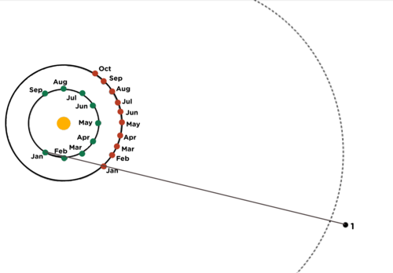

Note that inner orbit is that of Earth (green) and outer is that of Mars (red). The dashed line are the background stars.

**INSTRUCTIONS:**

2. Draw a line from each Earth position through the Mars position for the same month. Extend the line approximately 1 cm past the dashed curve on the right which represents the background stars.
4. Place a dot at the end of the line and label the dots in order. If a new line crosses one already drawn, draw the new line slightly longer and place the dot slightly farther away than you did for the other lines. The line for January is already drawn as an example. The dots represent the positions where an observer on Earth would see Mars for the month indicated on the diagram.
6. Start with the dot number 1, and carefully connect the dots in order. This connecting line represents the path Mars appears to follow on the sky as viewed from Earth.
8. Answer the questions below.

**QUESTIONS:**

**Problem:**
How does Mars move around the Sun between January and August?

**Solution:**
Mars orbits around the Sun in an anti-clockwise direction.

**Problem:**
To an observer on Earth, what movement does Mars appear to experience during that time period?

**Solution:**
It appears to initially be moving in an anti-clockwise direction, then it appears to turn around and travel in a clockwise direction before changing direction again and appearing to move in an anti-clockwise direction.

**Problem:**
During which months does Mars appear to be moving backward in its orbit?

**Solution:**
During May, June and July.

**Problem:**
Carefully observe what is happening to Earth and Mars in their orbits when Mars seems to loop "backward." What causes Mars to seem to move backward in its orbit?

**Solution:**
The Earth "overtakes" Mars in its orbit around the Sun.

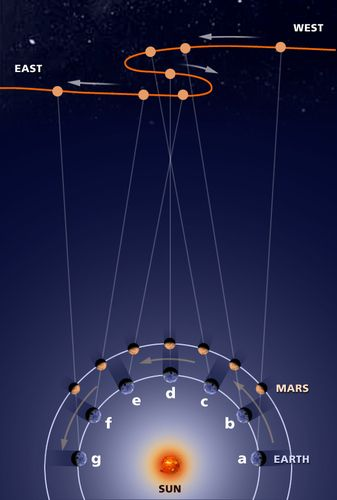

The Earth moves faster than Mars in its orbit and catches up with Mars at point (b) before overtaking Mars at point (d). As the Earth overtakes Mars, Mars appears to travel backwards on the sky, even though Mars is not really changing direction in space.

<Callout type="note" title="Note">
Retrograde motion of Mars.[http://vimeo.com/17836000](http://vimeo.com/17836000)
</Callout>

How can objects appear to move backwards when they are not really moving backwards? Let's do a test right now. Hold your arm outstretched in front of you and hold up your first finger. Cover or close your left eye and note where your finger appears against the background. Now cover or close your right eye instead. What do you notice about the position of where your finger appears? It moved to the right didn't it? But did you really move your finger? No, it just appeared to move because of your change in perspective.

[Did you know] The idea of a Sun-centred solar system was proposed as early as about 200 B.C. by Aristarchus of Samos (Samos is an island off the coast of Turkey). However, the idea did not survive long because the famous Greek Aristotle did not believe in a Sun-centred solar system.

### The discovery that the planets' orbits are elliptical

Ensure that learners are familiar with the term ellipse before starting this section. If necessary spend five minutes reviewing the properties of ellipses before continuing.

Johannes Kepler was a German astronomer and mathematician. He spent ten years trying to explain the motion of Mars across the sky in detail. He could only get his model of the solar system to fit the observations of the planets' motions if he assumed that rather than moving in a circle around the Sun, the planets all orbited in ellipses (ovals). He discovered that the true shape of the planets' orbits is elliptical.

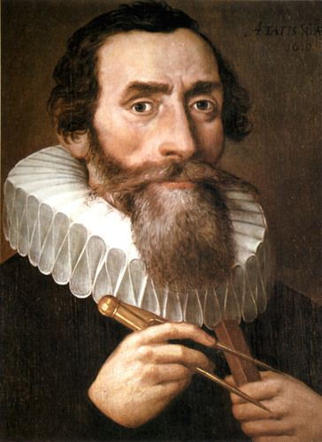

Johannes Kepler.

The Earth travels faster in its elliptical orbit when it is closer to the Sun than when it is farther away. This is because the gravitational force of attraction between the Earth and Sun is stronger when the Earth is closer to the Sun. This is true of the orbits of all planets around the Sun.

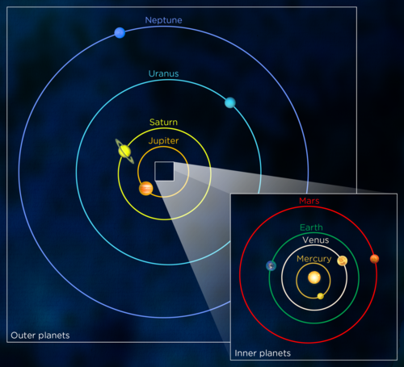

The Earth and the other planets in our solar system orbit around the Sun in an ellipse.

### Galileo's discoveries using his telescope

Galileo Galilei was an Italian physicist, mathematician and astronomer. He built his first telescope in 1609 and was the first astronomer to use a telescope. In 1610 he published a book called the *Sidereal Messenger,* listing the discoveries he had made using his telescope.

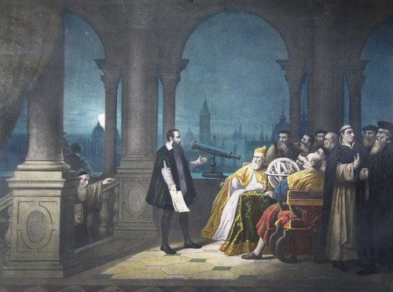

Galileo displaying his telescope.

Galileo discovered the four largest moons of Jupiter (which are now called the Galilean moons). Over several nights he watched them move and realised that they were actually orbiting around Jupiter.

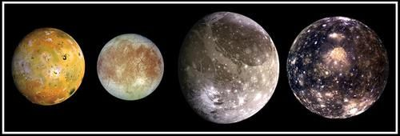

The four largest moons of Jupiter, left to right in increasing distance from Jupiter: Io, Europa, Ganymede and Callisto.

He also found that Venus has phases just like the Moon (and just like all planets). He discovered that the Moon has craters and that the Sun has dark spots which are called sunspots. These imperfections on the Moon and Sun discredited the belief held by the Catholic Church at the time that the heavens were perfect and unchanging.

The Catholic Church allowed Galileo to conduct his research, as long as he did not openly publicise his findings. In 1632 Galileo angered the head of the Catholic Church (the Pope) when he published a book in which he stated that the Earth was moving around the Sun. He was put on trial and found guilty of heresy. He was first imprisoned and later placed under house arrest.

<Callout type="note" title="Note">
Heresy is having a belief or opinion that was against the official teachings of the church at the time.
</Callout>

<Callout type="note" title="Note">
Although Galileo wasn't appreciated during his lifetime, his experimental and mathematical approach to physics was revolutionary and way ahead of his time.
</Callout>

### Newton discovers gravity

Isaac Newton was an English physicist and mathematician and is considered one of the greatest scientists of all time. He derived mathematical laws to describe the motions of objects but his greatest discovery was that of the force of gravity. In 1687 he published a book called *Philosophae Naturalis Principia Mathematica*, or in English: *Mathematical Principles of Natural Philosophy,*in which he explained his ideas about the motions of objects and gravity.

There is a famous story which says that Newton was sitting under an apple tree when an apple fell on his head and he began to think about gravity and falling objects. The apple didn't really land on his head but he did watch an apple fall and began to wonder why apples always fall down. He suggested that it was the force of gravity that caused apples to fall.

<Callout type="note" title="Note">
Learn more about gravity and general relativity (video)
</Callout>

Amazingly, he made the mental leap from Earth to space and realised that it was the force of gravity that was holding the Moon in its orbit around the Earth. According to Newton, gravity is the reason that objects fall to the ground when dropped and why planets orbit the Sun and why moons orbit planets. Up until Newton no one had been able to explain what held the Moon and the planets up in their orbits.

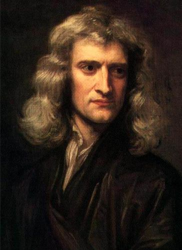

Sir Isaac Newton aged 46.

<Callout type="note" title="Note">
Some famous quotes from Sir Isaac Newton: "I can calculate the motions of the heavenly bodies, but not the madness of people." "Plato is my friend - Aristotle is my friend - but my greatest friend is truth."
</Callout>

# Interview with a revolutionary

In this activity learners will work in pairs to role play. One learner should imagine that they are an important early astronomer and the other learner will play the part of a journalist. The "journalist" will interview the "astronomer" in order to find out what important discoveries the astronomer has made. You may also ask the journalists to report back their findings to the class. If time permits you could ask the learners to switch places and therefore conduct two interviews in total (choosing a different astronomer each time). If you want to add a writing task to this activity you could also ask the "journalists" to write a newspaper report, detailing their interviewee's discoveries.

**MATERIALS:**

- reference materials about famous historical astronomers.

**INSTRUCTIONS:**

2. Work in pairs in this activity. One of you will play the role of an early famous astronomer and the other will play the role of a journalist.
4. Astronomer: Pick which famous astronomer you are going to be and answer the questions your partner asks you.
6. Journalist: Ask the "astronomer" what they have discovered and why their discoveries are important.

### Modern day discoveries

Scientists are continually making new discoveries, and with every new discovery comes a new question.

<Callout type="note" title="Note">
A short documentary about the search for habitable planets.
</Callout>

# Research a new discovery, invention or scientist

In this activity learners must conduct some research and then write a summary about a new discovery in astronomy, an invention in astronomy, or a particular astronomer that interests them. They can use the example material provided in this chapter, or they can conduct research online or at a local/school library. Decide how learners must present the information, either as a research project, an oral presentation or a poster.

**INSTRUCTIONS:**

2. Research either a recent discovery made in astronomy, or an invention used in astronomy or about a famous astronomer.
4. You can choose to write about one of the examples provided in the text below, or you can choose your own example.
6. Your teacher will inform you how you must present your work.

Some example discoveries:

**Exoplanets -** An exoplanet is a planet orbiting around a star other than our own Sun. The first exoplanet was discovered in 1992 when several planets were found orbiting around a small, rapidly spinning star. As of June 2013, 890 exoplanets have been discovered and more and more are being found all the time.

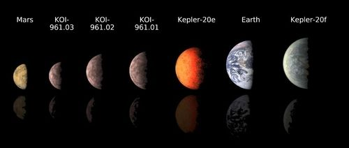

This image compares the smallest known exoplanets orbiting outside the solar system, to our own planets Mars and Earth.

<Callout type="note" title="Note">
Planet Quest - the search for another Earth.[http://planetquest.jpl.nasa.gov/](http://planetquest.jpl.nasa.gov/)
</Callout>

<Callout type="note" title="Note">
Citizen science - help look for other planets.[http://www.planethunters.org/](http://www.planethunters.org/)
</Callout>

**Black holes-**Black holes are super-dense regions in space which have very strong gravity, so strong that not even light can escape from them. Although you cannot see a black hole directly astronomers know they exist because of their pull on objects close to them. If you were to fall into a black hole feet first, you would be pulled apart like a piece of spaghetti.

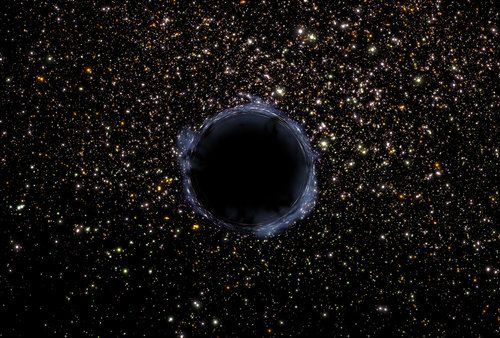

A black hole in the universe.

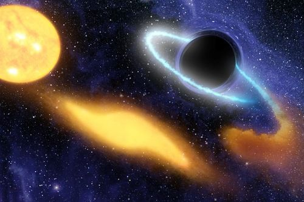

This artist's drawing concept shows a massive black hole ripping a star apart over time. On the left, the yellow, sun-like star comes too close to the black hole, and is stretched apart (middle yellow blob), until it is ripped apart. Some these remains of the star swirl into the black hole (blue-white cloudy ring on the right).

<Callout type="note" title="Note">
Watch a black hole swallow a star.
</Callout>

**The Expansion of the Universe-**In 1929, astronomer Edwin Hubble made the astonishing discovery that our universe is expanding. Looking at galaxies outside our Milky Way galaxy, he found that all the galaxies he looked at were moving away from the Earth, and that the most distant ones were moving away fastest. This implies that every galaxy is moving away from every other galaxy. In fact the space between galaxies is itself expanding.

<Callout type="note" title="Note">
A galaxy is a collection of stars held together by their gravitational pull, such as the Milky Way galaxy. We will learn more about galaxies next year in Gr 8.
</Callout>

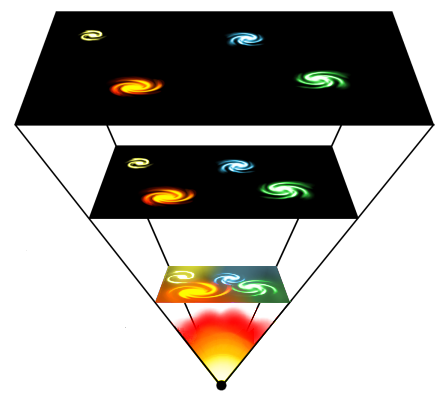

As the Universe expands, galaxies move further and further apart.

<Callout type="note" title="Note">
Universe awareness.[http://za.unawe.org/kids/](http://za.unawe.org/kids/)
</Callout>

# Modern day astronomers and physicists

**INSTRUCTIONS:**

Look at the photographs below and match the face to the description of the person.

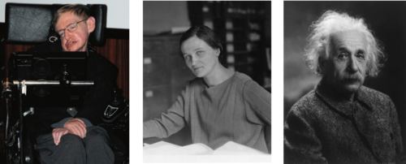

Stephen Hawking, Cecilia Payne-Gaposchkin, Albert Einstein.

**Descriptions:**

Stephen Hawking, a famous British physicist diagnosed with ALS, a form of Motor Neuron Disease, shortly after his 21st birthday. He is famous for his work on black holes.

Cecilia Payne-Gaposchkin, the astronomer responsible for discovering that stars are made up mostly of hydrogen and helium.

Albert Einstein, a German physicist famous for his work on gravity and the nature of space and time.

<Callout type="note" title="Note">
The final frontier for Humans.
</Callout>

<Callout type="note" title="Note">
The concept maps in your workbooks were created using an open source programme. You can download it from this link if you want to use it to create your own concept maps for your other subjects.[http://cmap.ihmc.us/download/](http://cmap.ihmc.us/download/)
</Callout>
